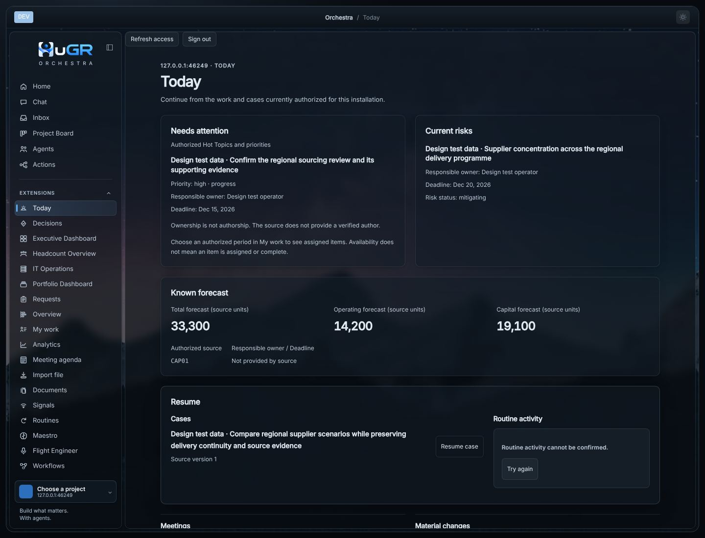
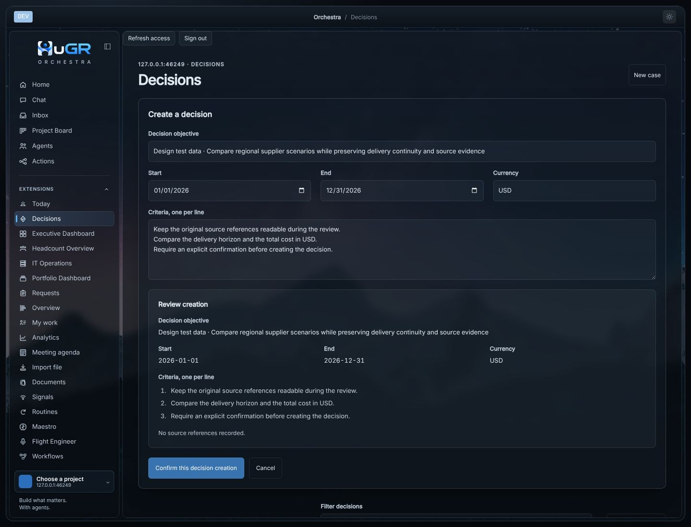
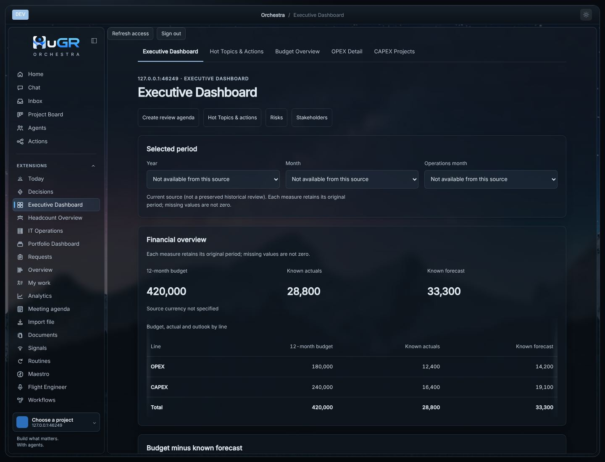
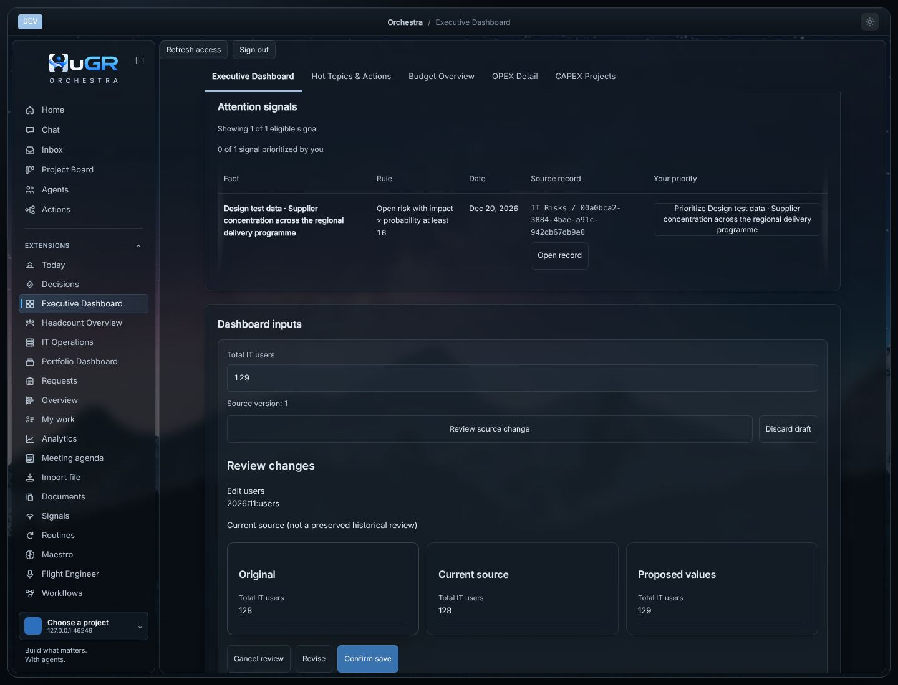

# Galeria — primeiras três telas nativas da Sucafina

Capturas **reais do Chromium**, executando o bundle nativo e uma instalação autêntica. Dados isolados de teste, identificados na própria interface; idioma inglês. As imagens são os JPEGs originais emitidos pelo navegador, sem recorte, retoque ou reconstrução.

Produto: `41ea32b657ed2a9c170e544ac76ed6ecaaefe1ff`, branch [`sf-design-polish`](https://github.com/gustavomhss/Orchestra-SF/tree/sf-design-polish).

Execução [44886474787](https://github.com/gustavomhss/Orchestra-SF/actions/runs/44886474787) · job `136792735083` · snapshot `c273ef9bee8ce9fe8761a5437bcb6dd3589bdd72` · **PASS, 1 teste, sem retries, 3,2 min**. [Verificações de tipos/regras/paletas](https://github.com/gustavomhss/Orchestra-SF/actions/runs/44886478223) também passaram.

## 1. Hoje — UI29

Cartões de atenção/riscos alinhados, previsão com números comparáveis e retomada de trabalho com hierarquia clara.

[Ver tema claro](UI29-light-desktop-test-data.jpg) · [Ver tela estreita](UI29-dark-390-test-data.jpg) · [Ver retomada estreita](UI29-dark-390-resume-test-data.jpg) · [Ver mensagens de disponibilidade](UI29-dark-desktop-source-availability-test-data.jpg)

## 2. Casos / Decisões — UI33

Filtro e atualização na mesma faixa, registros com identidade legível e uma ação principal explícita.

[Ver tema claro](UI33-light-desktop-test-data.jpg) · [Ver lista a 320 px](UI33-light-320-test-data.jpg)

### Criação e revisão

Campos alinhados, critérios numerados e confirmação/cancelamento inteiros no rodapé.

[Ver revisão a 320 px](UI33-light-320-inline-review-test-data.jpg)

## 3. Dashboard Executivo — CAP01

Navegação, controles e métricas no mesmo eixo. Valores financeiros conservam origem e período; ausências não são promovidas a zero.

[Ver tema claro](CAP01-light-desktop-test-data.jpg) · [Ver topo e filtros a 320 px](CAP01-light-320-test-data.jpg) · [Ver sinais](CAP01-dark-desktop-signals-test-data.jpg)

### Revisão do editor

A instalação fornece 128 usuários; o teste prepara 129, revisa, cancela e descarta. Não salva a alteração do Executivo.

## Todas as imagens e proveniência

| Imagem | Tela / estado | Viewport CSS | Tema |
| --- | --- | --- | --- |
| [UI33-dark-desktop-inline-review-test-data.jpg](UI33-dark-desktop-inline-review-test-data.jpg) | Criação de caso · revisão aberta | 1440 × 1100 | dark |
| [UI33-dark-desktop-review-actions-test-data.jpg](UI33-dark-desktop-review-actions-test-data.jpg) | Criação de caso · painel e rodapé completos | 1440 × 1100 | dark |
| [UI29-dark-desktop-test-data.jpg](UI29-dark-desktop-test-data.jpg) | Hoje · topo e principais cartões | 1440 × 1100 | dark |
| [UI29-dark-desktop-resume-test-data.jpg](UI29-dark-desktop-resume-test-data.jpg) | Hoje · retomada | 1440 × 1100 | dark |
| [UI29-dark-desktop-source-availability-test-data.jpg](UI29-dark-desktop-source-availability-test-data.jpg) | Hoje · disponibilidade das fontes | 1440 × 1100 | dark |
| [UI33-dark-desktop-test-data.jpg](UI33-dark-desktop-test-data.jpg) | Casos · lista e filtro | 1440 × 1100 | dark |
| [CAP01-dark-desktop-test-data.jpg](CAP01-dark-desktop-test-data.jpg) | Executivo · período e finanças | 1440 × 1100 | dark |
| [CAP01-dark-desktop-signals-test-data.jpg](CAP01-dark-desktop-signals-test-data.jpg) | Executivo · sinais de atenção | 1440 × 1100 | dark |
| [UI29-light-desktop-test-data.jpg](UI29-light-desktop-test-data.jpg) | Hoje · tema claro | 1440 × 1100 | light |
| [UI33-light-desktop-test-data.jpg](UI33-light-desktop-test-data.jpg) | Casos · tema claro | 1440 × 1100 | light |
| [CAP01-light-desktop-test-data.jpg](CAP01-light-desktop-test-data.jpg) | Executivo · tema claro | 1440 × 1100 | light |
| [UI33-light-320-test-data.jpg](UI33-light-320-test-data.jpg) | Casos · lista a 320 CSS px | 320 × 1100 | light |
| [CAP01-light-320-test-data.jpg](CAP01-light-320-test-data.jpg) | Executivo · topo e período a 320 CSS px | 320 × 1100 | light |
| [UI33-light-320-inline-review-test-data.jpg](UI33-light-320-inline-review-test-data.jpg) | Casos · rodapé de revisão a 320 CSS px | 320 × 1100 | light |
| [UI29-dark-390-test-data.jpg](UI29-dark-390-test-data.jpg) | Hoje · topo a 390 CSS px | 390 × 1100 | dark |
| [UI29-dark-390-resume-test-data.jpg](UI29-dark-390-resume-test-data.jpg) | Hoje · retomada e disponibilidade a 390 CSS px | 390 × 1100 | dark |
| [CAP01-dark-desktop-inline-review-test-data.jpg](CAP01-dark-desktop-inline-review-test-data.jpg) | Executivo · revisão de 128 para 129 usuários | 1440 × 1100 | dark |

Os PNGs canônicos ficam no artefato da execução, sujeito à retenção do GitHub Actions. Estes JPEGs permanecem versionados nesta branch. O [manifesto](manifest.json) associa cada arquivo ao blob Git, viewport, tema e execução original.

A largura de 320/390 CSS px é evidência de redistribuição do layout, não de zoom real a 200%/400%. A captura estreita do Executivo mostra o topo/controles; a revisão estreita de Casos mostra a parte inferior e as ações. Nenhuma aprovação de usuário ou de baseline visual é presumida. [Cobertura e limites completos](../VALIDATION.md).
