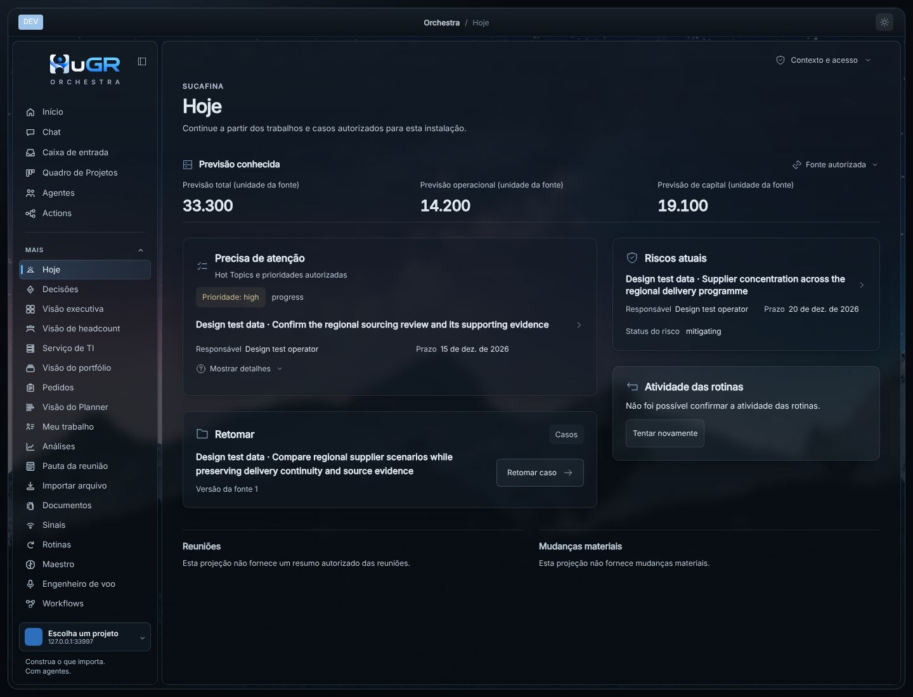
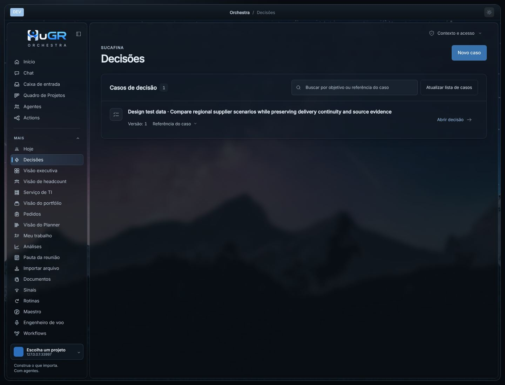
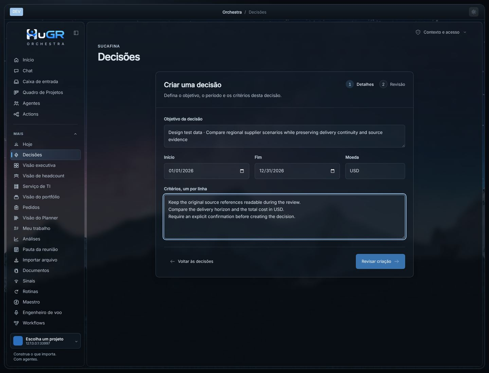
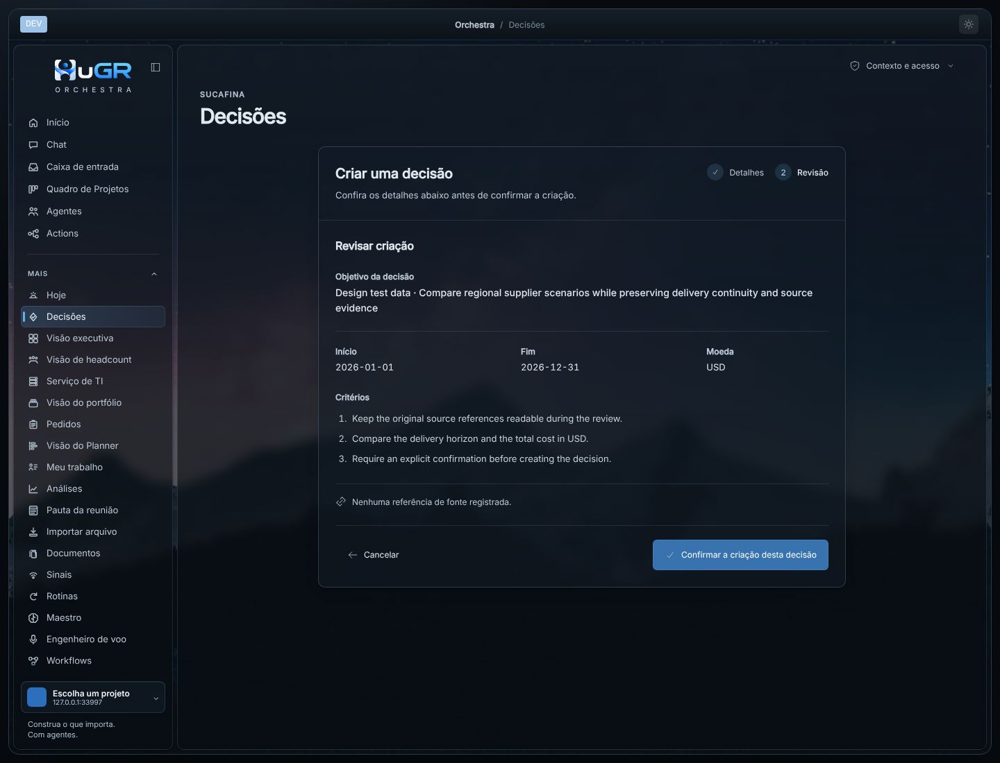
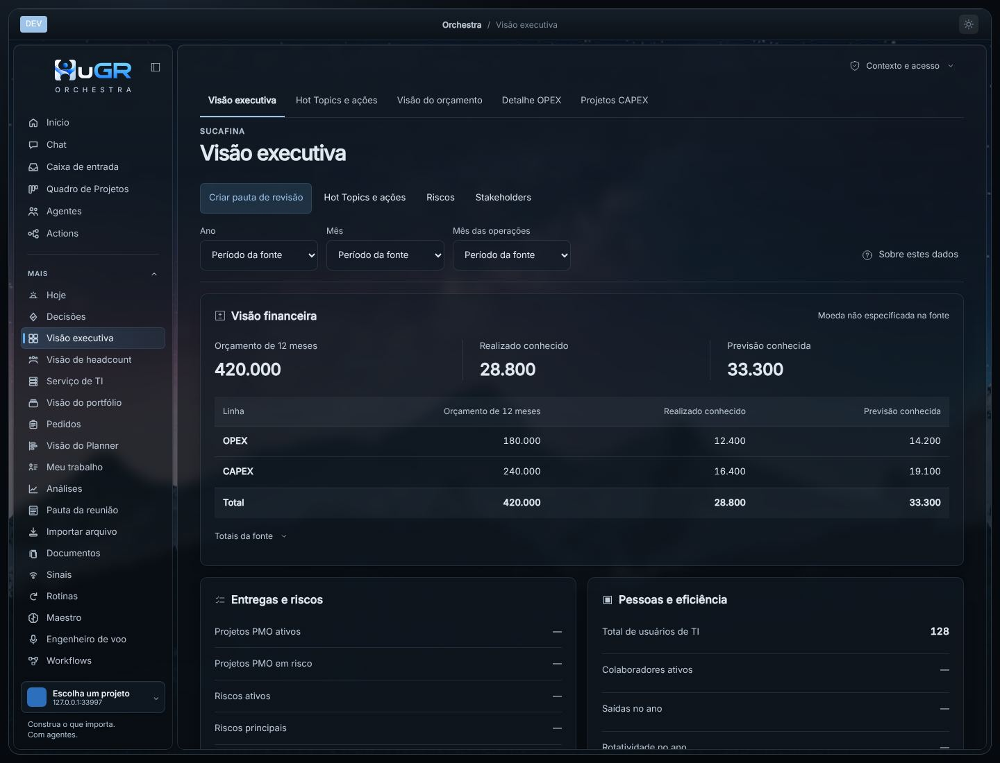

# Galeria — retrabalho das três telas nativas da Sucafina

Segunda versão após a rejeição da primeira entrega. Estas são **capturas reais do Chromium**, executando a aplicação nativa com uma instalação autêntica e dados isolados de teste. Os JPEGs são os próprios arquivos emitidos pelo navegador, sem recorte, retoque ou reconstrução.

Produto: [`245e15bf10b5c5287fa9338aa98d0adb28aeda76`](https://github.com/gustavomhss/Orchestra-SF/commit/245e15bf10b5c5287fa9338aa98d0adb28aeda76) · branch [`sf-design-polish`](https://github.com/gustavomhss/Orchestra-SF/tree/sf-design-polish).

**PASS:** [jornada real 44913429642](https://github.com/gustavomhss/Orchestra-SF/actions/runs/44913429642), 1 teste, sem retries, 2,5 min · [tipos, regras e paletas 44913434039](https://github.com/gustavomhss/Orchestra-SF/actions/runs/44913434039), 4 verificações. As 28 imagens têm origem e hashes registrados no [manifesto](manifest.json). [Resultados e limites completos](../VALIDATION.md).

## 1. Hoje — UI29

Previsão compacta com a fonte na linha do título. Atenção e retomada ocupam a coluna principal; riscos e rotinas ficam ao lado, com alturas independentes.

[Janela de 1440×800](UI29-dark-1440x800-test-data.jpg) · [Tema claro](UI29-light-desktop-test-data.jpg) · [390px](UI29-dark-390-test-data.jpg) · [Retomada estreita](UI29-dark-390-resume-test-data.jpg)

## 2. Decisões — UI33

Lista, busca e atualização na mesma superfície, com o objetivo em destaque e a referência recolhida.

A criação ocupa uma área de até 760px. A lista fica oculta enquanto o formulário está aberto; voltar preserva o rascunho e a ação Retomar rascunho o restaura.

A revisão substitui os campos e apresenta uma única confirmação explícita.

[Tema claro](UI33-light-desktop-test-data.jpg) · [Lista em 320px](UI33-light-320-test-data.jpg) · [Revisão e ações em 320px](UI33-light-320-inline-review-test-data.jpg) · [Menu nativo de acesso](UI33-dark-desktop-access-menu-test-data.jpg)

## 3. Visão executiva — CAP01

Filtros em uma barra compacta, financeiro e tabela juntos, indicadores em linhas de rótulo/valor e revisão organizada do editor.

[Indicadores de pessoas e entrega](CAP01-dark-desktop-people-test-data.jpg) · [Sinais](CAP01-dark-desktop-signals-test-data.jpg) · [Revisão de 128 para 129 usuários](CAP01-dark-desktop-inline-review-test-data.jpg) · [Tema claro](CAP01-light-desktop-test-data.jpg) · [320px](CAP01-light-320-test-data.jpg)

## Todas as capturas

| Tela | Estado | Idioma | Tema | Viewport CSS | Imagem |
| --- | --- | --- | --- | --- | --- |
| UI33 | Menu de contexto e acesso | en-US | dark | 1440×1100 | [Abrir](UI33-dark-desktop-access-menu-test-data.jpg) |
| UI33 | Editor da decisão | en-US | dark | 1440×1100 | [Abrir](UI33-dark-desktop-editor-test-data.jpg) |
| UI33 | Revisão da criação | en-US | dark | 1440×1100 | [Abrir](UI33-dark-desktop-inline-review-test-data.jpg) |
| UI33 | Revisão e ações completas | en-US | dark | 1440×1100 | [Abrir](UI33-dark-desktop-review-actions-test-data.jpg) |
| UI29 | Tela principal | en-US | dark | 1440×1100 | [Abrir](UI29-dark-desktop-test-data.jpg) |
| UI29 | Retomada de trabalho | en-US | dark | 1440×1100 | [Abrir](UI29-dark-desktop-resume-test-data.jpg) |
| UI29 | Disponibilidade de fontes | en-US | dark | 1440×1100 | [Abrir](UI29-dark-desktop-source-availability-test-data.jpg) |
| UI33 | Tela principal | en-US | dark | 1440×1100 | [Abrir](UI33-dark-desktop-test-data.jpg) |
| CAP01 | Tela principal | en-US | dark | 1440×1100 | [Abrir](CAP01-dark-desktop-test-data.jpg) |
| CAP01 | Pessoas e eficiência | en-US | dark | 1440×1100 | [Abrir](CAP01-dark-desktop-people-test-data.jpg) |
| CAP01 | Sinais de atenção | en-US | dark | 1440×1100 | [Abrir](CAP01-dark-desktop-signals-test-data.jpg) |
| UI29 | Tela principal | en-US | dark | 1440×800 | [Abrir](UI29-dark-1440x800-test-data.jpg) |
| UI33 | Tela principal | en-US | dark | 1440×800 | [Abrir](UI33-dark-1440x800-test-data.jpg) |
| CAP01 | Tela principal | en-US | dark | 1440×800 | [Abrir](CAP01-dark-1440x800-test-data.jpg) |
| UI29 | Tela principal | en-US | light | 1440×1100 | [Abrir](UI29-light-desktop-test-data.jpg) |
| UI33 | Tela principal | en-US | light | 1440×1100 | [Abrir](UI33-light-desktop-test-data.jpg) |
| CAP01 | Tela principal | en-US | light | 1440×1100 | [Abrir](CAP01-light-desktop-test-data.jpg) |
| UI33 | Tela principal | en-US | light | 320×1100 | [Abrir](UI33-light-320-test-data.jpg) |
| CAP01 | Tela principal | en-US | light | 320×1100 | [Abrir](CAP01-light-320-test-data.jpg) |
| UI33 | Revisão da criação | en-US | light | 320×1100 | [Abrir](UI33-light-320-inline-review-test-data.jpg) |
| UI29 | Tela principal | en-US | dark | 390×1100 | [Abrir](UI29-dark-390-test-data.jpg) |
| UI29 | Retomada de trabalho | en-US | dark | 390×1100 | [Abrir](UI29-dark-390-resume-test-data.jpg) |
| CAP01 | Revisão de 128 para 129 usuários | en-US | dark | 1440×1100 | [Abrir](CAP01-dark-desktop-inline-review-test-data.jpg) |
| UI29 | Tela principal | pt-BR | dark | 1440×1100 | [Abrir](UI29-pt-BR-dark-desktop-test-data.jpg) |
| UI33 | Tela principal | pt-BR | dark | 1440×1100 | [Abrir](UI33-pt-BR-dark-desktop-test-data.jpg) |
| UI33 | Editor da decisão | pt-BR | dark | 1440×1100 | [Abrir](UI33-pt-BR-dark-desktop-editor-test-data.jpg) |
| UI33 | Revisão da criação | pt-BR | dark | 1440×1100 | [Abrir](UI33-pt-BR-dark-desktop-inline-review-test-data.jpg) |
| CAP01 | Tela principal | pt-BR | dark | 1440×1100 | [Abrir](CAP01-pt-BR-dark-desktop-test-data.jpg) |

## Como interpretar a evidência

Os textos dos registros, critérios e valores de status pertencem aos dados de teste/fonte e podem continuar em inglês. Os rótulos e instruções capturados em português usam o catálogo pt-BR. O controle de data é nativo do navegador; a imagem mostra seu formato e a revisão mantém ISO, sem qualificação completa de apresentação regional de datas.

As imagens estreitas demonstram reflow a 320/390 CSS px, não zoom real de 200%/400%. A imagem do rodapé estreito é rolada para tornar as ações visíveis. As demais 67 superfícies continuam apenas inventariadas.

A primeira entrega permanece no histórico do Git. Esta galeria apresenta a nova versão para revisão; testes e revisão técnica não significam aprovação visual pelo usuário, merge ou deployment.
