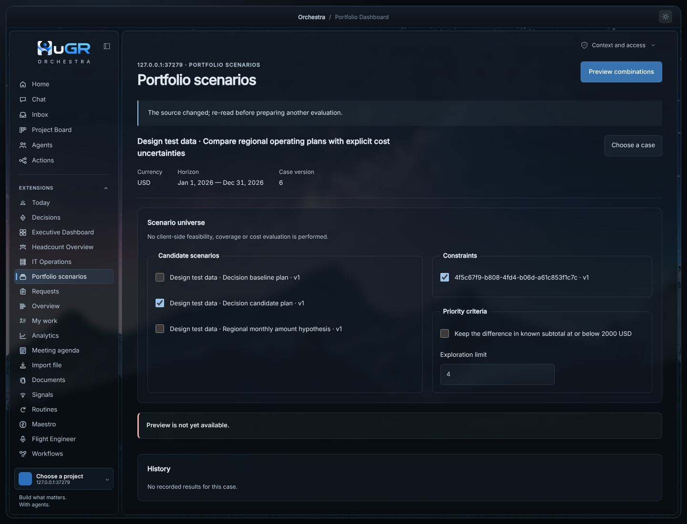

# Attempt 9 — original preview expires at the source authority boundary

The diagnostic failed as required by the unchanged 60-second preview assertion. It then observed the **same single original POST**, without replay, until it returned after **300,102 ms** with `403 {status: "denied", reason: "decision-authority-changed"}`. It did not reach UI43 or UI44 and submitted no explicit evaluation.

| Evidence | Exact identity |
| --- | --- |
| Product | `d8faa155002f0a9f3df029d946a026462af65e69` |
| Diagnostic snapshot | `ed96d0f667d6d2ed4516ca73115b6f3d165d4ab8` |
| Snapshot tree | `bff719c9f92fd66cce4673f4a8513d014f0ee621` |
| Run | [44991578651](https://github.com/gustavomhss/Orchestra-SF/actions/runs/44991578651) |
| Test / cleanup jobs | `137113585064` failure / `137115993000` success |
| Canonical artifact | [14742511965](https://github.com/gustavomhss/Orchestra-SF/actions/runs/44991578651/artifacts/14742511965), 9,359,406 bytes |
| Artifact SHA-256 | `d5500c957159cc6dbf673a5f61d08759bc2d8b45bfe6d2dbd13a4586b3249981` |
| Environment | Existing test-ci / production Playwright config; strict + prod; one worker, zero retries |

## What the original source returned

The original comparison before selection returned 200/ok in 20,323 ms. One genuine selection registration returned 200/ok in 60,544 ms. The canonical selection receipt was version 1, bound to case version 6 and the exact original baseline, candidate and criterion. Fresh controls and a second comparison (200/ok in 20,004 ms) verified the same original decision.

The native preview request began at 06:03:00.431 UTC. The original response wait failed at 60,006 ms. A parallel observer retained the request identity and consumed its own response body at 06:08:00.455 UTC. Its HTTP observer measured 300,102 ms from emission; the spec's observer measured 300,201 ms including event handling/body acquisition. These are two observation points for the same request, not two requests.

The [original UI authority](https://github.com/gustavomhss/Orchestra-SF/blob/d8faa155002f0a9f3df029d946a026462af65e69/modules/sucafina/Sucafinav1/product/integration/ui-authority.ts) gives a UI admission five minutes and removes expired admissions. The [original HTTP handler](https://github.com/gustavomhss/Orchestra-SF/blob/d8faa155002f0a9f3df029d946a026462af65e69/apps/cli/src/sucafina-product/portfolio-http.ts) emits this reason from its final revalidation after `business.withCase` returns. That final response does not expose the inner result and does not identify the cause of the latency. Authority, expiry, criteria and source checks remain unchanged.

## Timer collection limitation

The snapshot inserted bounded timers inside the original metric, comparison, selection and proof bodies. None reached the Actions log. The installed server fixture forwarded only its listening marker; the parent design fixture forwarded only `SF_DESIGN_STAGE` and used `SF_DESIGN_READY` internally. Neither printed discarded stdout at teardown. Consequently this attempt supplies **no measured internal call counts or span times**. The exact four diagnostic overlays and both original stdout sink hashes are retained in the [manifest](manifest.json).

A subsequent diagnostic adds only bounded static stdout forwarding plus pending-span snapshots. A separate complete portfolio journey runs on the newly grouped native availability reads, preserving the permanent 60-second wait. Neither pending execution is a passing result.

## Actual visual observation

Only this final original JPEG was emitted and inspected. The candidate and constraint stay selected; the native page shows the original source-changed notice, unavailable preview and empty history. It does not imply a persisted result.

All seven JPEG byte streams are durable. The other six are explicitly unreviewed in the manifest. This is diagnostic evidence, not design approval.
