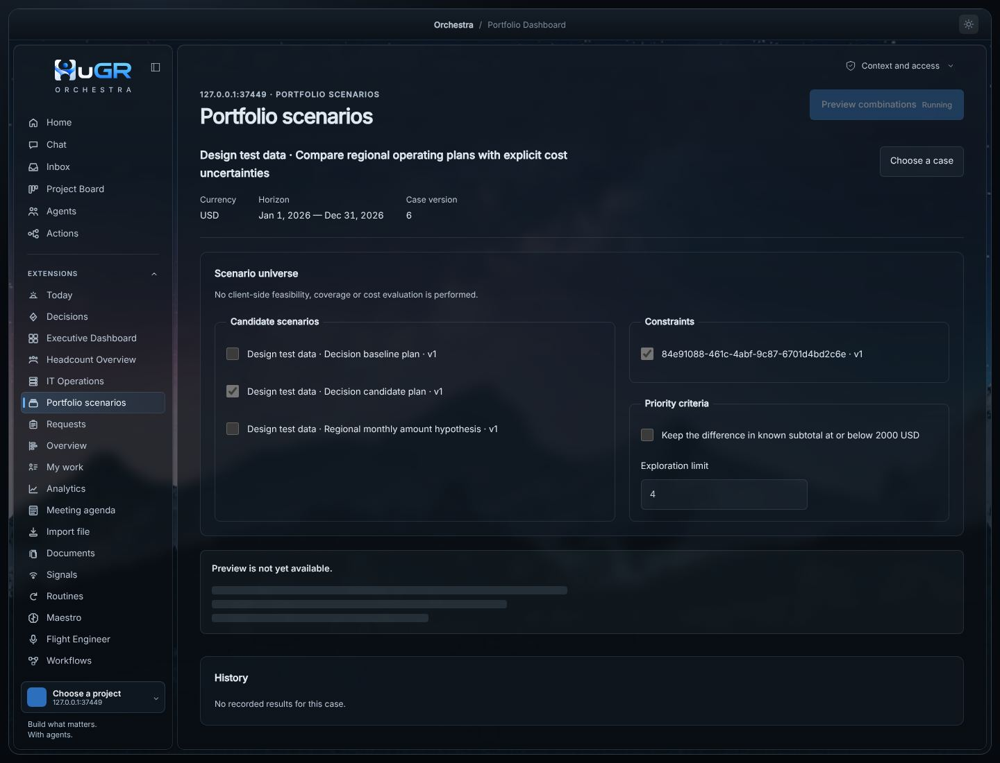

# Attempt 11 — clean portfolio journey after availability-read grouping

The complete first portfolio declaration still failed at its unchanged 60-second preview response wait. Original preparation, selection registration and exact fresh readbacks passed. One native preview POST was emitted; its eventual outcome was not observed before teardown. UI43 and UI44 were not reached.

| Evidence | Exact identity |
| --- | --- |
| Product | `b486fd1e76bdb2dc7c48cb070ba67a744358131a` |
| Snapshot | `1118949166cfe49ec1a3931a7d9d0176c81c646f` |
| Tree | `49201a222f7cf3f8da7a65191eb1b324a1020b04` |
| Run | [44992968102](https://github.com/gustavomhss/Orchestra-SF/actions/runs/44992968102) |
| Test / cleanup | `137117853231` failure / `137119691529` success |
| Permanent / isolated spec | `7d4af62590e256ed9f034fd8a00bbce5694f1c25` / `e90d4f6db47fec87158904c4e2c03c63009e070d` |
| Artifact | [14742767143](https://github.com/gustavomhss/Orchestra-SF/actions/runs/44992968102/artifacts/14742767143), 8,816,293 bytes |
| Artifact SHA-256 | `1b4e1874a84149e06ce2c2dbfb7f6a407109d1ce5a604c3bb8d8e4dd75420235` |

## Scope and observations

This snapshot contains only the existing CI request and an isolated spec that removes the second BI declaration. Its 18,318-character first declaration is byte-identical to Portfolio11. The existing production Playwright configuration, strict/prod environment, one worker and zero retries remain. There are no profiler, stdout-bridge or producer overlays.

The complete GitHub comparison from `d8faa155002f0a9f3df029d946a026462af65e69` to this product contains 106 files. The only changed runtime paths are the root-owned native availability composition in `host-context.ts`, `native-ui/operational-read-phase.ts` and `local/entry.ts`. The analytics leaves, original handlers/contracts, selected criterion and source-preparation helper are unchanged.

Original source durations were 25,764 ms for the first comparison, 77,135 ms for the single selection registration and 25,820 ms for the second comparison. The canonical receipt remained version 1 at case version 6, with the exact original pair and criterion plus unchanged current comparison. These observations are run-specific, not a controlled benchmark.

Native history for the empty case returned 200/ok in 458 ms. The main-case history response was observed as HTTP200, but the observer could not acquire its body and also recorded requestfailed. That limitation is retained verbatim in the [manifest](manifest.json); no original status/body is inferred for it.

The exact installed preview POST appeared at 06:23:14.503 UTC. The original 60-second response wait failed. No explicit evaluation was submitted. The previous diagnostic's eventual 403 is **not** treated as this run's response.

## Actual visual observation

Only the final original JPEG below was emitted and inspected. The native form retains the real candidate and constraint, disables editing while its action says Running, displays a pending preview skeleton and preserves empty recorded history.

All seven original JPEG byte streams are durable. Six remain explicitly unreviewed. This receipt is a failed qualification, not approval.
