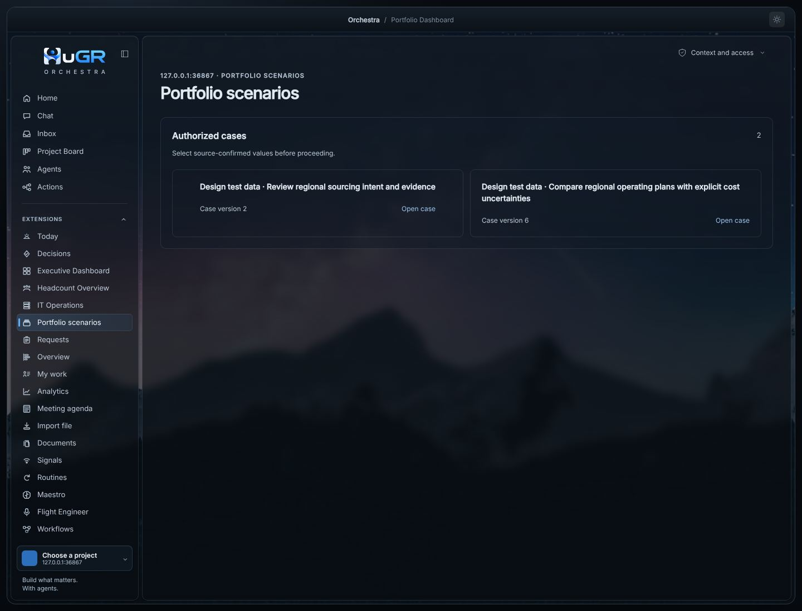
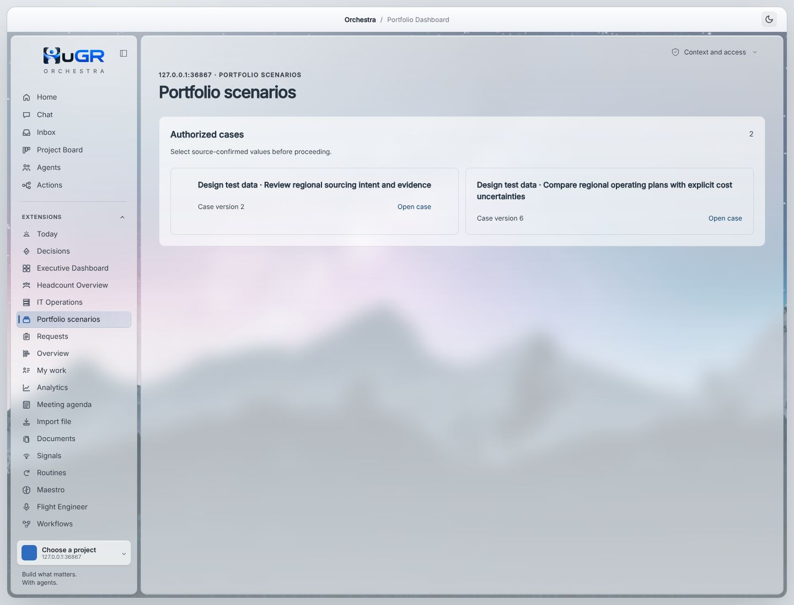
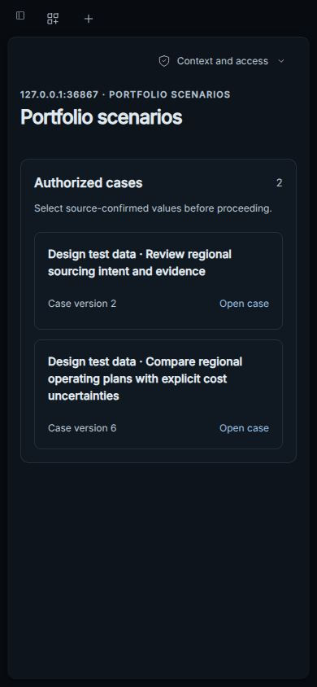
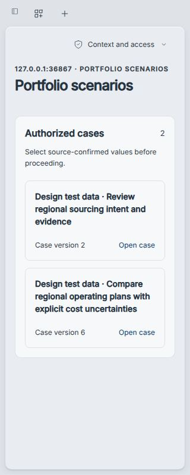
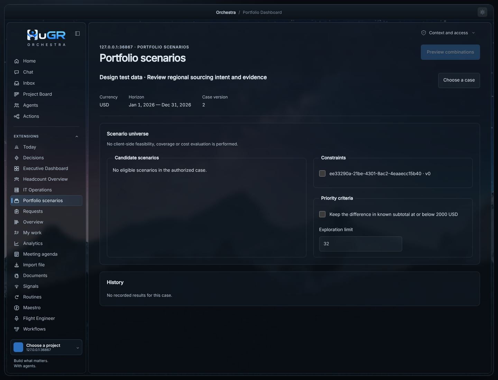
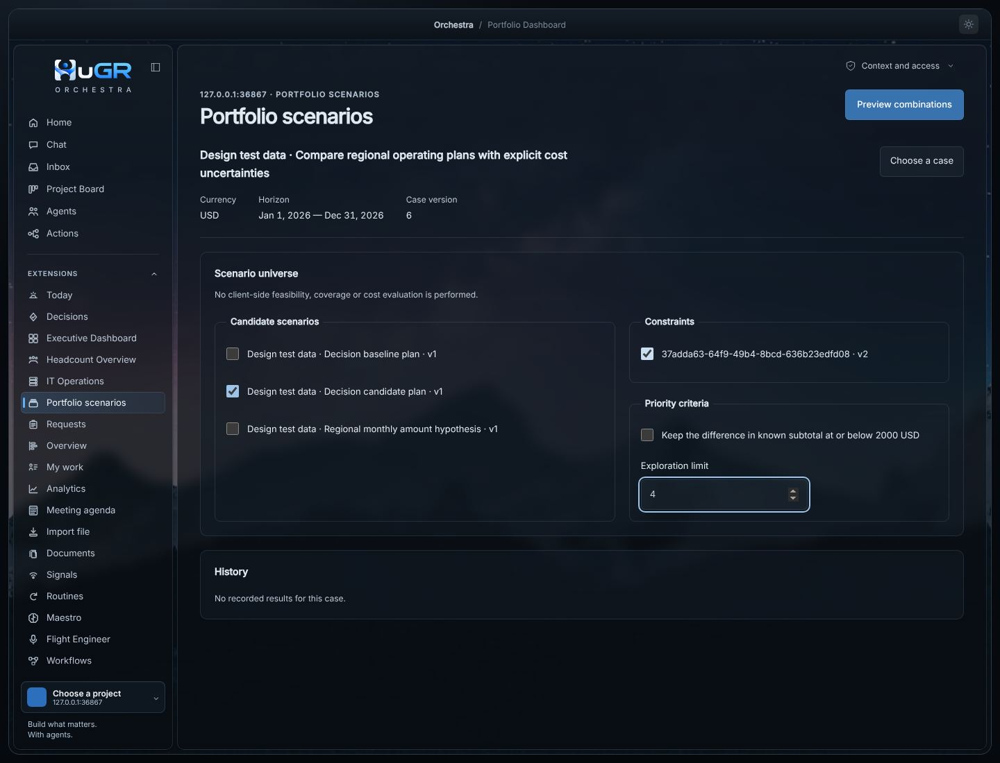
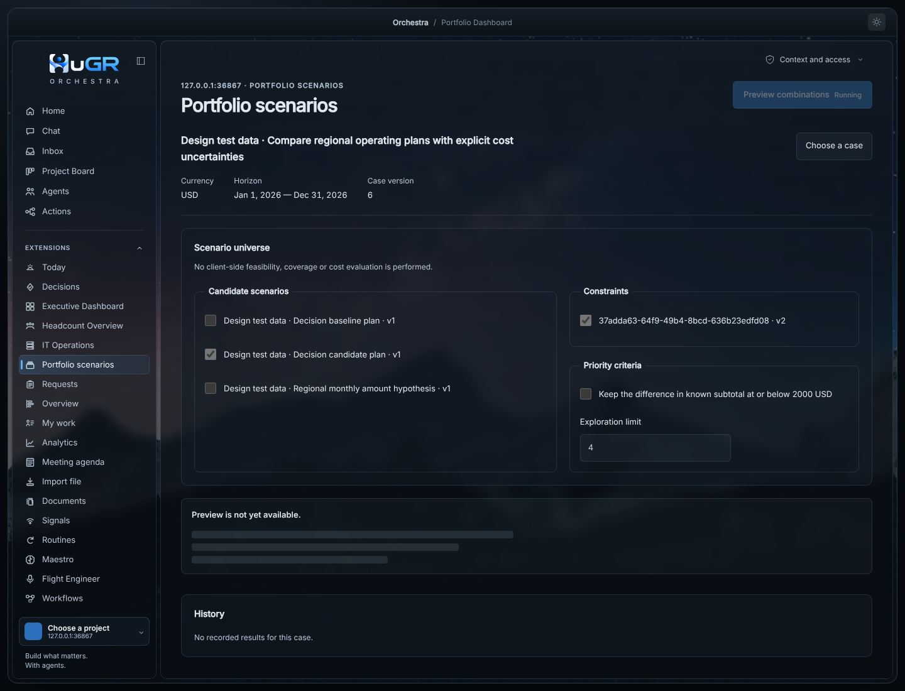

# Attempt 19 — Portfolio22 original installed journey

**Outcome: failed at the first original Portfolio preview response wait (60,000 ms).** The original preparation completed, and UI42 list, empty-case and configuration states were reached. The conditioned preview, repeated preview, explicit Portfolio evaluation, UI43 results, UI44 sensitivity journey and Portuguese completion were not reached. This attempt adds no area qualification and changes no global inventory count.

## Immutable receipt

- Product: `e4cc03bb3fa6deaed5c66f0050ffebf878dfef5d`.
- Snapshot: `405775a4af9c9a990228d3cff44b8c0940bf899d`; tree `7bb398d233182066b19bc49b0bd1553474ba165b`.
- [Run 45029253108](https://github.com/gustavomhss/Orchestra-SF/actions/runs/45029253108): completed, failure.
- [Test job 137228964207](https://github.com/gustavomhss/Orchestra-SF/actions/runs/45029253108/job/137228964207): failure; [cleanup 137231419873](https://github.com/gustavomhss/Orchestra-SF/actions/runs/45029253108/job/137231419873): success.
- Detailed receipt, exact blob identities and artifact metadata: [manifest.json](manifest.json).
- Original source, context, capture, fixture-stage and page-diagnostic records: [source-events.json](source-events.json).

The snapshot has exactly two overlays on the product: `.ci-run.json` (`a11922821a47594d76397582be38f9b7940177ca`) and the unchanged first analytics declaration with its helpers (`db1d7f4f0d770e5eed811070b0814c0363083c62`). The request uses the production Playwright configuration and strict/prod environment. Source helpers, seed, capture helper and original waits are preserved. No profiler, preload, replay or timeout extension was introduced.

## Original progression and failure

| Original stage | Observed outcome |
|---|---|
| Isolated native installation and source preparation | Completed; all 46 original fixture-stage events retained. |
| Parameter promotion, rule and units readback | HTTP 200 / ok; case v6 and rule v2; original units readback matched. |
| First original comparison | HTTP 200 / ok; 61,786 ms. |
| Human Portfolio selection | HTTP 200 / ok; 40,254 ms; selection v1. |
| Repeated original comparison and readback | HTTP 200 / ok; 60,373 ms; original alternative pair and criteria matched; current comparison unchanged. |
| UI42 list | Reached and captured in dark/light desktop, dark 390 px and light 320 px. |
| UI42 empty authorized case | Reached; preview disabled and no eligible scenarios shown. |
| UI42 configuration | Reached; original candidate and constraint v2 selected, exploration limit 4 focused. |
| First original Portfolio preview | Requested as native sequence 3 at 13:54:40.8816535 UTC; no response event observed before the original 60,000 ms wait expired. |
| Conditioned preview, repeated preview and explicit Portfolio evaluation | Not reached. |
| UI43 recorded results and UI44 sensitivity journey | Not reached. |
| Portuguese completion and final scope record | Not reached; no `SF_ANALYTICS_SCOPE` completion event. |

The two original history reads completed with HTTP 200 / ok in 438 ms and 824 ms. These reads do not establish a new Portfolio evaluation. The failure is `TimeoutError` at [the original wait, line 72](https://github.com/gustavomhss/Orchestra-SF/blob/405775a4af9c9a990228d3cff44b8c0940bf899d/packages/app-shell/e2e/sucafina/design-wave-five-analytics.spec.ts#L72). No preview HTTP status or producer result body was observed. Internal completion or persistence after the browser wait remains unknown.

The receipt retains current source timings as observations of this run; it makes no causal performance claim. Context readiness and the absence of console/page errors do not establish that the preview completed.

## Evidence acquisition and byte preservation

Only the completed test-job log was read. It yielded 24 source events, 2 context events, 6 capture-metadata events, 46 original fixture stages and 3 page diagnostics, with zero parse errors. No raw job transcript is committed.

All seven emitted JPEGs were reconstructed from 33 original, complete, 1-based `SF_DESIGN_PREVIEW` chunks. The total is 537,306 JPEG bytes. No image was resized, re-encoded or resampled. Each remote image was read back as base64 and matched byte for byte; the source-events file also matched exactly. The preservation commit is `0ff56e6f41c39fb2243fe002329f095a2115e236`.

The original Playwright artifact metadata is retained in the manifest (`playwright-ubuntu-24.04-1`, artifact `14757102249`). Its ZIP contains the canonical PNG evidence; this archive preserves the emitted original JPEG previews without downloading or transforming that ZIP.

## Actual visual review

All seven recovered JPEGs below were viewed by the `read_path` reviewer in this session. They document partial UI42 states; none is used to claim a completed area or producer result.

### UI42-list-dark-desktop-test-data

Dark desktop list: two authorized cases, versions 2 and 6, and separate Open case actions are readable in aligned cards. This capture covers the list state only.

Dimensions: 1440 × 1100; original JPEG: 80643 bytes; 5 complete chunks.

### UI42-list-light-desktop-test-data

Light desktop list: the same two cases, versions and actions remain readable; case titles wrap within their cards.

Dimensions: 1440 × 1100; original JPEG: 85929 bytes; 5 complete chunks.

### UI42-list-dark-390-test-data

Dark 390 px list: the native layout stacks both case cards; headings, versions and Open case actions remain visible without obvious horizontal clipping.

Dimensions: 390 × 844; original JPEG: 28708 bytes; 2 complete chunks.

### UI42-list-light-320-test-data

Light 320 px list: both case cards stack inside the compact native page; long titles wrap, and versions plus Open case actions remain visible.

Dimensions: 320 × 800; original JPEG: 27471 bytes; 2 complete chunks.

### UI42-empty-authorized-case-test-data

Empty authorized case: case version 2, USD and the source horizon are readable; the page explicitly reports no eligible scenarios, keeps Preview combinations disabled and shows no recorded results.

Dimensions: 1440 × 1100; original JPEG: 97948 bytes; 6 complete chunks.

### UI42-configure-focused-candidate-test-data

Configured source case: case version 6 shows three original candidates, the selected candidate and v2 constraint, and exploration limit 4 with a visible focus outline. Preview combinations is available before submission.

Dimensions: 1440 × 1100; original JPEG: 106410 bytes; 6 complete chunks.

### FAILED-native-wave-three-test-data

Failure capture: Preview combinations remains Running, the inputs are disabled, the preview region says Preview is not yet available with placeholder bars, and History still has no recorded results. This is a pending producer state, not a completed preview.

Dimensions: 1440 × 1100; original JPEG: 110197 bytes; 7 complete chunks.

