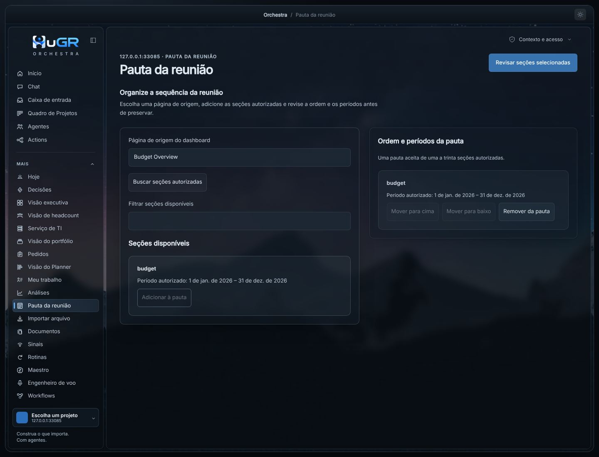
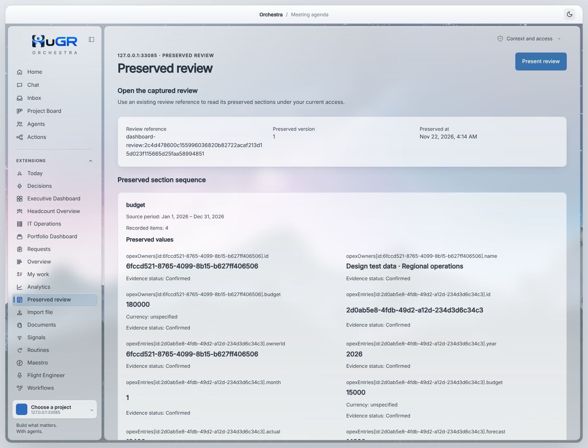
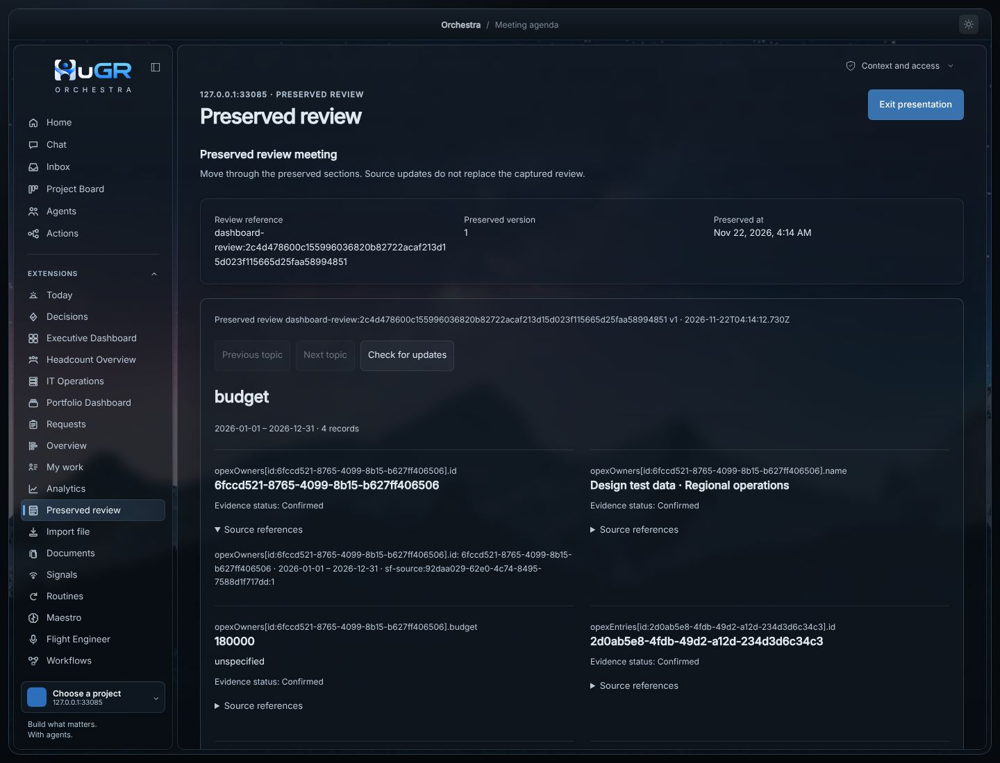
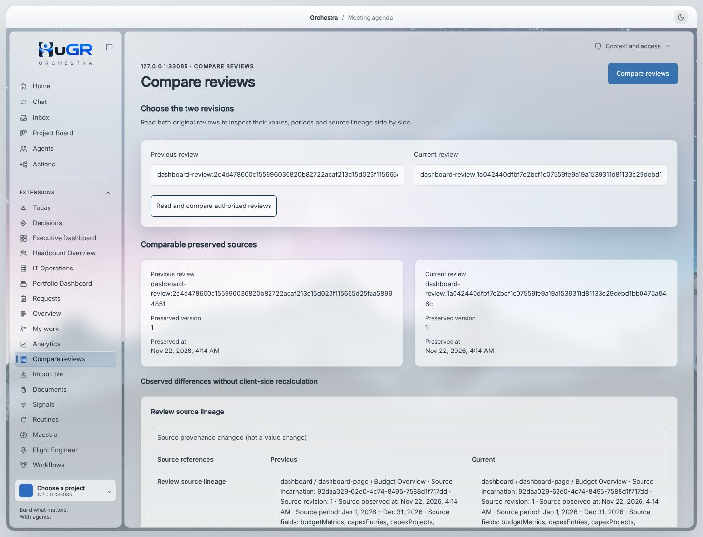
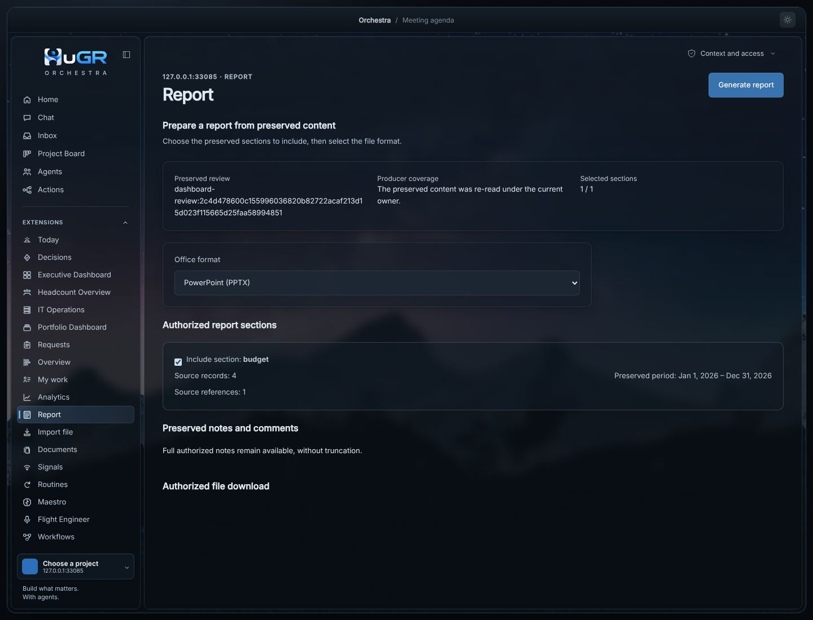
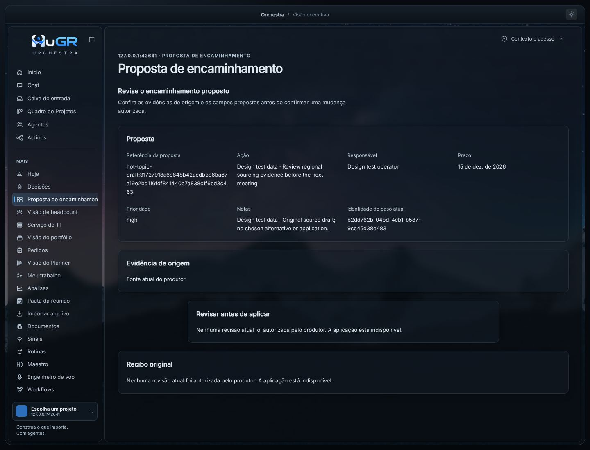

# Real installed review and proposal UI

UI47–50 passed the original-source journey in [run 44983842825](https://github.com/gustavomhss/Orchestra-SF/actions/runs/44983842825). UI54 passed independently in [run 44984801462](https://github.com/gustavomhss/Orchestra-SF/actions/runs/44984801462). Both snapshots use the same product parent `2a73ad159e3c5529425f11b94b71677cef7dd1bb`. The earlier combined run keeps its overall failure status because its proposal response-body acquisition failed before setup.

These are actual installed production-channel screenshots using original producers and labeled test data. Every matrix image below was manually viewed. Images preserve the real viewport and scroll position. Targeted value/table captures intentionally show content below the page header. Narrow reflow is 390px for reviews and 320px for proposals; it is not a browser-zoom claim.

| Area/stage | Dark desktop | Light desktop | Narrow | Brazilian Portuguese |
| --- | --- | --- | --- | --- |
| UI47 agenda | [Dark](attempt-07/UI47-dark-desktop-sections-test-data.jpg) | [Light](attempt-07/UI47-light-desktop-sections-test-data.jpg) | [Narrow](attempt-07/UI47-dark-390-sections-test-data.jpg) | [pt-BR](attempt-07/UI47-pt-BR-dark-desktop-test-data.jpg) |
| UI48 detail | [Dark](attempt-07/UI48-detail-values-dark-desktop-test-data.jpg) | [Light](attempt-07/UI48-detail-values-light-desktop-test-data.jpg) | [Narrow](attempt-07/UI48-detail-values-dark-390-test-data.jpg) | [pt-BR](attempt-07/UI48-detail-values-pt-BR-dark-desktop-test-data.jpg) |
| UI48 presentation | [Dark](attempt-07/UI48-present-values-dark-desktop-test-data.jpg) | [Light](attempt-07/UI48-present-values-light-desktop-test-data.jpg) | [Narrow](attempt-07/UI48-present-values-dark-390-test-data.jpg) | [pt-BR](attempt-07/UI48-present-values-pt-BR-dark-desktop-test-data.jpg) |
| UI49 comparison | [Dark](attempt-07/UI49-compare-dark-desktop-test-data.jpg) | [Light](attempt-07/UI49-compare-light-desktop-test-data.jpg) | [Narrow](attempt-07/UI49-compare-dark-390-test-data.jpg) | [pt-BR](attempt-07/UI49-compare-pt-BR-dark-desktop-test-data.jpg) |
| UI50 report selection | [Dark](attempt-07/UI50-selection-dark-desktop-test-data.jpg) | [Light](attempt-07/UI50-selection-light-desktop-test-data.jpg) | [Narrow](attempt-07/UI50-selection-dark-390-test-data.jpg) | [pt-BR](attempt-07/UI50-selection-pt-BR-dark-desktop-test-data.jpg) |
| UI54 proposal | [Dark](attempt-08/UI54-dark-desktop-original-draft-test-data.jpg) | [Light](attempt-08/UI54-light-desktop-original-draft-test-data.jpg) | [Narrow](attempt-08/UI54-dark-320-original-draft-test-data.jpg) | [pt-BR](attempt-08/UI54-pt-BR-dark-desktop-original-draft-test-data.jpg) |

## Review and negative states

- [Original preservation preview](attempt-07/UI47-dark-desktop-preservation-review-test-data.jpg), [390px confirmation controls](attempt-07/UI47-dark-390-preservation-review-test-data.jpg) and [producer confirmation](attempt-07/UI47-dark-desktop-producer-confirmed-test-data.jpg).
- [No native authorized review list](attempt-07/UI48-list-unavailable-dark-desktop-test-data.jpg) and [no native report list](attempt-07/UI50-list-unavailable-dark-desktop-test-data.jpg). Known references can open the original readers.
- [Expanded original source evidence](attempt-07/UI48-dark-desktop-expanded-original-source-test-data.jpg), [real stale-update 409 alert](attempt-07/UI48-dark-desktop-original-stale-update-test-data.jpg) and [unsent discussion draft retained](attempt-07/UI48-dark-desktop-unsent-draft-retained-test-data.jpg).
- [390px comparison leading columns](attempt-07/UI49-dark-390-original-comparison-table-test-data.jpg) and [Current column after real horizontal scroll](attempt-07/UI49-dark-390-current-source-column-test-data.jpg).
- [Original report selection in PPTX format](attempt-07/UI50-dark-desktop-one-section-pptx-test-data.jpg). No report generation, publication or delivery was invoked.
- [Proposal missing-source negative at 320px](attempt-08/UI54-dark-320-missing-source-test-data.jpg). The registered original draft succeeds independently; preparation and receipt remain unavailable without an original current choice.

## Selected actual views

### Agenda in Brazilian Portuguese

### Preserved source values

### Presentation with complete source references

### Original comparison

### Report source selection

### Original Hot Topic draft

## Provenance and limits

All 44 attempt 7 JPEGs and all 6 attempt 8 JPEGs are saved. The review owner manually viewed 33 from attempt 7 and all 6 from attempt 8. The exact viewed names, Git blob identities, diagnostics, workflow artifact digests, jobs and snapshots are in [capture-provenance.json](capture-provenance.json) and each attempt's capture-manifest.json. Canonical workflow artifacts retain original PNG captures and source attachments.

The agenda contains one original canonical section, so multi-section reorder is unqualified. The original review-update 409 remains a negative. Native review/report list sources remain unavailable. UI54 has no current choice, preparation or application, and no original receipt was synthesized. No source authority was invented to populate these views. See [SOURCE-BOUNDARIES.md](SOURCE-BOUNDARIES.md), [ATTEMPTS.md](ATTEMPTS.md) and [HANDOFF.md](HANDOFF.md).
