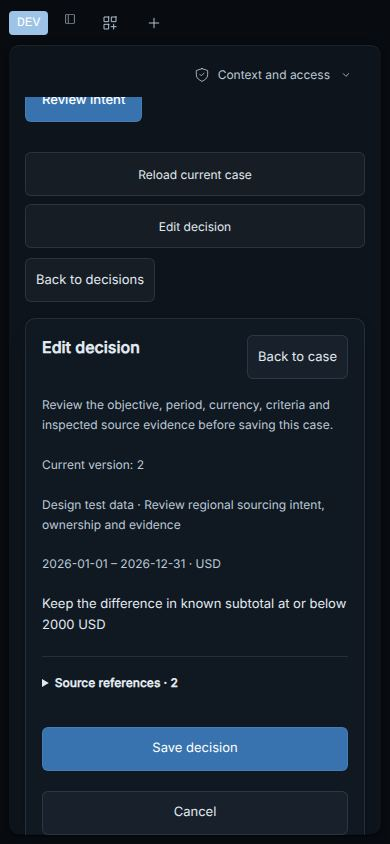
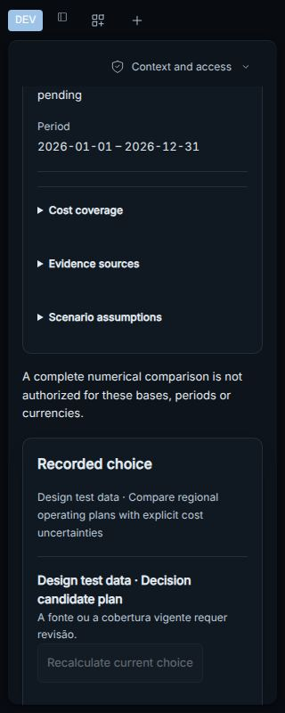
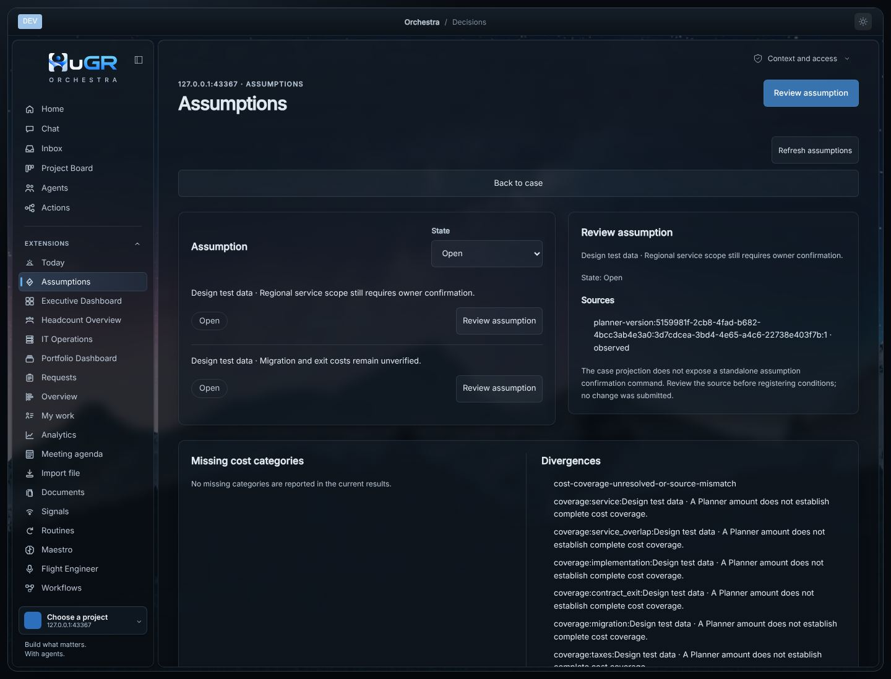
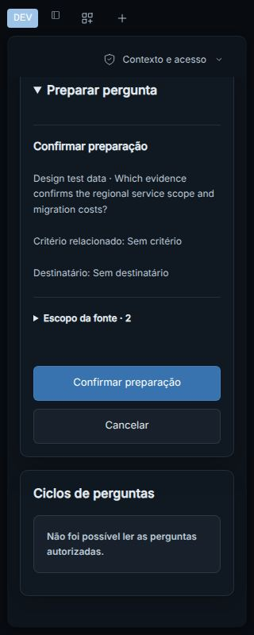
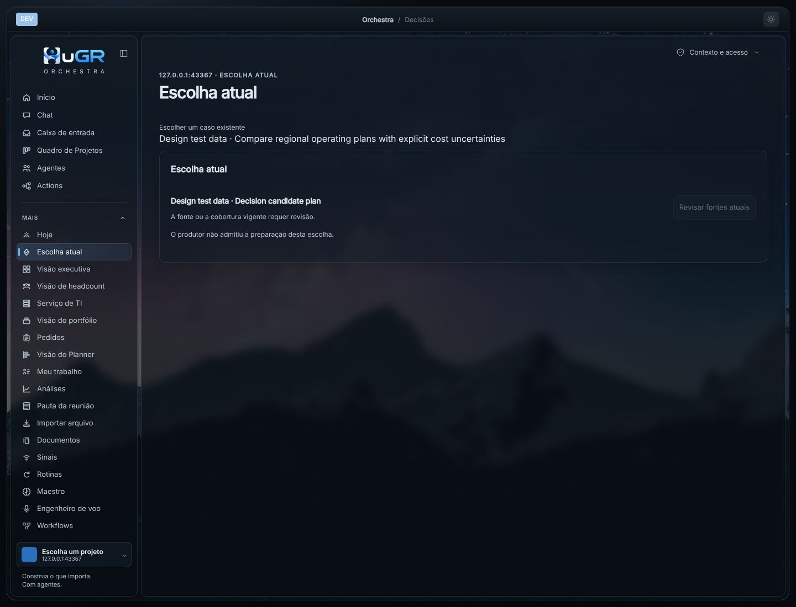
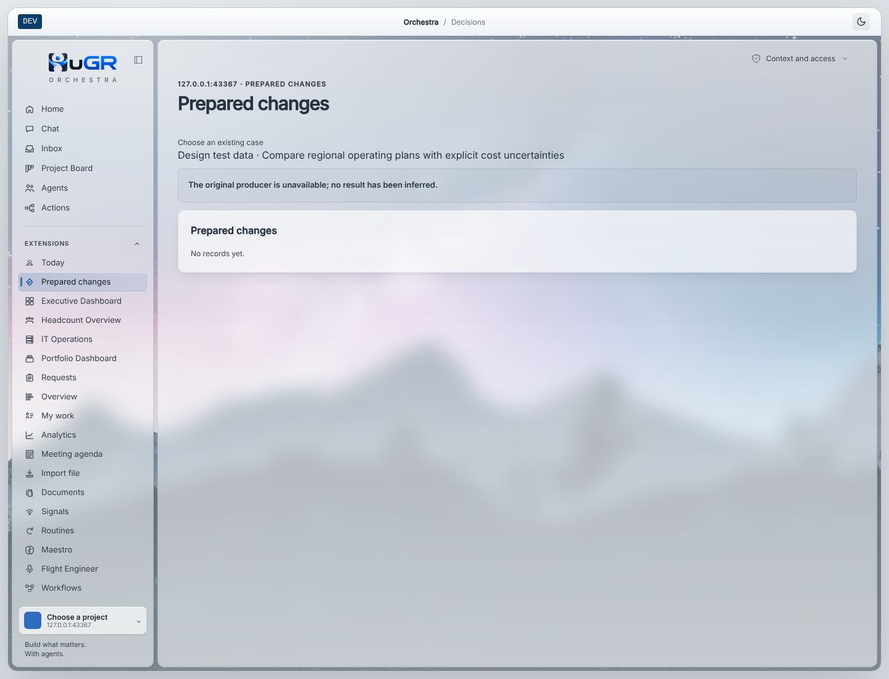
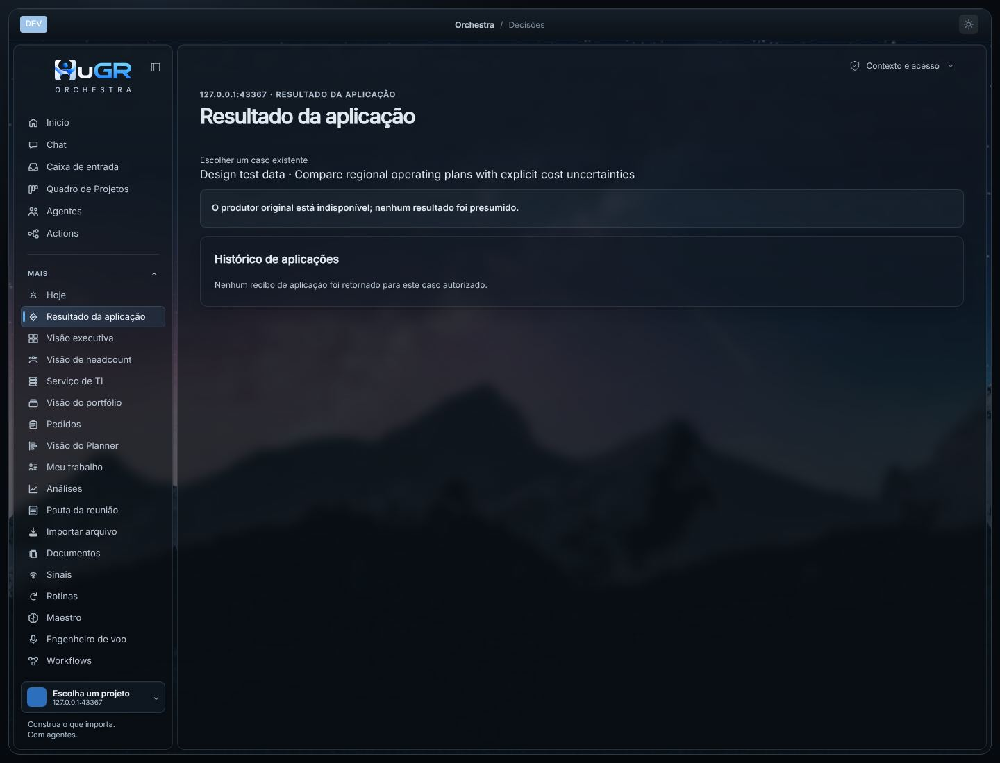
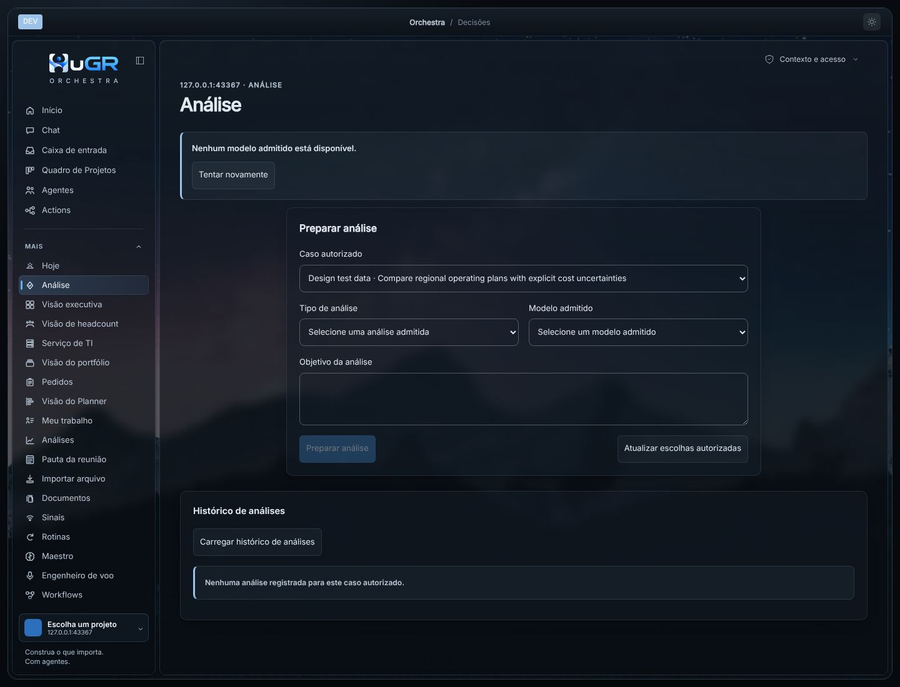

# Decisions — final wave-four gallery

**PASS for all 41 captured states across UI34–UI41.** This gallery contains the original JPEG previews from the successful Decisions14 production-browser journey. All files were visually reviewed: 33 by the Decisions owner, the eight light-desktop images independently by the Procurement reviewer, and eight representative BR/narrow images again by the integration reviewer. No visual blockers were found.

## Provenance

| Evidence | Exact source |
| --- | --- |
| Browser execution | [Decisions14 — run 44972048219, job 137053751021](https://github.com/gustavomhss/Orchestra-SF/actions/runs/44972048219/job/137053751021) · one test passed in 10.3m · retries 0 |
| Immutable browser snapshot | `58def9db4b3aa4c156a041eb86fbbd41de95bba7` |
| Tested product composition | `e5494ff044ee46cdd80c1d754131c284538d4d31` |
| Upstream dev | `2eeb114266f8b9c9df9bb8f78a02ccf242cdc68b` |
| Technical verification | [Gate17 — run 44972927162, job 137056417643](https://github.com/gustavomhss/Orchestra-SF/actions/runs/44972927162/job/137056417643) · 15 checks / 89 regression cases |
| Technical snapshot and product | `e6b7de08b4cbb7790a585e2292bb985a41e60902` over `0550c4bb8fc3b4b4e68561777010ca03483e2391` |
| Capture integrity | 41/41 files, 196/196 log parts, no skipped/missing/extra preview; 3,161,553 bytes |
| Encoding | Original JPEG, quality 78; no recompression or compositing. Canonical PNG attachments remain in the original run artifact. |

[manifest.json](manifest.json) records every Git blob SHA, byte size, dimensions, locale, color scheme, review author and per-image note. Earlier failed or partial runs and disposable diagnostics are excluded from this gallery.

## Real execution and source continuity

The isolated native installation enrolls the original operator and seeds through actual Planner/domain, source and Decisions commands. The browser does not intercept HTTP, fabricate a successful response, insert a prepared change/receipt, or substitute authorization.

- **UI34:** one actual `decision-edit` POST returned 200. The submitted CAS used the exact original case ID, incarnation and version; an idempotency key was present. Fresh original readback proved the changed objective and increased version while retaining identical source references and criteria. Review cancellation, close/reopen retention, mounted hidden fields and the focused 390px action review were exercised.
- **UI37:** one actual `sf_question_prepare` POST returned 200. The proposal acknowledged preparation only; fresh original readback proved the case version and question list were unchanged. No question was recorded or sent.
- **UI35/UI36:** both source alternatives and amounts, recorded opaque-route choice, actual empty editable case, comparison qualification, source disclosure, confirmed-filter emptiness and original assumption detail were asserted.
- **UI38–UI40:** the actual selected choice and original producer refusal, empty prepared-change ledger and no-receipt history were asserted; no promotion, application or recovery request was fabricated.
- **UI41:** original choices/history POST reads succeeded. Visible selector counts were compared to a fresh original API read, and the selected case remained present before every positive capture. Objective input and admitted analysis selection were exercised where available. The actual model list was empty, so preparation remained disabled and no analysis execution is claimed.

Safe diagnostics contain **56 reads, all HTTP 200**: 35 case projections, 11 current-choice reads, five analysis choices and five analysis history reads. Twenty-one completed after 300,000ms from test entry; the last case projection returned 200 at 453,279ms. Both page lifecycles closed with empty console-error and page-error arrays. There were no source-failure/probe events. The full journey remained one fixture and one test, with the original 780-second limit and no retries.

## Captured-state matrix

Every area has EN dark desktop (1440×1100), EN light desktop (1440×1100), EN dark narrow (390×844) and pt-BR dark desktop (1440×1100). Nine additional captures cover editor/review/detail/empty/qualification states, including 320×800 review. This is the recorded matrix, not every theme/locale/viewport combination.

| Area | Captures | Proven behavior | Qualification limit |
| --- | ---: | --- | --- |
| UI34 — Case summary | 6 | Retained edit/review/cancel/reopen, one decision-edit POST, exact case CAS and unchanged source references/criteria on original readback. | Source attachments are disclosed; no new evidence is invented. |
| UI35 — Alternatives | 7 | Authorized empty alternative/choice state, actual two-source amounts and comparison, historical choice on the opaque case route. | The original producer does not admit current-choice preparation in this installation; no provenance, recalculation or promotion is fabricated. |
| UI36 — Assumptions | 5 | Open assumptions, confirmed filter with genuine filtered-empty state, exact evidence detail, empty derived missing categories and original coverage divergences. | Review does not confirm or mutate an assumption. |
| UI37 — Questions | 7 | Retained composer and review, one actual sf_question_prepare POST, unchanged case version/question list. | Preparation does not send or record a question. Optional cycle/recipient reads remain unavailable when unadmitted. |
| UI38 — Current choice | 4 | Actual recorded choice and explicit producer preparation refusal. | No source provenance or successful recalculation is fabricated. |
| UI39 — Prepared changes | 4 | Original empty prepared-change ledger. | Populated application/CAS/recovery paths are preserved but are not browser-qualified by this fixture. |
| UI40 — Application result | 4 | Original empty application-receipt ledger. | No apply/recover request or receipt is invented; populated receipt detail remains unqualified. |
| UI41 — Analysis | 4 | Original choices/list POST reads, real selector counts and history, objective input and actual catalog admission state. | No provider credential, model, run or output is fabricated. Prepare/start/cancel/output require separately admitted source configuration. |

## Representative views

### UI34 — Retained editor review at 390px

### UI35 — Complete comparison qualification at 320px

### UI36 — Original assumption detail and coverage divergences

### UI37 — Portuguese review and actions at 320px

### UI38 — Actual recorded choice with producer refusal

### UI39 — Genuine empty prepared-change ledger

### UI40 — Original no-receipt history

### UI41 — Authorized case, absent model and admitted empty history

## All 41 originals

| Area | Count | Files |
| --- | ---: | --- |
| UI34 | 6 | [dark-desktop-editor](UI34-dark-desktop-editor-test-data.jpg) · [dark-390-review-actions](UI34-dark-390-review-actions-test-data.jpg) · [dark-desktop](UI34-dark-desktop-test-data.jpg) · [light-desktop](UI34-light-desktop-test-data.jpg) · [dark-390](UI34-dark-390-test-data.jpg) · [pt-BR-dark-desktop](UI34-pt-BR-dark-desktop-test-data.jpg) |
| UI35 | 7 | [dark-desktop-empty-choice](UI35-dark-desktop-empty-choice-test-data.jpg) · [dark-320-comparison](UI35-dark-320-comparison-test-data.jpg) · [dark-320-comparison-qualification](UI35-dark-320-comparison-qualification-test-data.jpg) · [dark-desktop](UI35-dark-desktop-test-data.jpg) · [light-desktop](UI35-light-desktop-test-data.jpg) · [dark-390](UI35-dark-390-test-data.jpg) · [pt-BR-dark-desktop](UI35-pt-BR-dark-desktop-test-data.jpg) |
| UI36 | 5 | [dark-desktop-assumption-detail](UI36-dark-desktop-assumption-detail-test-data.jpg) · [dark-desktop](UI36-dark-desktop-test-data.jpg) · [light-desktop](UI36-light-desktop-test-data.jpg) · [dark-390](UI36-dark-390-test-data.jpg) · [pt-BR-dark-desktop](UI36-pt-BR-dark-desktop-test-data.jpg) |
| UI37 | 7 | [dark-desktop-question-review](UI37-dark-desktop-question-review-test-data.jpg) · [dark-desktop-prepared-proposal](UI37-dark-desktop-prepared-proposal-test-data.jpg) · [dark-desktop](UI37-dark-desktop-test-data.jpg) · [light-desktop](UI37-light-desktop-test-data.jpg) · [dark-390](UI37-dark-390-test-data.jpg) · [pt-BR-dark-desktop](UI37-pt-BR-dark-desktop-test-data.jpg) · [pt-BR-dark-320-review](UI37-pt-BR-dark-320-review-test-data.jpg) |
| UI38 | 4 | [dark-desktop](UI38-dark-desktop-test-data.jpg) · [light-desktop](UI38-light-desktop-test-data.jpg) · [dark-390](UI38-dark-390-test-data.jpg) · [pt-BR-dark-desktop](UI38-pt-BR-dark-desktop-test-data.jpg) |
| UI39 | 4 | [dark-desktop](UI39-dark-desktop-test-data.jpg) · [light-desktop](UI39-light-desktop-test-data.jpg) · [dark-390](UI39-dark-390-test-data.jpg) · [pt-BR-dark-desktop](UI39-pt-BR-dark-desktop-test-data.jpg) |
| UI40 | 4 | [dark-desktop](UI40-dark-desktop-test-data.jpg) · [light-desktop](UI40-light-desktop-test-data.jpg) · [dark-390](UI40-dark-390-test-data.jpg) · [pt-BR-dark-desktop](UI40-pt-BR-dark-desktop-test-data.jpg) |
| UI41 | 4 | [dark-desktop](UI41-dark-desktop-test-data.jpg) · [light-desktop](UI41-light-desktop-test-data.jpg) · [dark-390](UI41-dark-390-test-data.jpg) · [pt-BR-dark-desktop](UI41-pt-BR-dark-desktop-test-data.jpg) |

## Technical and business limits

Gate17 passed app-shell/E2E/full CLI typechecks, source guards and palette parity, plus all 89 scoped regression cases. The new `sucafina-case-read-scope.test.ts` contributes two passing cases and 81 assertions. Its positive creates a real Planner source/case and original Procurement selection, advances a controlled test clock, then uses fresh original leases to prove unchanged case/evidence/C08 revision. Its negatives preserve common authority/request fences and reject expired/replaced eligible Procurement boundaries. Their planned change is an explicitly structural fixture, not an emitted C12 preparation/application.

- UI35/UI38 show the actual recorded choice, but the original producer does not admit current-choice preparation. No missing-provenance cause is inferred beyond its returned refusal; recalculation and promotion are not browser-qualified.
- UI36 reviews and filters assumptions; it does not confirm or mutate them. Producer codes and authored evidence remain literal.
- UI37 prepares one proposal but does not record or send it. The optional cycle/recipient reads remain unavailable when not admitted; their populated states are not qualified.
- UI39/UI40 have genuine empty prepared-change and application-receipt ledgers. Populated application, CAS conflict, recovery and receipt-detail states are preserved but not exercised by this browser fixture.
- UI41 has original authorized cases, analysis options and an empty history, but no admitted model. Preparation review, start, cancel and output are not exercised; no provider credentials, model, run or result are fabricated.
- The case-scope regression uses original authority, SQLite, sources and Planner producers with a bounded test identity provider. Its eligible Procurement negatives use an explicitly structural planned-change fixture; they do not prove an emitted C12 preparation, application or receipt.
- Visual evidence is Chromium at 1440x1100, 390x844 and 320x800. It covers the recorded theme/locale states, not the full theme/locale/viewport cross-product, browser zoom, every browser or every preserved business state.
- Producer-supplied Portuguese reasons and raw state/code values remain literal in an English UI. Existing EN/pt-BR UI catalogs were not rewritten.

All diagnostic/relay instrumentation remains confined to disposable diagnostic branches. The gallery's tested product includes only the scoped case-read correction; the original selection writer, five-minute TTL, seed, grants, closed schemas and producer contracts remain intact.

See [Decisions review](../../decisions/REVIEW.md) for the source-backed diagnosis and [handoff](../../decisions/HANDOFF.md) for integration ownership and test paths.
