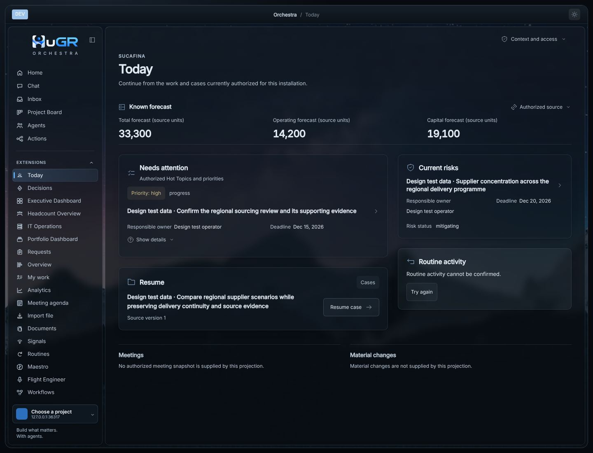
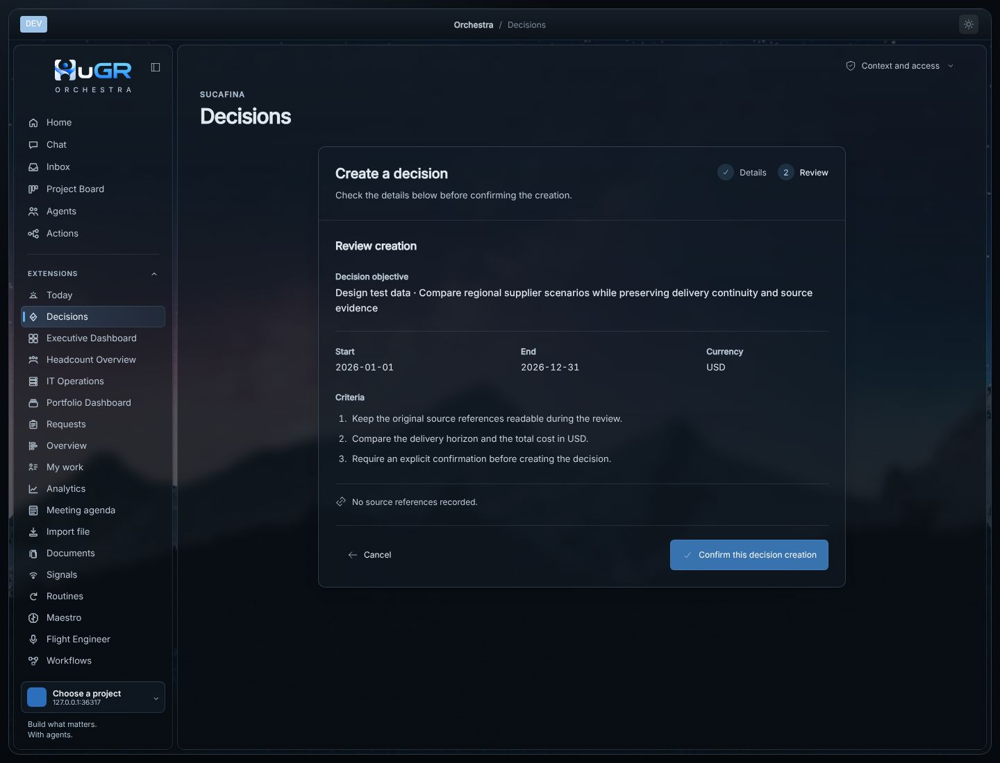
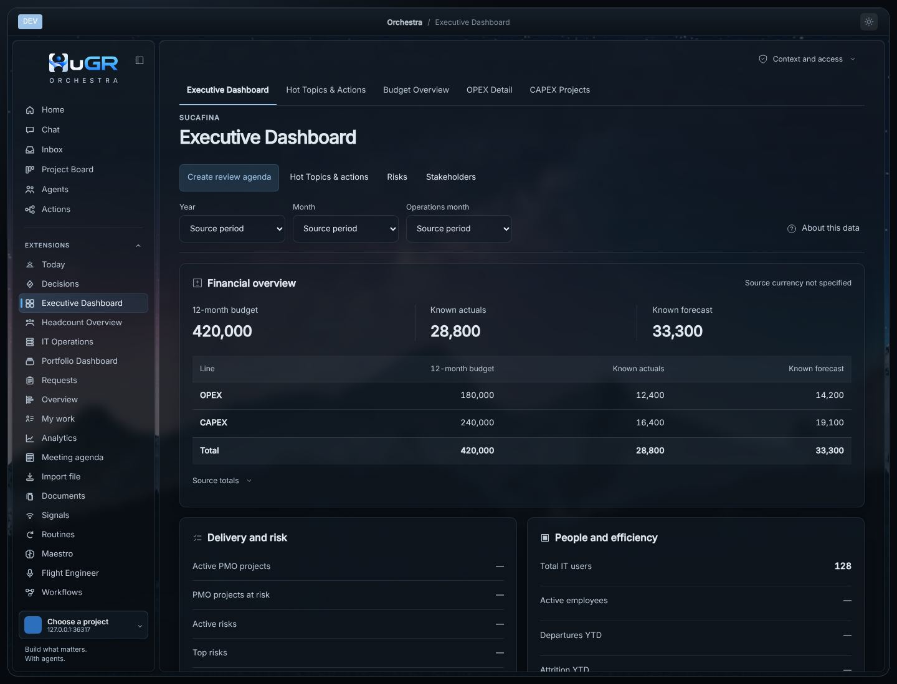
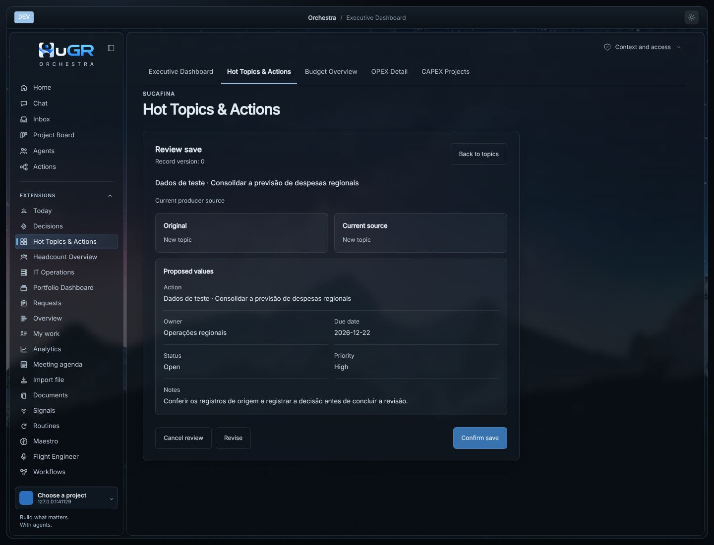
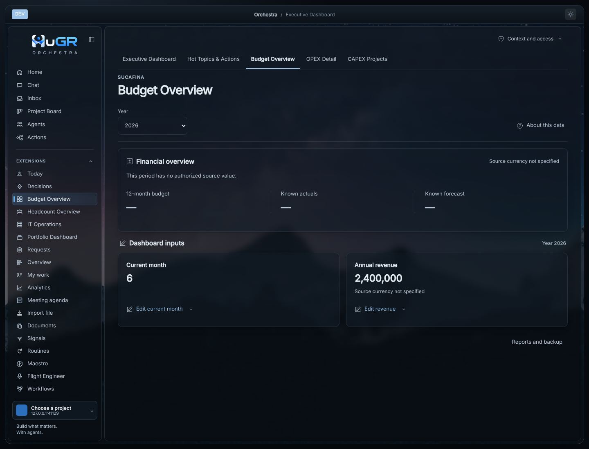
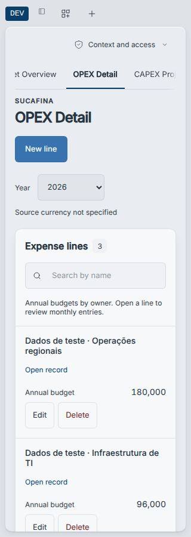

# Regression of the first six native areas

[Official run 44963871177](https://github.com/gustavomhss/Orchestra-SF/actions/runs/44963871177) passed both original browser journeys in 4.8 minutes, using the production bundle and original source fixtures. Snapshot `f6533b5856840c4722f38d3e5070204c8e4d4877` tested product `7c0caf8da905a03579379c35ce1cd49375a87509`, including the final shared native reading-health host composition of this block.

The job emitted 67 complete previews with no preview skip. The six representative images below were inspected and persisted unchanged from Actions. [The manifest](manifest.json) inventories all 67 names and the exact blob hashes of the six saved JPEGs. Earlier accepted galleries retain their original scope and review status.

The reviewed states preserve the visual hierarchy, source absences and focused review actions. The 320px OPEX screen reflows its rows; its lower rows continue below the captured viewport. No overlap or document-wide horizontal overflow was observed in these six images. Actual browser zoom, contrast ratios and other browser engines were not measured.

## UI29

## UI33

## CAP01

## CAP02

## CAP03

## CAP04

