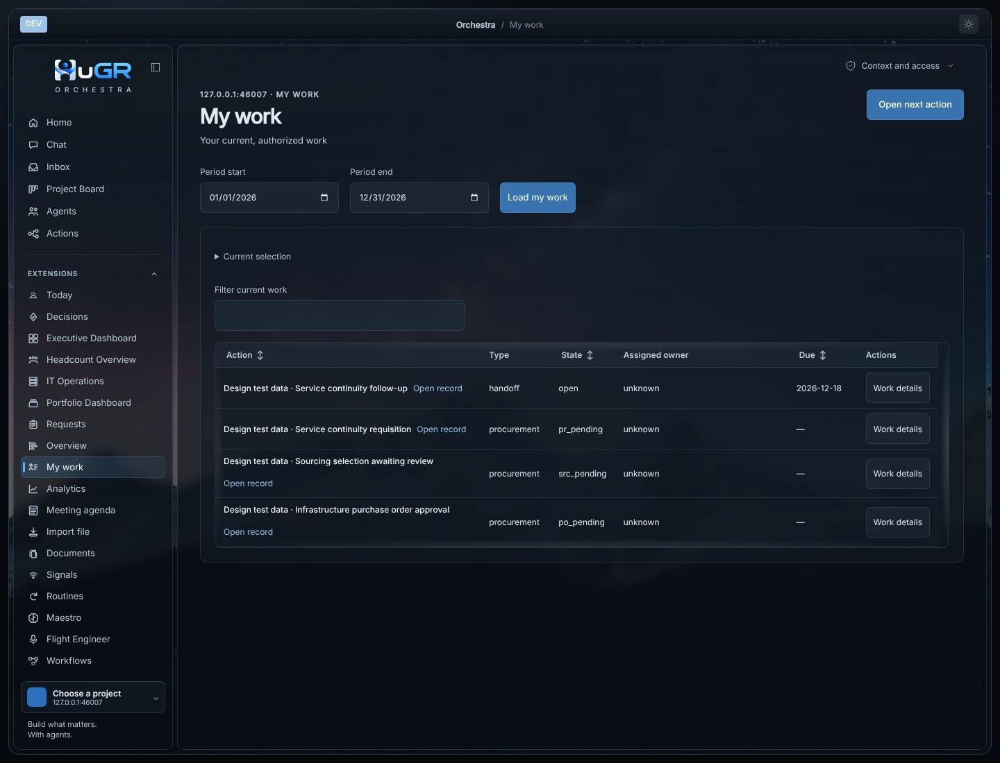
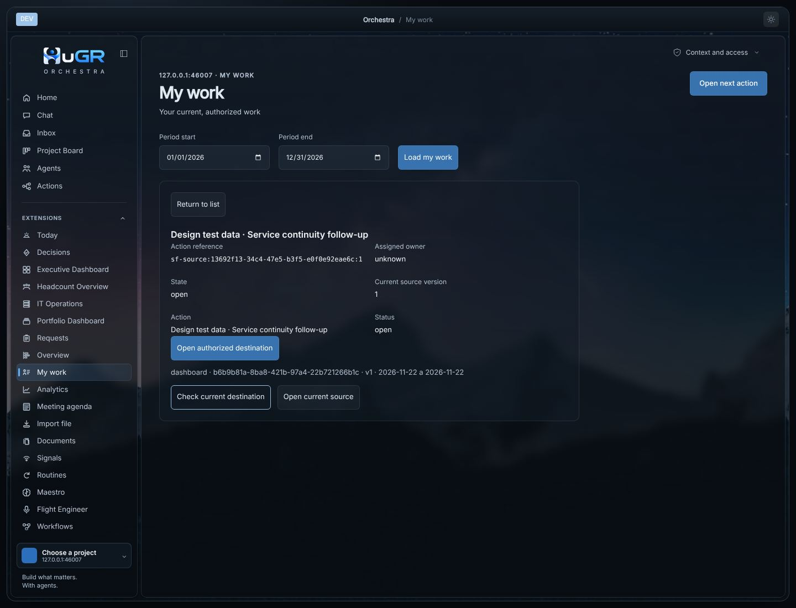
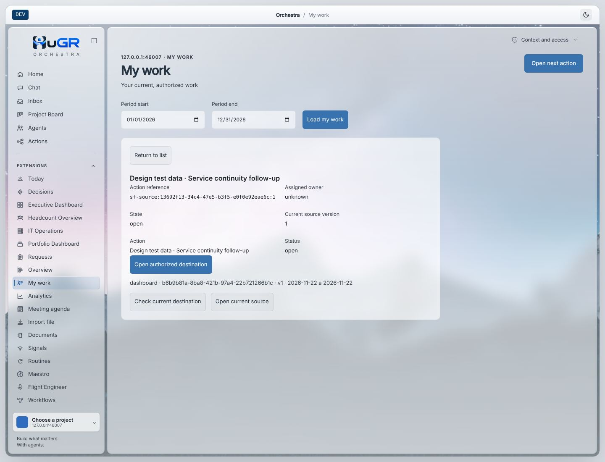
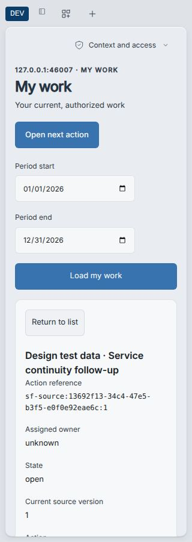
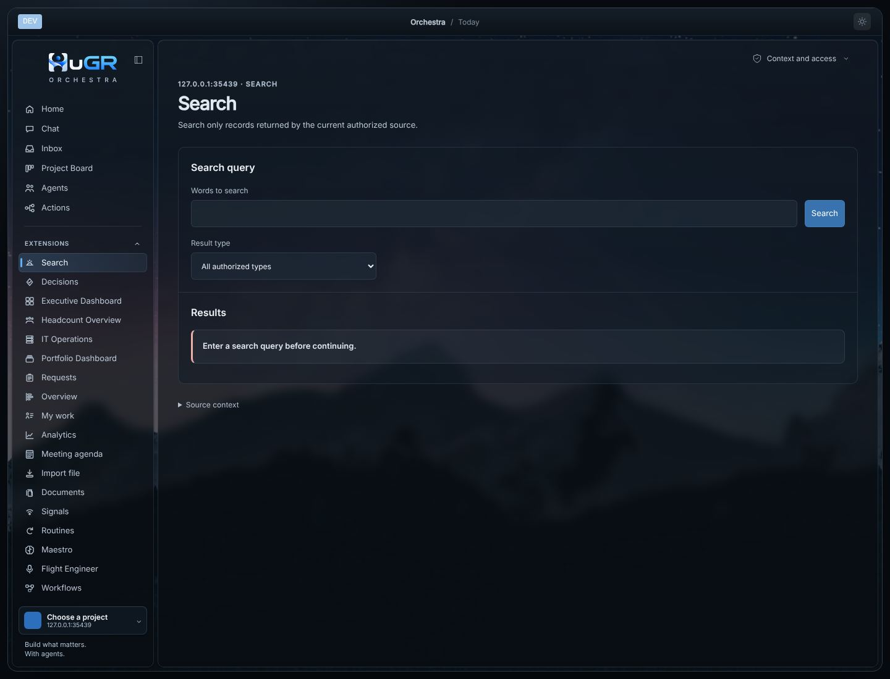
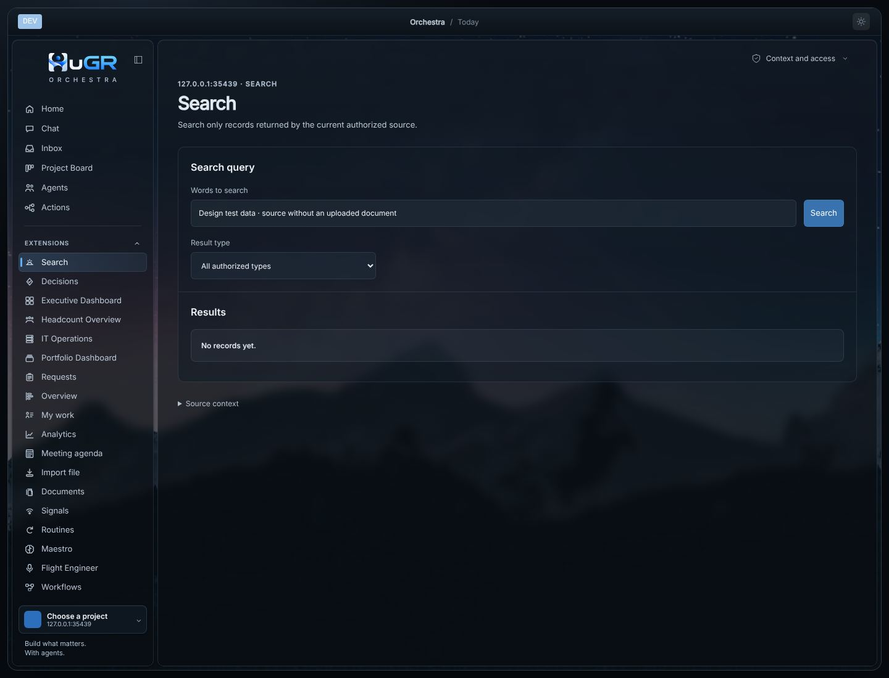
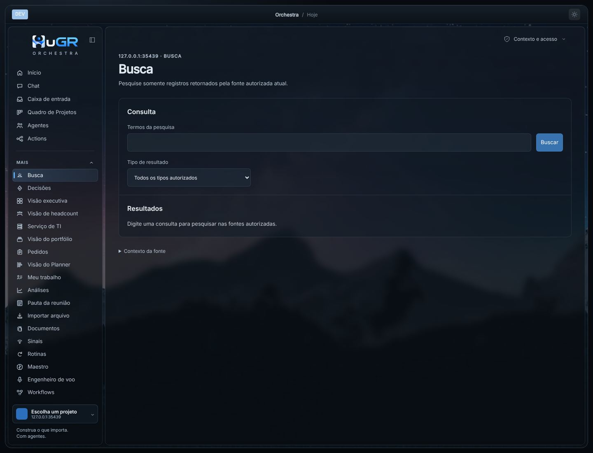

# Work evidence — UI30–UI32

**Current qualification: UI30 Work and UI31 Search passed. UI32 Saved views is pending. Thirteen complete captures are preserved here.**

[Manifest](manifest.json) · [UI30 Work9 Actions run](https://github.com/gustavomhss/Orchestra-SF/actions/runs/44964988862) · [UI31 Work8 Actions run](https://github.com/gustavomhss/Orchestra-SF/actions/runs/44964042218)

The file contains three independent journeys. Work9 completed with UI30 and UI31 passing and UI32 failing; Work8 supplied the already-qualified Search gallery. This folder includes only the passing journeys. UI32's failure and captures are not represented as a pass.

| Area | Qualified source | Immutable snapshot | Captures |
| --- | --- | --- | --- |
| UI30 — My work | Work9, job 137031865834 | [206c0ea](https://github.com/gustavomhss/Orchestra-SF/tree/206c0ea661c1647713cbaf312ade4c73be70dc5d) | 7 |
| UI31 — Search | Work8, job 137028931967 | [0d836c8](https://github.com/gustavomhss/Orchestra-SF/tree/0d836c823ae855a167dfef521a63fef0ae5be3fe) | 6 |

The manifest binds each image to its run, blob hash, size, viewport, theme and locale. Product commits are recorded separately from the immutable CI snapshots.

## UI30 — observed behavior

An original local Dashboard handoff supplies a real Hot Topic and assignment to the enrolled operator. The fixture obtains the actor and recipient from the original services; it neither grants new access nor sends external communication. The original Work selection and period return four assigned actions. The Hot Topic detail preserves the original owner reference and current source version. Returning to the list and local filtering work without inventing a source result.

Both original destination requests return HTTP 200 JSON: the first check takes about 17.2 seconds and the second authorization about 17.4 seconds in Work9. After the second response, the browser opens the expected native Hot Topics & Actions record and displays the original title. The test waits for these real responses before checking navigation. No producer deadline, clock, grant or two-witness check was changed.

The seven captures were visually reviewed. The period controls, table and current-detail panel have clear hierarchy; the detail is constrained to approximately 760px. The list is hidden during detail reading. Dark and light themes remain legible. At 320px, date fields and actions stack, the source reference wraps inside the panel, and the filtered-empty message is shown once. The Portuguese initial page has complete labels and guidance.

## UI31 — observed behavior

The blank query is rejected before any search request. The submitted query goes only in the private POST body, with no query text in the address. The original Documents projection returns HTTP 200; a fresh original HTTP read confirms the canonical empty result. Changing the local result-type filter does not issue another request. The English and Portuguese pages close with no page or console errors.

All six images were visually reviewed. Desktop hierarchy, separation of the query from results, text contrast and controls are clear in both themes. At 320px the form stacks and remains inside the viewport; the long query is contained by the text input. The Portuguese desktop keeps complete labels and instructions.

## Coverage limits

The positive UI30 detail and destination use the genuine Hot Topic handoff. Procurement details returned HTTP 503 in an earlier original-source run and remain a documented limitation. These images do not claim successful Procurement detail authorization, and no C58 protection was changed. The source's owner label is literally `unknown`; the UI preserves it rather than fabricating a display name.

The isolated installation has no uploaded searchable document. UI31 qualifies validation, the actual empty response, local filtering and layout; it does not qualify non-empty search results or opening a result. The suite uses original enrollment, sources and HTTP transport, without fabricated contexts, grants, receipts or successful responses.

Coverage is Chromium, English desktop dark/light and 320px light, plus Portuguese desktop dark initial states. Other engines, actual browser zoom and Portuguese 320px are not claimed. Native date hints reflect the browser locale used by the test. UI32 evidence will be added only after its save/CAS/readback journey passes.

## UI30 captures

### UI30-dark-desktop-choose-period

### UI30-dark-desktop-assigned-work

### UI30-dark-desktop-authorized-detail

### UI30-light-desktop-authorized-detail

### UI30-light-320-authorized-detail

### UI30-light-320-filtered-empty

### UI30-pt-BR-dark-desktop

## UI31 captures

### UI31-dark-desktop-before-query

### UI31-dark-desktop-required-query

### UI31-dark-desktop-source-empty

### UI31-light-desktop-source-empty

### UI31-light-320-source-empty

### UI31-pt-BR-dark-desktop

