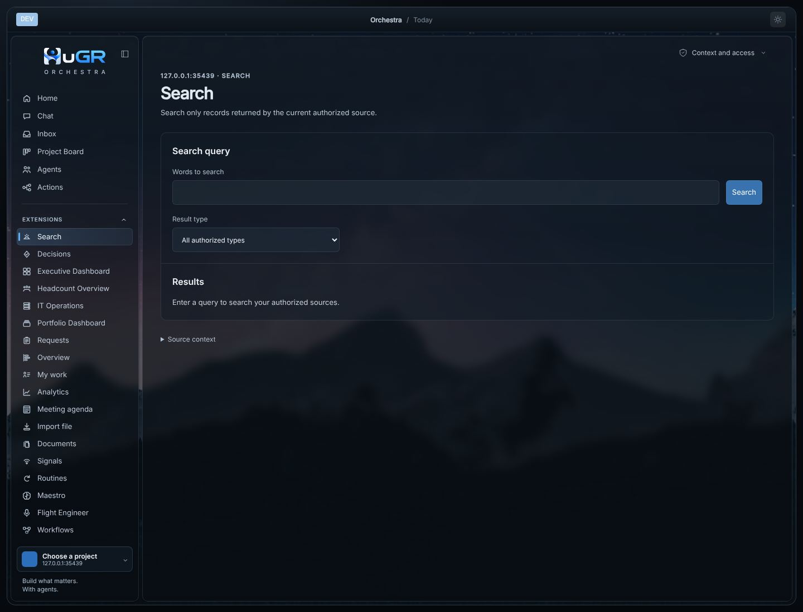

# Work evidence — UI30–UI32

**Current qualification: UI31 Search passed. UI30 Work and UI32 Saved views are pending.**

[Work8 Actions run](https://github.com/gustavomhss/Orchestra-SF/actions/runs/44964042218) · [Immutable test snapshot](https://github.com/gustavomhss/Orchestra-SF/tree/0d836c823ae855a167dfef521a63fef0ae5be3fe) · [Tested product commit](https://github.com/gustavomhss/Orchestra-SF/tree/7c0caf8da905a03579379c35ce1cd49375a87509) · [Manifest](manifest.json)

The file contains three independent journeys. Work8 completed with one passed journey and two failures. Only the six captures from the passing UI31 journey are included here; this gallery does not imply that UI30 or UI32 passed.

## UI31 — observed behavior

The blank query is rejected before any search request. The submitted query goes only in the private POST body, with no query text in the address. The original Documents projection returns HTTP 200; a fresh original HTTP read confirms the canonical empty result. Changing the local result-type filter does not issue another request. The English and Portuguese pages close with no page or console errors.

All six images were visually reviewed. Desktop hierarchy, separation of the query from results, text contrast and controls are clear in both themes. At 320px the form stacks and remains inside the viewport; the long query is contained by the text input. The Portuguese desktop keeps complete labels and instructions.

## Coverage limits

The isolated installation has no uploaded searchable document. These captures qualify validation, the actual empty response, local filtering and layout, but do not qualify non-empty search results or opening a search result. The suite uses the original enrollment, sources and HTTP transport, without fabricated contexts, grants, receipts or successful responses.

Coverage is Chromium, English desktop dark/light and 320px light, plus Portuguese desktop dark. Other engines, actual browser zoom and Portuguese 320px are not claimed. UI30 and UI32 evidence will be added only after their journeys pass.

## UI31 captures

### UI31-dark-desktop-before-query

### UI31-dark-desktop-required-query

### UI31-dark-desktop-source-empty

### UI31-light-desktop-source-empty

### UI31-light-320-source-empty

### UI31-pt-BR-dark-desktop

