# Work evidence — UI30–UI32

**Observed result: 3 journeys passed in Work10, with one confirmed browser save, fresh original-source readback and 22 complete captures. This gallery preserves 22 visually reviewed images across Work8, Work9 and Work10.**

[Final Work10 Actions run](https://github.com/gustavomhss/Orchestra-SF/actions/runs/44965705732) · [Final immutable snapshot](https://github.com/gustavomhss/Orchestra-SF/tree/6bff36e3308c4ac205a59011827c8f19c06c5873) · [Tested product commit](https://github.com/gustavomhss/Orchestra-SF/tree/87a738830c83bf1fa9ee30c32b38fb1e297b30f8) · [Manifest](manifest.json)

The three independent journeys passed together in Work10 in 5.1 minutes. All six English/Portuguese page closures reported empty page-error and console-error collections. The gallery retains previously qualified UI30 and UI31 images and adds the nine UI32 images from Work10; no failed-journey image is included.

| Area | Preserved capture source | Immutable snapshot | Captures |
| --- | --- | --- | --- |
| UI30 — My work | [Work9](https://github.com/gustavomhss/Orchestra-SF/actions/runs/44964988862), job 137031865834 | [206c0ea](https://github.com/gustavomhss/Orchestra-SF/tree/206c0ea661c1647713cbaf312ade4c73be70dc5d) | 7 |
| UI31 — Search | [Work8](https://github.com/gustavomhss/Orchestra-SF/actions/runs/44964042218), job 137028931967 | [0d836c8](https://github.com/gustavomhss/Orchestra-SF/tree/0d836c823ae855a167dfef521a63fef0ae5be3fe) | 6 |
| UI32 — Saved views | [Work10](https://github.com/gustavomhss/Orchestra-SF/actions/runs/44965705732), job 137034123246 | [6bff36e](https://github.com/gustavomhss/Orchestra-SF/tree/6bff36e3308c4ac205a59011827c8f19c06c5873) | 9 |

The manifest binds every image to its run, blob hash, size, viewport, theme and locale. Product commits are recorded separately from CI snapshots. Work8 and Work9 had other failing journeys; only their individually passing Search and Work journeys are used here. Work10 independently qualifies all three.

## UI30 — observed behavior

An original local Dashboard handoff supplies a real Hot Topic and assignment to the enrolled operator. The fixture obtains the actor and recipient from the original services; it neither grants new access nor sends external communication. The original Work selection and period return four assigned actions. The Hot Topic detail preserves the original owner reference and current source version. Returning to the list and local filtering work without inventing a source result.

Both original destination requests return HTTP 200 JSON. They take about 17.2 and 17.4 seconds in Work9, and about 18.0 and 17.8 seconds in Work10. After the second authorization, the browser opens the expected native Hot Topics & Actions record and displays the original title. The test waits for these real responses before checking navigation. No producer deadline, clock, grant or two-witness check was changed.

The seven preserved captures were visually reviewed. The period controls, table and current-detail panel have clear hierarchy; the detail is constrained to approximately 760px. The list is hidden during detail reading. Dark and light themes remain legible. At 320px, date fields and actions stack, the source reference wraps inside the panel, and the filtered-empty message is shown once. The Portuguese initial page has complete labels and guidance.

## UI31 — observed behavior

The blank query is rejected before any search request. The submitted query goes only in the private POST body, with no query text in the address. The original Documents projection returns HTTP 200; a fresh original HTTP read confirms the canonical empty result. Changing the local result-type filter does not issue another request.

All six preserved images were visually reviewed. Desktop hierarchy, separation of the query from results, text contrast and controls are clear in both themes. At 320px the form stacks and remains inside the viewport; the long query is contained by the text input. The Portuguese desktop keeps complete labels and instructions.

## UI32 — observed behavior and correction

The original V1 source creates a version-1 view through its existing HTTP boundary. The editor retains the revised title and compact density when returning to the list, reopening, revising and canceling review. One browser save is confirmed, the UI shows version 2, and a fresh original HTTP open returns exactly the revised title/density with the original period and filters. A new native route reads that same saved view. Removal is reviewed and canceled without a second mutation. The new-view route continues to show that V2 and preferred entry are unavailable.

The nine images were visually reviewed. The collection, focused editor and approximately 760px review have distinct purposes. Source version and source page remain visible. Original/current/proposed values are legible in both themes. At 320px the review values wrap inside their panels and Cancel review, Revise and Confirm save appear as complete stacked controls. The confirmed readback shows Version 2, the updated title and compact density. The Portuguese list displays the same saved title from the source.

The pre-dispatch failure observed in Work8/9 was reproduced by the focused Solid regression: nested reactive data was rejected by the unchanged closed input schema. The fix detaches the reviewed command before hashing and dispatch, preserving enumerable string fields, original values and expected version. It retains unknown fields, explicit undefined and non-finite values for the original codec to reject. It does not use a JSON serialization round trip or relax schema admission. Pre-dispatch rejection also now renders the existing inline unavailable state. Temporary diagnostic code was removed.

[Gate13](https://github.com/gustavomhss/Orchestra-SF/actions/runs/44966016316), job 137035096579, ran all three new cases in `sucafina-saved-view-command.test.ts` with zero failures: tracked source/read codec and exact command admission; invalid-field preservation; unchanged removal identity and CAS. Work10 then confirmed the browser/source behavior above.

## Coverage limits

The positive UI30 detail and destination use the genuine Hot Topic handoff. Procurement details returned HTTP 503 in the [earlier Work5 run](https://github.com/gustavomhss/Orchestra-SF/actions/runs/44960541317) and remain a documented limitation. These images do not claim successful Procurement detail authorization, and no C58 protection was changed. The source's owner label is literally `unknown`; the UI preserves it rather than fabricating a display name.

The isolated installation has no uploaded searchable document. UI31 qualifies validation, the actual empty response, local filtering and layout; it does not qualify non-empty search results or opening a result. UI32 qualifies an existing V1 edit and canceled removal, not deletion or creation of V2 views. V2 native views and preferred entry remain unavailable.

Coverage is Chromium, English desktop dark/light and 320px light, plus Portuguese desktop dark initial states. Other engines, actual browser zoom and Portuguese 320px are not claimed. Native date hints retain the captured browser's format. Original enrollment, sources and HTTP transport supplied all authority and results; contexts, grants, receipts and successful responses were not fabricated. User acceptance and merge remain outside this evidence.

## UI30 captures

### UI30-dark-desktop-choose-period

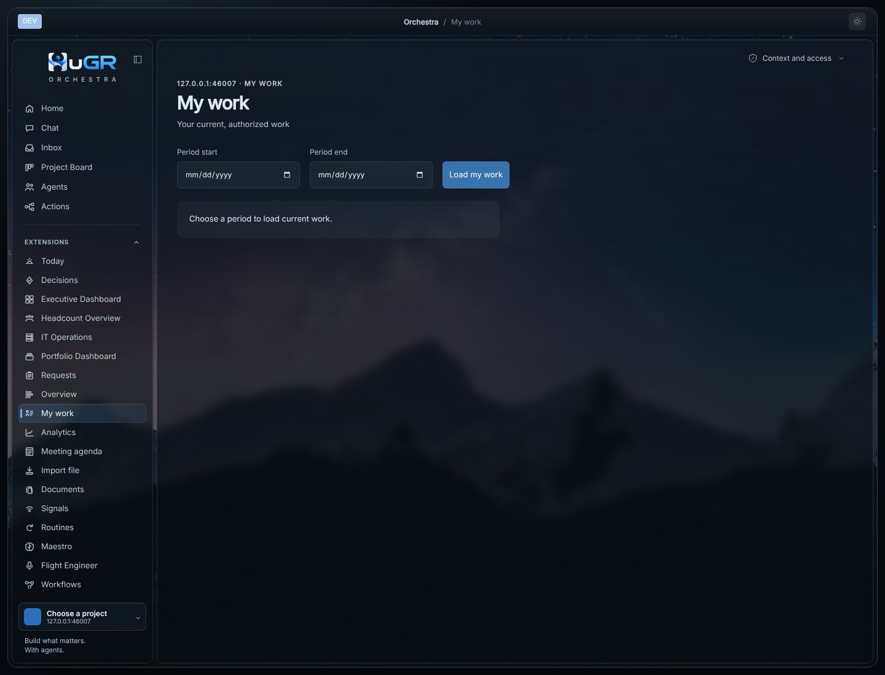

### UI30-dark-desktop-assigned-work

### UI30-dark-desktop-authorized-detail

### UI30-light-desktop-authorized-detail

### UI30-light-320-authorized-detail

### UI30-light-320-filtered-empty

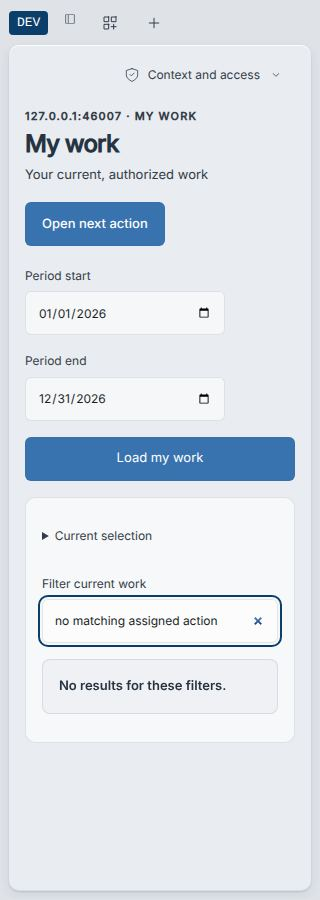

### UI30-pt-BR-dark-desktop

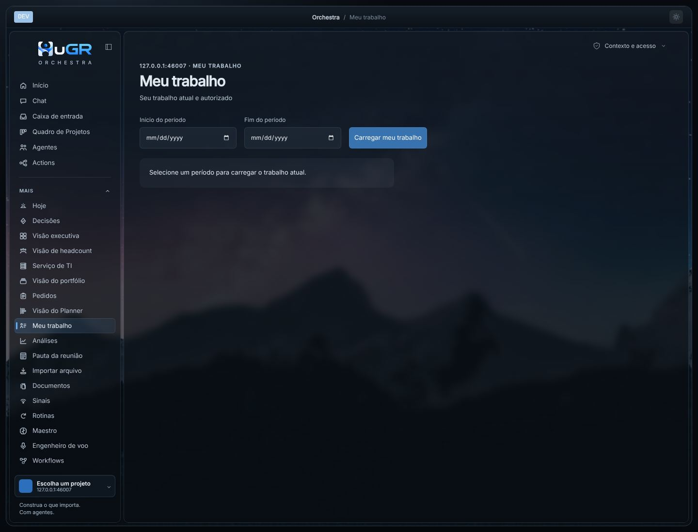

## UI31 captures

### UI31-dark-desktop-before-query

### UI31-dark-desktop-required-query

### UI31-dark-desktop-source-empty

### UI31-light-desktop-source-empty

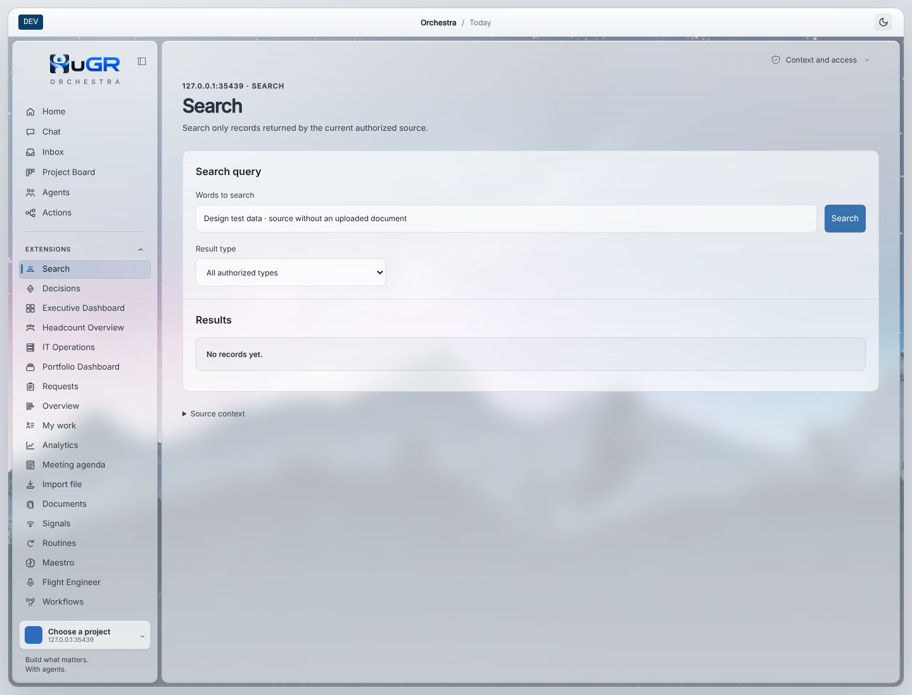

### UI31-light-320-source-empty

### UI31-pt-BR-dark-desktop

## UI32 captures

### UI32-dark-desktop-existing-view-list

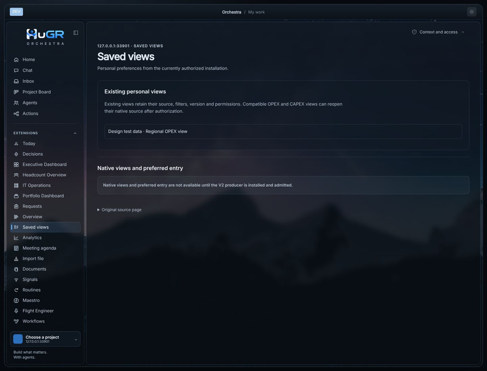

### UI32-dark-desktop-existing-view-editor

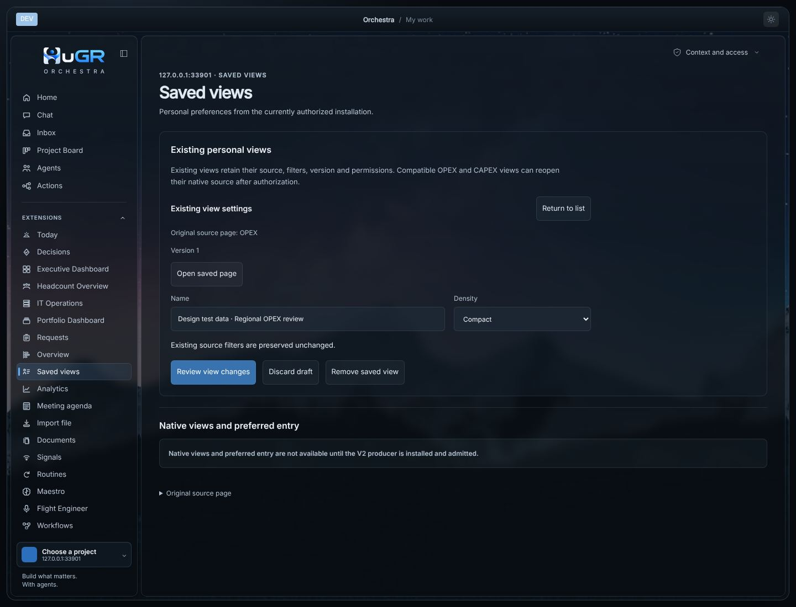

### UI32-dark-desktop-existing-view-review

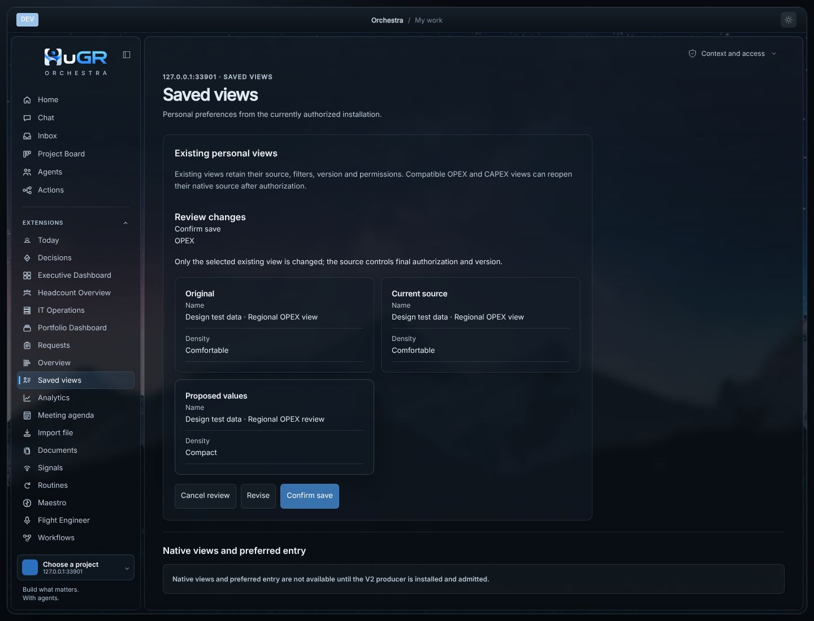

### UI32-light-desktop-existing-view-review

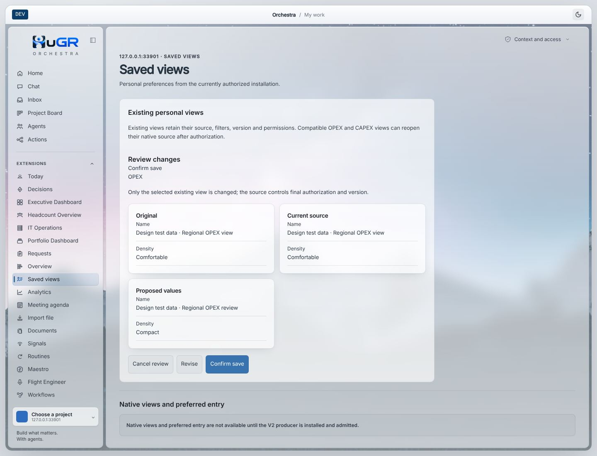

### UI32-light-320-existing-view-review-actions

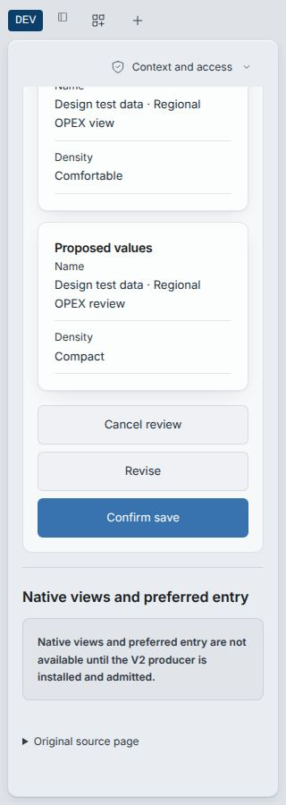

### UI32-light-desktop-confirmed-view-readback

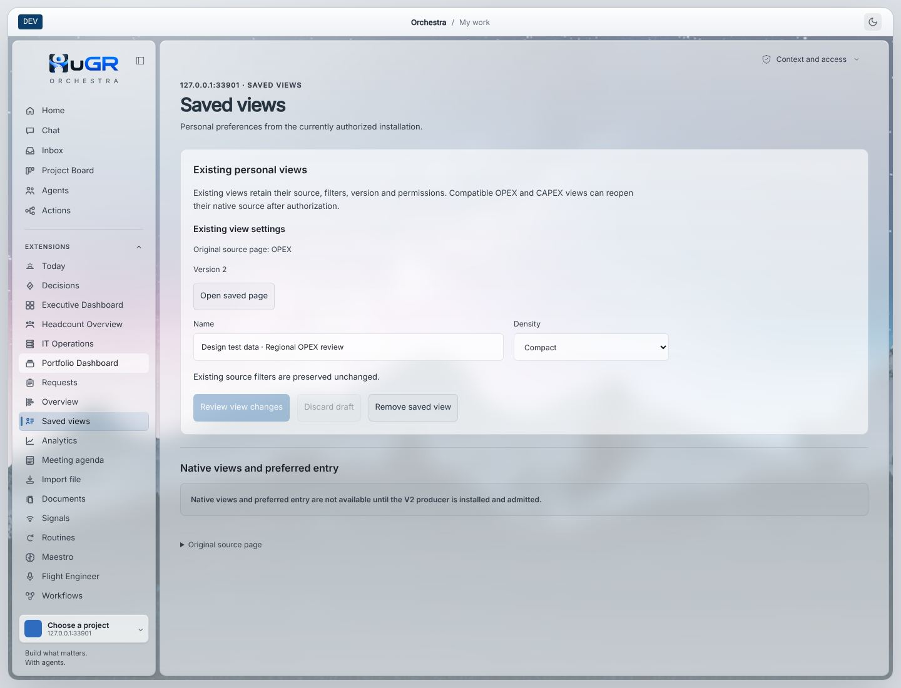

### UI32-light-desktop-removal-review

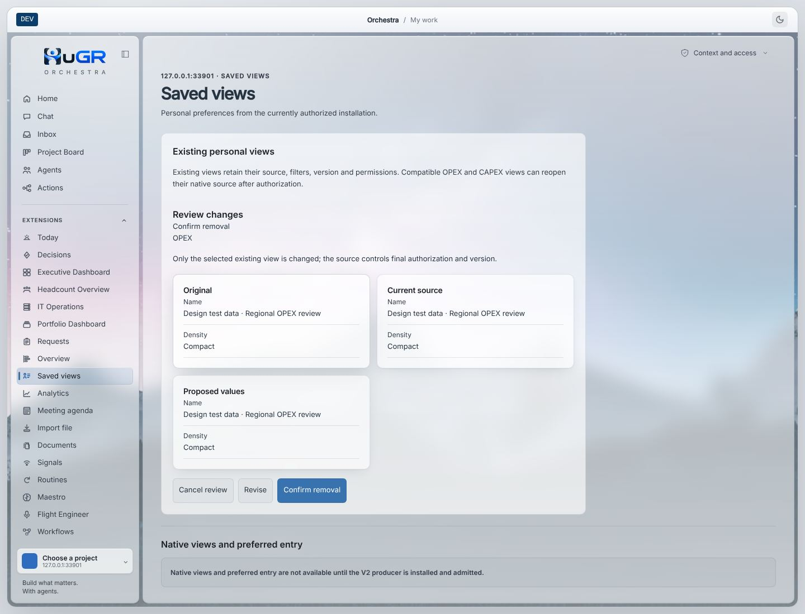

### UI32-light-desktop-native-v2-unavailable

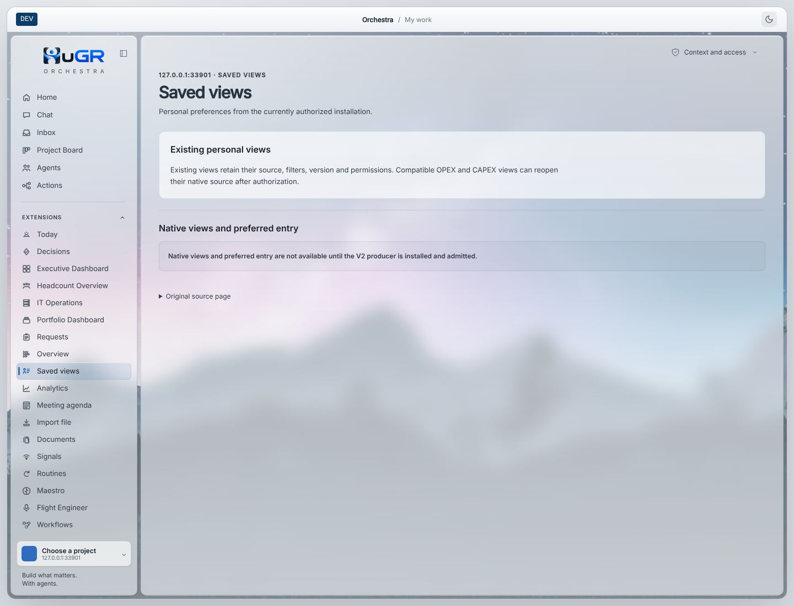

### UI32-pt-BR-dark-desktop

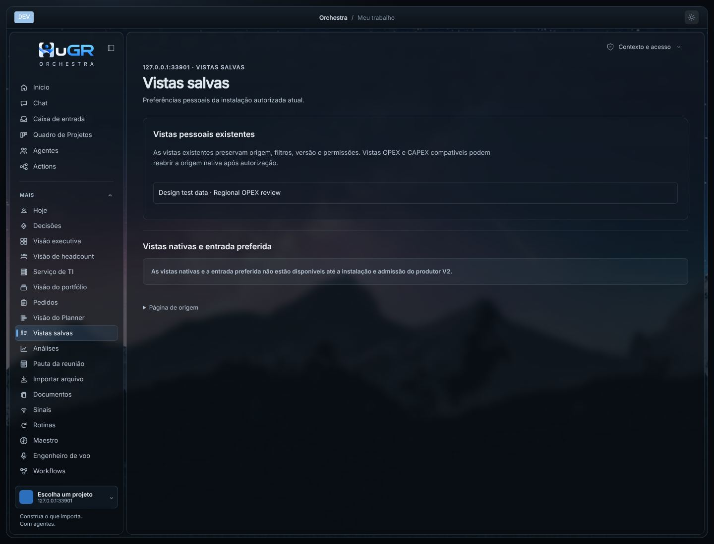
