# Galeria visual — últimas 14 áreas Sucafina

Esta galeria reúne 31 imagens reais das 14 áreas UI57–UI70, capturadas no app-shell de produção pelo workflow Linux original `test-ci` e inspecionadas visualmente. Cada estado identifica sua rodada, o enquadramento e os limites funcionais. Uma imagem de estado não transforma uma jornada incompleta em aprovação.

A qualificação da recusa original de casos semelhantes ainda está em andamento. Consulte o [relatório central](../VALIDATION.md) e o [manifesto com proveniência](./manifest.json).

| Área | Tela | Imagens selecionadas |
| --- | --- | --- |
| UI57 | Histórico, recibo e revisão de importação | 2 |
| UI58 | Documentos | 1 |
| UI59 | Evidências | 4 |
| UI60 | Documento em cenário | 2 |
| UI61 | Sinais de memória | 6 |
| UI62 | Casos semelhantes | 1 |
| UI63 | Resultados / Outcomes | 2 |
| UI64 | Rotinas | 1 |
| UI65 | Resultado da rotina | 1 |
| UI66 | Recorrência | 1 |
| UI67 | Contexto da instalação | 2 |
| UI68 | Exportações | 2 |
| UI69 | Administração local | 3 |
| UI70 | Contribuições / residentes | 3 |

## UI57 — Histórico, recibo e revisão de importação

### recovered-receipt-pt-br-desktop

1440×1100px. [Run 45121980778](https://github.com/gustavomhss/Orchestra-SF/actions/runs/45121980778), job `137517602373`, snapshot `f312587515353b15f59c5c362678d3090e167677`.

Final Records R15 passed all four original production journeys. Original Files reads, ClamD, receipts, source revocation and unchanged deadlines.

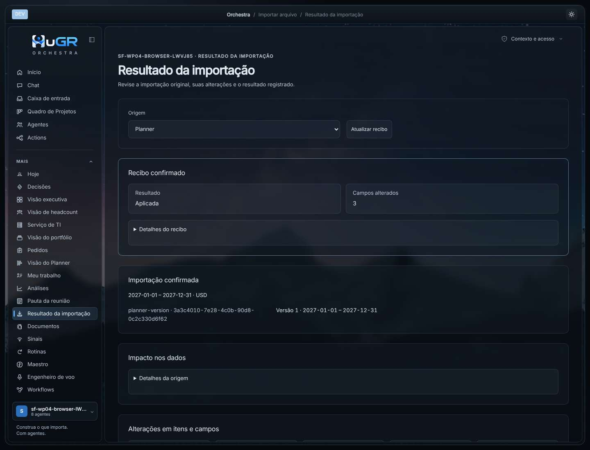

### changed-fields-original-values

1440×1100px. [Run 45121980778](https://github.com/gustavomhss/Orchestra-SF/actions/runs/45121980778), job `137517602373`, snapshot `f312587515353b15f59c5c362678d3090e167677`.

Final Records R15 passed all four original production journeys. Original Files reads, ClamD, receipts, source revocation and unchanged deadlines.

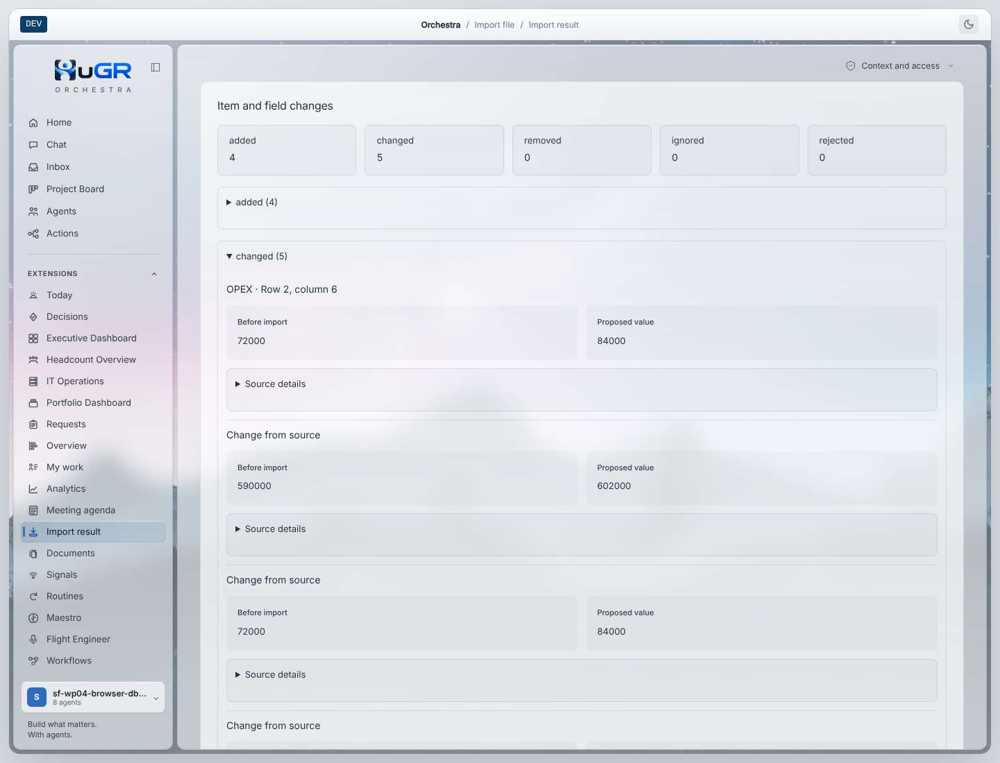

## UI58 — Documentos

### authorized-catalog-dark-desktop

1440×1100px. [Run 45121980778](https://github.com/gustavomhss/Orchestra-SF/actions/runs/45121980778), job `137517602373`, snapshot `f312587515353b15f59c5c362678d3090e167677`.

Final Records R15 passed all four original production journeys. Original Files reads, ClamD, receipts, source revocation and unchanged deadlines.

## UI59 — Evidências

### review-original-source-dark-desktop

1440×1100px. [Run 45121980778](https://github.com/gustavomhss/Orchestra-SF/actions/runs/45121980778), job `137517602373`, snapshot `f312587515353b15f59c5c362678d3090e167677`.

Final Records R15 passed all four original production journeys. Original Files reads, ClamD, receipts, source revocation and unchanged deadlines.

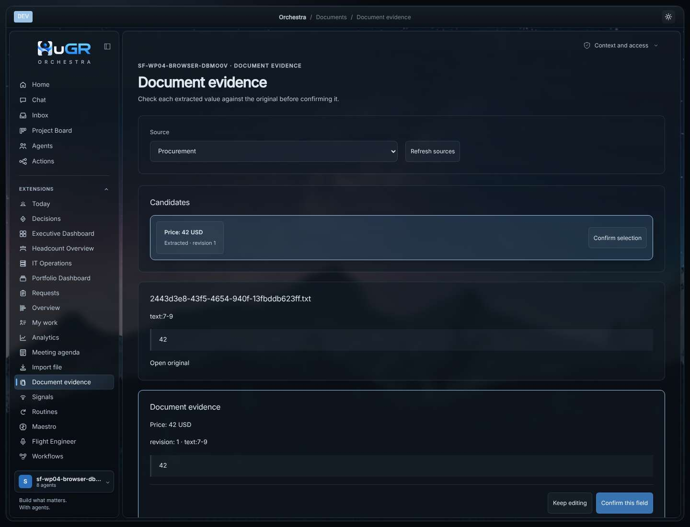

### review-original-source-light-narrow

320×900px. [Run 45121980778](https://github.com/gustavomhss/Orchestra-SF/actions/runs/45121980778), job `137517602373`, snapshot `f312587515353b15f59c5c362678d3090e167677`.

Final Records R15 passed all four original production journeys. Original Files reads, ClamD, receipts, source revocation and unchanged deadlines. Narrow source/candidate/excerpt; lower edge reaches Open original. Content below that edge is not visually qualified by this frame.

### review-original-source-pt-br-desktop

1440×1100px. [Run 45107932060](https://github.com/gustavomhss/Orchestra-SF/actions/runs/45107932060), job `137473384578`, snapshot `91f3028e0a00f7f8a32b40dcfad845b8cb2d20da`.

Actual state reviewed; first3 original Operations journeys passed. Whole R10run3of4; separate positive UI60 is qualified by R12.

### review-original-source-light-desktop

1440×1100px. [Run 45121980778](https://github.com/gustavomhss/Orchestra-SF/actions/runs/45121980778), job `137517602373`, snapshot `f312587515353b15f59c5c362678d3090e167677`.

Final Records R15 passed all four original production journeys. Original Files reads, ClamD, receipts, source revocation and unchanged deadlines.

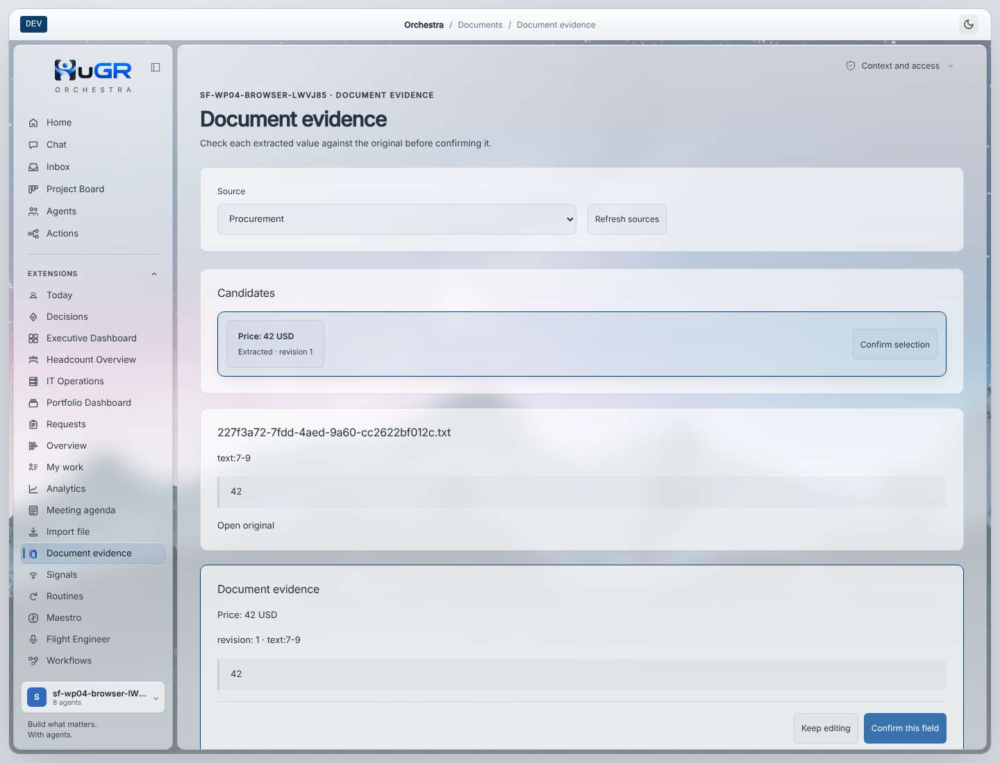

## UI60 — Documento em cenário

### confirmed-source-restricted-simulation-dark-desktop

1440×1100px. [Run 45121980778](https://github.com/gustavomhss/Orchestra-SF/actions/runs/45121980778), job `137517602373`, snapshot `f312587515353b15f59c5c362678d3090e167677`.

Final Records R15 passed all four original production journeys. Original Files reads, ClamD, receipts, source revocation and unchanged deadlines. Restricted source state only. The refusal lower in the scroller is asserted by the journey, outside this capture.

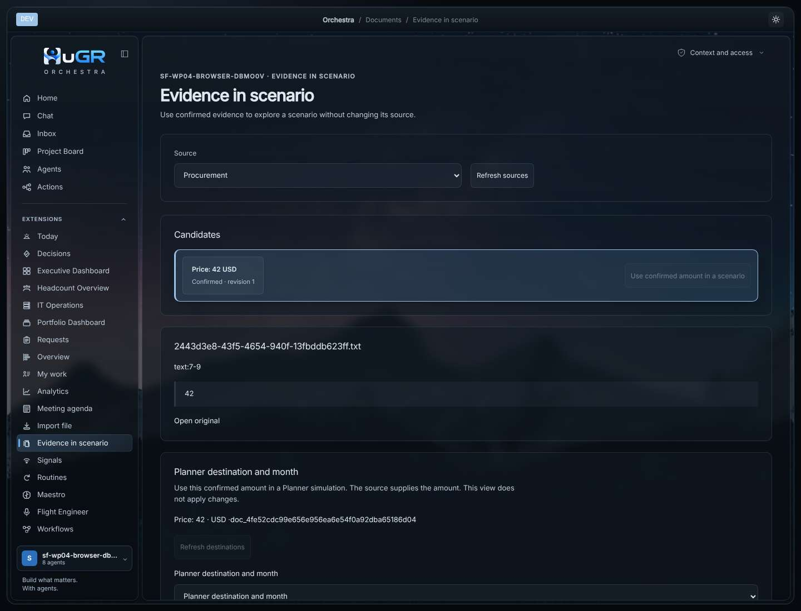

### preview-from-confirmed-evidence

1440×1100px. [Run 45121980778](https://github.com/gustavomhss/Orchestra-SF/actions/runs/45121980778), job `137517602373`, snapshot `f312587515353b15f59c5c362678d3090e167677`.

Final Records R15 passed all four original production journeys. Original Files reads, ClamD, receipts, source revocation and unchanged deadlines. Original subtotal42USD, total unavailable, baseline420 preserved. A persistent evidence link is not exercised.

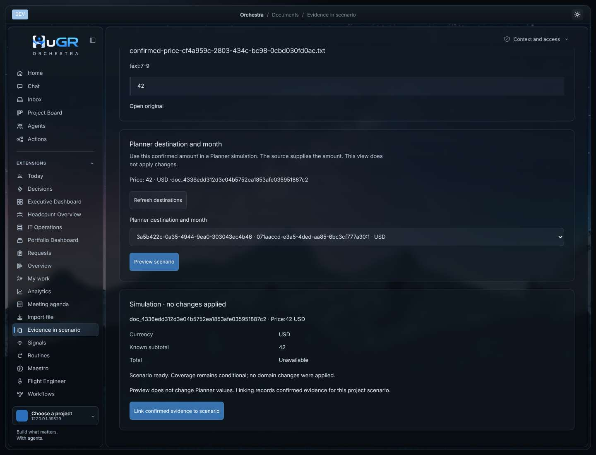

## UI61 — Sinais de memória

### dark-desktop-recorded-condition

1440×1100px. [Run 45117078885](https://github.com/gustavomhss/Orchestra-SF/actions/runs/45117078885), job `137502251987`, snapshot `257717aa632d7f029ec27b4d3cb8b9a603bad0a6`.

Original conditions captured; materiality exceeded40s. Whole UI61 journey failed; no positive materiality or signal result qualified.

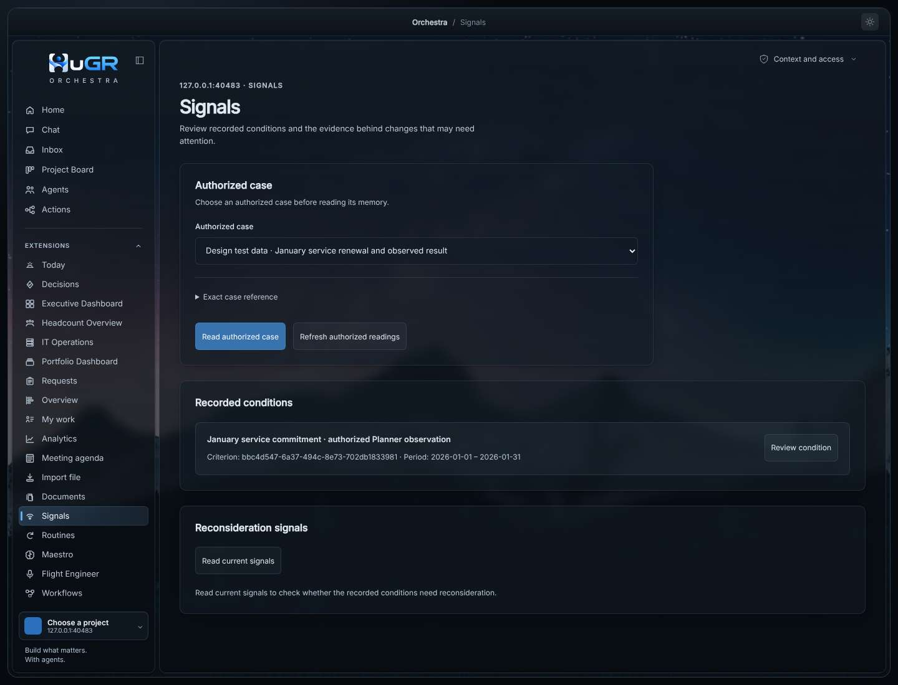

### light-320-recorded-condition

320×900px. [Run 45117078885](https://github.com/gustavomhss/Orchestra-SF/actions/runs/45117078885), job `137502251987`, snapshot `257717aa632d7f029ec27b4d3cb8b9a603bad0a6`.

Original conditions captured; materiality exceeded40s. Whole UI61 journey failed; no positive materiality or signal result qualified.

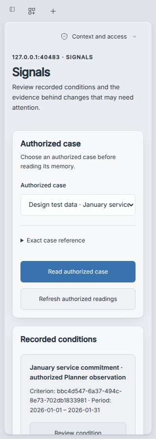

### en-dark-desktop-materiality-local-cancel

1440×1100px. [Run 45122439989](https://github.com/gustavomhss/Orchestra-SF/actions/runs/45122439989), job `137519060570`, snapshot `b0931669e80589776a6ce8a1e63b8957a5e2d280`.

Both isolated native cancellation journeys passed. One original GET each, browser ERR_ABORTED, conditions retained, no resend, selection clearing. No positive result or server cancellation is claimed. Viewport scrolled to show retained conditions and the local cancellation state; top case heading may lie outside the frame.

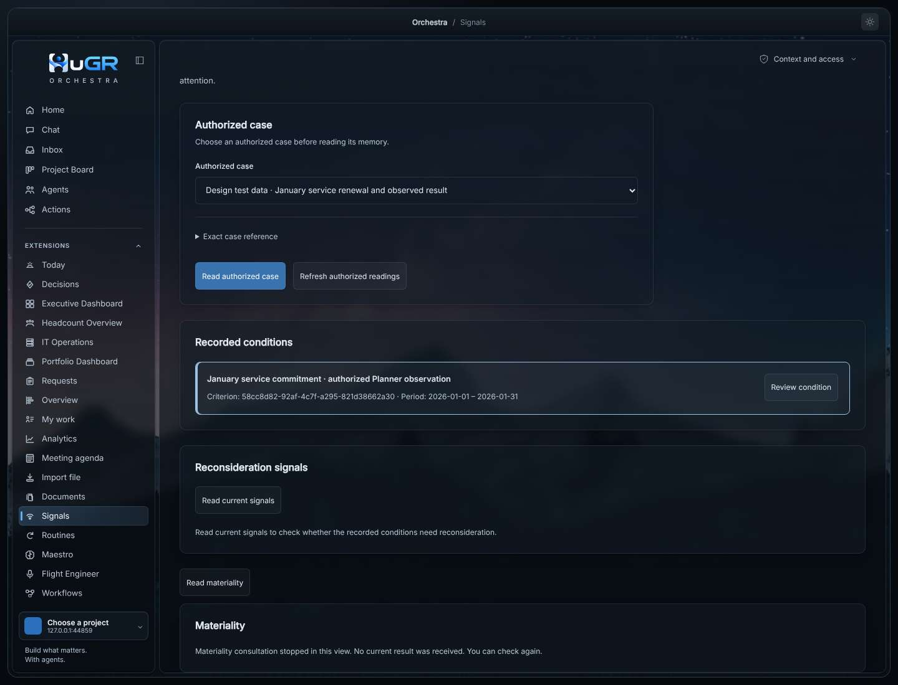

### en-light-320-materiality-local-cancel

320×900px. [Run 45122439989](https://github.com/gustavomhss/Orchestra-SF/actions/runs/45122439989), job `137519060570`, snapshot `b0931669e80589776a6ce8a1e63b8957a5e2d280`.

Both isolated native cancellation journeys passed. One original GET each, browser ERR_ABORTED, conditions retained, no resend, selection clearing. No positive result or server cancellation is claimed. Viewport scrolled to show retained conditions and the local cancellation state; top case heading may lie outside the frame.

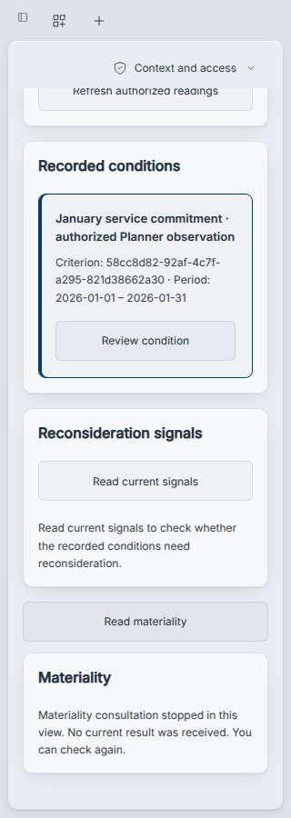

### br-dark-desktop-signals-local-cancel

1440×1100px. [Run 45122439989](https://github.com/gustavomhss/Orchestra-SF/actions/runs/45122439989), job `137519060570`, snapshot `b0931669e80589776a6ce8a1e63b8957a5e2d280`.

Both isolated native cancellation journeys passed. One original GET each, browser ERR_ABORTED, conditions retained, no resend, selection clearing. No positive result or server cancellation is claimed.

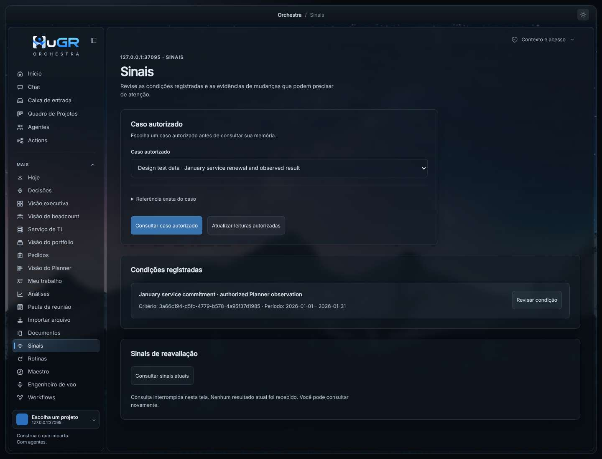

### br-light-320-signals-local-cancel

320×900px. [Run 45122439989](https://github.com/gustavomhss/Orchestra-SF/actions/runs/45122439989), job `137519060570`, snapshot `b0931669e80589776a6ce8a1e63b8957a5e2d280`.

Both isolated native cancellation journeys passed. One original GET each, browser ERR_ABORTED, conditions retained, no resend, selection clearing. No positive result or server cancellation is claimed. Viewport scrolled to show retained conditions and the local cancellation state; top case heading may lie outside the frame.

## UI62 — Casos semelhantes

### pt-br-dark-desktop-authorized-candidates

1440×1100px. [Run 45117078885](https://github.com/gustavomhss/Orchestra-SF/actions/runs/45117078885), job `137502251987`, snapshot `257717aa632d7f029ec27b4d3cb8b9a603bad0a6`.

Actual authorized candidates in pt-BR. Recall POST503; no successful recall result qualified.

## UI63 — Resultados / Outcomes

### light-desktop-incomplete-coverage

1440×1100px. [Run 45117078885](https://github.com/gustavomhss/Orchestra-SF/actions/runs/45117078885), job `137502251987`, snapshot `257717aa632d7f029ec27b4d3cb8b9a603bad0a6`.

Full area journey passed in R11. Whole run3of5.

### pt-br-dark-desktop-incomplete-coverage

1440×1100px. [Run 45117078885](https://github.com/gustavomhss/Orchestra-SF/actions/runs/45117078885), job `137502251987`, snapshot `257717aa632d7f029ec27b4d3cb8b9a603bad0a6`.

Full area journey passed in R11. Whole run3of5.

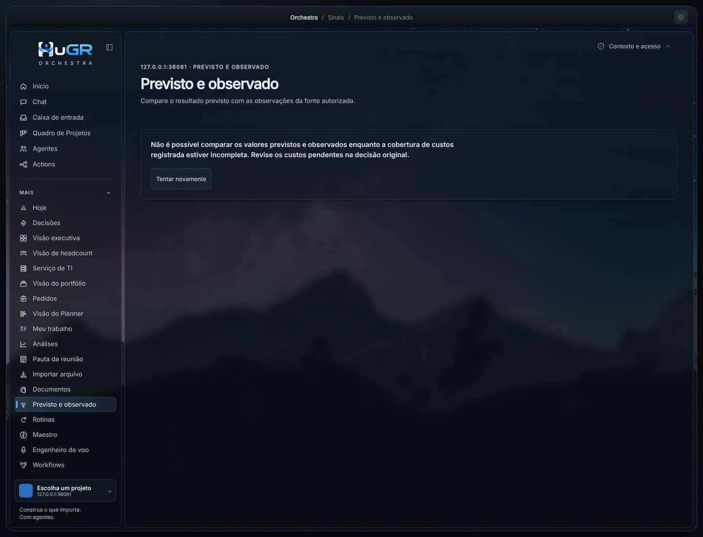

## UI64 — Rotinas

### pt-br-dark-360

360×900px. [Run 45115912342](https://github.com/gustavomhss/Orchestra-SF/actions/runs/45115912342), job `137498592745`, snapshot `15e29d2f1aa89ee0e289585b8b1957c79db3c1d7`.

Final R18run passed2of2journeys; original installed/denied states only.

## UI65 — Resultado da rotina

### en-light-desktop-no-run-return

1440×1100px. [Run 45115912342](https://github.com/gustavomhss/Orchestra-SF/actions/runs/45115912342), job `137498592745`, snapshot `15e29d2f1aa89ee0e289585b8b1957c79db3c1d7`.

Final R18run passed2of2journeys; original installed/denied states only.

## UI66 — Recorrência

### pt-br-light-desktop

1440×1100px. [Run 45115912342](https://github.com/gustavomhss/Orchestra-SF/actions/runs/45115912342), job `137498592745`, snapshot `15e29d2f1aa89ee0e289585b8b1957c79db3c1d7`.

Final R18run passed2of2journeys; original installed/denied states only.

## UI67 — Contexto da instalação

### light-desktop-refreshed-context

1440×1100px. [Run 45107929407](https://github.com/gustavomhss/Orchestra-SF/actions/runs/45107929407), job `137473376276`, snapshot `6798798e51f8c8ad844b5cd0c2463878dee48901`.

UI67 journey passed. Whole R9run1of5; other journeys not qualified by this state.

### pt-br-dark-desktop-current-context

1440×1100px. [Run 45117078885](https://github.com/gustavomhss/Orchestra-SF/actions/runs/45117078885), job `137502251987`, snapshot `257717aa632d7f029ec27b4d3cb8b9a603bad0a6`.

Full area journey passed in R11. Whole run3of5.

## UI68 — Exportações

### authorized-format-pt-br-desktop

1440×1100px. [Run 45121980778](https://github.com/gustavomhss/Orchestra-SF/actions/runs/45121980778), job `137517602373`, snapshot `f312587515353b15f59c5c362678d3090e167677`.

Final Records R15 passed all four original production journeys. Original Files reads, ClamD, receipts, source revocation and unchanged deadlines.

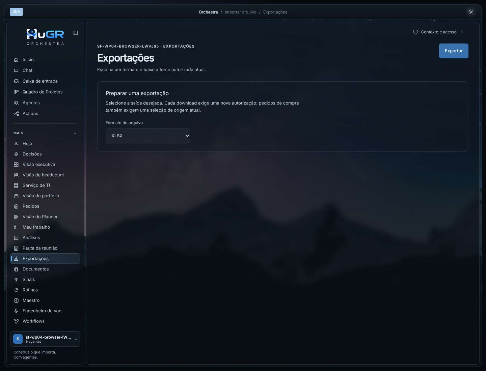

### authorized-format-dark-desktop

1440×1100px. [Run 45121980778](https://github.com/gustavomhss/Orchestra-SF/actions/runs/45121980778), job `137517602373`, snapshot `f312587515353b15f59c5c362678d3090e167677`.

Final Records R15 passed all four original production journeys. Original Files reads, ClamD, receipts, source revocation and unchanged deadlines.

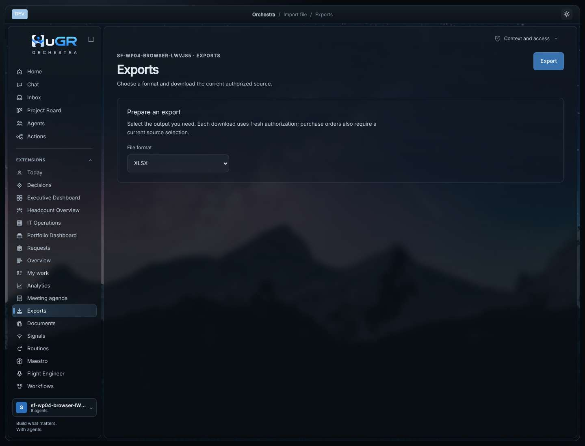

## UI69 — Administração local

### dark-desktop-summary-settings

1440×1100px. [Run 45121178514](https://github.com/gustavomhss/Orchestra-SF/actions/runs/45121178514), job `137515072792`, snapshot `4d1aa02cca18a6116933c9a23acf50767fba6271`.

Post-PR715 UI69 focal passed the unchanged original journey, including one save, original persisted readback/CAS and pt-BR.

### light-320-summary-review-actions

320×900px. [Run 45121178514](https://github.com/gustavomhss/Orchestra-SF/actions/runs/45121178514), job `137515072792`, snapshot `4d1aa02cca18a6116933c9a23acf50767fba6271`.

Post-PR715 UI69 focal passed the unchanged original journey, including one save, original persisted readback/CAS and pt-BR. Scrolled review actions and unavailable notifications section; header and full proposed-value panel outside frame.

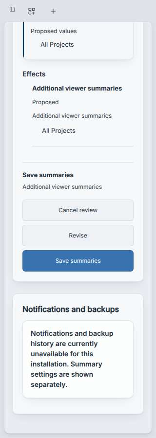

### pt-br-dark-desktop-administration

1440×1100px. [Run 45121178514](https://github.com/gustavomhss/Orchestra-SF/actions/runs/45121178514), job `137515072792`, snapshot `4d1aa02cca18a6116933c9a23acf50767fba6271`.

Post-PR715 UI69 focal passed the unchanged original journey, including one save, original persisted readback/CAS and pt-BR.

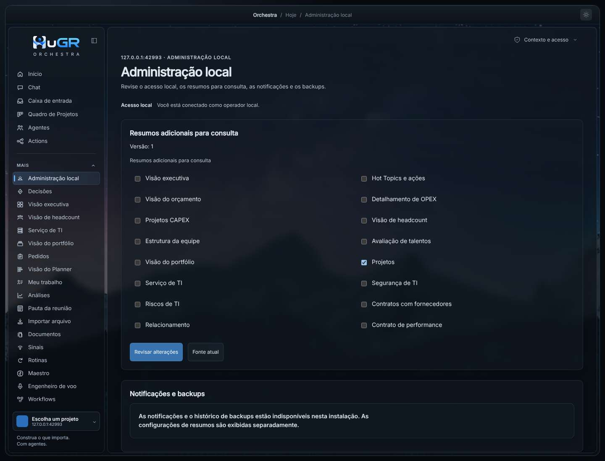

## UI70 — Contribuições / residentes

### en-light-desktop-resident-case-detail

1440×1100px. [Run 45115912342](https://github.com/gustavomhss/Orchestra-SF/actions/runs/45115912342), job `137498592745`, snapshot `15e29d2f1aa89ee0e289585b8b1957c79db3c1d7`.

Final R18run passed2of2journeys; original installed/denied states only.

### en-light-360-resident-case-detail

360×900px. [Run 45115912342](https://github.com/gustavomhss/Orchestra-SF/actions/runs/45115912342), job `137498592745`, snapshot `15e29d2f1aa89ee0e289585b8b1957c79db3c1d7`.

Final R18run passed2of2journeys; original installed/denied states only. Scrolled middle of the skill list. Wrapping and disclosures visible; case selector and human-decision panel outside frame.

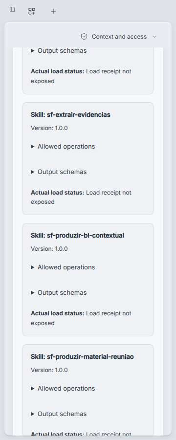

### pt-br-dark-360-installed-state

360×900px. [Run 45115912342](https://github.com/gustavomhss/Orchestra-SF/actions/runs/45115912342), job `137498592745`, snapshot `15e29d2f1aa89ee0e289585b8b1957c79db3c1d7`.

Final R18run passed2of2journeys; original installed/denied states only.

## Limites da revisão

As imagens foram inspecionadas a partir dos bytes emitidos pelo CI e associadas aos blobs retornados pelo GitHub. Não houve releitura binária independente pelo conector textual. A revisão cobre os enquadramentos visíveis em estados selecionados, temas claro/escuro, EN/pt-BR e larguras estreitas. Não mede zoom real ou contraste numérico.
