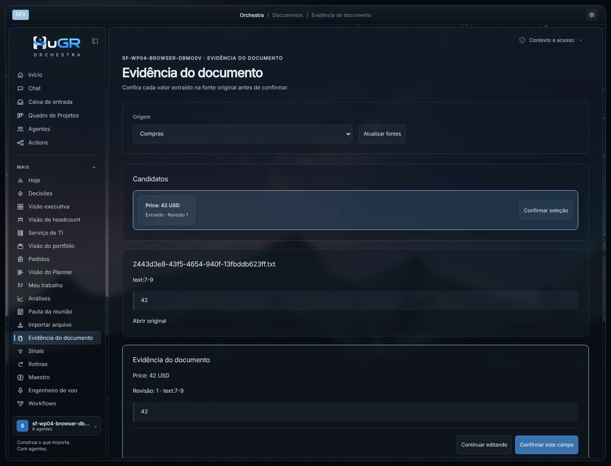
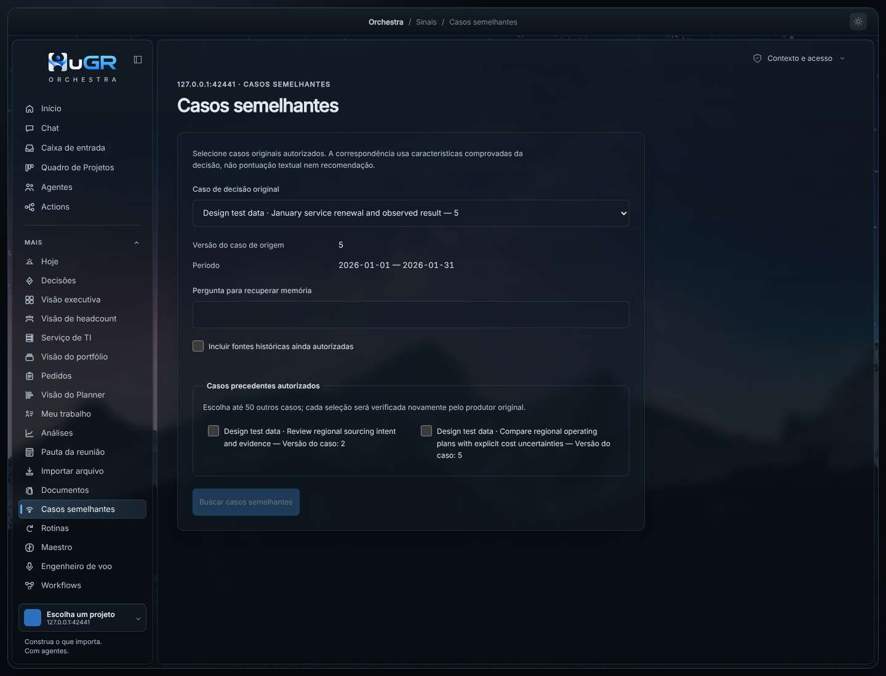
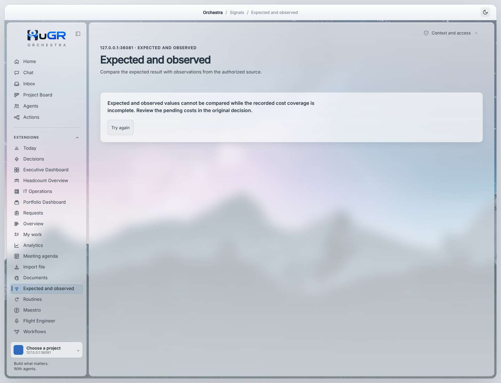
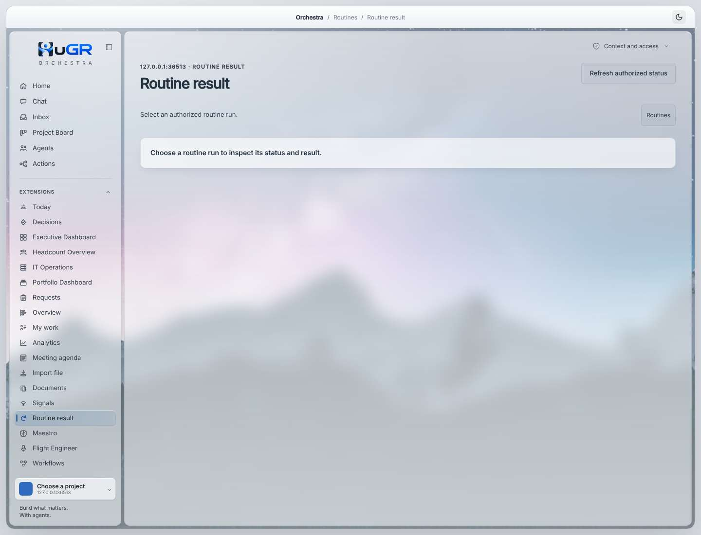
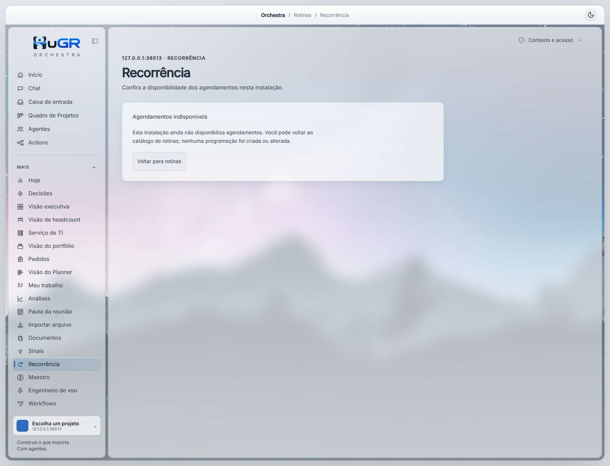
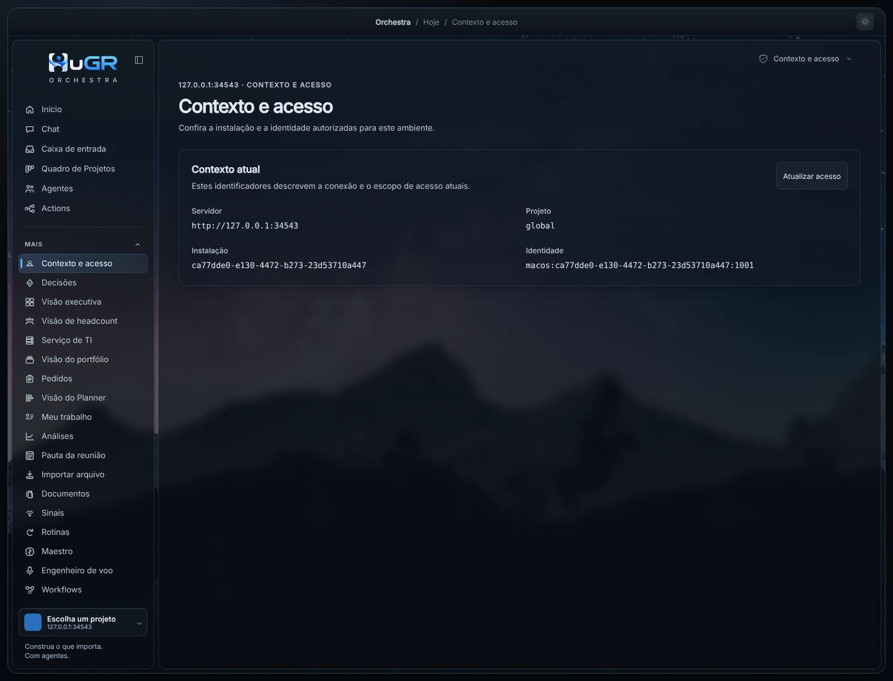
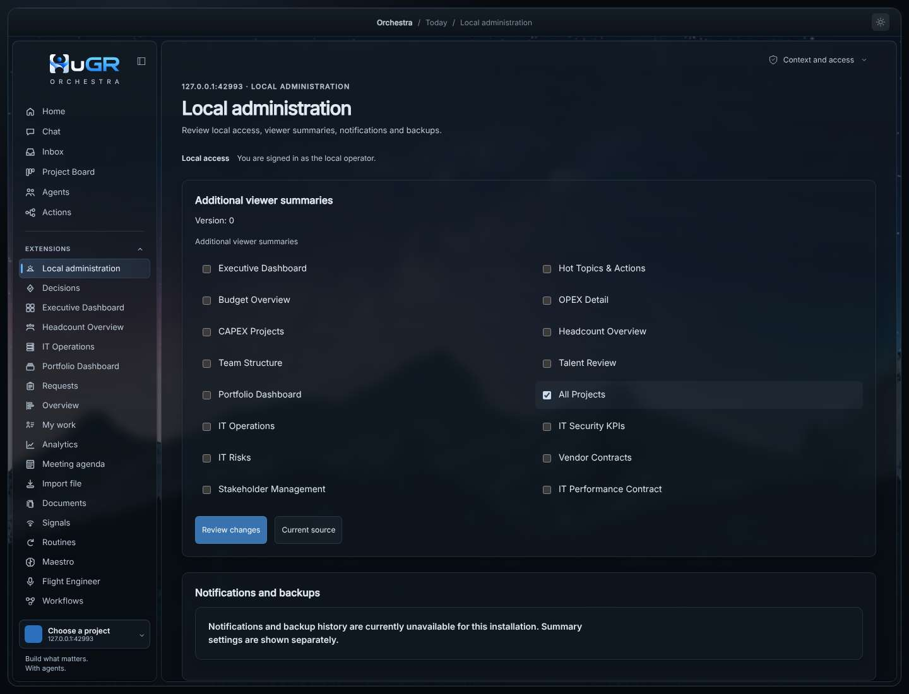

# Galeria visual — últimas 14 áreas Sucafina

Esta galeria reúne 24 imagens reais das 14 áreas UI57–UI70, capturadas no app-shell de produção pelo workflow Linux original `test-ci` e inspecionadas visualmente. Os limites funcionais de cada rodada estão identificados junto de cada estado. Uma imagem de estado não transforma uma jornada incompleta em aprovação.

A validação final permanece em andamento. Consulte o [relatório central](../VALIDATION.md) e o [manifesto com proveniência](./manifest.json).

| Área | Tela | Imagens selecionadas |
| --- | --- | --- |
| UI57 | Histórico, recibo e revisão de importação | 2 |
| UI58 | Documentos | 1 |
| UI59 | Evidências | 3 |
| UI60 | Documento em cenário | 2 |
| UI61 | Sinais de memória | 2 |
| UI62 | Casos semelhantes | 1 |
| UI63 | Resultados / Outcomes | 2 |
| UI64 | Rotinas | 1 |
| UI65 | Resultado da rotina | 1 |
| UI66 | Recorrência | 1 |
| UI67 | Contexto da instalação | 2 |
| UI68 | Exportações | 1 |
| UI69 | Administração local | 2 |
| UI70 | Contribuições / residentes | 3 |

## UI57 — Histórico, recibo e revisão de importação

### recovered-receipt-pt-br-desktop

1440×1100px. [Run 45107932060](https://github.com/gustavomhss/Orchestra-SF/actions/runs/45107932060), job `137473384578`, snapshot `91f3028e0a00f7f8a32b40dcfad845b8cb2d20da`.

Actual state reviewed; first3 original Operations journeys passed. Whole R10run3of4; separate positive UI60 is qualified by R12.

### changed-fields-original-values

1440×1100px. [Run 45107932060](https://github.com/gustavomhss/Orchestra-SF/actions/runs/45107932060), job `137473384578`, snapshot `91f3028e0a00f7f8a32b40dcfad845b8cb2d20da`.

Actual state reviewed; first3 original Operations journeys passed. Whole R10run3of4; separate positive UI60 is qualified by R12.

## UI58 — Documentos

### authorized-catalog-dark-desktop

1440×1100px. [Run 45107932060](https://github.com/gustavomhss/Orchestra-SF/actions/runs/45107932060), job `137473384578`, snapshot `91f3028e0a00f7f8a32b40dcfad845b8cb2d20da`.

Actual state reviewed; first3 original Operations journeys passed. Whole R10run3of4; separate positive UI60 is qualified by R12.

## UI59 — Evidências

### review-original-source-dark-desktop

1440×1100px. [Run 45107932060](https://github.com/gustavomhss/Orchestra-SF/actions/runs/45107932060), job `137473384578`, snapshot `91f3028e0a00f7f8a32b40dcfad845b8cb2d20da`.

Actual state reviewed; first3 original Operations journeys passed. Whole R10run3of4; separate positive UI60 is qualified by R12.

### review-original-source-light-narrow

320×900px. [Run 45107932060](https://github.com/gustavomhss/Orchestra-SF/actions/runs/45107932060), job `137473384578`, snapshot `91f3028e0a00f7f8a32b40dcfad845b8cb2d20da`.

Actual state reviewed; first3 original Operations journeys passed. Whole R10run3of4; separate positive UI60 is qualified by R12.

### review-original-source-pt-br-desktop

1440×1100px. [Run 45107932060](https://github.com/gustavomhss/Orchestra-SF/actions/runs/45107932060), job `137473384578`, snapshot `91f3028e0a00f7f8a32b40dcfad845b8cb2d20da`.

Actual state reviewed; first3 original Operations journeys passed. Whole R10run3of4; separate positive UI60 is qualified by R12.

## UI60 — Documento em cenário

### confirmed-source-restricted-simulation-dark-desktop

1440×1100px. [Run 45107932060](https://github.com/gustavomhss/Orchestra-SF/actions/runs/45107932060), job `137473384578`, snapshot `91f3028e0a00f7f8a32b40dcfad845b8cb2d20da`.

Actual state reviewed; first3 original Operations journeys passed. Whole R10run3of4; separate positive UI60 is qualified by R12. Restricted simulation; this frame is not a successful preview.

### preview-from-confirmed-evidence

1440×1100px. [Run 45112944681](https://github.com/gustavomhss/Orchestra-SF/actions/runs/45112944681), job `137489189400`, snapshot `1dbb95a44cf22eb1f8db5aa944b3e3da49ef5f74`.

Positive UI60 journey passed28original assertions. Whole RecordsR12run3of4.

## UI61 — Sinais de memória

### dark-desktop-recorded-condition

1440×1100px. [Run 45117078885](https://github.com/gustavomhss/Orchestra-SF/actions/runs/45117078885), job `137502251987`, snapshot `257717aa632d7f029ec27b4d3cb8b9a603bad0a6`.

Original conditions captured; materiality exceeded40s. Whole UI61 journey failed; no positive materiality or signal result qualified.

### light-320-recorded-condition

320×900px. [Run 45117078885](https://github.com/gustavomhss/Orchestra-SF/actions/runs/45117078885), job `137502251987`, snapshot `257717aa632d7f029ec27b4d3cb8b9a603bad0a6`.

Original conditions captured; materiality exceeded40s. Whole UI61 journey failed; no positive materiality or signal result qualified.

## UI62 — Casos semelhantes

### pt-br-dark-desktop-authorized-candidates

1440×1100px. [Run 45117078885](https://github.com/gustavomhss/Orchestra-SF/actions/runs/45117078885), job `137502251987`, snapshot `257717aa632d7f029ec27b4d3cb8b9a603bad0a6`.

Actual authorized candidates in pt-BR. Recall POST503; no successful recall result qualified.

## UI63 — Resultados / Outcomes

### light-desktop-incomplete-coverage

1440×1100px. [Run 45117078885](https://github.com/gustavomhss/Orchestra-SF/actions/runs/45117078885), job `137502251987`, snapshot `257717aa632d7f029ec27b4d3cb8b9a603bad0a6`.

Full area journey passed in R11. Whole run3of5.

### pt-br-dark-desktop-incomplete-coverage

1440×1100px. [Run 45117078885](https://github.com/gustavomhss/Orchestra-SF/actions/runs/45117078885), job `137502251987`, snapshot `257717aa632d7f029ec27b4d3cb8b9a603bad0a6`.

Full area journey passed in R11. Whole run3of5.

## UI64 — Rotinas

### pt-br-dark-360

360×900px. [Run 45115912342](https://github.com/gustavomhss/Orchestra-SF/actions/runs/45115912342), job `137498592745`, snapshot `15e29d2f1aa89ee0e289585b8b1957c79db3c1d7`.

Final R18run passed2of2journeys; original installed/denied states only.

## UI65 — Resultado da rotina

### en-light-desktop-no-run-return

1440×1100px. [Run 45115912342](https://github.com/gustavomhss/Orchestra-SF/actions/runs/45115912342), job `137498592745`, snapshot `15e29d2f1aa89ee0e289585b8b1957c79db3c1d7`.

Final R18run passed2of2journeys; original installed/denied states only.

## UI66 — Recorrência

### pt-br-light-desktop

1440×1100px. [Run 45115912342](https://github.com/gustavomhss/Orchestra-SF/actions/runs/45115912342), job `137498592745`, snapshot `15e29d2f1aa89ee0e289585b8b1957c79db3c1d7`.

Final R18run passed2of2journeys; original installed/denied states only.

## UI67 — Contexto da instalação

### light-desktop-refreshed-context

1440×1100px. [Run 45107929407](https://github.com/gustavomhss/Orchestra-SF/actions/runs/45107929407), job `137473376276`, snapshot `6798798e51f8c8ad844b5cd0c2463878dee48901`.

UI67 journey passed. Whole R9run1of5; other journeys not qualified by this state.

### pt-br-dark-desktop-current-context

1440×1100px. [Run 45117078885](https://github.com/gustavomhss/Orchestra-SF/actions/runs/45117078885), job `137502251987`, snapshot `257717aa632d7f029ec27b4d3cb8b9a603bad0a6`.

Full area journey passed in R11. Whole run3of5.

## UI68 — Exportações

### authorized-format-pt-br-desktop

1440×1100px. [Run 45107932060](https://github.com/gustavomhss/Orchestra-SF/actions/runs/45107932060), job `137473384578`, snapshot `91f3028e0a00f7f8a32b40dcfad845b8cb2d20da`.

Actual state reviewed; first3 original Operations journeys passed. Whole R10run3of4; separate positive UI60 is qualified by R12.

## UI69 — Administração local

### dark-desktop-summary-settings

1440×1100px. [Run 45112934520](https://github.com/gustavomhss/Orchestra-SF/actions/runs/45112934520), job `137489157834`, snapshot `ee44197dd7ce1d0ba83cd3bacb0b6ca71d7855b9`.

Actual desktop dark and320light review states only. Whole R10run0of5; these images do not qualify saved readback.

### light-320-summary-review-actions

320×900px. [Run 45112934520](https://github.com/gustavomhss/Orchestra-SF/actions/runs/45112934520), job `137489157834`, snapshot `ee44197dd7ce1d0ba83cd3bacb0b6ca71d7855b9`.

Actual desktop dark and320light review states only. Whole R10run0of5; these images do not qualify saved readback.

## UI70 — Contribuições / residentes

### en-light-desktop-resident-case-detail

1440×1100px. [Run 45115912342](https://github.com/gustavomhss/Orchestra-SF/actions/runs/45115912342), job `137498592745`, snapshot `15e29d2f1aa89ee0e289585b8b1957c79db3c1d7`.

Final R18run passed2of2journeys; original installed/denied states only.

### en-light-360-resident-case-detail

360×900px. [Run 45115912342](https://github.com/gustavomhss/Orchestra-SF/actions/runs/45115912342), job `137498592745`, snapshot `15e29d2f1aa89ee0e289585b8b1957c79db3c1d7`.

Final R18run passed2of2journeys; original installed/denied states only. Scrolled middle of the skill list. Wrapping and disclosures visible; case selector and human-decision panel outside frame.

### pt-br-dark-360-installed-state

360×900px. [Run 45115912342](https://github.com/gustavomhss/Orchestra-SF/actions/runs/45115912342), job `137498592745`, snapshot `15e29d2f1aa89ee0e289585b8b1957c79db3c1d7`.

Final R18run passed2of2journeys; original installed/denied states only.

## Limites da revisão

As imagens foram inspecionadas a partir dos bytes emitidos pelo CI e associadas aos blobs retornados pelo GitHub. Não houve releitura binária independente pelo conector textual. A revisão cobre o enquadramento visível, com estados selecionados claro/escuro, EN/pt-BR e larguras estreitas; não mede zoom real ou contraste numérico.
