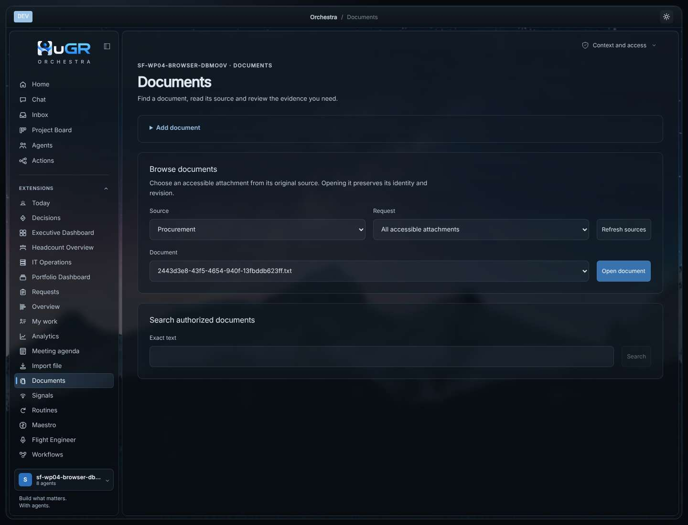
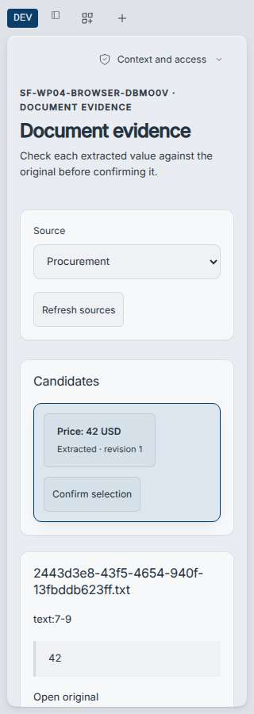
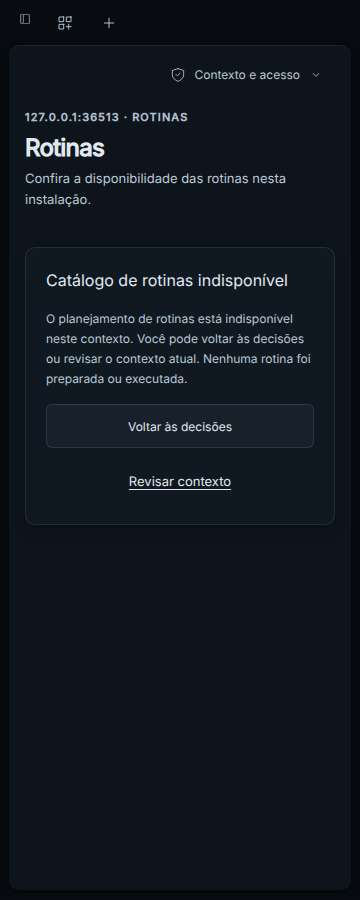
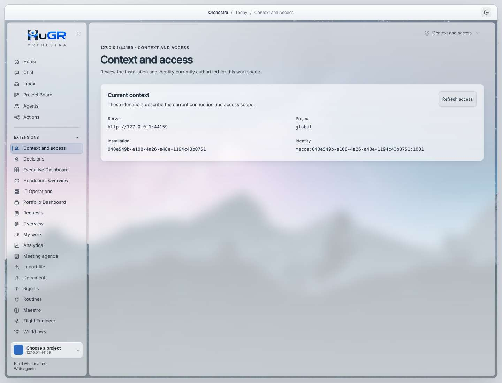
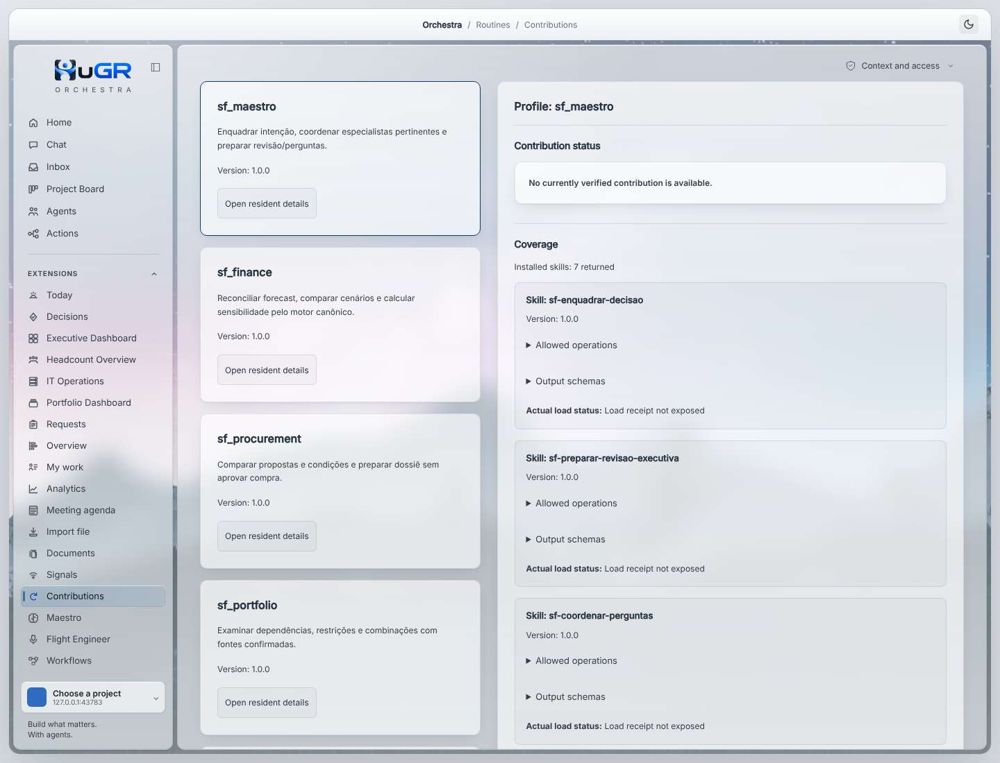
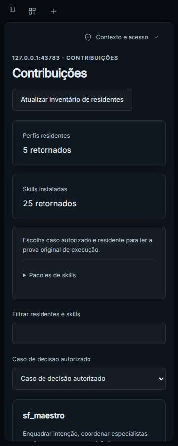

# Capturas reais — sexto lote Sucafina

Esta seleção reúne **18 JPEGs de 11 áreas**, emitidos pelo navegador no workflow original `test-ci`. A qualificação final das demais áreas está em andamento; o manifesto não antecipa seus resultados.

Cada imagem identifica o estado realmente capturado, a execução e o snapshot. Captura aprovada não transforma uma execução inteira com falha em sucesso. A [validação](../VALIDATION.md) e os relatórios por grupo delimitam as operações exercitadas. O [manifesto](manifest.json) conserva dimensões, bytes, origem e SHA de cada blob.

UI64 e UI66 mostram apresentações contextuais com F01 negado e folha ausente. A prévia positiva de UI60 conserva subtotal42USD, total indisponível e nenhuma alteração de domínio. O recorte UI70 light360 mostra a região rolada de skills; não mostra o seletor de caso nem o painel humano.

## UI57 — Histórico, recibo e revisão de importação

### recovered-receipt-pt-br-desktop

1440×1100px. [Run 45107932060](https://github.com/gustavomhss/Orchestra-SF/actions/runs/45107932060), job `137473384578`, snapshot `91f3028e0a00f7f8a32b40dcfad845b8cb2d20da`.

Actual state reviewed; first 3 original Operations journeys passed. Whole R10 run3 of4; separate positive UI60 is qualified by R12.

### changed-fields-original-values

1440×1100px. [Run 45107932060](https://github.com/gustavomhss/Orchestra-SF/actions/runs/45107932060), job `137473384578`, snapshot `91f3028e0a00f7f8a32b40dcfad845b8cb2d20da`.

Actual state reviewed; first 3 original Operations journeys passed. Whole R10 run3 of4; separate positive UI60 is qualified by R12.

## UI58 — Documentos

### authorized-catalog-dark-desktop

1440×1100px. [Run 45107932060](https://github.com/gustavomhss/Orchestra-SF/actions/runs/45107932060), job `137473384578`, snapshot `91f3028e0a00f7f8a32b40dcfad845b8cb2d20da`.

Actual state reviewed; first 3 original Operations journeys passed. Whole R10 run3 of4; separate positive UI60 is qualified by R12.

## UI59 — Evidências de documentos

### review-original-source-dark-desktop

1440×1100px. [Run 45107932060](https://github.com/gustavomhss/Orchestra-SF/actions/runs/45107932060), job `137473384578`, snapshot `91f3028e0a00f7f8a32b40dcfad845b8cb2d20da`.

Actual state reviewed; first 3 original Operations journeys passed. Whole R10 run3 of4; separate positive UI60 is qualified by R12.

### review-original-source-light-narrow

320×900px. [Run 45107932060](https://github.com/gustavomhss/Orchestra-SF/actions/runs/45107932060), job `137473384578`, snapshot `91f3028e0a00f7f8a32b40dcfad845b8cb2d20da`.

Actual state reviewed; first 3 original Operations journeys passed. Whole R10 run3 of4; separate positive UI60 is qualified by R12.

### review-original-source-pt-br-desktop

1440×1100px. [Run 45107932060](https://github.com/gustavomhss/Orchestra-SF/actions/runs/45107932060), job `137473384578`, snapshot `91f3028e0a00f7f8a32b40dcfad845b8cb2d20da`.

Actual state reviewed; first 3 original Operations journeys passed. Whole R10 run3 of4; separate positive UI60 is qualified by R12.

## UI60 — Cenários de documentos

### confirmed-source-restricted-simulation-dark-desktop

1440×1100px. [Run 45107932060](https://github.com/gustavomhss/Orchestra-SF/actions/runs/45107932060), job `137473384578`, snapshot `91f3028e0a00f7f8a32b40dcfad845b8cb2d20da`.

Actual state reviewed; first 3 original Operations journeys passed. Whole R10 run3 of4; separate positive UI60 is qualified by R12. Restricted simulation; this frame is not a successful preview.

### preview-from-confirmed-evidence

1440×1100px. [Run 45112944681](https://github.com/gustavomhss/Orchestra-SF/actions/runs/45112944681), job `137489189400`, snapshot `1dbb95a44cf22eb1f8db5aa944b3e3da49ef5f74`.

Positive UI60 journey passed 28 original assertions. Whole RecordsR12run3 of4.

## UI64 — Catálogo de rotinas

### pt-br-dark-360

360×900px. [Run 45115912342](https://github.com/gustavomhss/Orchestra-SF/actions/runs/45115912342), job `137498592745`, snapshot `15e29d2f1aa89ee0e289585b8b1957c79db3c1d7`.

Final R18 run passed 2 of2 journeys; original installed/denied states only.

## UI65 — Execuções de rotinas

### en-light-desktop-no-run-return

1440×1100px. [Run 45115912342](https://github.com/gustavomhss/Orchestra-SF/actions/runs/45115912342), job `137498592745`, snapshot `15e29d2f1aa89ee0e289585b8b1957c79db3c1d7`.

Final R18 run passed 2 of2 journeys; original installed/denied states only.

## UI66 — Agendamentos

### pt-br-light-desktop

1440×1100px. [Run 45115912342](https://github.com/gustavomhss/Orchestra-SF/actions/runs/45115912342), job `137498592745`, snapshot `15e29d2f1aa89ee0e289585b8b1957c79db3c1d7`.

Final R18 run passed 2 of2 journeys; original installed/denied states only.

## UI67 — Contexto da instalação

### light-desktop-refreshed-context

1440×1100px. [Run 45107929407](https://github.com/gustavomhss/Orchestra-SF/actions/runs/45107929407), job `137473376276`, snapshot `6798798e51f8c8ad844b5cd0c2463878dee48901`.

UI67 journey passed. Whole R9 run1 of5; other journeys not qualified by this state.

## UI68 — Exportações e arquivos

### authorized-format-pt-br-desktop

1440×1100px. [Run 45107932060](https://github.com/gustavomhss/Orchestra-SF/actions/runs/45107932060), job `137473384578`, snapshot `91f3028e0a00f7f8a32b40dcfad845b8cb2d20da`.

Actual state reviewed; first 3 original Operations journeys passed. Whole R10 run3 of4; separate positive UI60 is qualified by R12.

## UI69 — Administração local

### dark-desktop-summary-settings

1440×1100px. [Run 45112934520](https://github.com/gustavomhss/Orchestra-SF/actions/runs/45112934520), job `137489157834`, snapshot `ee44197dd7ce1d0ba83cd3bacb0b6ca71d7855b9`.

Actual desktop dark and320 light review states only. Whole R10 run0 of5; these images do not qualify saved readback.

### light-320-summary-review-actions

320×900px. [Run 45112934520](https://github.com/gustavomhss/Orchestra-SF/actions/runs/45112934520), job `137489157834`, snapshot `ee44197dd7ce1d0ba83cd3bacb0b6ca71d7855b9`.

Actual desktop dark and320 light review states only. Whole R10 run0 of5; these images do not qualify saved readback.

## UI70 — Residentes

### en-light-desktop-resident-case-detail

1440×1100px. [Run 45115912342](https://github.com/gustavomhss/Orchestra-SF/actions/runs/45115912342), job `137498592745`, snapshot `15e29d2f1aa89ee0e289585b8b1957c79db3c1d7`.

Final R18 run passed 2 of2 journeys; original installed/denied states only.

### en-light-360-resident-case-detail

360×900px. [Run 45115912342](https://github.com/gustavomhss/Orchestra-SF/actions/runs/45115912342), job `137498592745`, snapshot `15e29d2f1aa89ee0e289585b8b1957c79db3c1d7`.

Final R18 run passed 2 of2 journeys; original installed/denied states only. Scrolled middle of the skill list. Wrapping and disclosures visible; case selector and human-decision panel outside frame.

### pt-br-dark-360-installed-state

360×900px. [Run 45115912342](https://github.com/gustavomhss/Orchestra-SF/actions/runs/45115912342), job `137498592745`, snapshot `15e29d2f1aa89ee0e289585b8b1957c79db3c1d7`.

Final R18 run passed 2 of2 journeys; original installed/denied states only.

## Limites da revisão

As imagens foram inspecionadas a partir dos bytes emitidos pelo CI e associadas aos blobs retornados pelo GitHub. Não houve releitura binária independente pelo conector textual. A revisão cobre o enquadramento visível, com estados selecionados claro/escuro, EN/pt-BR e larguras estreitas; não mede zoom real ou contraste numérico.
