# R11 visual evidence

These are the unchanged JPEG previews emitted by the original browser run [45117078885](https://github.com/gustavomhss/Orchestra-SF/actions/runs/45117078885), candidate `cb924bd6cda9bb1fd2ac304618d3a8760b80d94e`. The full-page PNGs remain in Playwright artifact `14792609948`. The [manifest](./evidence/manifest.json) records exact image blobs, dimensions and qualification boundaries. The run passed UI63, UI67 and UI69; UI61 and UI62 retain the limits stated below.

## UI61

The original condition step passed. Materiality timed out later; these images do not qualify materiality or a signal response.

### dark-desktop-recorded-condition

1440 × 1100 pixels; original log preview, 75,829 bytes. Source job `137502251987`.

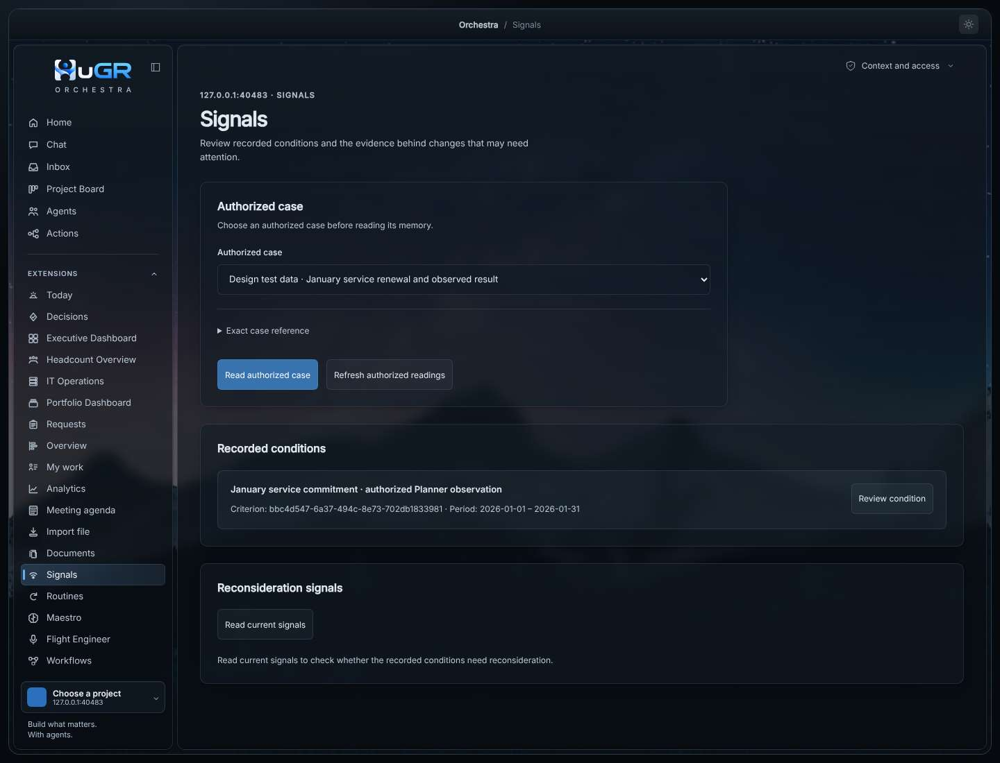

### light-desktop-recorded-condition

1440 × 1100 pixels; original log preview, 79,757 bytes. Source job `137502251987`.

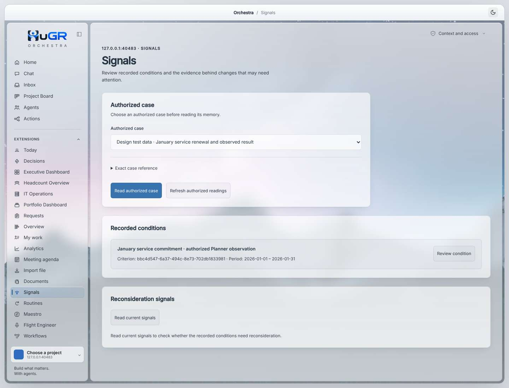

### light-320-recorded-condition

320 × 900 pixels; original log preview, 26,525 bytes. Source job `137502251987`.

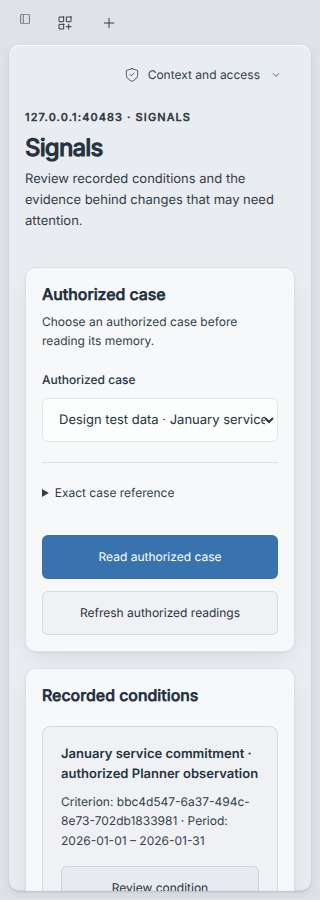

## UI62

Authorized candidates in Brazilian Portuguese passed. The original recall returned 503; this is not a qualified recall result.

### pt-br-dark-desktop-authorized-candidates

1440 × 1100 pixels; original log preview, 76,393 bytes. Source job `137502251987`.

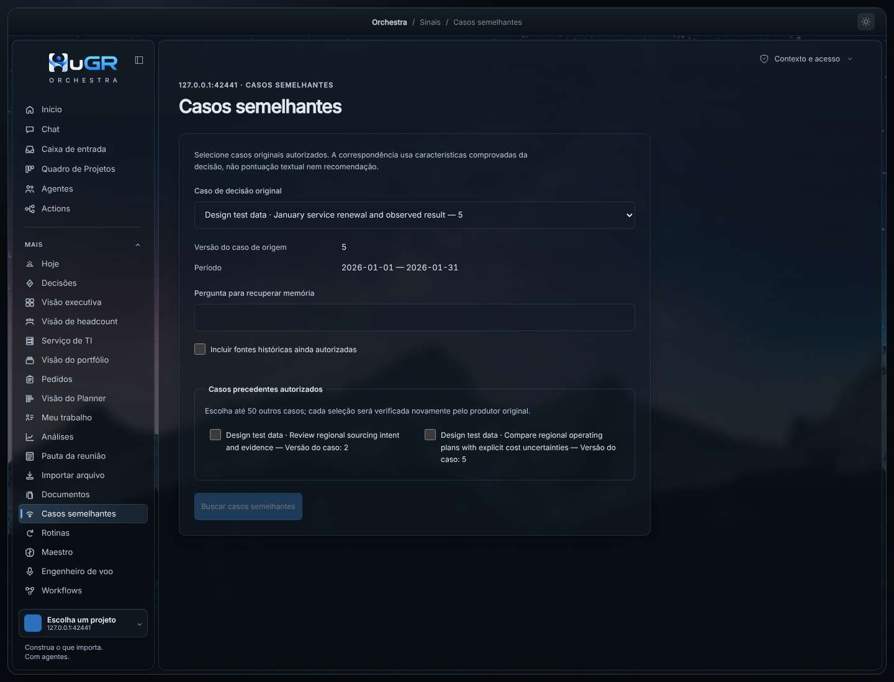

## UI63

The entire journey passed with the exact original incomplete-coverage refusal and a recorded choice without a signal condition. No numerical comparison is claimed.

### dark-desktop-recorded-choice-no-condition

1440 × 1100 pixels; original log preview, 86,163 bytes. Source job `137502251987`.

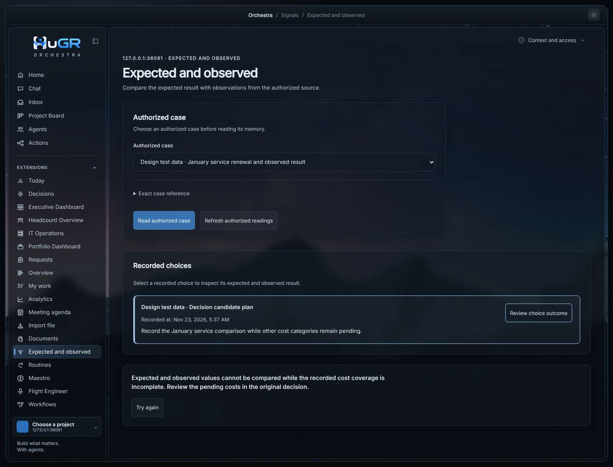

### light-desktop-incomplete-coverage

1440 × 1100 pixels; original log preview, 64,178 bytes. Source job `137502251987`.

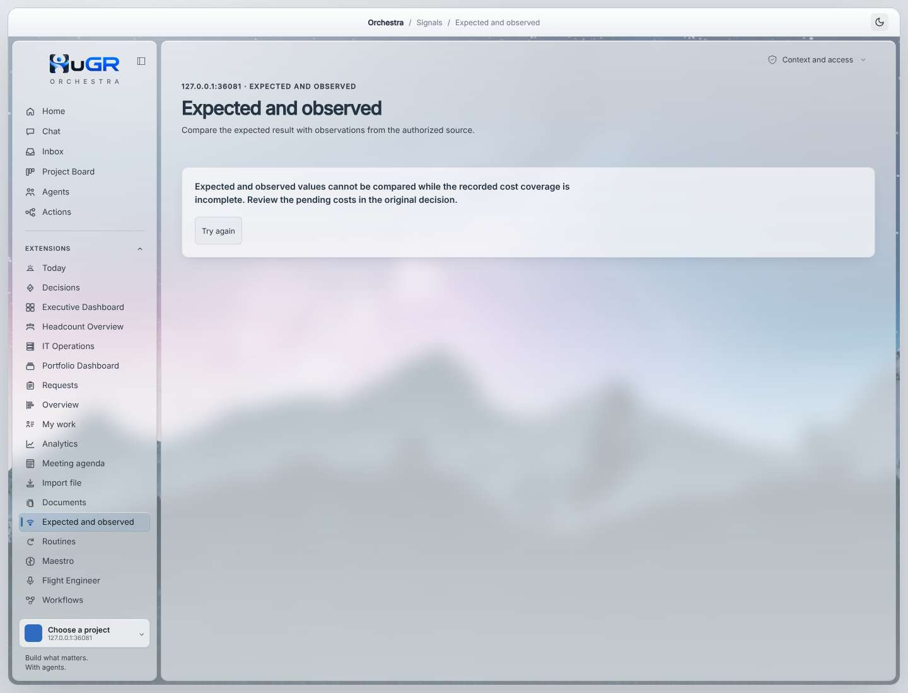

### light-320-incomplete-coverage

320 × 900 pixels; original log preview, 19,407 bytes. Source job `137502251987`.

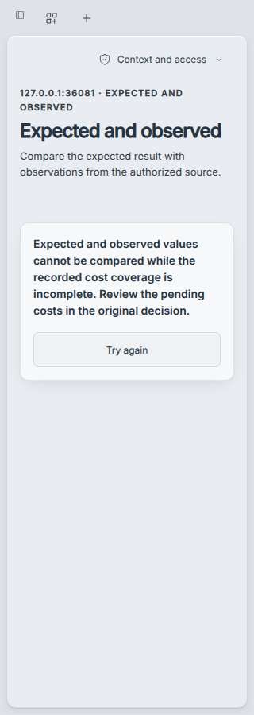

### pt-br-dark-desktop-incomplete-coverage

1440 × 1100 pixels; original log preview, 62,107 bytes. Source job `137502251987`.

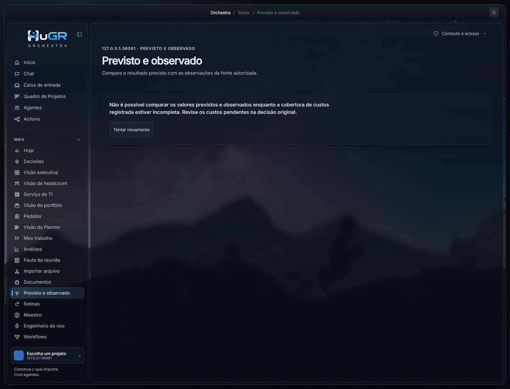

## UI67

The entire journey passed, including the original context refresh and Brazilian Portuguese.

### dark-desktop-current-context

1440 × 1100 pixels; original log preview, 63,870 bytes. Source job `137502251987`.

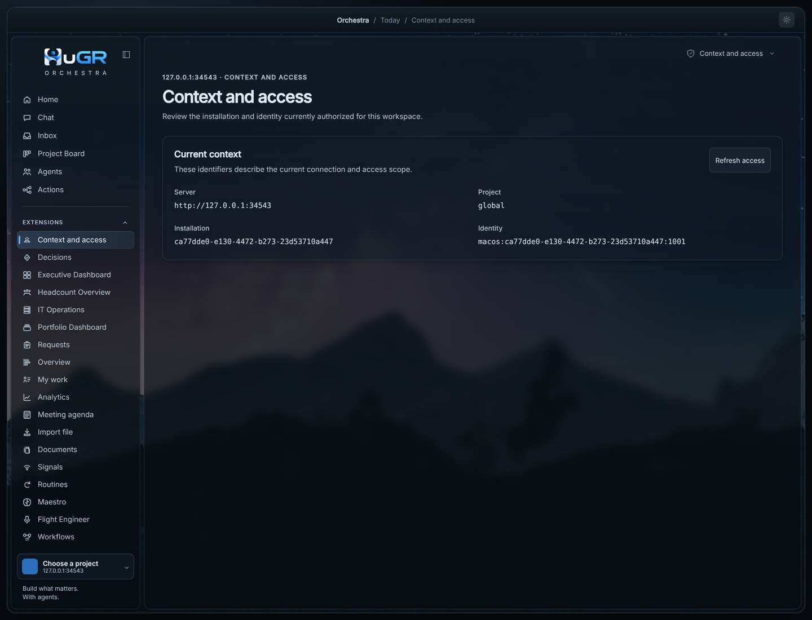

### light-desktop-refreshed-context

1440 × 1100 pixels; original log preview, 67,707 bytes. Source job `137502251987`.

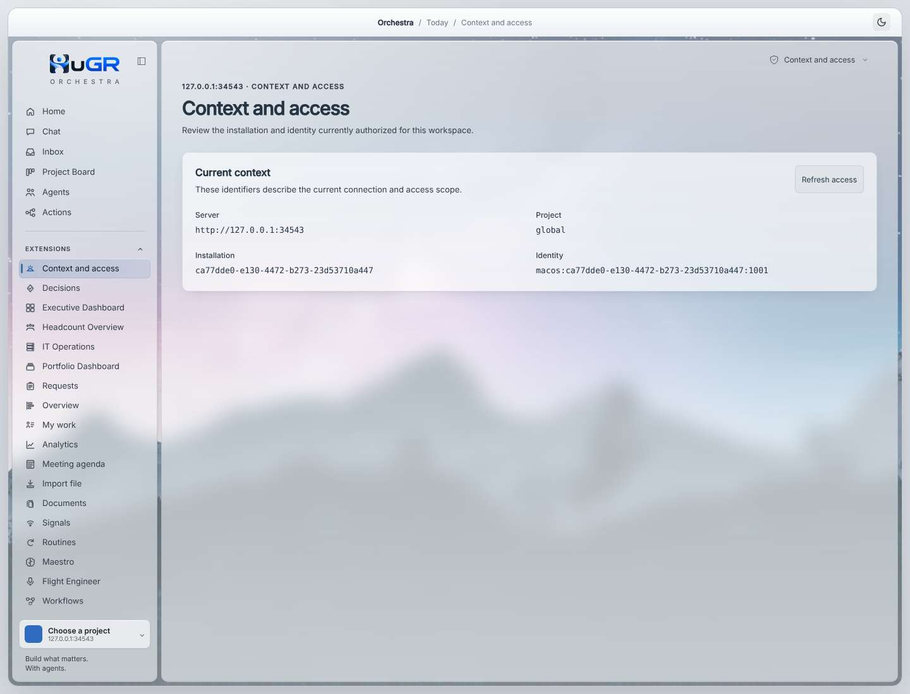

### pt-br-dark-desktop-current-context

1440 × 1100 pixels; original log preview, 64,554 bytes. Source job `137502251987`.

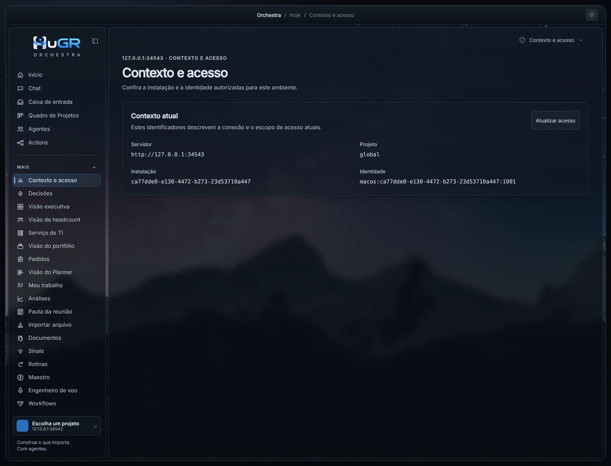

## UI69

The entire journey passed, including one reviewed save, exact CAS and persisted readback. These images precede PR715's additional summary spacing.

### dark-desktop-summary-settings

1440 × 1100 pixels; original log preview, 80,806 bytes. Source job `137502251987`.

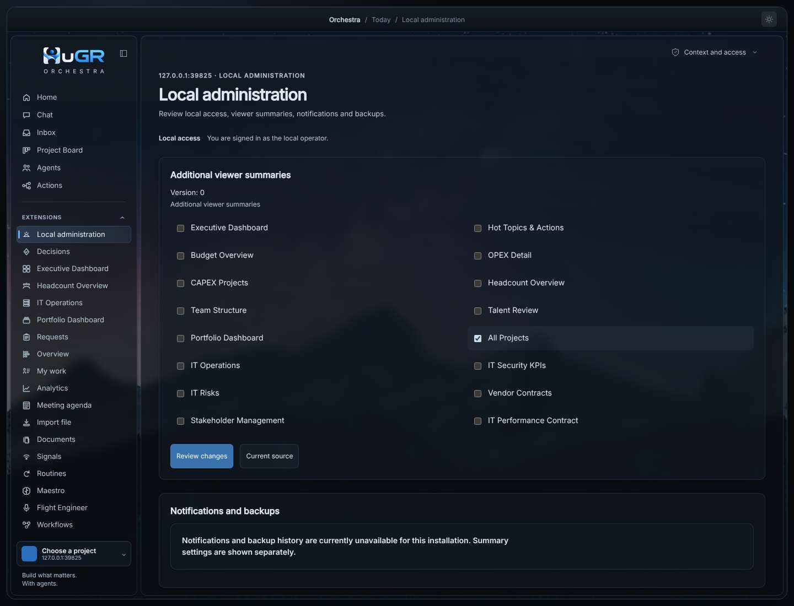

### light-320-summary-review-actions

320 × 900 pixels; original log preview, 23,181 bytes. Source job `137502251987`.

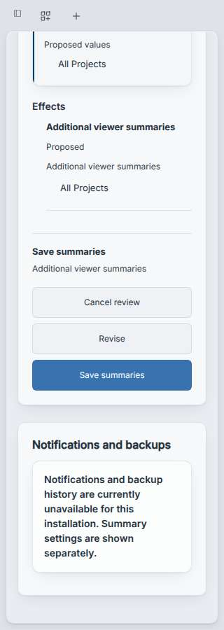

### pt-br-dark-desktop-administration

1440 × 1100 pixels; original log preview, 84,293 bytes. Source job `137502251987`.

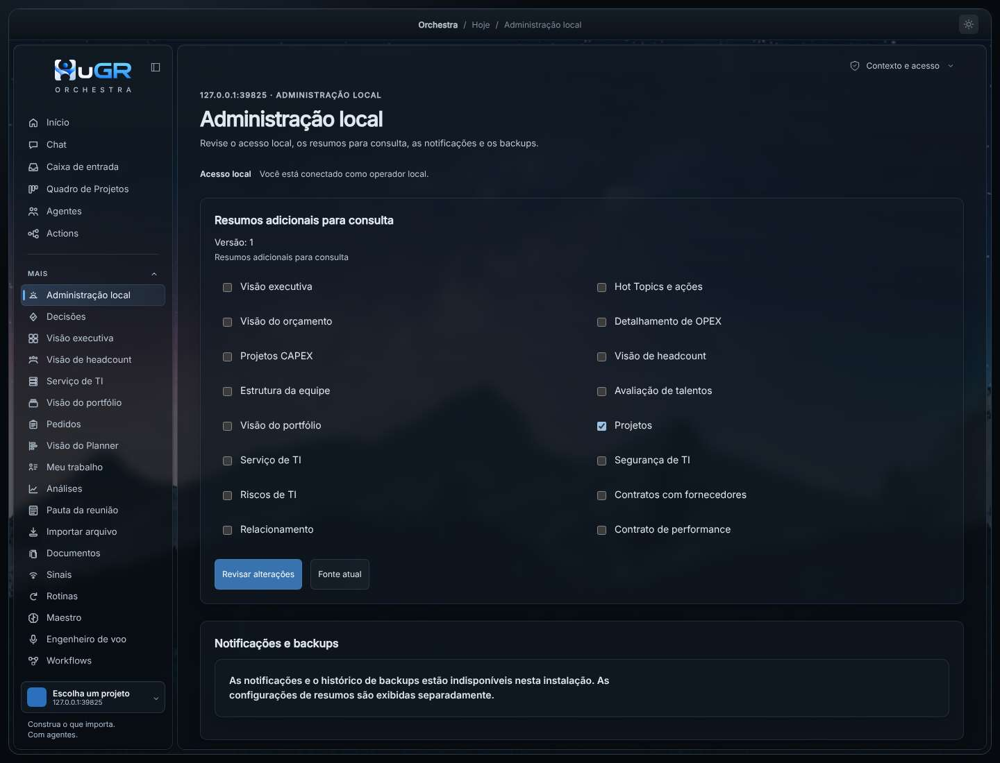

