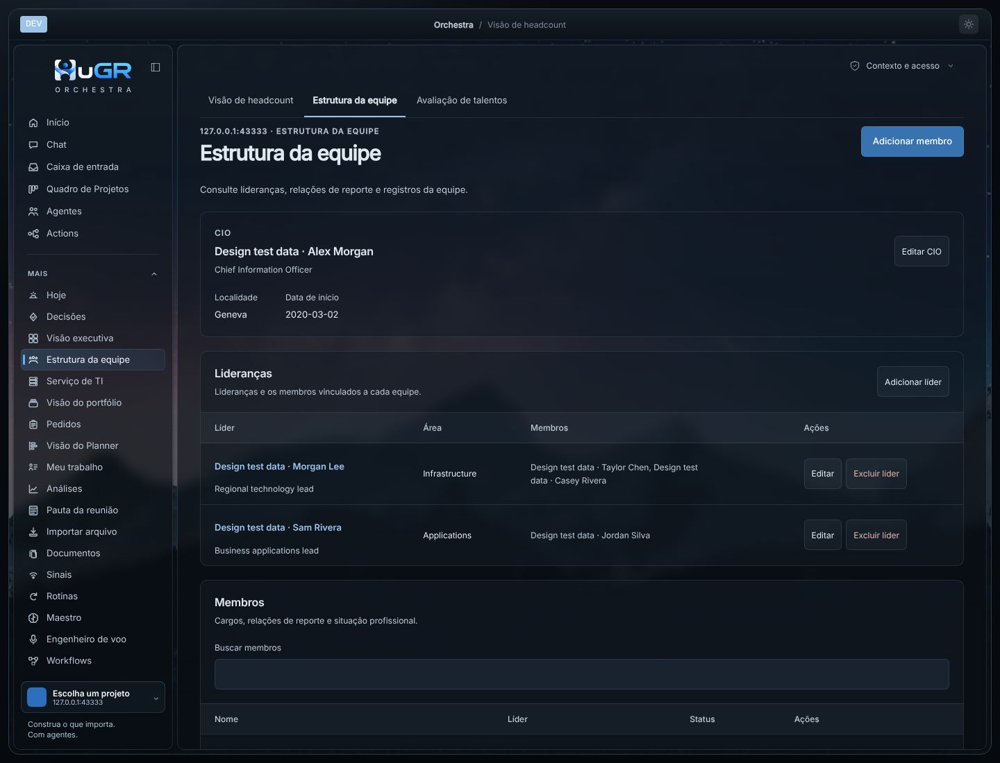
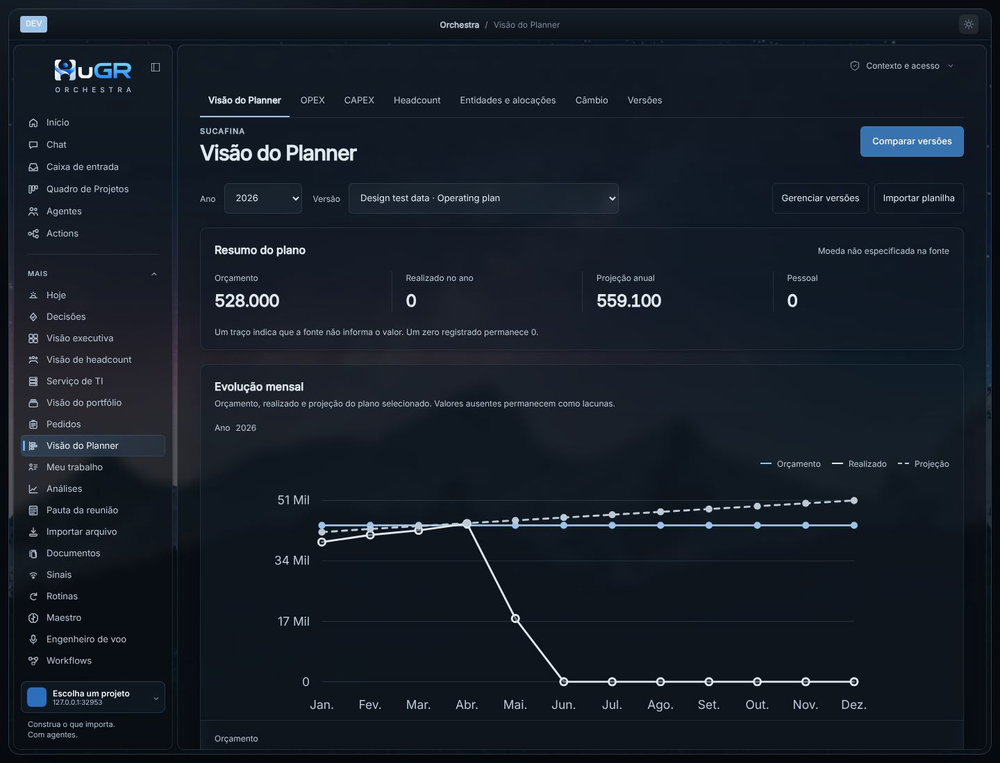
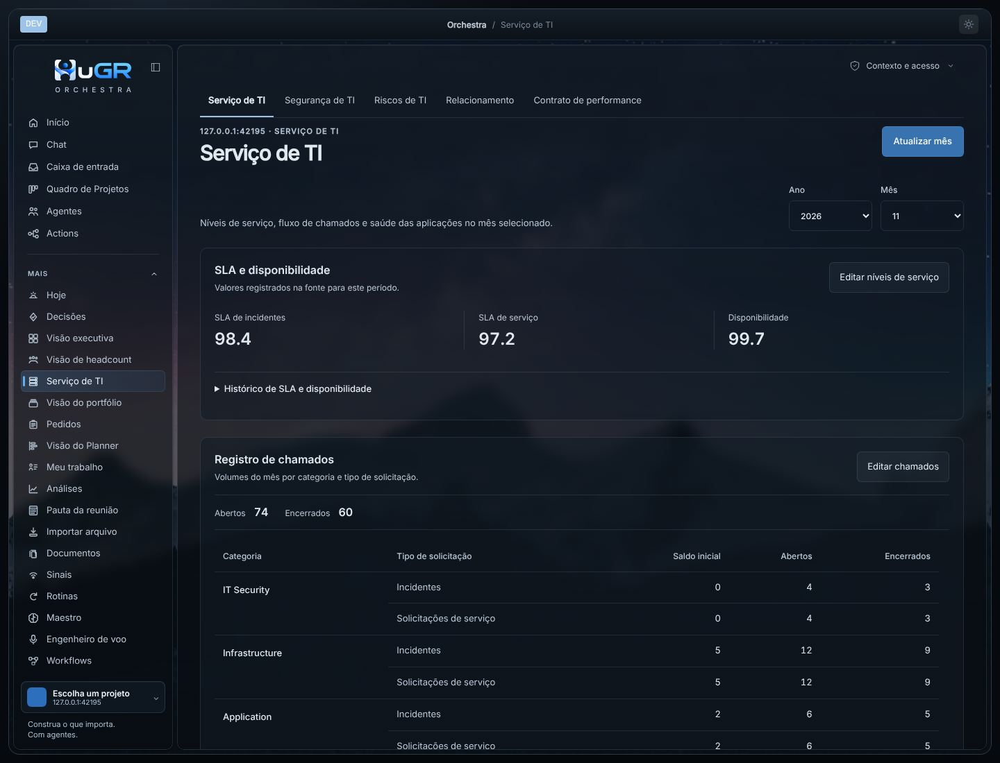

# Sucafina nativa — galeria do bloco de 15 áreas

**15 áreas retrabalhadas · 88 estados funcionais exercitados · 79 estados fotografados · 177 capturas reais.**

Produto: `e378923d7619c168b2d7b2c82b1232449eca2c45`, branch [sf-design-fifteen](https://github.com/gustavomhss/Orchestra-SF/tree/sf-design-fifteen), originada diretamente de `dev acc0181508ceda7416bce57284b2307a9b20385b`. [PR #587](https://github.com/gustavomhss/Orchestra-SF/pull/587). A revisão visual do usuário está pendente; estas quinze áreas ainda não foram mescladas.

As imagens mostram a aplicação nativa do Orchestra com dados identificados de teste, criados por produtores reais em instalações isoladas. Tema, idioma, largura e posição de rolagem são variantes da mesma área. Nove estados de Finanças foram exercitados sem captura própria; estão identificados no [mapa](../scope.json) e na [validação](../VALIDATION.md).

## Pessoas e portfólio

Estrutura, lideranças e membros passam a ter uma hierarquia de leitura clara; detalhe, edição e confirmação usam etapas próprias. Os formulários de pessoas, talentos, projetos e marcos seguem a mesma composição nativa.

[Ver as 58 capturas de Pessoas e Portfólio](people/README.md)

## Finanças e Planner

CAPEX, contratos e planejamento têm listas e detalhes organizados por assunto. O Planner reúne versão, resumo e série mensal; as grades preservam os meses, os valores da fonte e a navegação por teclado.

[Ver as 47 capturas de Finanças e Planner](finance/README.md)

## Operações

Serviço/SLA, Segurança, Riscos, Stakeholders e Performance receberam listas, indicadores, detalhes, formulários e revisões com alinhamento e espaçamento consistentes. A confirmação e a volta ao registro foram verificadas com gravações reais e releitura.

[Ver as 72 capturas de Operações](operations/README.md)

## Índice das quinze áreas

| Área | Entrega | Estados funcionais | Estados fotografados | Imagens | Galeria |
| --- | --- | ---: | ---: | ---: | --- |
| CAP05 | CAPEX — realizado e previsão | 10 | 7 | 11 | [finance](finance/README.md) |
| CAP06 | Pessoas — visão geral | 1 | 1 | 5 | [people](people/README.md) |
| CAP07 | Estrutura e membros | 10 | 10 | 16 | [people](people/README.md) |
| CAP08 | Talentos | 6 | 6 | 15 | [people](people/README.md) |
| CAP09 | Portfólio — visão geral | 1 | 1 | 5 | [people](people/README.md) |
| CAP10 | Projetos | 10 | 10 | 17 | [people](people/README.md) |
| CAP11 | Serviço e SLA | 7 | 7 | 16 | [operations](operations/README.md) |
| CAP12 | Segurança | 4 | 4 | 16 | [operations](operations/README.md) |
| CAP13 | Riscos | 5 | 5 | 13 | [operations](operations/README.md) |
| CAP14 | Contratos | 7 | 6 | 10 | [finance](finance/README.md) |
| CAP15 | Stakeholders | 4 | 4 | 11 | [operations](operations/README.md) |
| CAP16 | Desempenho operacional | 5 | 5 | 16 | [operations](operations/README.md) |
| CAP17 | Planner — visão geral | 1 | 1 | 5 | [finance](finance/README.md) |
| CAP18 | Planner OPEX | 10 | 7 | 11 | [finance](finance/README.md) |
| CAP19 | Planner CAPEX | 7 | 5 | 10 | [finance](finance/README.md) |

## Evidência e limites

- As cinco jornadas agrupadas passaram, com **11 gravações confirmadas e releitura da fonte**. Nenhuma exclusão foi executada; suas revisões foram canceladas.
- As seis áreas anteriores passaram novamente na regressão depois dos ajustes compartilhados. Suas 67 capturas são evidência histórica e não entram nas 177 deste bloco.
- A matriz contém inglês em claro/escuro, português no tema escuro, desktop de 1440px e reflow de 320px ou 390px conforme o grupo. Zoom real e outros navegadores não foram qualificados.
- Importação/exportação de talentos indisponíveis na instalação são mostradas como indisponíveis. Valores ausentes continuam distintos de zero.
- Os JPEGs desta galeria são permanentes no repositório. Artefatos completos do Playwright, respectivos prazos e digests estão nos manifestos de cada grupo.

O [manifesto consolidado](manifest.json) liga cada grupo ao seu mapa de estados, runs e arquivos. Os [relatórios dos agentes](../VALIDATION.md) registram os testes, os reparos encontrados e os limites. A aprovação de design pertence à revisão do usuário.
