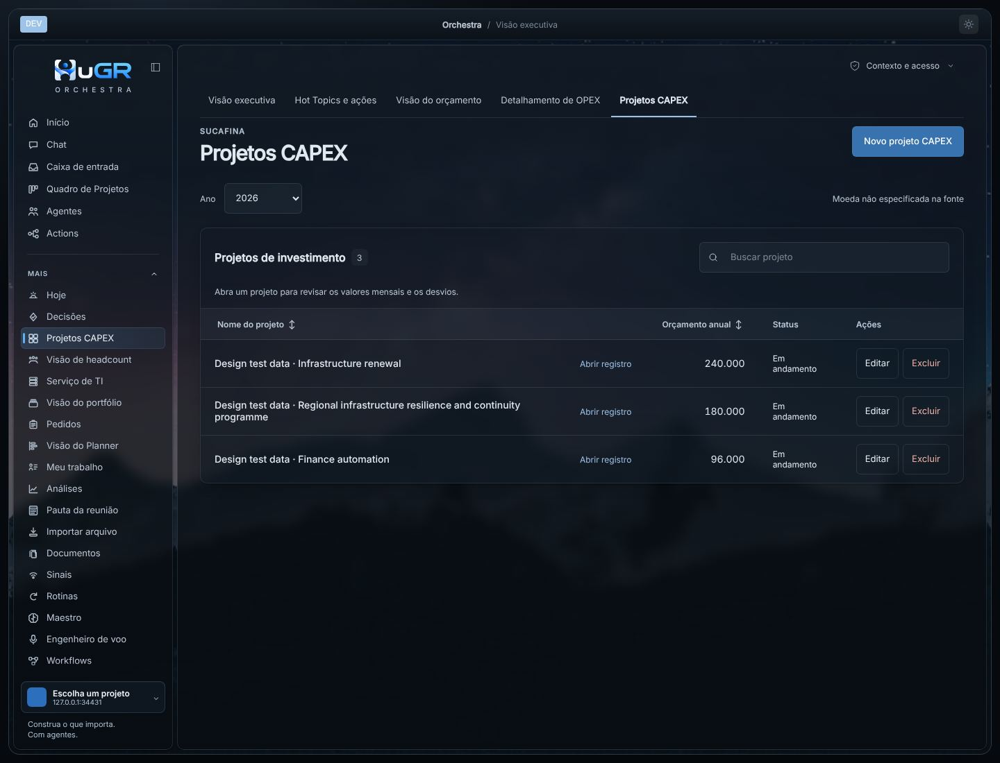
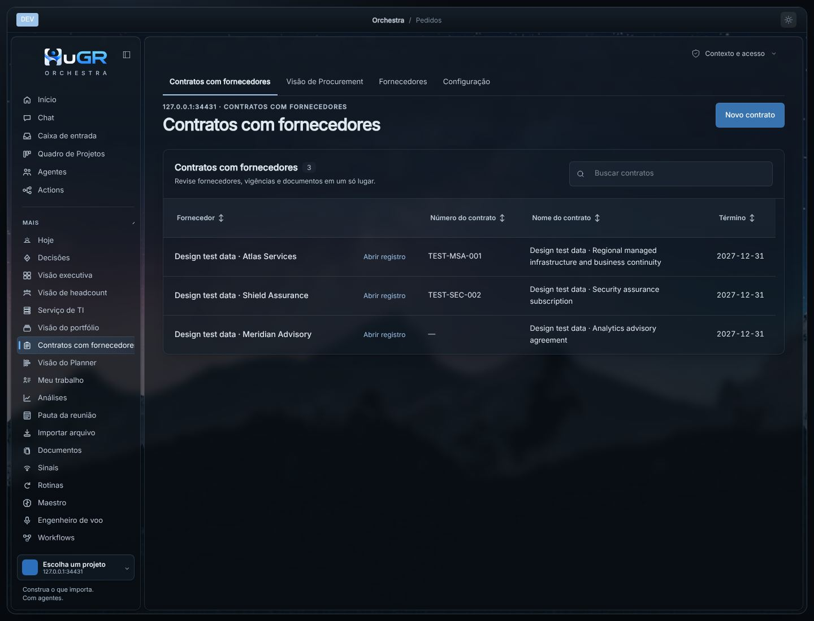
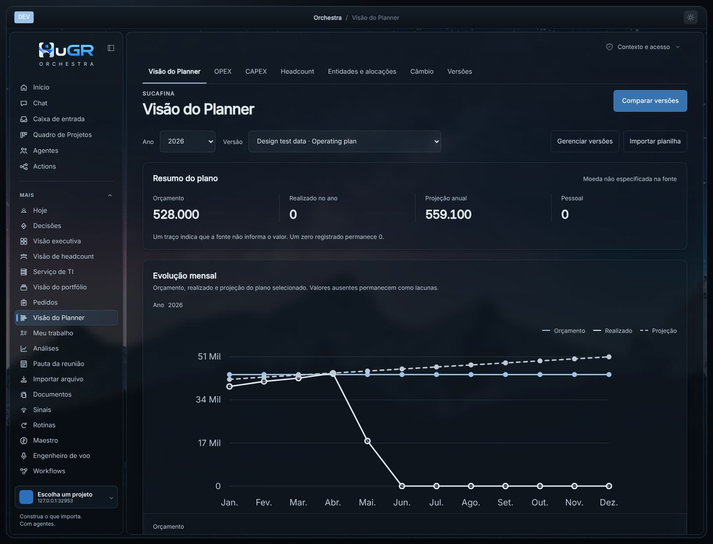
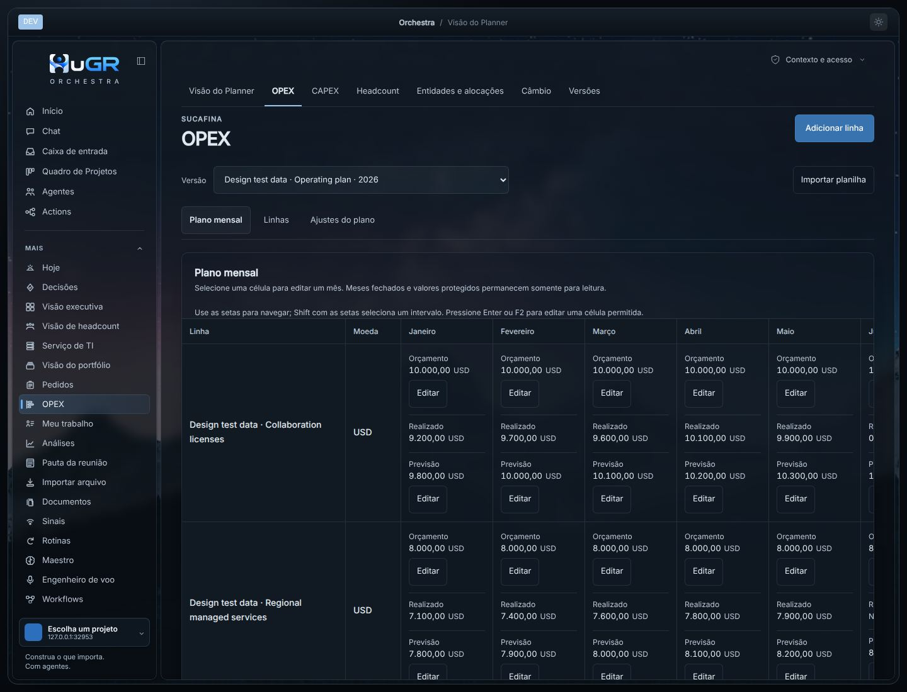
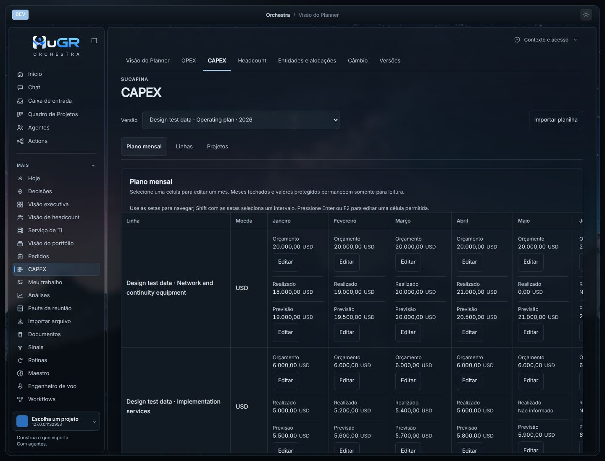

# Financeiro e Planner — galeria da terceira rodada

**5 áreas · 35 estados funcionais exercitados · 26 estados com imagem própria · 47 capturas reais.** As outras 21 imagens são variantes dos mesmos estados. Nove estados foram exercitados sem captura dedicada; não são apresentados como revisão visual. A aprovação visual do usuário permanece pendente.

As imagens mostram a aplicação nativa, instalada de forma isolada e preenchida pelos produtores canônicos com dados de teste. [Jornada aprovada: 2 testes, 3,6 minutos](https://github.com/gustavomhss/Orchestra-SF/actions/runs/44947193512). Os quatro contextos encerraram sem erros de console ou de página. Foram confirmadas três gravações: CAP05 forecast mensal, CAP14 prazo/notas e CAP19 descrição com nova entrada e releitura. A prévia de colagem CAP18 foi cancelada sem aplicar.

[Relatório completo](../../finance/REVIEW.md) · [Manifesto de imagens e proveniência](manifest.json) · [PNGs canônicos do navegador](https://github.com/gustavomhss/Orchestra-SF/actions/runs/44947193512/artifacts/14723703101)

Os JPEGs desta pasta são persistentes. O artefato de PNGs expira em 28/11/2026 conforme a retenção do Actions. Reflow em 320 CSS px não é uma medição de zoom real. A projeção CAP19 não fornece aprovação e datas de investimento; as imagens preservam essa ausência. Contratos usa a normalização do produtor para montantes ausentes; não se afirma preservação de null de ponta a ponta.

## Áreas

| Área | Estados funcionais | Estados com imagem própria | Capturas |
| --- | ---: | ---: | ---: |
| CAP05 — CAPEX — realizado e previsão | 10 | 7 | 11 |
| CAP14 — Contratos | 7 | 6 | 10 |
| CAP17 — Planner — visão geral | 1 | 1 | 5 |
| CAP18 — Planner OPEX | 10 | 7 | 11 |
| CAP19 — Planner CAPEX | 7 | 5 | 10 |

### CAP05 — CAPEX — realizado e previsão

### CAP14 — Contratos

### CAP17 — Planner — visão geral

### CAP18 — Planner OPEX

### CAP19 — Planner CAPEX

## Estados de trabalho

| Área | Estado | Captura principal | Variantes |
| --- | --- | --- | ---: |
| CAP05 | Lista de projetos | [Abrir imagem](CAP05-dark-desktop-list-test-data.jpg) | 3 |
| CAP05 | Detalhe com doze meses | [Abrir imagem](CAP05-dark-desktop-twelve-months-test-data.jpg) | 1 |
| CAP05 | Editor anual | Exercitado; sem captura dedicada | 0 |
| CAP05 | Revisão anual | [Abrir imagem](CAP05-dark-desktop-annual-review-test-data.jpg) | 0 |
| CAP05 | Editor de desvio | Exercitado; sem captura dedicada | 0 |
| CAP05 | Revisão de desvio | [Abrir imagem](CAP05-dark-desktop-deviation-review-test-data.jpg) | 0 |
| CAP05 | Editor mensal | [Abrir imagem](CAP05-dark-desktop-month-editor-test-data.jpg) | 0 |
| CAP05 | Revisão mensal | [Abrir imagem](CAP05-dark-320-month-review-actions-test-data.jpg) | 0 |
| CAP05 | Criação de projeto | [Abrir imagem](CAP05-dark-desktop-create-test-data.jpg) | 0 |
| CAP05 | Revisão da criação de projeto | Exercitado; sem captura dedicada | 0 |
| CAP14 | Lista de contratos | [Abrir imagem](CAP14-dark-desktop-list-test-data.jpg) | 3 |
| CAP14 | Detalhe do contrato | [Abrir imagem](CAP14-dark-desktop-contract-detail-test-data.jpg) | 0 |
| CAP14 | Editor do contrato | [Abrir imagem](CAP14-dark-desktop-fifteen-field-editor-test-data.jpg) | 1 |
| CAP14 | Revisão da edição | [Abrir imagem](CAP14-dark-320-review-actions-test-data.jpg) | 0 |
| CAP14 | Revisão da exclusão | [Abrir imagem](CAP14-dark-desktop-delete-review-test-data.jpg) | 0 |
| CAP14 | Criação de contrato | Exercitado; sem captura dedicada | 0 |
| CAP14 | Revisão da criação | [Abrir imagem](CAP14-dark-desktop-create-review-test-data.jpg) | 0 |
| CAP17 | Indicadores, séries mensais e comparação | [Abrir imagem](CAP17-dark-desktop-summary-and-series-test-data.jpg) | 4 |
| CAP18 | Grade mensal | [Abrir imagem](CAP18-dark-desktop-monthly-grid-start-test-data.jpg) | 4 |
| CAP18 | Prévia do produtor para colagem | [Abrir imagem](CAP18-dark-desktop-original-producer-paste-preview-test-data.jpg) | 0 |
| CAP18 | Lista de linhas | Exercitado; sem captura dedicada | 0 |
| CAP18 | Editor de linha | [Abrir imagem](CAP18-dark-desktop-record-editor-test-data.jpg) | 0 |
| CAP18 | Revisão de linha | [Abrir imagem](CAP18-dark-320-record-review-actions-test-data.jpg) | 0 |
| CAP18 | Criação de linha | Exercitado; sem captura dedicada | 0 |
| CAP18 | Revisão da criação | [Abrir imagem](CAP18-dark-desktop-create-review-test-data.jpg) | 0 |
| CAP18 | Configurações do plano | Exercitado; sem captura dedicada | 0 |
| CAP18 | Revisão do período fechado | [Abrir imagem](CAP18-dark-desktop-closed-month-review-test-data.jpg) | 0 |
| CAP18 | Revisão da divisão por elemento | [Abrir imagem](CAP18-dark-desktop-split-review-test-data.jpg) | 0 |
| CAP19 | Grade mensal | [Abrir imagem](CAP19-dark-desktop-monthly-grid-test-data.jpg) | 2 |
| CAP19 | Lista de projetos | [Abrir imagem](CAP19-dark-desktop-projects-test-data.jpg) | 1 |
| CAP19 | Editor de projeto | [Abrir imagem](CAP19-dark-320-project-editor-test-data.jpg) | 2 |
| CAP19 | Revisão de projeto | [Abrir imagem](CAP19-dark-320-project-review-actions-test-data.jpg) | 0 |
| CAP19 | Lista de linhas | Exercitado; sem captura dedicada | 0 |
| CAP19 | Editor de linha | Exercitado; sem captura dedicada | 0 |
| CAP19 | Revisão de distribuição | [Abrir imagem](CAP19-dark-desktop-spread-review-test-data.jpg) | 0 |

## Variantes de tema, idioma, largura e releitura

Estas imagens não acrescentam áreas ou estados funcionais.

| Área | Estado | Imagem |
| --- | --- | --- |
| CAP05 | Lista de projetos | [CAP05-light-desktop-list-test-data](CAP05-light-desktop-list-test-data.jpg) |
| CAP05 | Lista de projetos | [CAP05-light-320-list-test-data](CAP05-light-320-list-test-data.jpg) |
| CAP05 | Lista de projetos | [CAP05-pt-BR-dark-desktop-test-data](CAP05-pt-BR-dark-desktop-test-data.jpg) |
| CAP05 | Detalhe com doze meses | [CAP05-dark-320-monthly-records-test-data](CAP05-dark-320-monthly-records-test-data.jpg) |
| CAP14 | Lista de contratos | [CAP14-light-desktop-list-test-data](CAP14-light-desktop-list-test-data.jpg) |
| CAP14 | Lista de contratos | [CAP14-light-320-list-test-data](CAP14-light-320-list-test-data.jpg) |
| CAP14 | Lista de contratos | [CAP14-pt-BR-dark-desktop-test-data](CAP14-pt-BR-dark-desktop-test-data.jpg) |
| CAP14 | Editor do contrato | [CAP14-dark-320-editor-test-data](CAP14-dark-320-editor-test-data.jpg) |
| CAP17 | Indicadores, séries mensais e comparação | [CAP17-light-desktop-summary-test-data](CAP17-light-desktop-summary-test-data.jpg) |
| CAP17 | Indicadores, séries mensais e comparação | [CAP17-light-320-summary-test-data](CAP17-light-320-summary-test-data.jpg) |
| CAP17 | Indicadores, séries mensais e comparação | [CAP17-light-320-version-comparison-test-data](CAP17-light-320-version-comparison-test-data.jpg) |
| CAP17 | Indicadores, séries mensais e comparação | [CAP17-pt-BR-dark-desktop-test-data](CAP17-pt-BR-dark-desktop-test-data.jpg) |
| CAP18 | Grade mensal | [CAP18-dark-desktop-monthly-grid-december-test-data](CAP18-dark-desktop-monthly-grid-december-test-data.jpg) |
| CAP18 | Grade mensal | [CAP18-light-desktop-grid-test-data](CAP18-light-desktop-grid-test-data.jpg) |
| CAP18 | Grade mensal | [CAP18-dark-320-source-months-test-data](CAP18-dark-320-source-months-test-data.jpg) |
| CAP18 | Grade mensal | [CAP18-pt-BR-dark-desktop-test-data](CAP18-pt-BR-dark-desktop-test-data.jpg) |
| CAP19 | Grade mensal | [CAP19-light-desktop-monthly-grid-test-data](CAP19-light-desktop-monthly-grid-test-data.jpg) |
| CAP19 | Grade mensal | [CAP19-pt-BR-dark-desktop-test-data](CAP19-pt-BR-dark-desktop-test-data.jpg) |
| CAP19 | Lista de projetos | [CAP19-dark-320-projects-test-data](CAP19-dark-320-projects-test-data.jpg) |
| CAP19 | Editor de projeto | [CAP19-dark-desktop-confirmed-project-test-data](CAP19-dark-desktop-confirmed-project-test-data.jpg) |
| CAP19 | Editor de projeto | [CAP19-pt-BR-dark-320-project-editor-test-data](CAP19-pt-BR-dark-320-project-editor-test-data.jpg) |
