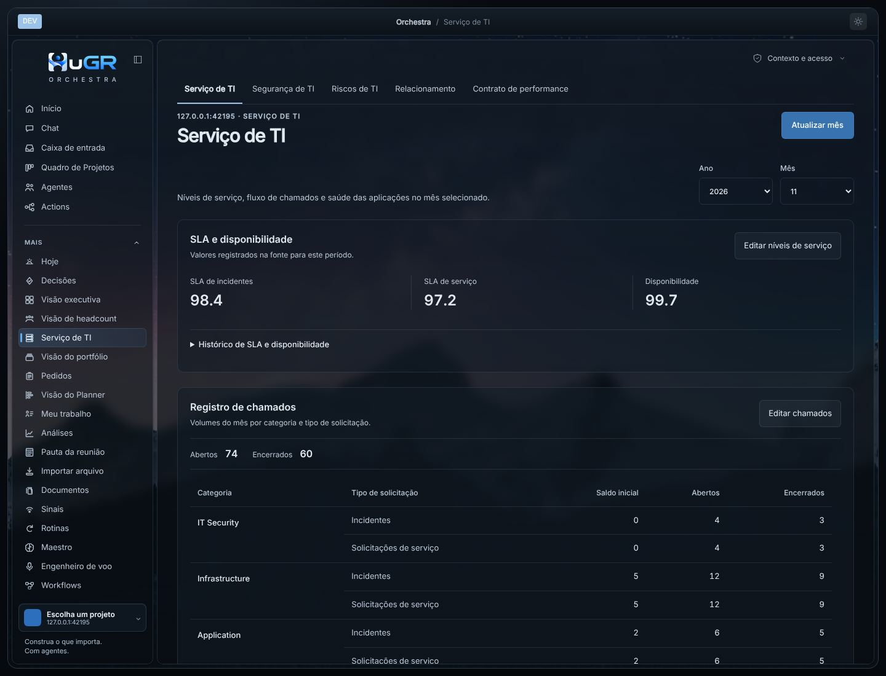
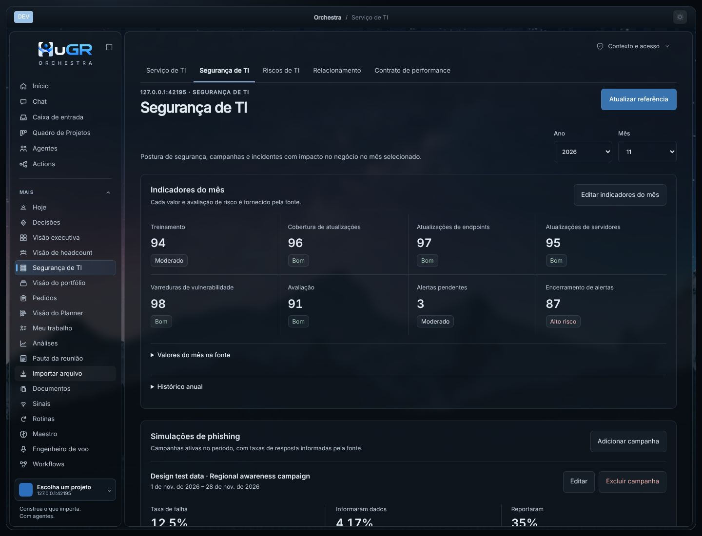
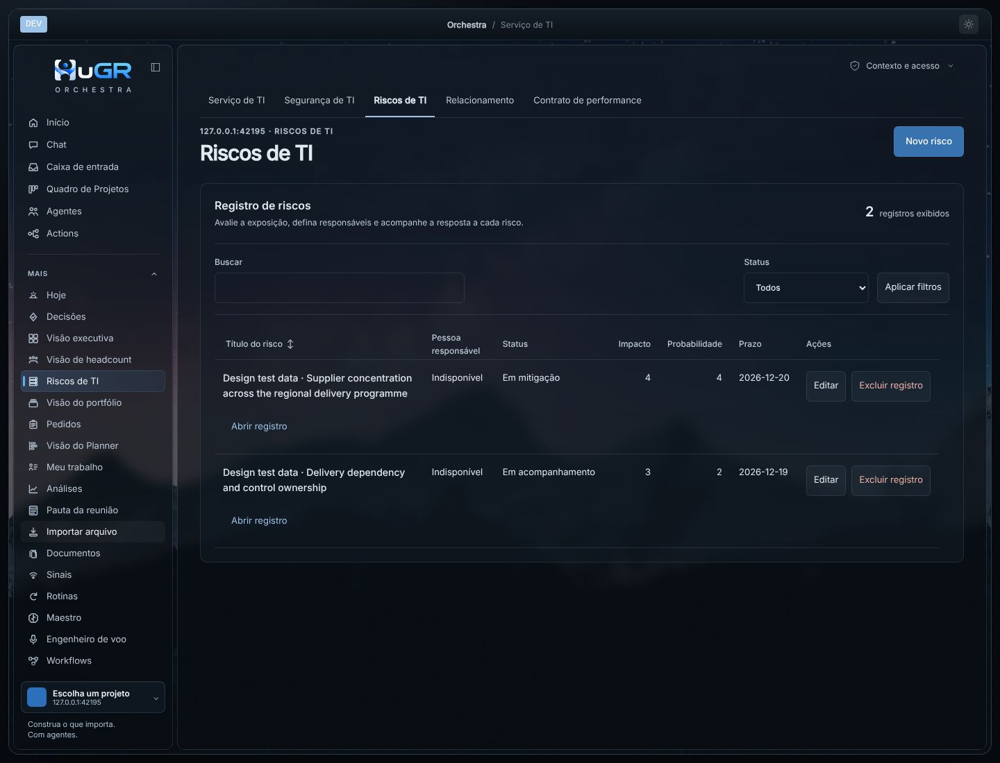
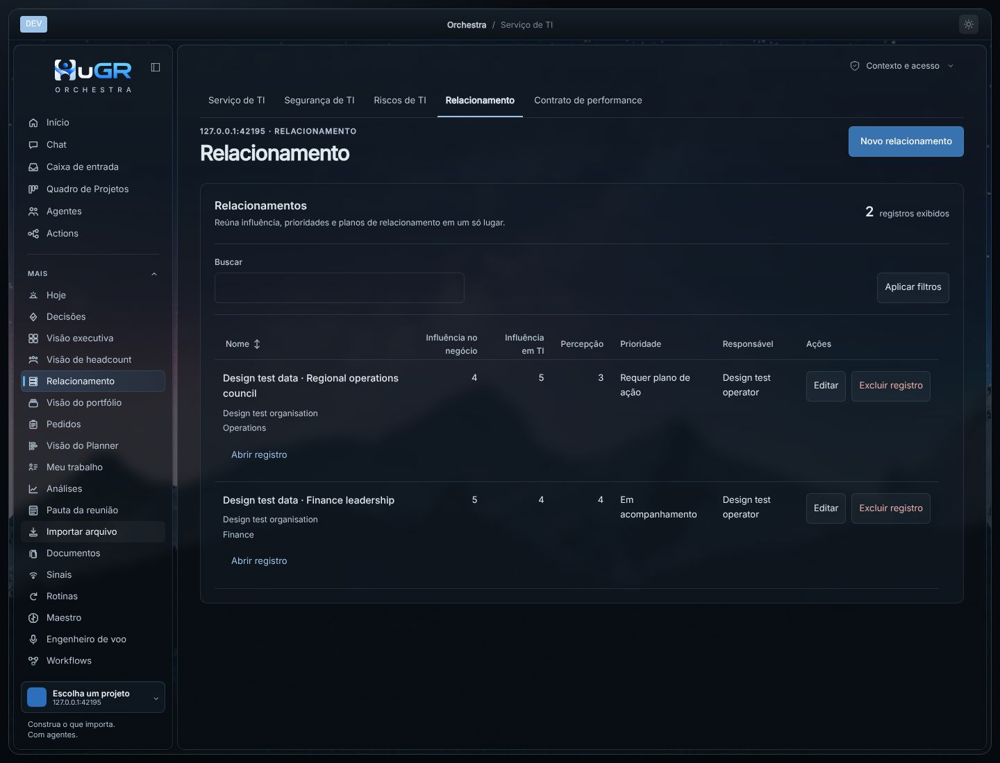
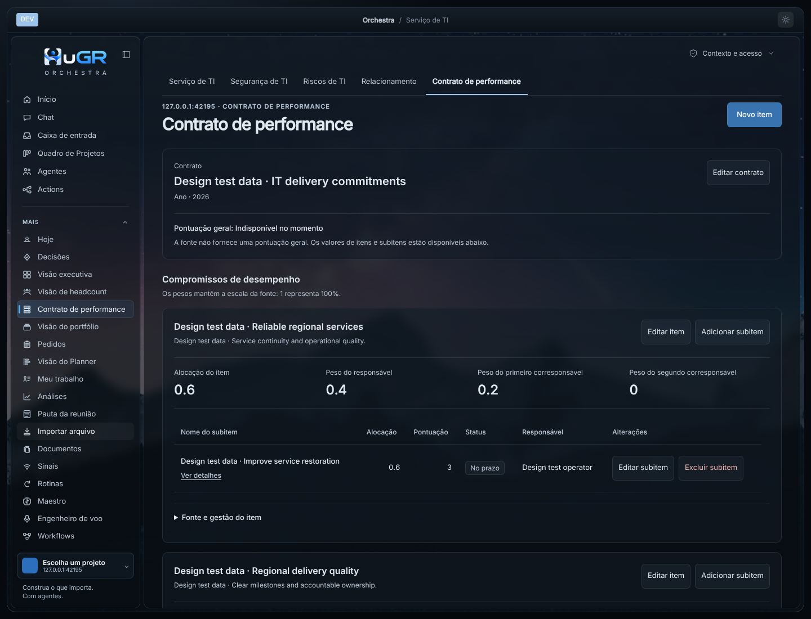

# Operações — galeria da terceira rodada

**5 áreas · 25 estados funcionais com imagem própria · 72 capturas reais.** As outras 47 imagens são variantes dos mesmos estados. O usuário autorizou a integração condicionada aos checks verdes; a composição passou. Consulte [a verificação do merge](../../MERGE.md) e o PR #587.

As imagens mostram a aplicação nativa, instalada de forma isolada e preenchida pelos produtores canônicos com dados de teste. As três execuções finais passaram: [Serviço/Segurança — 2 testes](https://github.com/gustavomhss/Orchestra-SF/actions/runs/44947197315), [Riscos/Stakeholders/Performance — 3 testes](https://github.com/gustavomhss/Orchestra-SF/actions/runs/44949738285) e [português — 1 teste](https://github.com/gustavomhss/Orchestra-SF/actions/runs/44949742205). Os seis contextos encerraram com consoleErrors[] e pageErrors[]. Nenhuma captura ficou incompleta ou foi pulada.

Foram confirmadas cinco gravações com atualização da vista e releitura da fonte: SLA, campanha, risco, relacionamento e subitem de desempenho. As revisões de exclusão foram canceladas. Nenhuma autorização, resposta de domínio ou recibo foi simulado.

[Relatório completo](../../operations/REVIEW.md) · [Manifesto de imagens e proveniência](manifest.json)

Os JPEGs desta pasta são persistentes. Os três artefatos completos do Playwright expiram em 28/11/2026 conforme a retenção do Actions; IDs, digests e prazos estão no manifesto. Reflow em 390 CSS px não é uma medição de zoom real.

## Áreas

| Área | Estados funcionais fotografados | Capturas |
| --- | ---: | ---: |
| CAP11 — Serviço e SLA | 7 | 16 |
| CAP12 — Segurança | 4 | 16 |
| CAP13 — Riscos | 5 | 13 |
| CAP15 — Stakeholders | 4 | 11 |
| CAP16 — Desempenho operacional | 5 | 16 |

### CAP11 — Serviço e SLA

### CAP12 — Segurança

### CAP13 — Riscos

### CAP15 — Stakeholders

### CAP16 — Desempenho operacional

## Estados de trabalho

| Área | Estado | Captura principal | Variantes |
| --- | --- | --- | ---: |
| CAP11 | Visão geral do serviço | [Abrir imagem](CAP11-operations-dark-desktop-test-data.jpg) | 6 |
| CAP11 | Editor de indicadores da aplicação | [Abrir imagem](CAP11-application-editor-dark-desktop-test-data.jpg) | 0 |
| CAP11 | Editor de categorias | [Abrir imagem](CAP11-categories-editor-dark-desktop-test-data.jpg) | 0 |
| CAP11 | Preparação da substituição mensal | [Abrir imagem](CAP11-import-editor-dark-desktop-test-data.jpg) | 0 |
| CAP11 | Revisão da substituição mensal | [Abrir imagem](CAP11-import-review-top-dark-desktop-test-data.jpg) | 1 |
| CAP11 | Editor dos níveis de serviço | [Abrir imagem](CAP11-sla-editor-dark-desktop-test-data.jpg) | 1 |
| CAP11 | Revisão dos níveis de serviço | [Abrir imagem](CAP11-sla-review-dark-desktop-test-data.jpg) | 1 |
| CAP12 | Visão geral de segurança | [Abrir imagem](CAP12-operations-dark-desktop-test-data.jpg) | 6 |
| CAP12 | Revisão da exclusão de incidente | [Abrir imagem](CAP12-incident-delete-review-top-dark-desktop-test-data.jpg) | 1 |
| CAP12 | Editor de campanha | [Abrir imagem](CAP12-campaign-editor-dark-desktop-test-data.jpg) | 3 |
| CAP12 | Revisão de campanha | [Abrir imagem](CAP12-campaign-review-top-dark-desktop-test-data.jpg) | 2 |
| CAP13 | Registro de riscos | [Abrir imagem](CAP13-operations-dark-desktop-test-data.jpg) | 4 |
| CAP13 | Detalhe do risco | [Abrir imagem](CAP13-detail-dark-desktop-test-data.jpg) | 1 |
| CAP13 | Revisão da exclusão de risco | [Abrir imagem](CAP13-delete-review-dark-desktop-test-data.jpg) | 0 |
| CAP13 | Editor de risco | [Abrir imagem](CAP13-editor-dark-desktop-test-data.jpg) | 1 |
| CAP13 | Revisão da edição de risco | [Abrir imagem](CAP13-review-top-dark-desktop-test-data.jpg) | 2 |
| CAP15 | Lista de relacionamentos | [Abrir imagem](CAP15-operations-dark-desktop-test-data.jpg) | 3 |
| CAP15 | Detalhe do relacionamento | [Abrir imagem](CAP15-detail-dark-desktop-test-data.jpg) | 1 |
| CAP15 | Editor de relacionamento | [Abrir imagem](CAP15-editor-dark-desktop-test-data.jpg) | 1 |
| CAP15 | Revisão da edição de relacionamento | [Abrir imagem](CAP15-review-top-dark-desktop-test-data.jpg) | 2 |
| CAP16 | Visão geral do contrato de performance | [Abrir imagem](CAP16-operations-dark-desktop-test-data.jpg) | 5 |
| CAP16 | Editor de item | [Abrir imagem](CAP16-item-editor-dark-desktop-test-data.jpg) | 0 |
| CAP16 | Detalhe do subitem | [Abrir imagem](CAP16-subitem-detail-dark-desktop-test-data.jpg) | 2 |
| CAP16 | Editor de subitem | [Abrir imagem](CAP16-subitem-editor-dark-desktop-test-data.jpg) | 2 |
| CAP16 | Revisão do subitem | [Abrir imagem](CAP16-subitem-review-top-dark-desktop-test-data.jpg) | 2 |

## Todas as imagens por estado

### CAP11 · Visão geral do serviço

- [CAP11-operations-dark-desktop-test-data](CAP11-operations-dark-desktop-test-data.jpg)
- [CAP11-operations-light-desktop-test-data](CAP11-operations-light-desktop-test-data.jpg)
- [CAP11-ticket-ledger-dark-desktop-test-data](CAP11-ticket-ledger-dark-desktop-test-data.jpg)
- [CAP11-application-health-dark-desktop-test-data](CAP11-application-health-dark-desktop-test-data.jpg)
- [CAP11-settings-dark-desktop-test-data](CAP11-settings-dark-desktop-test-data.jpg)
- [CAP11-operations-pt-BR-dark-desktop-test-data](CAP11-operations-pt-BR-dark-desktop-test-data.jpg)
- [CAP11-operations-pt-BR-dark-390-test-data](CAP11-operations-pt-BR-dark-390-test-data.jpg)

### CAP11 · Editor de indicadores da aplicação

- [CAP11-application-editor-dark-desktop-test-data](CAP11-application-editor-dark-desktop-test-data.jpg)

### CAP11 · Editor de categorias

- [CAP11-categories-editor-dark-desktop-test-data](CAP11-categories-editor-dark-desktop-test-data.jpg)

### CAP11 · Preparação da substituição mensal

- [CAP11-import-editor-dark-desktop-test-data](CAP11-import-editor-dark-desktop-test-data.jpg)

### CAP11 · Revisão da substituição mensal

- [CAP11-import-review-top-dark-desktop-test-data](CAP11-import-review-top-dark-desktop-test-data.jpg)
- [CAP11-import-review-dark-desktop-test-data](CAP11-import-review-dark-desktop-test-data.jpg)

### CAP11 · Editor dos níveis de serviço

- [CAP11-sla-editor-dark-desktop-test-data](CAP11-sla-editor-dark-desktop-test-data.jpg)
- [CAP11-editor-pt-BR-dark-390-test-data](CAP11-editor-pt-BR-dark-390-test-data.jpg)

### CAP11 · Revisão dos níveis de serviço

- [CAP11-sla-review-dark-desktop-test-data](CAP11-sla-review-dark-desktop-test-data.jpg)
- [CAP11-review-pt-BR-dark-390-test-data](CAP11-review-pt-BR-dark-390-test-data.jpg)

### CAP12 · Visão geral de segurança

- [CAP12-operations-dark-desktop-test-data](CAP12-operations-dark-desktop-test-data.jpg)
- [CAP12-operations-light-desktop-test-data](CAP12-operations-light-desktop-test-data.jpg)
- [CAP12-campaign-departments-dark-desktop-test-data](CAP12-campaign-departments-dark-desktop-test-data.jpg)
- [CAP12-incidents-dark-desktop-test-data](CAP12-incidents-dark-desktop-test-data.jpg)
- [CAP12-unscoped-actions-dark-desktop-test-data](CAP12-unscoped-actions-dark-desktop-test-data.jpg)
- [CAP12-operations-pt-BR-dark-desktop-test-data](CAP12-operations-pt-BR-dark-desktop-test-data.jpg)
- [CAP12-operations-pt-BR-dark-390-test-data](CAP12-operations-pt-BR-dark-390-test-data.jpg)

### CAP12 · Revisão da exclusão de incidente

- [CAP12-incident-delete-review-top-dark-desktop-test-data](CAP12-incident-delete-review-top-dark-desktop-test-data.jpg)
- [CAP12-incident-delete-review-dark-desktop-test-data](CAP12-incident-delete-review-dark-desktop-test-data.jpg)

### CAP12 · Editor de campanha

- [CAP12-campaign-editor-dark-desktop-test-data](CAP12-campaign-editor-dark-desktop-test-data.jpg)
- [CAP12-department-editor-dark-desktop-test-data](CAP12-department-editor-dark-desktop-test-data.jpg)
- [CAP12-editor-pt-BR-dark-390-test-data](CAP12-editor-pt-BR-dark-390-test-data.jpg)
- [CAP12-departments-pt-BR-dark-390-test-data](CAP12-departments-pt-BR-dark-390-test-data.jpg)

### CAP12 · Revisão de campanha

- [CAP12-campaign-review-top-dark-desktop-test-data](CAP12-campaign-review-top-dark-desktop-test-data.jpg)
- [CAP12-campaign-review-dark-desktop-test-data](CAP12-campaign-review-dark-desktop-test-data.jpg)
- [CAP12-review-pt-BR-dark-390-test-data](CAP12-review-pt-BR-dark-390-test-data.jpg)

### CAP13 · Registro de riscos

- [CAP13-operations-dark-desktop-test-data](CAP13-operations-dark-desktop-test-data.jpg)
- [CAP13-operations-light-desktop-test-data](CAP13-operations-light-desktop-test-data.jpg)
- [CAP13-filtered-empty-dark-desktop-test-data](CAP13-filtered-empty-dark-desktop-test-data.jpg)
- [CAP13-operations-pt-BR-dark-desktop-test-data](CAP13-operations-pt-BR-dark-desktop-test-data.jpg)
- [CAP13-operations-pt-BR-dark-390-test-data](CAP13-operations-pt-BR-dark-390-test-data.jpg)

### CAP13 · Detalhe do risco

- [CAP13-detail-dark-desktop-test-data](CAP13-detail-dark-desktop-test-data.jpg)
- [CAP13-detail-pt-BR-dark-390-test-data](CAP13-detail-pt-BR-dark-390-test-data.jpg)

### CAP13 · Revisão da exclusão de risco

- [CAP13-delete-review-dark-desktop-test-data](CAP13-delete-review-dark-desktop-test-data.jpg)

### CAP13 · Editor de risco

- [CAP13-editor-dark-desktop-test-data](CAP13-editor-dark-desktop-test-data.jpg)
- [CAP13-editor-pt-BR-dark-390-test-data](CAP13-editor-pt-BR-dark-390-test-data.jpg)

### CAP13 · Revisão da edição de risco

- [CAP13-review-top-dark-desktop-test-data](CAP13-review-top-dark-desktop-test-data.jpg)
- [CAP13-review-dark-desktop-test-data](CAP13-review-dark-desktop-test-data.jpg)
- [CAP13-review-pt-BR-dark-390-test-data](CAP13-review-pt-BR-dark-390-test-data.jpg)

### CAP15 · Lista de relacionamentos

- [CAP15-operations-dark-desktop-test-data](CAP15-operations-dark-desktop-test-data.jpg)
- [CAP15-operations-light-desktop-test-data](CAP15-operations-light-desktop-test-data.jpg)
- [CAP15-operations-pt-BR-dark-desktop-test-data](CAP15-operations-pt-BR-dark-desktop-test-data.jpg)
- [CAP15-operations-pt-BR-dark-390-test-data](CAP15-operations-pt-BR-dark-390-test-data.jpg)

### CAP15 · Detalhe do relacionamento

- [CAP15-detail-dark-desktop-test-data](CAP15-detail-dark-desktop-test-data.jpg)
- [CAP15-detail-pt-BR-dark-390-test-data](CAP15-detail-pt-BR-dark-390-test-data.jpg)

### CAP15 · Editor de relacionamento

- [CAP15-editor-dark-desktop-test-data](CAP15-editor-dark-desktop-test-data.jpg)
- [CAP15-editor-pt-BR-dark-390-test-data](CAP15-editor-pt-BR-dark-390-test-data.jpg)

### CAP15 · Revisão da edição de relacionamento

- [CAP15-review-top-dark-desktop-test-data](CAP15-review-top-dark-desktop-test-data.jpg)
- [CAP15-review-dark-desktop-test-data](CAP15-review-dark-desktop-test-data.jpg)
- [CAP15-review-pt-BR-dark-390-test-data](CAP15-review-pt-BR-dark-390-test-data.jpg)

### CAP16 · Visão geral do contrato de performance

- [CAP16-operations-dark-desktop-test-data](CAP16-operations-dark-desktop-test-data.jpg)
- [CAP16-operations-light-desktop-test-data](CAP16-operations-light-desktop-test-data.jpg)
- [CAP16-items-dark-desktop-test-data](CAP16-items-dark-desktop-test-data.jpg)
- [CAP16-owner-assignments-dark-desktop-test-data](CAP16-owner-assignments-dark-desktop-test-data.jpg)
- [CAP16-operations-pt-BR-dark-desktop-test-data](CAP16-operations-pt-BR-dark-desktop-test-data.jpg)
- [CAP16-operations-pt-BR-dark-390-test-data](CAP16-operations-pt-BR-dark-390-test-data.jpg)

### CAP16 · Editor de item

- [CAP16-item-editor-dark-desktop-test-data](CAP16-item-editor-dark-desktop-test-data.jpg)

### CAP16 · Detalhe do subitem

- [CAP16-subitem-detail-dark-desktop-test-data](CAP16-subitem-detail-dark-desktop-test-data.jpg)
- [CAP16-subitem-quarters-dark-desktop-test-data](CAP16-subitem-quarters-dark-desktop-test-data.jpg)
- [CAP16-subitem-detail-pt-BR-dark-390-test-data](CAP16-subitem-detail-pt-BR-dark-390-test-data.jpg)

### CAP16 · Editor de subitem

- [CAP16-subitem-editor-dark-desktop-test-data](CAP16-subitem-editor-dark-desktop-test-data.jpg)
- [CAP16-editor-pt-BR-dark-390-test-data](CAP16-editor-pt-BR-dark-390-test-data.jpg)
- [CAP16-quarter-editor-pt-BR-dark-390-test-data](CAP16-quarter-editor-pt-BR-dark-390-test-data.jpg)

### CAP16 · Revisão do subitem

- [CAP16-subitem-review-top-dark-desktop-test-data](CAP16-subitem-review-top-dark-desktop-test-data.jpg)
- [CAP16-subitem-review-dark-desktop-test-data](CAP16-subitem-review-dark-desktop-test-data.jpg)
- [CAP16-review-pt-BR-dark-390-test-data](CAP16-review-pt-BR-dark-390-test-data.jpg)

## Limites

As capturas verificam os estados admitidos nesta instalação. Não se afirma cobertura independente de cada uma das vinte rotas cadastradas, de todos os comandos de criação/exclusão ou de todos os cenários de revogação, pendência e resultado desconhecido. Os comandos e as regras existentes permanecem nos seus donos. Ausências da fonte são exibidas explicitamente; não são substituídas por zero ou “Não”.

A correção final estabiliza a referência do rascunho durante a saída da revisão após uma gravação confirmada. Os três testes de registros só passaram depois dessa correção. A remoção posterior do diagnóstico temporário CAP16 é documentada no relatório de integração, sem alteração no caminho de sucesso.
