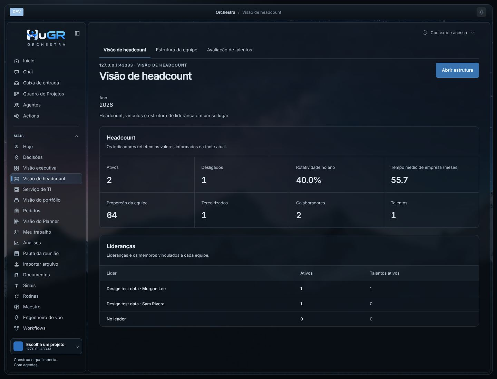
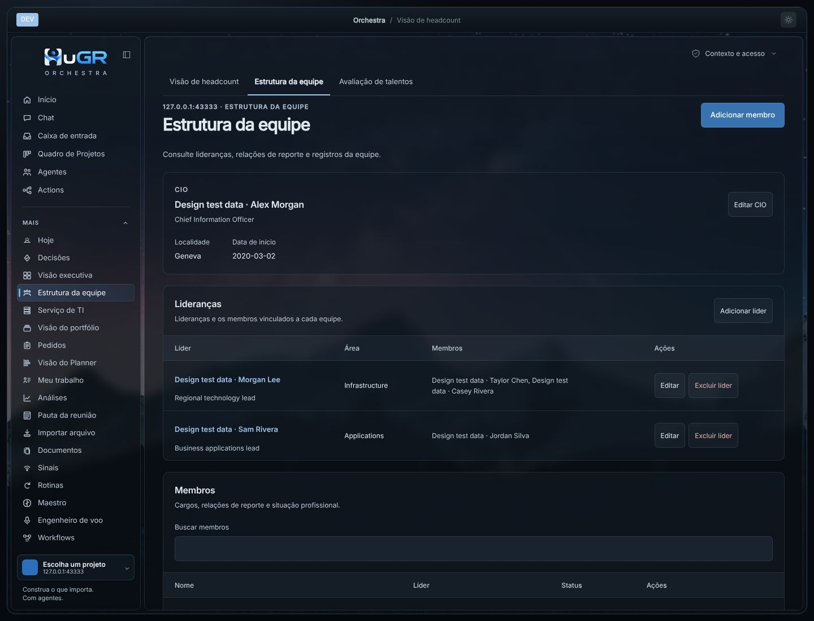
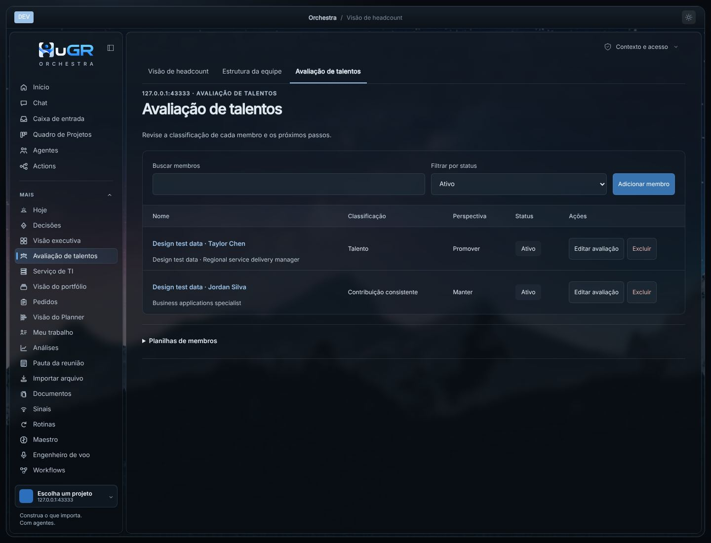
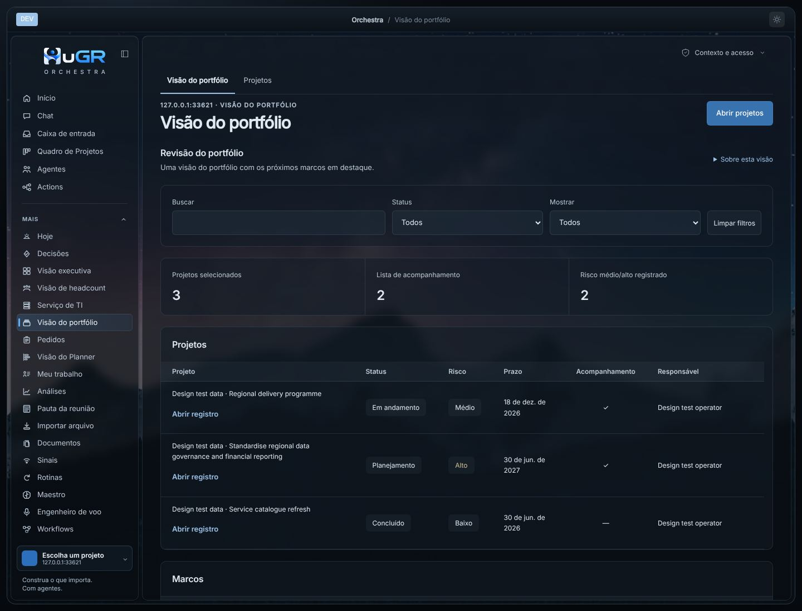
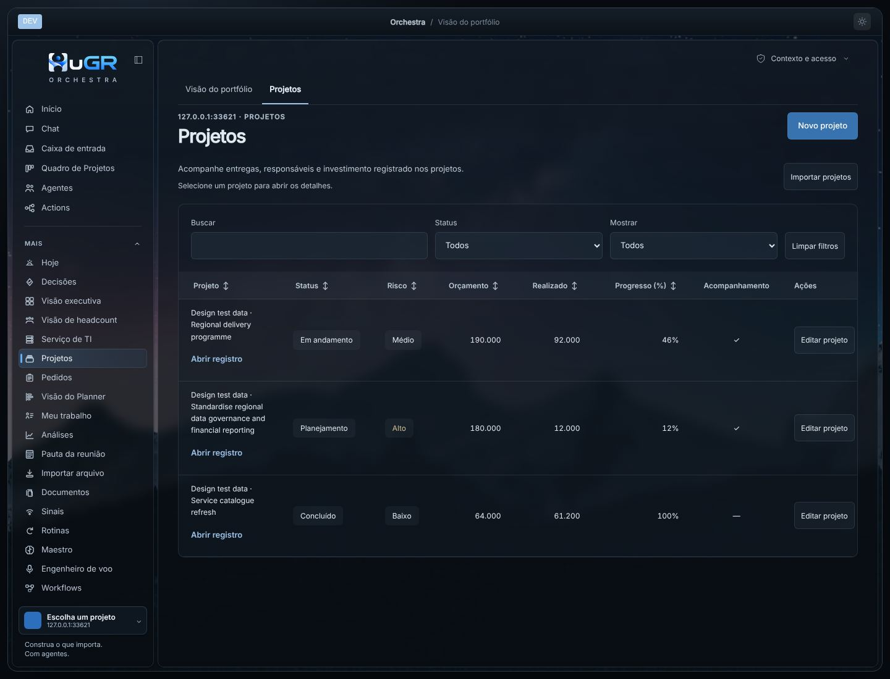

# Pessoas e portfólio — capturas reais

Cinco áreas nativas, **28 estados de negócio e 58 capturas**. Dados de teste isolados, criados pelos produtores originais. Temas, idiomas, larguras e rolagens são variantes; não representam áreas adicionais.

[Execução final — 2 jornadas aprovadas, 0 falhas](https://github.com/gustavomhss/Orchestra-SF/actions/runs/44942301625) · [Relatório e limites](../../people/REVIEW.md) · [Manifesto](manifest.json)

Produto capturado: `741a05b44afccafc53e6ae2aa6c0255027cf1653`. Snapshot de execução: `579e1d4bd85221d0dd2a527f8f09a3ceb37e1408`. Três gravações reais foram confirmadas e relidas: membro, projeto e marco. As revisões de exclusão foram canceladas.

Os JPEGs abaixo ficam versionados no repositório. Os PNGs originais estão no artefato [14722815268](https://github.com/gustavomhss/Orchestra-SF/actions/runs/44942301625/artifacts/14722815268), com retenção até 28/11/2026. O manifesto registra dimensões, tamanho e blob Git de cada JPEG.

## CAP06 — Pessoas — visão geral

| Estado | Captura principal | Variantes verificadas |
| --- | --- | --- |
| Headcount overview and leader breakdown | [CAP06-dark-desktop-test-data](CAP06-dark-desktop-test-data.jpg) | [CAP06-light-desktop-test-data](CAP06-light-desktop-test-data.jpg) · [CAP06-light-320-test-data](CAP06-light-320-test-data.jpg) · [CAP06-light-320-leaders-test-data](CAP06-light-320-leaders-test-data.jpg) · [CAP06-pt-BR-dark-desktop-test-data](CAP06-pt-BR-dark-desktop-test-data.jpg) |

## CAP07 — Estrutura e membros

| Estado | Captura principal | Variantes verificadas |
| --- | --- | --- |
| CIO, leaders and member collection | [CAP07-dark-desktop-test-data](CAP07-dark-desktop-test-data.jpg) | [CAP07-dark-desktop-members-test-data](CAP07-dark-desktop-members-test-data.jpg) · [CAP07-light-desktop-test-data](CAP07-light-desktop-test-data.jpg) · [CAP07-light-320-test-data](CAP07-light-320-test-data.jpg) · [CAP07-light-320-members-test-data](CAP07-light-320-members-test-data.jpg) · [CAP07-pt-BR-dark-desktop-test-data](CAP07-pt-BR-dark-desktop-test-data.jpg) |
| Existing CIO editor | [CAP07-dark-desktop-cio-editor-test-data](CAP07-dark-desktop-cio-editor-test-data.jpg) | — |
| Leader detail | [CAP07-dark-desktop-leader-detail-test-data](CAP07-dark-desktop-leader-detail-test-data.jpg) | — |
| Existing leader editor | [CAP07-dark-desktop-leader-editor-test-data](CAP07-dark-desktop-leader-editor-test-data.jpg) | — |
| Member detail | [CAP07-dark-desktop-member-detail-test-data](CAP07-dark-desktop-member-detail-test-data.jpg) | — |
| Existing member editor | [CAP07-dark-desktop-member-editor-test-data](CAP07-dark-desktop-member-editor-test-data.jpg) | — |
| Existing member change review | [CAP07-dark-desktop-member-review-test-data](CAP07-dark-desktop-member-review-test-data.jpg) | [CAP07-dark-320-member-review-actions-test-data](CAP07-dark-320-member-review-actions-test-data.jpg) |
| New member editor | [CAP07-dark-desktop-new-member-test-data](CAP07-dark-desktop-new-member-test-data.jpg) | — |
| New member review | [CAP07-dark-desktop-new-member-review-test-data](CAP07-dark-desktop-new-member-review-test-data.jpg) | — |
| Leader deletion review | [CAP07-dark-desktop-delete-review-test-data](CAP07-dark-desktop-delete-review-test-data.jpg) | — |

## CAP08 — Talentos

| Estado | Captura principal | Variantes verificadas |
| --- | --- | --- |
| Talent collection, including Terminated filter | [CAP08-dark-desktop-test-data](CAP08-dark-desktop-test-data.jpg) | [CAP08-light-desktop-test-data](CAP08-light-desktop-test-data.jpg) · [CAP08-light-320-test-data](CAP08-light-320-test-data.jpg) · [CAP08-dark-desktop-terminated-filter-test-data](CAP08-dark-desktop-terminated-filter-test-data.jpg) · [CAP08-pt-BR-dark-desktop-test-data](CAP08-pt-BR-dark-desktop-test-data.jpg) |
| Talent member detail | [CAP08-dark-desktop-member-detail-test-data](CAP08-dark-desktop-member-detail-test-data.jpg) | — |
| Existing assessment editor | [CAP08-dark-desktop-assessment-editor-test-data](CAP08-dark-desktop-assessment-editor-test-data.jpg) | [CAP08-pt-BR-dark-desktop-assessment-editor-test-data](CAP08-pt-BR-dark-desktop-assessment-editor-test-data.jpg) |
| Assessment change review | [CAP08-dark-desktop-assessment-review-test-data](CAP08-dark-desktop-assessment-review-test-data.jpg) | [CAP08-dark-320-assessment-review-actions-test-data](CAP08-dark-320-assessment-review-actions-test-data.jpg) · [CAP08-pt-BR-dark-desktop-assessment-review-test-data](CAP08-pt-BR-dark-desktop-assessment-review-test-data.jpg) |
| Workbook import unavailable | [CAP08-dark-desktop-import-unavailable-test-data](CAP08-dark-desktop-import-unavailable-test-data.jpg) | [CAP08-pt-BR-dark-desktop-import-unavailable-test-data](CAP08-pt-BR-dark-desktop-import-unavailable-test-data.jpg) |
| Workbook export unavailable | [CAP08-dark-desktop-export-unavailable-test-data](CAP08-dark-desktop-export-unavailable-test-data.jpg) | [CAP08-pt-BR-dark-desktop-export-unavailable-test-data](CAP08-pt-BR-dark-desktop-export-unavailable-test-data.jpg) |

## CAP09 — Visão do portfólio

| Estado | Captura principal | Variantes verificadas |
| --- | --- | --- |
| Portfolio overview, projects and milestone schedule | [CAP09-dark-desktop-test-data](CAP09-dark-desktop-test-data.jpg) | [CAP09-dark-desktop-milestones-test-data](CAP09-dark-desktop-milestones-test-data.jpg) · [CAP09-light-desktop-test-data](CAP09-light-desktop-test-data.jpg) · [CAP09-light-320-test-data](CAP09-light-320-test-data.jpg) · [CAP09-pt-BR-dark-desktop-test-data](CAP09-pt-BR-dark-desktop-test-data.jpg) |

## CAP10 — Projetos e marcos

| Estado | Captura principal | Variantes verificadas |
| --- | --- | --- |
| Project collection | [CAP10-dark-desktop-test-data](CAP10-dark-desktop-test-data.jpg) | [CAP10-light-desktop-test-data](CAP10-light-desktop-test-data.jpg) · [CAP10-light-320-test-data](CAP10-light-320-test-data.jpg) · [CAP10-pt-BR-dark-desktop-test-data](CAP10-pt-BR-dark-desktop-test-data.jpg) |
| Existing project detail | [CAP10-dark-desktop-project-detail-test-data](CAP10-dark-desktop-project-detail-test-data.jpg) | — |
| Existing project editor | [CAP10-dark-desktop-project-editor-test-data](CAP10-dark-desktop-project-editor-test-data.jpg) | [CAP10-pt-BR-dark-desktop-project-editor-test-data](CAP10-pt-BR-dark-desktop-project-editor-test-data.jpg) |
| Existing project change review | [CAP10-dark-desktop-project-review-test-data](CAP10-dark-desktop-project-review-test-data.jpg) | [CAP10-dark-320-project-review-actions-test-data](CAP10-dark-320-project-review-actions-test-data.jpg) · [CAP10-pt-BR-dark-desktop-project-review-test-data](CAP10-pt-BR-dark-desktop-project-review-test-data.jpg) · [CAP10-pt-BR-dark-320-project-review-actions-test-data](CAP10-pt-BR-dark-320-project-review-actions-test-data.jpg) |
| Project milestone collection | [CAP10-dark-desktop-milestones-test-data](CAP10-dark-desktop-milestones-test-data.jpg) | — |
| Existing milestone editor | [CAP10-dark-desktop-milestone-editor-test-data](CAP10-dark-desktop-milestone-editor-test-data.jpg) | — |
| Milestone change review | [CAP10-dark-desktop-milestone-review-test-data](CAP10-dark-desktop-milestone-review-test-data.jpg) | — |
| Project deletion review | [CAP10-dark-desktop-delete-review-test-data](CAP10-dark-desktop-delete-review-test-data.jpg) | — |
| New project editor | [CAP10-dark-desktop-new-project-test-data](CAP10-dark-desktop-new-project-test-data.jpg) | — |
| New project review | [CAP10-dark-desktop-new-project-review-test-data](CAP10-dark-desktop-new-project-review-test-data.jpg) | — |

## Limites relevantes

CAP08 mostra honestamente a indisponibilidade de importação e exportação; não há transferência simulada. Sua projeção também não fornece nomes de líderes, portanto conserva o identificador autorizado. As capturas de 320 CSS px comprovam reflow; zoom real de 200% não foi medido. O usuário autorizou a integração condicionada aos checks verdes; a composição passou. Consulte [a verificação do merge](../../MERGE.md) e o PR #587.
