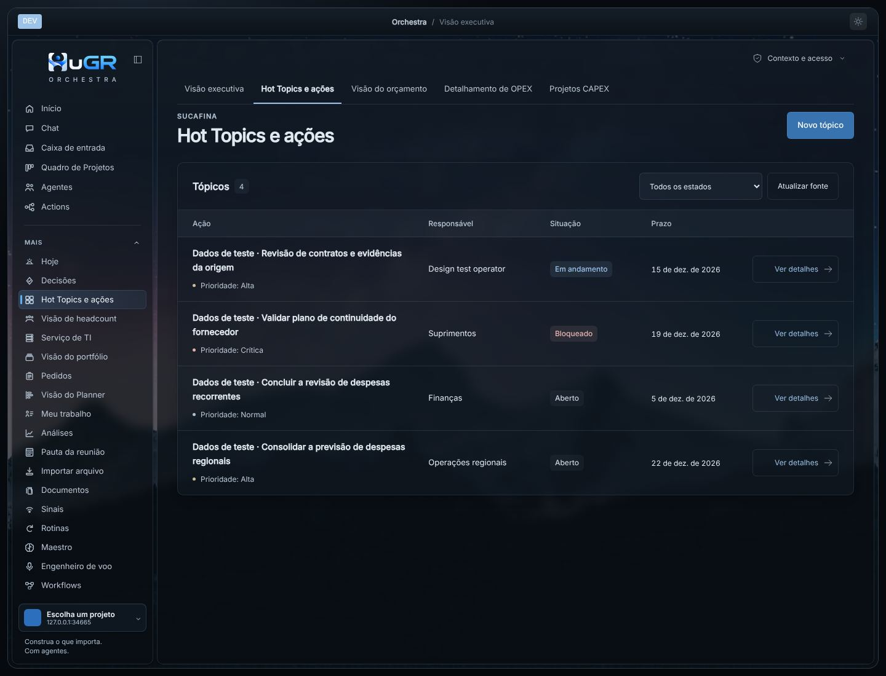
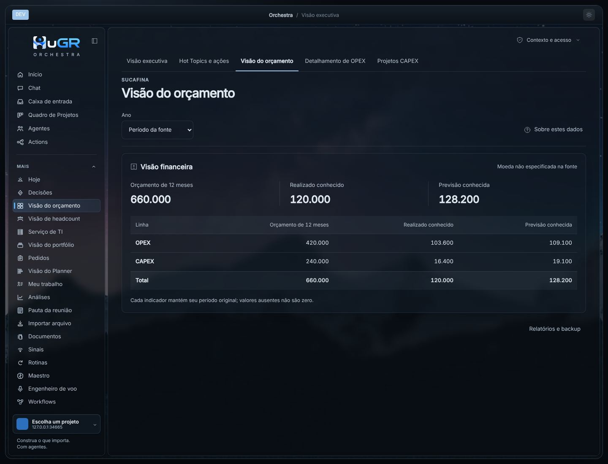
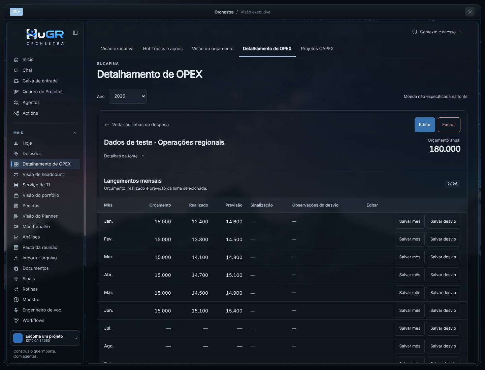

# Segunda rodada — capturas reais da Sucafina

**Hot Topics (CAP02), Visão do orçamento (CAP03) e OPEX (CAP04).** Produto [5012d7a](https://github.com/gustavomhss/Orchestra-SF/commit/5012d7adf0e5d02576fe6a0add6f79331a812137), na branch [sf-design-two](https://github.com/gustavomhss/Orchestra-SF/tree/sf-design-two), criada de `dev bcdc109`.

São **39 capturas da aplicação real**, incluindo **11 em português**, produzidas na [jornada final aprovada pelo CI](https://github.com/gustavomhss/Orchestra-SF/actions/runs/44920647017). Os registros identificados como “Dados de teste” pertencem à instalação isolada de verificação. A aprovação visual do usuário para esta rodada está pendente.

## Hot Topics e ações

Lista com leitura por colunas, responsáveis, situação e prioridade; detalhe e formulário têm composições próprias.

[Editor em português](CAP02-pt-BR-dark-desktop-editor-test-data.jpg) · [Revisão em português](CAP02-pt-BR-dark-desktop-review-test-data.jpg) · [Detalhe em português](CAP02-pt-BR-dark-desktop-detail-test-data.jpg) · [Seletor com foco a 320px](CAP02-dark-320-related-test-data.jpg)

## Visão do orçamento

Indicadores e tabela OPEX/CAPEX na mesma superfície. O ano selecionado mantém o escopo real da fonte; os editores de mês e receita têm revisão própria.

[Editor em português](CAP03-pt-BR-dark-desktop-editor-test-data.jpg) · [Revisão em português](CAP03-pt-BR-dark-desktop-review-test-data.jpg) · [Ausências no ano selecionado](CAP03-dark-desktop-annual-test-data.jpg)

## Detalhamento de OPEX

Identidade e orçamento anual acima do ledger mensal. Valores conhecidos, ausências, edição e revisão têm hierarquia explícita.

[Lista em português](CAP04-pt-BR-dark-desktop-test-data.jpg) · [Editor em português](CAP04-pt-BR-dark-desktop-editor-test-data.jpg) · [Revisão em português](CAP04-pt-BR-dark-desktop-review-test-data.jpg) · [Detalhe a 320px](CAP04-dark-320-detail-test-data.jpg)

## Todas as capturas

Cada arquivo mostra o viewport indicado. As revisões a 320px são capturas roladas para as ações; o detalhe OPEX a 320px mostra o início do ledger. Reflow por largura não é uma medição de zoom do navegador.

| Tela | Estado | Idioma | Tema | Viewport | Captura |
| --- | --- | --- | --- | --- | --- |
| CAP02 | Vista principal | en-US | Escuro | 1440 × 1100 | [Abrir](CAP02-dark-desktop-test-data.jpg) |
| CAP02 | Vista principal | en-US | Escuro | 1440 × 800 | [Abrir](CAP02-dark-1440x800-test-data.jpg) |
| CAP02 | Vista principal | en-US | Claro | 1440 × 1100 | [Abrir](CAP02-light-desktop-test-data.jpg) |
| CAP02 | Vista principal | en-US | Claro | 320 × 900 | [Abrir](CAP02-light-320-test-data.jpg) |
| CAP03 | Vista principal | en-US | Escuro | 1440 × 1100 | [Abrir](CAP03-dark-desktop-test-data.jpg) |
| CAP03 | Vista principal | en-US | Escuro | 1440 × 800 | [Abrir](CAP03-dark-1440x800-test-data.jpg) |
| CAP03 | Vista principal | en-US | Claro | 1440 × 1100 | [Abrir](CAP03-light-desktop-test-data.jpg) |
| CAP03 | Vista principal | en-US | Claro | 320 × 900 | [Abrir](CAP03-light-320-test-data.jpg) |
| CAP04 | Vista principal | en-US | Escuro | 1440 × 1100 | [Abrir](CAP04-dark-desktop-test-data.jpg) |
| CAP04 | Vista principal | en-US | Escuro | 1440 × 800 | [Abrir](CAP04-dark-1440x800-test-data.jpg) |
| CAP04 | Vista principal | en-US | Claro | 1440 × 1100 | [Abrir](CAP04-light-desktop-test-data.jpg) |
| CAP04 | Vista principal | en-US | Claro | 320 × 900 | [Abrir](CAP04-light-320-test-data.jpg) |
| CAP02 | Editor | en-US | Escuro | 1440 × 1100 | [Abrir](CAP02-dark-desktop-editor-test-data.jpg) |
| CAP02 | Revisão | en-US | Escuro | 1440 × 1100 | [Abrir](CAP02-dark-desktop-review-test-data.jpg) |
| CAP02 | Revisão | en-US | Escuro | 320 × 900 | [Abrir](CAP02-dark-320-review-test-data.jpg) |
| CAP02 | Detalhe | en-US | Escuro | 1440 × 1100 | [Abrir](CAP02-dark-desktop-detail-test-data.jpg) |
| CAP02 | Detalhe — seletor com foco | en-US | Escuro | 320 × 900 | [Abrir](CAP02-dark-320-related-test-data.jpg) |
| CAP02 | Revisão de edição existente | en-US | Escuro | 1440 × 1100 | [Abrir](CAP02-dark-desktop-existing-review-test-data.jpg) |
| CAP02 | Confirmação de salvamento | en-US | Escuro | 1440 × 1100 | [Abrir](CAP02-dark-desktop-saved-test-data.jpg) |
| CAP03 | Ano selecionado — ausência explícita | en-US | Escuro | 1440 × 1100 | [Abrir](CAP03-dark-desktop-annual-test-data.jpg) |
| CAP03 | Revisão | en-US | Escuro | 1440 × 1100 | [Abrir](CAP03-dark-desktop-review-test-data.jpg) |
| CAP03 | Revisão | en-US | Escuro | 320 × 900 | [Abrir](CAP03-dark-320-review-test-data.jpg) |
| CAP04 | Nova linha | en-US | Escuro | 1440 × 1100 | [Abrir](CAP04-dark-desktop-new-line-test-data.jpg) |
| CAP04 | Detalhe | en-US | Escuro | 1440 × 1100 | [Abrir](CAP04-dark-desktop-detail-test-data.jpg) |
| CAP04 | Detalhe | en-US | Escuro | 320 × 900 | [Abrir](CAP04-dark-320-detail-test-data.jpg) |
| CAP04 | Editor | en-US | Escuro | 1440 × 1100 | [Abrir](CAP04-dark-desktop-editor-test-data.jpg) |
| CAP04 | Revisão | en-US | Escuro | 1440 × 1100 | [Abrir](CAP04-dark-desktop-review-test-data.jpg) |
| CAP04 | Revisão | en-US | Escuro | 320 × 900 | [Abrir](CAP04-dark-320-review-test-data.jpg) |
| CAP02 | Vista principal | pt-BR | Escuro | 1440 × 1100 | [Abrir](CAP02-pt-BR-dark-desktop-test-data.jpg) |
| CAP03 | Vista principal | pt-BR | Escuro | 1440 × 1100 | [Abrir](CAP03-pt-BR-dark-desktop-test-data.jpg) |
| CAP04 | Vista principal | pt-BR | Escuro | 1440 × 1100 | [Abrir](CAP04-pt-BR-dark-desktop-test-data.jpg) |
| CAP02 | Detalhe | pt-BR | Escuro | 1440 × 1100 | [Abrir](CAP02-pt-BR-dark-desktop-detail-test-data.jpg) |
| CAP02 | Editor | pt-BR | Escuro | 1440 × 1100 | [Abrir](CAP02-pt-BR-dark-desktop-editor-test-data.jpg) |
| CAP02 | Revisão | pt-BR | Escuro | 1440 × 1100 | [Abrir](CAP02-pt-BR-dark-desktop-review-test-data.jpg) |
| CAP03 | Editor | pt-BR | Escuro | 1440 × 1100 | [Abrir](CAP03-pt-BR-dark-desktop-editor-test-data.jpg) |
| CAP03 | Revisão | pt-BR | Escuro | 1440 × 1100 | [Abrir](CAP03-pt-BR-dark-desktop-review-test-data.jpg) |
| CAP04 | Detalhe | pt-BR | Escuro | 1440 × 1100 | [Abrir](CAP04-pt-BR-dark-desktop-detail-test-data.jpg) |
| CAP04 | Editor | pt-BR | Escuro | 1440 × 1100 | [Abrir](CAP04-pt-BR-dark-desktop-editor-test-data.jpg) |
| CAP04 | Revisão | pt-BR | Escuro | 1440 × 1100 | [Abrir](CAP04-pt-BR-dark-desktop-review-test-data.jpg) |

## Proveniência e limites

- [Manifesto com SHAs, dimensões e execuções](manifest.json).
- [Validação funcional e limites da matriz](../VALIDATION.md).
- [Integração e correções encontradas nas verificações](../INTEGRATION.md).
- [PNG originais e diagnósticos no Actions](https://github.com/gustavomhss/Orchestra-SF/actions/runs/44920647017/artifacts/14713935784), com retenção até 28/11/2026. Os JPEGs desta pasta ficam preservados no repositório.
- [Galeria da primeira rodada aprovada](../../evidence/README.md), preservada separadamente.

Esta galeria é evidência para revisão. Não é uma declaração de aprovação do usuário, golden baseline, deploy ou revisão de todas as 70 telas.
