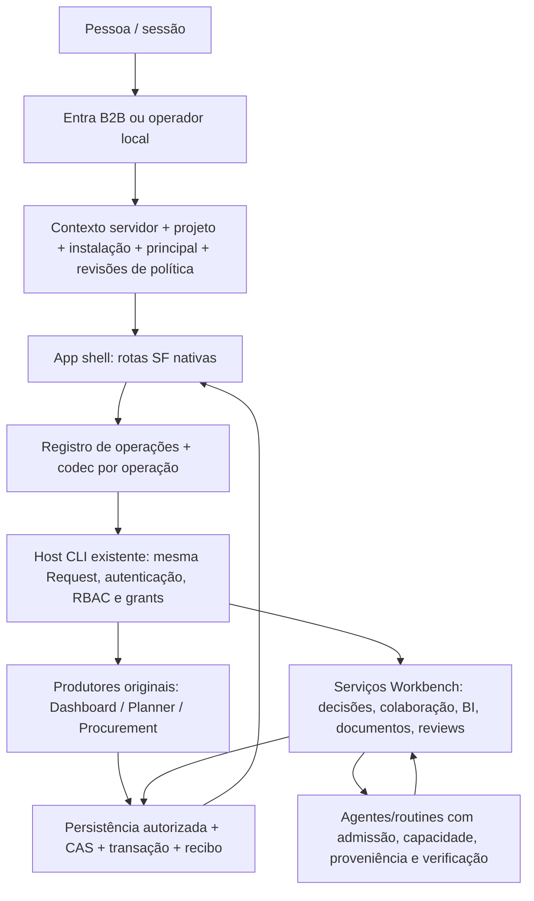
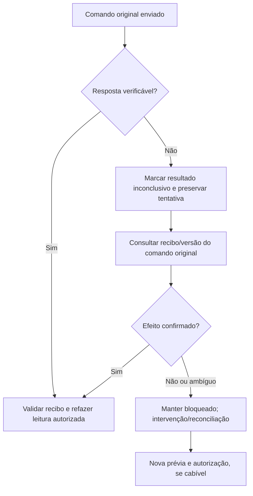

# Orchestra-SF — Atlas completo de funcionalidades, fluxos e jornadas

**Auditoria de leitura, 16 de novembro de 2026 (horário de São Paulo).** Repositório: [`gustavomhss/Orchestra-SF`](https://github.com/gustavomhss/Orchestra-SF). **Pin funcional estudado:** branch `close-final-candidate`, commit [`42d344a0efc4d85187388f149c54acac2db171da`](https://github.com/gustavomhss/Orchestra-SF/tree/42d344a0efc4d85187388f149c54acac2db171da). **Pin alternativo de CI (histórico, não HEAD atual):** candidato diagnóstico `sf-ci-probe` em `1c9011d54c3e7e3aa3e78a2e4f4a3b6f7c4bf7ec` (PR #260). As conclusões de uma árvore não são automaticamente transferíveis para a outra.

> **Veredicto:** o produto é um workbench corporativo multi-domínio com governança, e não um mero painel. **Mapa estrutural consistente; homologação operacional completa NÃO comprovada.** O candidato diagnóstico histórico tinha CI com falhas e não era promovível; verificações de branches móveis são identificadas com seu SHA observado. Esta auditoria não executou uma instância real Azure/Microsoft Entra nem atestou todas as ações com atores corporativos reais.

## 1. Escopo, resultado e o significado de “triple check”

Foram investigadas duas camadas distintas:

1. **Orchestra como plataforma:** desktop/CLI/servidor, Maestro e agentes, projetos, worktrees, workflows e Relay, modelos, habilidades, ferramentas, MCP, contexto, Atlas, Omni, sessões e permissões.
2. **Sucafina como produto hospedado no Orchestra:** três produtores de origem (Dashboard, Planner, Procurement) e o **Workbench SF** (trabalho, decisões, BI, revisões, importações, evidências, memória e rotinas), exposto também por UI nativa no `app-shell`.

Para avaliar cada fluxo, considerei quatro níveis independentes de evidência:

- **D — Descrição/contrato:** guia, manifesto, critérios e oráculos Given/When/Then.
- **I — Implementação:** rota no app-shell, operação/tipo no schema, adaptador real no host/CLI e produtor de negócio com persistência/autorização.
- **T — Teste implementado:** teste de contrato, unidade, integração, Playwright ou teste de fonte que realmente contém expectativas; sua presença não implica que executou com sucesso.
- **E — Execução observada:** conclusão de um run no GitHub Actions, vinculada ao SHA exato e, quando necessário, a atores/tenant/VM verdadeiros.

A expressão **“triplo check” aqui significa cruzar D, I e T e conferir E separadamente**. Só recebe status **homologado** aquilo que executou com sucesso na combinação correta de SHA, ambiente, dados e ator. Ausência de E fica como **não comprovado**, mesmo com três fontes concordantes. Nenhum sinal verde em `sf/preflight` substitui end-to-end, identidade real ou deploy.

### Resultado quantitativo comprovado

| Verificação | Resultado observado | O que demonstra | O que NÃO demonstra |
|---|---:|---|---|
| Superfícies no manifesto | **70** | Escopo declarado, dividido em 28 CAP + 42 UI | Disponibilidade funcional de todas |
| IDs distintos no registro de rotas | **70/70** | Nenhuma superfície catalogada ficou sem ID roteável | Autorização ou UI apta a realizar ação |
| Rotas principais manifesto → registro | **70/70** | Nenhuma divergência entre as entradas congeladas e o roteador | Navegação efetiva em servidor real |
| Total de padrões de rota | **165** | Subrotas de lista, criação, edição, histórico e detalhe | Que cada tela e editor estejam instalados |
| Registro tipado de operações | **306** | 305 operações do catálogo original + uma extensão rastreada; 116 leituras, 170 mutações, 15 preparações, 3 prévias e 2 autenticações | Que os 306 codecs/producers estejam disponíveis |
| Paridade operação/contrato | **304/305 métodos coincidem** | Há um desvio GET→POST em `projection.search`, deliberado no código por privacidade | Contratos normativos do pin atual integralmente reconciliados |
| Pin histórico dos 6 producers | **6/6 blobs diferentes** | O manifesto fixa versões antigas dos produtores CAP01–CAP28 | Compatibilidade semântica com o candidato atual |
| HTML catálogo (após correção v2) | **70/70 linhas** | A tabela é um único elemento HTML pesquisável | Homologação do UX em navegador real |
| Capítulos nativos | **15** | Partição completa da interface funcional | Aceite de UX final |
| Critérios rastreados na campanha | **1.610** | Planejamento e rastreabilidade de 15 WPs / 74 tarefas | 1.610 testes passando |
| Arquivos `uXX.spec.ts` nativos lidos | **46** | Cobertura de fonte autoral por jornada e superfície | 46 suítes E2E verdes |

**Controle de integridade do inventário:** IDs ausentes no registro: `0`; IDs extras sem manifesto: `0`; entradas principais sem rota correspondente: `0`; **165/165 variantes de rota** batem exatamente entre manifesto e roteador; **70/70 recursos de contrato** são resolvidos e **nenhum `domainCommand` catalogado ficou sem operação registrada**. Duplicatas de padrão+ID+kind: `0`. Estas são verificações estruturais, não de execução/segurança em ambiente real.

## 2. Arquitetura de confiança — de ponta a ponta

**Observações verificadas no código:**

- `modules/sucafina/Sucafinav1/index.ts` registra DashboardBudget, DashboardPeople, DashboardOperations, DashboardPortfolio, PlannerModule e ProcurementModule como **contribuições originais**.
- `runtime/host.ts` e `runtime/application.ts` compõem Sucafina no listener do Orchestra; o módulo **não cria servidor paralelo**. O mesmo adaptador de persistência sustenta tráfego HTTP e jobs.
- `apps/cli/src/sucafina-product/installation.ts` liga a instalação ao host; `native-ui/router.ts` instala as projeções nativas que tenham binding real. Rota conhecida **não** é privilégio.
- `packages/schema/src/sucafina/operation-registry.ts` registra metadados de operações. O próprio código adverte que metadados sem codec + producer **falham fechados**.
- `packages/app-shell/src/orchestra/chapters/sucafina/host/native-chapter-entry.ts` compõe as entradas dos 15 capítulos e preserva seleção do owner. O app não pode inventar referência de registro, titular ou autorização.
- A sessão Microsoft é baseada em tenant de recurso (`tid`) e `oid` dentro daquele tenant, OIDC/confidential web client e PKCE. A autorização combina papel por grupo, grant individual e permissão de domínio, sem fallback para `local-operator` na nuvem.
- `product/decisions/apply.ts` exige escolha, mudança preparada, revisão vinculada, confirmação humana e recibo do domínio; recuperação é um caminho distinto da nova execução.
- `product/imports/apply.ts` exige preview versionada, sessão atual, confirmação e aplicação atômica com recibo da mesma tentativa.
- `apps/cli/src/sucafina-product/native-host.ts` integra `SessionV2`, `AgentV2` e `SkillV2` do Orchestra. `native-execution.ts` executa admissão, preflight, verificação do output e ciclo de cancelamento; não basta aparecer “agente” na interface.

**Regra central:** `Open`/`Read` → `Prepare`/`Preview` → `Review` → `Confirm` → `Producer apply` → `Receipt` → `Authorized reread`. Etapas podem ser recusadas por ausência de fonte, mudança de revisão/escopo, resposta perdida, permissão insuficiente ou indisponibilidade real. **Um link, preview, parecer de IA, mensagem ou escolha não executa automaticamente uma transação de negócio.**

### Fontes de verdade e projeções

| Dado | Fonte responsável | Consumidores secundários | Erro proibido |
|---|---|---|---|
| OPEX / CAPEX / forecast / headcount / FX | Planner, Dashboard e seus contratos originais | BI, decisão, revisão, memória | Contar hipótese como oficial ou missing como zero |
| Requisição, ofertas, fornecedores e aprovação | Procurement original | Dashboard, decisões, trabalho, relatórios | Liberar aprovação por texto/role inferido; emissão externa não registrada |
| Case, alternativas, escolha, histórico | Workbench Decisions | Portfólio, reuniões, rotinas | Converter comparação em escolha ou em apply |
| Documentos e evidências | Fonte autorizada do anexo/documento | Extração, cenário, decisão | Promover candidato não confirmado a fato |
| Revisão preservada | Artefato imutável de review | Meeting view, comparação, DOCX/PPTX | Recalcular conteúdo histórico sem preservar nova revisão |
| Execução de análise/rotina | Host de agente + store de run | Workbench, memória, reuniões | Exibir `started` como `completed`/`approved` |

## 3. Personas, deveres e barreiras entre usuários

As personas do oráculo não são automaticamente nomes de grupos de Entra. A instalação precisa mapear grupos reais, grants e autorização por recurso.

| Persona | Objetivo de usuário | Jornadas relevantes | Limite de autoridade |
|---|---|---|---|
| Executivo/CIO autorizado | Entender prioridades, preparar e preservar uma reunião, deliberar | J05, J06, J07, J08 | Não vira Finance/aprovador de compra só por visualizar |
| Finance / Budget owner | Elaborar, comparar e revisar orçamento/forecast | J01–J03, J07 | Não muda actual fechado/versão official sem regra e autorização |
| RH/People | Gerir headcount, organograma, talentos | J02, J08 | Dados pessoais/remuneração e exportação sob permissão específica |
| Líder de domínio/contribuidor | Atualizar valores e status que lhe foram atribuídos | J01, J03, J06 | Confirmação sem alteração não autoriza mudança de outro registro |
| Requester | Criar e submeter PR | J04 | Não herda ações de Buyer/aprovador |
| Buyer | Comparar ofertas, gerir sourcing e PO | J04, J07 | Não aprova a própria etapa se não for holder autorizado |
| Holder/aprovador | Deliberar na sua fila e estágio | J04 | Aprovação exige holder atual, estágio e revisão dos valores |
| Supplier admin | Gerenciar cadastro/status de fornecedor | J04 | Dados bancários têm separação de operações e proteção extra |
| Leitor restrito | Abrir somente fontes que lhe pertencem | J05, J08 | Revogação bloqueia leitura, download e navegação histórica |
| Operador local de sistema | Administrar instalação local isolada | J08 | Não é identidade substituta para Microsoft hospedado |

As decisões entre atores não devem ser inferidas por nome, e-mail, `owner` textual ou origem do link; exigem identificador de domínio e autorização fresca. Um `403` correto num ator negado não é defeito; um `403` na jornada autorizada que esperava `200` é bloqueio real de homologação.

## 4. Catálogo das 70 superfícies (com rotas principais)

A tabela a seguir é derivada do manifesto congelado. “Ação dominante” reproduz o propósito da superfície, **não** garante que o botão esteja habilitado ou seja uma mutação admissível em toda instalação.

| Capítulo | ID | Superfície | Rota principal | Ação principal | Teste-fonte identificado |
|---|---|---|---|---|---|
| Home e acesso | `UI29` | Hoje | `/orchestra/sf-home` | Ver meu trabalho | [`u01`](https://github.com/gustavomhss/Orchestra-SF/blob/42d344a0efc4d85187388f149c54acac2db171da/packages/app-shell/e2e/sucafina/native/journeys/u01.spec.ts) |
| Home e acesso | `UI31` | Busca SF | `/orchestra/sf-home/search` | Buscar | [`u42`](https://github.com/gustavomhss/Orchestra-SF/blob/42d344a0efc4d85187388f149c54acac2db171da/packages/app-shell/e2e/sucafina/native/journeys/u42.spec.ts) |
| Home e acesso | `UI67` | Login/contexto/acesso | `/orchestra/sf-home/context` | Selecionar contexto | [`u01-host231`](https://github.com/gustavomhss/Orchestra-SF/blob/42d344a0efc4d85187388f149c54acac2db171da/packages/app-shell/e2e/sucafina/native/journeys/u01-host231.spec.ts), [`shell-guard237`](https://github.com/gustavomhss/Orchestra-SF/blob/42d344a0efc4d85187388f149c54acac2db171da/packages/app-shell/e2e/sucafina/native/journeys/shell-guard237.spec.ts) |
| Home e acesso | `UI69` | Ferramentas locais de administração | `/orchestra/sf-home/administration` | Revisar operação | [`u28`](https://github.com/gustavomhss/Orchestra-SF/blob/42d344a0efc4d85187388f149c54acac2db171da/packages/app-shell/e2e/sucafina/native/journeys/u28.spec.ts) |
| Dashboard e prioridades | `CAP01` | Dashboard: Executive Dashboard | `/orchestra/sf-dashboard/executive` | Preparar reunião | [`u02`](https://github.com/gustavomhss/Orchestra-SF/blob/42d344a0efc4d85187388f149c54acac2db171da/packages/app-shell/e2e/sucafina/native/journeys/u02.spec.ts) |
| Dashboard e prioridades | `CAP02` | Dashboard: Hot Topics & Actions | `/orchestra/sf-dashboard/hot-topics` | Novo tópico | [`u38`](https://github.com/gustavomhss/Orchestra-SF/blob/42d344a0efc4d85187388f149c54acac2db171da/packages/app-shell/e2e/sucafina/native/journeys/u38.spec.ts) |
| Dashboard e prioridades | `CAP03` | Dashboard: Budget Overview | `/orchestra/sf-dashboard/budget` | Revisar orçamento | [`u02`](https://github.com/gustavomhss/Orchestra-SF/blob/42d344a0efc4d85187388f149c54acac2db171da/packages/app-shell/e2e/sucafina/native/journeys/u02.spec.ts), [`u39`](https://github.com/gustavomhss/Orchestra-SF/blob/42d344a0efc4d85187388f149c54acac2db171da/packages/app-shell/e2e/sucafina/native/journeys/u39.spec.ts), [`u40`](https://github.com/gustavomhss/Orchestra-SF/blob/42d344a0efc4d85187388f149c54acac2db171da/packages/app-shell/e2e/sucafina/native/journeys/u40.spec.ts) |
| Dashboard e prioridades | `CAP04` | Dashboard: OPEX Detail | `/orchestra/sf-dashboard/opex` | Nova linha | [`u39`](https://github.com/gustavomhss/Orchestra-SF/blob/42d344a0efc4d85187388f149c54acac2db171da/packages/app-shell/e2e/sucafina/native/journeys/u39.spec.ts), [`u40`](https://github.com/gustavomhss/Orchestra-SF/blob/42d344a0efc4d85187388f149c54acac2db171da/packages/app-shell/e2e/sucafina/native/journeys/u40.spec.ts) |
| Dashboard e prioridades | `CAP05` | Dashboard: CAPEX Projects | `/orchestra/sf-dashboard/capex` | Novo projeto CAPEX | [`u39`](https://github.com/gustavomhss/Orchestra-SF/blob/42d344a0efc4d85187388f149c54acac2db171da/packages/app-shell/e2e/sucafina/native/journeys/u39.spec.ts), [`u40`](https://github.com/gustavomhss/Orchestra-SF/blob/42d344a0efc4d85187388f149c54acac2db171da/packages/app-shell/e2e/sucafina/native/journeys/u40.spec.ts) |
| Dashboard e prioridades | `UI54` | Encaminhar Hot Topic | `/orchestra/sf-dashboard/hot-topics/proposals/:proposalRef` | Aplicar encaminhamento | [`u38`](https://github.com/gustavomhss/Orchestra-SF/blob/42d344a0efc4d85187388f149c54acac2db171da/packages/app-shell/e2e/sucafina/native/journeys/u38.spec.ts) |
| People e talentos | `CAP06` | Dashboard: Headcount Overview | `/orchestra/sf-people/overview` | Abrir estrutura | [`u03`](https://github.com/gustavomhss/Orchestra-SF/blob/42d344a0efc4d85187388f149c54acac2db171da/packages/app-shell/e2e/sucafina/native/journeys/u03.spec.ts) |
| People e talentos | `CAP07` | Dashboard: Team Structure | `/orchestra/sf-people/structure` | Adicionar membro | [`u03`](https://github.com/gustavomhss/Orchestra-SF/blob/42d344a0efc4d85187388f149c54acac2db171da/packages/app-shell/e2e/sucafina/native/journeys/u03.spec.ts) |
| People e talentos | `CAP08` | Dashboard: Talent Review | `/orchestra/sf-people/talent` | Editar avaliação | [`u47`](https://github.com/gustavomhss/Orchestra-SF/blob/42d344a0efc4d85187388f149c54acac2db171da/packages/app-shell/e2e/sucafina/native/journeys/u47.spec.ts) |
| Operations e segurança | `CAP11` | Dashboard: IT Operations | `/orchestra/sf-operations/service` | Atualizar mês | [`u04`](https://github.com/gustavomhss/Orchestra-SF/blob/42d344a0efc4d85187388f149c54acac2db171da/packages/app-shell/e2e/sucafina/native/journeys/u04.spec.ts) |
| Operations e segurança | `CAP12` | Dashboard: IT Security KPIs | `/orchestra/sf-operations/security` | Atualizar referência | [`u29`](https://github.com/gustavomhss/Orchestra-SF/blob/42d344a0efc4d85187388f149c54acac2db171da/packages/app-shell/e2e/sucafina/native/journeys/u29.spec.ts) |
| Operations e segurança | `CAP13` | Dashboard: IT Risks | `/orchestra/sf-operations/risks` | Novo risco | [`u30`](https://github.com/gustavomhss/Orchestra-SF/blob/42d344a0efc4d85187388f149c54acac2db171da/packages/app-shell/e2e/sucafina/native/journeys/u30.spec.ts) |
| Operations e segurança | `CAP15` | Dashboard: Stakeholder Management | `/orchestra/sf-operations/stakeholders` | Novo relacionamento | [`u30`](https://github.com/gustavomhss/Orchestra-SF/blob/42d344a0efc4d85187388f149c54acac2db171da/packages/app-shell/e2e/sucafina/native/journeys/u30.spec.ts) |
| Operations e segurança | `CAP16` | Dashboard: IT Performance Contract | `/orchestra/sf-operations/performance` | Novo item | [`u31`](https://github.com/gustavomhss/Orchestra-SF/blob/42d344a0efc4d85187388f149c54acac2db171da/packages/app-shell/e2e/sucafina/native/journeys/u31.spec.ts) |
| Portfolio e cenários | `CAP09` | Dashboard: Portfolio Dashboard | `/orchestra/sf-portfolio/overview` | Abrir projetos | [`u05`](https://github.com/gustavomhss/Orchestra-SF/blob/42d344a0efc4d85187388f149c54acac2db171da/packages/app-shell/e2e/sucafina/native/journeys/u05.spec.ts) |
| Portfolio e cenários | `CAP10` | Dashboard: All Projects | `/orchestra/sf-portfolio/projects` | Novo projeto | [`u05`](https://github.com/gustavomhss/Orchestra-SF/blob/42d344a0efc4d85187388f149c54acac2db171da/packages/app-shell/e2e/sucafina/native/journeys/u05.spec.ts) |
| Portfolio e cenários | `UI42` | Campanha/candidatos | `/orchestra/sf-portfolio/scenarios/:caseRef` | Avaliar combinações | [`u19`](https://github.com/gustavomhss/Orchestra-SF/blob/42d344a0efc4d85187388f149c54acac2db171da/packages/app-shell/e2e/sucafina/native/journeys/u19.spec.ts) |
| Portfolio e cenários | `UI43` | Combinações/histórico | `/orchestra/sf-portfolio/scenarios/:caseRef/results/:resultRef` | Revisar cenário | [`u19`](https://github.com/gustavomhss/Orchestra-SF/blob/42d344a0efc4d85187388f149c54acac2db171da/packages/app-shell/e2e/sucafina/native/journeys/u19.spec.ts) |
| Portfolio e cenários | `UI44` | Sensibilidade | `/orchestra/sf-portfolio/sensitivity/:caseRef/:resultRef` | Avaliar limite | [`u19`](https://github.com/gustavomhss/Orchestra-SF/blob/42d344a0efc4d85187388f149c54acac2db171da/packages/app-shell/e2e/sucafina/native/journeys/u19.spec.ts) |
| Planner e versões | `CAP17` | Planner: Overview | `/orchestra/sf-planner/overview` | Comparar versões | [`u06`](https://github.com/gustavomhss/Orchestra-SF/blob/42d344a0efc4d85187388f149c54acac2db171da/packages/app-shell/e2e/sucafina/native/journeys/u06.spec.ts) |
| Planner e versões | `CAP18` | Planner: OPEX | `/orchestra/sf-planner/opex` | Revisar alterações | [`u07`](https://github.com/gustavomhss/Orchestra-SF/blob/42d344a0efc4d85187388f149c54acac2db171da/packages/app-shell/e2e/sucafina/native/journeys/u07.spec.ts), [`u48`](https://github.com/gustavomhss/Orchestra-SF/blob/42d344a0efc4d85187388f149c54acac2db171da/packages/app-shell/e2e/sucafina/native/journeys/u48.spec.ts) |
| Planner e versões | `CAP19` | Planner: CAPEX | `/orchestra/sf-planner/capex` | Revisar alterações | [`u07`](https://github.com/gustavomhss/Orchestra-SF/blob/42d344a0efc4d85187388f149c54acac2db171da/packages/app-shell/e2e/sucafina/native/journeys/u07.spec.ts), [`u48`](https://github.com/gustavomhss/Orchestra-SF/blob/42d344a0efc4d85187388f149c54acac2db171da/packages/app-shell/e2e/sucafina/native/journeys/u48.spec.ts) |
| Planner e versões | `CAP20` | Planner: Headcount | `/orchestra/sf-planner/headcount` | Revisar alterações | [`u08`](https://github.com/gustavomhss/Orchestra-SF/blob/42d344a0efc4d85187388f149c54acac2db171da/packages/app-shell/e2e/sucafina/native/journeys/u08.spec.ts) |
| Planner e versões | `CAP21` | Planner: Entities & allocations | `/orchestra/sf-planner/allocations` | Adicionar registro | [`u09`](https://github.com/gustavomhss/Orchestra-SF/blob/42d344a0efc4d85187388f149c54acac2db171da/packages/app-shell/e2e/sucafina/native/journeys/u09.spec.ts) |
| Planner e versões | `CAP22` | Planner: FX rates | `/orchestra/sf-planner/fx` | Adicionar moeda | [`u45`](https://github.com/gustavomhss/Orchestra-SF/blob/42d344a0efc4d85187388f149c54acac2db171da/packages/app-shell/e2e/sucafina/native/journeys/u45.spec.ts) |
| Planner e versões | `CAP23` | Planner: Versions | `/orchestra/sf-planner/versions` | Criar versão | [`u46`](https://github.com/gustavomhss/Orchestra-SF/blob/42d344a0efc4d85187388f149c54acac2db171da/packages/app-shell/e2e/sucafina/native/journeys/u46.spec.ts) |
| Procurement e fornecedores | `CAP14` | Dashboard: Vendor Contracts | `/orchestra/sf-procurement/contracts` | Novo contrato | [`u15`](https://github.com/gustavomhss/Orchestra-SF/blob/42d344a0efc4d85187388f149c54acac2db171da/packages/app-shell/e2e/sucafina/native/journeys/u15.spec.ts) |
| Procurement e fornecedores | `CAP24` | Procurement: Dashboard | `/orchestra/sf-procurement/overview` | Abrir pedidos | Não indexado diretamente |
| Procurement e fornecedores | `CAP25` | Procurement: Requests | `/orchestra/sf-procurement/requests` | Continuar pedido | [`u12`](https://github.com/gustavomhss/Orchestra-SF/blob/42d344a0efc4d85187388f149c54acac2db171da/packages/app-shell/e2e/sucafina/native/journeys/u12.spec.ts) |
| Procurement e fornecedores | `CAP26` | Procurement: My approvals | `/orchestra/sf-procurement/approvals` | Revisar decisão | [`u13`](https://github.com/gustavomhss/Orchestra-SF/blob/42d344a0efc4d85187388f149c54acac2db171da/packages/app-shell/e2e/sucafina/native/journeys/u13.spec.ts) |
| Procurement e fornecedores | `CAP27` | Procurement: Suppliers | `/orchestra/sf-procurement/suppliers` | Novo fornecedor | [`u14`](https://github.com/gustavomhss/Orchestra-SF/blob/42d344a0efc4d85187388f149c54acac2db171da/packages/app-shell/e2e/sucafina/native/journeys/u14.spec.ts) |
| Procurement e fornecedores | `CAP28` | Procurement: Settings | `/orchestra/sf-procurement/settings` | Revisar configurações | [`u36`](https://github.com/gustavomhss/Orchestra-SF/blob/42d344a0efc4d85187388f149c54acac2db171da/packages/app-shell/e2e/sucafina/native/journeys/u36.spec.ts) |
| Meu trabalho e colaboração | `UI30` | Meu trabalho | `/orchestra/sf-work` | Abrir próxima ação | [`u41`](https://github.com/gustavomhss/Orchestra-SF/blob/42d344a0efc4d85187388f149c54acac2db171da/packages/app-shell/e2e/sucafina/native/journeys/u41.spec.ts) |
| Meu trabalho e colaboração | `UI32` | Visões salvas | `/orchestra/sf-work/views/:viewId` | Salvar vista | [`u43`](https://github.com/gustavomhss/Orchestra-SF/blob/42d344a0efc4d85187388f149c54acac2db171da/packages/app-shell/e2e/sucafina/native/journeys/u43.spec.ts) |
| Meu trabalho e colaboração | `UI51` | Relações entre registros | `/orchestra/sf-work/relations/:relationRef` | Vincular registro | [`u44`](https://github.com/gustavomhss/Orchestra-SF/blob/42d344a0efc4d85187388f149c54acac2db171da/packages/app-shell/e2e/sucafina/native/journeys/u44.spec.ts) |
| Meu trabalho e colaboração | `UI52` | Thread contextual | `/orchestra/sf-work/threads/:threadRef` | Enviar comentário | [`u44`](https://github.com/gustavomhss/Orchestra-SF/blob/42d344a0efc4d85187388f149c54acac2db171da/packages/app-shell/e2e/sucafina/native/journeys/u44.spec.ts) |
| Meu trabalho e colaboração | `UI53` | Confirmar sem alteração | `/orchestra/sf-work/confirmations/:selectionRef` | Confirmar sem alteração | [`u44`](https://github.com/gustavomhss/Orchestra-SF/blob/42d344a0efc4d85187388f149c54acac2db171da/packages/app-shell/e2e/sucafina/native/journeys/u44.spec.ts) |
| Decisões governadas | `UI33` | Lista/criação de casos | `/orchestra/sf-decisions` | Novo caso | [`u16`](https://github.com/gustavomhss/Orchestra-SF/blob/42d344a0efc4d85187388f149c54acac2db171da/packages/app-shell/e2e/sucafina/native/journeys/u16.spec.ts) |
| Decisões governadas | `UI34` | Resumo/intenção do caso | `/orchestra/sf-decisions/:caseRef` | Revisar intenção | [`u01`](https://github.com/gustavomhss/Orchestra-SF/blob/42d344a0efc4d85187388f149c54acac2db171da/packages/app-shell/e2e/sucafina/native/journeys/u01.spec.ts), [`u16`](https://github.com/gustavomhss/Orchestra-SF/blob/42d344a0efc4d85187388f149c54acac2db171da/packages/app-shell/e2e/sucafina/native/journeys/u16.spec.ts) |
| Decisões governadas | `UI35` | Alternativas e comparação | `/orchestra/sf-decisions/:caseRef/alternatives` | Comparar alternativas | [`u17`](https://github.com/gustavomhss/Orchestra-SF/blob/42d344a0efc4d85187388f149c54acac2db171da/packages/app-shell/e2e/sucafina/native/journeys/u17.spec.ts) |
| Decisões governadas | `UI36` | Premissas e divergências | `/orchestra/sf-decisions/:caseRef/assumptions` | Revisar premissa | [`u17`](https://github.com/gustavomhss/Orchestra-SF/blob/42d344a0efc4d85187388f149c54acac2db171da/packages/app-shell/e2e/sucafina/native/journeys/u17.spec.ts) |
| Decisões governadas | `UI37` | Perguntas e ciclos | `/orchestra/sf-decisions/:caseRef/questions` | Responder pergunta | [`u17`](https://github.com/gustavomhss/Orchestra-SF/blob/42d344a0efc4d85187388f149c54acac2db171da/packages/app-shell/e2e/sucafina/native/journeys/u17.spec.ts) |
| Decisões governadas | `UI38` | Escolha humana atual | `/orchestra/sf-decisions/:caseRef/choice` | Registrar escolha | [`u17`](https://github.com/gustavomhss/Orchestra-SF/blob/42d344a0efc4d85187388f149c54acac2db171da/packages/app-shell/e2e/sucafina/native/journeys/u17.spec.ts), [`u18`](https://github.com/gustavomhss/Orchestra-SF/blob/42d344a0efc4d85187388f149c54acac2db171da/packages/app-shell/e2e/sucafina/native/journeys/u18.spec.ts) |
| Decisões governadas | `UI39` | Mudanças preparadas | `/orchestra/sf-decisions/:caseRef/changes/:changeRef` | Aplicar mudança | [`u18`](https://github.com/gustavomhss/Orchestra-SF/blob/42d344a0efc4d85187388f149c54acac2db171da/packages/app-shell/e2e/sucafina/native/journeys/u18.spec.ts) |
| Decisões governadas | `UI40` | Recibo/histórico de aplicação | `/orchestra/sf-decisions/:caseRef/receipts/:receiptRef` | Consultar resultado | [`u18`](https://github.com/gustavomhss/Orchestra-SF/blob/42d344a0efc4d85187388f149c54acac2db171da/packages/app-shell/e2e/sucafina/native/journeys/u18.spec.ts) |
| Decisões governadas | `UI41` | Análise assíncrona | `/orchestra/sf-decisions/:caseRef/analyses/:analysisRef` | Abrir resultado | [`u37`](https://github.com/gustavomhss/Orchestra-SF/blob/42d344a0efc4d85187388f149c54acac2db171da/packages/app-shell/e2e/sucafina/native/journeys/u37.spec.ts) |
| BI e visualização | `UI45` | Catálogo BI | `/orchestra/sf-bi` | Escolher contexto | [`u20`](https://github.com/gustavomhss/Orchestra-SF/blob/42d344a0efc4d85187388f149c54acac2db171da/packages/app-shell/e2e/sucafina/native/journeys/u20.spec.ts), [`u21`](https://github.com/gustavomhss/Orchestra-SF/blob/42d344a0efc4d85187388f149c54acac2db171da/packages/app-shell/e2e/sucafina/native/journeys/u21.spec.ts), [`u22`](https://github.com/gustavomhss/Orchestra-SF/blob/42d344a0efc4d85187388f149c54acac2db171da/packages/app-shell/e2e/sucafina/native/journeys/u22.spec.ts) |
| BI e visualização | `UI46` | Visual BI e drilldown | `/orchestra/sf-bi/:viewId` | Ver dados | [`u20`](https://github.com/gustavomhss/Orchestra-SF/blob/42d344a0efc4d85187388f149c54acac2db171da/packages/app-shell/e2e/sucafina/native/journeys/u20.spec.ts), [`u21`](https://github.com/gustavomhss/Orchestra-SF/blob/42d344a0efc4d85187388f149c54acac2db171da/packages/app-shell/e2e/sucafina/native/journeys/u21.spec.ts), [`u22`](https://github.com/gustavomhss/Orchestra-SF/blob/42d344a0efc4d85187388f149c54acac2db171da/packages/app-shell/e2e/sucafina/native/journeys/u22.spec.ts) |
| Revisões e relatórios | `UI47` | Seleção da pauta | `/orchestra/sf-reviews/agenda` | Preservar revisão | [`u25`](https://github.com/gustavomhss/Orchestra-SF/blob/42d344a0efc4d85187388f149c54acac2db171da/packages/app-shell/e2e/sucafina/native/journeys/u25.spec.ts) |
| Revisões e relatórios | `UI48` | Revisões preservadas | `/orchestra/sf-reviews/reviews/:reviewRef` | Apresentar revisão | [`u32`](https://github.com/gustavomhss/Orchestra-SF/blob/42d344a0efc4d85187388f149c54acac2db171da/packages/app-shell/e2e/sucafina/native/journeys/u32.spec.ts) |
| Revisões e relatórios | `UI49` | Comparar revisões | `/orchestra/sf-reviews/compare` | Comparar revisões | [`u32`](https://github.com/gustavomhss/Orchestra-SF/blob/42d344a0efc4d85187388f149c54acac2db171da/packages/app-shell/e2e/sucafina/native/journeys/u32.spec.ts) |
| Revisões e relatórios | `UI50` | Exportar relatório | `/orchestra/sf-reviews/reports/:reviewRef` | Gerar relatório | [`u33`](https://github.com/gustavomhss/Orchestra-SF/blob/42d344a0efc4d85187388f149c54acac2db171da/packages/app-shell/e2e/sucafina/native/journeys/u33.spec.ts) |
| Imports e exports | `UI55` | Arquivos/destino de import | `/orchestra/sf-imports/new` | Gerar prévia | [`u23`](https://github.com/gustavomhss/Orchestra-SF/blob/42d344a0efc4d85187388f149c54acac2db171da/packages/app-shell/e2e/sucafina/native/journeys/u23.spec.ts) |
| Imports e exports | `UI56` | Prévia/impacto de import | `/orchestra/sf-imports/:manifestId/preview` | Revisar impacto | [`u23`](https://github.com/gustavomhss/Orchestra-SF/blob/42d344a0efc4d85187388f149c54acac2db171da/packages/app-shell/e2e/sucafina/native/journeys/u23.spec.ts) |
| Imports e exports | `UI57` | Aplicação/recibo de import | `/orchestra/sf-imports/:manifestId/receipt` | Consultar resultado | [`u23`](https://github.com/gustavomhss/Orchestra-SF/blob/42d344a0efc4d85187388f149c54acac2db171da/packages/app-shell/e2e/sucafina/native/journeys/u23.spec.ts) |
| Imports e exports | `UI68` | Exports de dados/PO | `/orchestra/sf-imports/exports` | Exportar | [`u23`](https://github.com/gustavomhss/Orchestra-SF/blob/42d344a0efc4d85187388f149c54acac2db171da/packages/app-shell/e2e/sucafina/native/journeys/u23.spec.ts) |
| Documentos e evidências | `UI58` | Catálogo de documentos | `/orchestra/sf-documents` | Adicionar documento | [`u24`](https://github.com/gustavomhss/Orchestra-SF/blob/42d344a0efc4d85187388f149c54acac2db171da/packages/app-shell/e2e/sucafina/native/journeys/u24.spec.ts) |
| Documentos e evidências | `UI59` | Extração/confirmação | `/orchestra/sf-documents/:documentRef/evidence` | Confirmar seleção | [`u24`](https://github.com/gustavomhss/Orchestra-SF/blob/42d344a0efc4d85187388f149c54acac2db171da/packages/app-shell/e2e/sucafina/native/journeys/u24.spec.ts) |
| Documentos e evidências | `UI60` | Documento para cenário | `/orchestra/sf-documents/:documentRef/scenario` | Revisar uso da evidência | [`u24`](https://github.com/gustavomhss/Orchestra-SF/blob/42d344a0efc4d85187388f149c54acac2db171da/packages/app-shell/e2e/sucafina/native/journeys/u24.spec.ts) |
| Memória e observações | `UI61` | Sinais/materialidade | `/orchestra/sf-memory/signals` | Revisar sinal | [`u26`](https://github.com/gustavomhss/Orchestra-SF/blob/42d344a0efc4d85187388f149c54acac2db171da/packages/app-shell/e2e/sucafina/native/journeys/u26.spec.ts) |
| Memória e observações | `UI62` | Casos semelhantes | `/orchestra/sf-memory/cases` | Abrir caso | [`u26`](https://github.com/gustavomhss/Orchestra-SF/blob/42d344a0efc4d85187388f149c54acac2db171da/packages/app-shell/e2e/sucafina/native/journeys/u26.spec.ts), [`similarity217/ui62`](https://github.com/gustavomhss/Orchestra-SF/blob/42d344a0efc4d85187388f149c54acac2db171da/packages/app-shell/e2e/sucafina/native/journeys/similarity217/ui62.spec.ts) |
| Memória e observações | `UI63` | Previsto versus observado | `/orchestra/sf-memory/outcomes/:selectionRef` | Revisar comparação | [`u26`](https://github.com/gustavomhss/Orchestra-SF/blob/42d344a0efc4d85187388f149c54acac2db171da/packages/app-shell/e2e/sucafina/native/journeys/u26.spec.ts) |
| Rotinas e agentes | `UI64` | Catálogo/admissão de rotinas | `/orchestra/sf-routines` | Preparar rotina | [`u27`](https://github.com/gustavomhss/Orchestra-SF/blob/42d344a0efc4d85187388f149c54acac2db171da/packages/app-shell/e2e/sucafina/native/journeys/u27.spec.ts) |
| Rotinas e agentes | `UI65` | Execução/resultado de rotina | `/orchestra/sf-routines/runs/:runRef` | Abrir resultado | [`u27`](https://github.com/gustavomhss/Orchestra-SF/blob/42d344a0efc4d85187388f149c54acac2db171da/packages/app-shell/e2e/sucafina/native/journeys/u27.spec.ts) |
| Rotinas e agentes | `UI66` | Recorrência | `/orchestra/sf-routines/schedules/:scheduleRef` | Revisar recorrência | [`u34`](https://github.com/gustavomhss/Orchestra-SF/blob/42d344a0efc4d85187388f149c54acac2db171da/packages/app-shell/e2e/sucafina/native/journeys/u34.spec.ts) |
| Rotinas e agentes | `UI70` | Estado/perfil de residentes | `/orchestra/sf-routines/residents` | Ver contribuição | [`u35`](https://github.com/gustavomhss/Orchestra-SF/blob/42d344a0efc4d85187388f149c54acac2db171da/packages/app-shell/e2e/sucafina/native/journeys/u35.spec.ts) |

## 5. Oito jornadas canônicas: passo a passo e contraprovas

### J01 — Contribuir e retomar

**Atores:** contribuidor autorizado e segundo usuário do mesmo domínio. **Entradas:** Hoje `UI29`, Meu trabalho `UI30`, confirmações `UI53` e registros do Dashboard/Planner.

1. Selecionar servidor, projeto, instalação e papel atual (`UI67`); abrir Meu trabalho sem perder período e filtros.
2. Abrir um registro atribuído e constatar separadamente campo não informado, zero registrado e versão original.
3. Editar três valores e justificativa; salvar sob permissão atual e CAS do registro; reler a projeção autorizada.
4. Voltar: preservar filtro, posição da lista e mês. Confirmar **sem alteração** outro registro com a versão que foi realmente observada.
5. Fazer segundo usuário alterar o mesmo registro. A tentativa antiga deve informar conflito, preservar edição e não sobrescrever a fonte; mês independente não gera pendência falsa.

**Aceite:** nova projeção observável, trilha de versão, retorno à lista e no máximo uma pendência por mudança material. **Contraprovas:** edição stale, troca de owner, revogação de acesso, mesma aparência de homônimos, resposta HTTP perdida. **Fontes:** oráculo J01; produtores `product/collaboration`, `product/planner`; testes `u01`, `u41`, `u44` e contratos `work.test.ts`.

**Status:** fluxo documentado e código/testes localizados; **não homologado ponta a ponta com dois atores reais** neste exame.

### J02 — Entender e comparar forecast

**Atores:** Finance, Budget owner, HR. **Entradas:** Dashboard orçamento `CAP03`; Planner `CAP17`–`CAP23`; BI `UI45`/`UI46`; Portfólio `UI42`–`UI44`.

1. Abrir versão e competência de orçamento; identificar OPEX, CAPEX, headcount, alocações, moedas e taxa FX de origem.
2. Consultar budget, actual e forecast sem somar células indisponíveis como zero; fontes e unidades precisam ter a mesma janela e câmbio compatível.
3. Criar duas hipóteses/versionamentos independentes; alterar a mesma licença de USD 72.000 para USD 84.000 e USD 78.000.
4. Comparar cada cenário ao baseline de USD 590.000 e ao budget de USD 600.000; examinar impacto mensal de FTE e custos.
5. Tentar edição proibida da versão official/locked; verificar que fonte oficial e actual permanecem idênticos.

**Oráculo aritmético:** outlooks USD 602.000/596.000; deltas +USD 12.000/+USD 6.000 contra 590.000; margens –USD 2.000/+USD 4.000 contra o budget. Falta de FX fica indeterminada, não zero. **Contraprovas:** versão congelada, currency mismatch, atualização concorrente, parcialidade de cobertura, perda de acesso. **Testes:** `u02`, `u06`–`u09`, `u19`–`u22`, `u45`, `u46`, `u48`.

**Status:** lógica e UI têm fontes/testes; dados reais, todas as versões e o resultado numérico instalado ainda precisam ser certificados no mesmo candidato.

### J03 — Importar com confiança

**Atores:** Finance e líder do domínio. **Entradas:** `UI55` → `UI56` → `UI57`, com `UI68` para exportação; às vezes origem em Dashboard/Planner/Talent.

1. Descobrir destino autorizado e período; selecionar XLSX, XLS ou JSON (somente formatos aceitos pela superfície).
2. Parsear arquivo e gerar manifesto/prévia versionada: linhas válidas, erros, inclusões, substituições, remoções opcionais e impactos.
3. Cancelar uma vez sem gravar; gerar nova prévia. Trocar base ou fonte para provocar stale e exigir prévia revisada.
4. Confirmar aplicação contra o **mesmo manifesto** e a **mesma versão**. O backend revalida identidade, arquivo, escopo, digest, CAS e efeito atômico.
5. Consultar resultado original sem duplicar efeito; exportar e reimportar para verificar preservação de valores e identificadores suportados.

**Aceite:** preview nunca grava; falha não aplica parcialmente; comando e recibo conciliam; mudança de origem obriga nova revisão. **Contraprovas:** import malformado, origem alterada, response-loss, identidade diferente, repetições com mesmo identificador. **Implementação:** `product/imports/apply.ts`, `product/imports/*`, `runtime/workbooks.ts`; **testes:** `u23` e Playwright `e2e/sucafina/operations.spec.ts`.

**Status observado:** **BLOQUEADA em CI** no candidato diagnóstico: `sf/test-CI-UI-OPERATIONS` falhou com HTTP **403** onde o caso esperava **200**, e outro cenário recebeu **422** onde esperava **200**. Isso impede declarar importação E2E aprovada.

### J04 — Comprar e decidir com contexto

**Atores distintos:** Requester, Buyer, holder/aprovador, Supplier admin. **Entradas:** `CAP24`–`CAP28`; contrato `CAP14`; decisão `UI33`–`UI40`.

1. **Requester** cria pedido e informa PR com valor USD 32.000; salva rascunho e submete a requisição.
2. O produto resolve etapas e aprovadores atuais para PR/sourcing/PO. **Holder** vê somente item em estágio e valor autorizados; aprovador pode aprovar ou rejeitar com motivo.
3. **Buyer** prepara sourcing, insere cotações e avaliações técnicas/comerciais; não confunde fornecedor inativo, quote incompleta ou cotação inelegível com proposta aceitável.
4. Comparação: A USD 32.400; B EUR 28.000 × 1,08 = **USD 30.240**; C USD 29.000 **tecnicamente inelegível**, não pode ganhar pelo menor preço. O oráculo inclui notas 87,9333/85 e exige rastrear seus componentes na fonte.
5. Registrar justificativa, selecionar cotação, avançar para PO, submeter a etapa apropriada e obter aprovações. Rejeição e ressubmissão produzem histórico e versão novos.
6. Emitir **internamente** onde permitido; revisar fila, aging e cadastro de fornecedor. **Emissão interna não equivale a envio externo ou integração ERP.**

**Máquina resumida de estados no produtor real:** `draft` → `pr_pending` ou `pr_rejected` → `sourcing` → `src_pending` ou `src_rejected` → `po_draft` → `po_pending` ou `po_rejected` → `po_approved` → `po_issued`; `cancelled` é saída condicionada. O grafo pode ter loops por rejeição, e cada comando tem guard de ator/etapa/versão.

**Contraprovas:** trocar ator no meio; pedir aprovação como não-holder; adulterar moeda/cotação; alterar `sourceVersion`; retry após resposta perdida; leitura de dados bancários sem grant; recurso de outro tenant. **Implementações:** `runtime/procurement.ts`, `src/procurement.ts`, `product/procurement/*`, `native-ui/procurement.ts`; **testes:** `u12`–`u15`, `u36`, product/contracts.

**Status observado:** **BLOQUEADA em CI**. Suíte Operations teve HTTP 403/422 em jornadas autorizadas; Decisions exigia original Procurement com `200`, recebeu **503**; suíte de produto apresentou discrepância de HTTP 403 esperado/404 obtido para ownership. O código tem as operações, mas isso não é aprovação de ponta a ponta.

### J05 — Preparar, conduzir e preservar reunião

**Atores:** executivo autorizado e leitor com acesso reduzido. **Entradas:** `UI47` pauta → `UI48` review/presentação → `UI49` comparação → `UI50` exportação.

1. Escolher seções da pauta: prioridades, budget, portfolio, procurement, riscos e períodos; aceitar mistura de competências **somente com rótulo explícito**.
2. Preservar um snapshot com os identificadores e revisões da fonte. O oráculo inclui **25 projetos**, notas longas e diferentes competências.
3. Mudar a fonte original após a captura. A apresentação deve continuar mostrando a versão preservada, com conteúdo e ordem imutáveis.
4. Comparar com outra revisão autorizada. Diferenciar mudança de valor, mudança apenas de observação/versão, ausência, null e zero; declarar incompatibilidade quando a comparação não for significativa.
5. Preparar/baixar DOCX e PPTX a partir da revisão preservada. Revalidar autorização **antes do download**, não apenas no início da geração.
6. Revogar acesso do leitor e repetir link, apresentação, comparação e download: nenhum material privado antigo deve permanecer acessível.

**Contraprovas:** projeto duplicado/ausente, FX implícita, data da reunião confundida com data da fonte, revoked session após geração, export cujo arquivo não existe. **Implementações:** `product/reviews/*`, `product/reports/*`, `runtime/application.ts`; **testes:** `u25`, `u32`, `u33`, `e2e/sucafina/reports.spec.ts`.

**Status:** implementações e testes encontrados, porém **CI Reports vermelho também no probe**: RPT-01 excedeu 180 s aguardando `review-report`; RPT-02 não encontrou admissão da navegação original (`200` esperado, status indefinido). Geração Office bem-sucedida com acesso real **não atestada**.

### J06 — Encaminhar e acompanhar sem duplicar

**Atores:** executivo autorizado e responsável explicitamente selecionado. **Entradas:** Hot Topics `CAP02`/`UI54`, relações `UI51`, conversas `UI52`, confirmação `UI53`, Meu trabalho `UI30`, decisões `UI37`.

1. Selecionar uma nota de reunião, contrato e linha de Planner. Registrar relações entre identificadores canônicos distintos — nunca emparelhar por título semelhante.
2. Formular pergunta à pessoa selecionada. Um thread cria colaboração, **não aprovação financeira**.
3. Preparar uma confirmação de escopo; abrir o registro e comparar valores com a fonte atual.
4. Confirmar explicitamente. Ao perder a resposta, consultar a tentativa/recibo original antes de enviar outra; não produzir duas tarefas ou duas alterações.
5. Acompanhar o encaminhamento e seu estado no Hot Topics e em Meu trabalho. Alteração no domínio original só ocorre por comando autorizado do próprio produtor.

**Contraprovas:** homônimos, owner textual sem vínculo, tentativa repetida com payload diferente, seleção expirada, mudança de política, thread sem seleção válida. **Implementações:** `product/collaboration/*`, `product/dashboard/hot-topics.ts`, `product/decisions/*`; **testes:** `u38`, `u41`, `u44`.

**Status:** fluxo mapeado em docs/código/testes; sem confirmação E2E global no mesmo SHA. O princípio de não duplicar foi encontrado nos contratos, mas precisa de prova instalada de perda de resposta.

### J07 — Usar rotinas com retorno verificável

**Atores:** executivo, Finance e Buyer. **Entradas:** `UI64` catálogo/admissão → `UI65` run/resultado → `UI66` recorrência → `UI70` residentes. Pode referenciar casos `UI33` e outputs de análises `UI41`.

1. Descobrir receita publicada, versão/digest fixados e caso/escopo autorizados. Preparar input a partir de **fontes vivas**, não prompt do usuário que se autodeclara autorizado.
2. Executar a preparação humana ou admitir uma análise nativa com modelo, skill, sessão, orçamento e identidade aprovados.
3. Acompanhar states como queued/running/completed/failed/cancelled/needs-input. Cada resultado deve identificar `runRef`, skill, entrada, seleção e proveniência.
4. Verificar output por schema e verifier independente antes de mostrá-lo como contribuição. **Uma contribuição não executa uma decisão**.
5. Cancelar quando o produtor e o run permitirem; rever origem após revogação, mudança de versão ou perda de resposta.
6. Quando suportado, criar recorrência no scheduler nativo, consultar última ocorrência, pausar ou revisar segundo o contrato do produtor. `started` no scheduler significa **admissão do prompt**, não prova de completion.

**Contraprovas:** provider/skill indisponível, duplicata de `runRef`, source digest alterado, output incompatível, cancelamento tardio, scheduler sem `scheduleDetails.read`, troca de owner e falha do host. **Implementações:** `apps/cli/src/sucafina-product/native-host.ts`, `native-execution.ts`, `product/ai/*`, `product/routines/*`; **testes:** `u27`, `u34`, `u35`, native contracts.

**Status:** há código de execução nativa, não apenas stub; **não há certificação de agenda, residentes e execução completa com as identidades do cliente**. UI66 possui proteção explícita contra editar uma recorrência quando os detalhes atuais não estão disponíveis.

### J08 — Preservar o conjunto e operar a interface

**Atores:** diferentes perfis reais de Dashboard, Planner e Procurement; operador local e usuário Microsoft. **Entradas:** os 15 capítulos, 70 superfícies e 165 padrões de URL.

1. Autenticar, selecionar owner e percorrer as 28 capacidades base + 42 novas vistas; verificar os rótulos e permissões atuais.
2. Abrir listas, filtros, detalhamento, criar/editar, cancelar rascunho, voltar e retomar sem trocar owner, período e versão.
3. Validar teclado/foco, dark/light, zoom 200% e viewport 320/768/1440 px; o corpus de E2E usa também 1024/1280 em algumas telas.
4. Abrir links alterados ou malformados, acessar dados de outro ator, remover grant ou mudar a sessão durante resposta: falhar fechado e limpar informações protegidas.
5. Executar compilação, integração, browser, produto, CLI e static/contract no **mesmo checkout**. Conferir hash de source, tree, pacote extraído, recibos e ambiente.

**Aceite:** nenhum fluxo legado perdido; sem permissão implícita; captura de fonte correta; UI responsiva; teste reproduzível no SHA congelado C; recuperação/rollback previstos. **Contraprovas:** link sem owner, fonte inexistente, resposta HTTP desconhecida, edição stale, 401/403/409/422, release diferente do testado. **Testes:** os 46 `uXX.spec.ts`, os 38+ arquivos de `native-ui-contract`, suíte app/CLI/SF e oráculo J08.

**Status:** **não homologada**, pois o CI observado é vermelho e o tenant/VM reais ainda não possuem evidência final de aceite.

## 6. Subjornadas operacionais recorrentes

Oito oráculos cobrem macrofluxos, mas a experiência de trabalho contém subfluxos que merecem casos de aceite próprios.

| ID sugerido | Subjornada concreta | Origem → destino | Critério de não-regressão |
|---|---|---|---|
| SJ01 | Executivo verifica orçamento e prioridades | CAP01 → CAP03/CAP02 → UI47 | Competência e autoria explícitas |
| SJ02 | Gestor lança despesas mensais OPEX | CAP04 ou CAP18 → revisão → save | CAS por linha e valor ausente distinto de zero |
| SJ03 | Gestor lança projeto CAPEX | CAP05/CAP19 → detalhe → revisão | Não criar projeto duplicado por retry |
| SJ04 | RH ajusta headcount e FTE | CAP06/CAP07/CAP20 → versões | Acesso diferenciado a dados pessoais |
| SJ05 | Segurança registra incidente e ação | CAP12 → incidente/ação → histórico | Responsável, referência e versões vinculados |
| SJ06 | TI acompanha SLA e tickets | CAP11 → mês → import/review | Nenhum mês anterior alterado por filtro |
| SJ07 | PMO atualiza milestone | CAP09/CAP10 → projeto → milestone | Fonte de projeto intacta e datas verdadeiras |
| SJ08 | Finance configura versão official | CAP23 → comparar → lock/official | Mutação apenas com confirmação e role |
| SJ09 | Procurement altera cadastro de fornecedor | CAP27 → perfil → update | Dados bancários exigem operação segregada |
| SJ10 | Aprovador rejeita com motivo | CAP26 → detalhe → revisão | Rejeição não aprova nem pula holder |
| SJ11 | Analista registra decisão de investimento | UI33 → UI35 → UI38 → UI39/40 | Escolha não dispara apply sem revisão |
| SJ12 | Analista extrai evidência documental | UI58 → UI59 → UI60 | Candidato exige confirmação humana e source-ref atual |
| SJ13 | CIO compara snapshots de duas reuniões | UI47 → UI48 → UI49 → UI50 | Comparação preserva diferenças de período e cobertura |
| SJ14 | Gestor investiga repetição de um resultado | UI61 → UI62 → UI63 | Similaridade não é causalidade e corte temporal explícito |
| SJ15 | Executor usa agente para análise específica | UI41/UI64 → UI65 → escolha humana | Modelo não adquire poder de aprovação |
| SJ16 | Profissional salva visão pessoal | UI32 → reabrir contexto | **V2 nativa está explicitamente bloqueada no teste u43**; não declarar completa |
| SJ17 | Operador administra acesso local | UI67/UI69 → permissions | Local operator nunca substitui tenant Microsoft |
| SJ18 | Baixar export de registro/relatório | UI68/CAP08/UI50 → arquivo | Autorização revalidada antes de expor bytes |

## 7. Contratos de estado, UX de falha e governança

**Ações com efeitos de domínio** requerem escopo correto e, quando aplicável: `principalRef`, `projectId`, `installationId`, `accessRevision`, `policyVersion`, `incarnation`, `sourceVersion`, `idempotencyKey`, digest de comando/preview e autenticação da Request original. Um identificador de rota é um **seletor**, não permissão. O ref nativo tem codec canônico (`r_` + base64url UTF-8) para preservar referências opacas; não é criptografia.

| Estado | Significado correto na UX | O que não fazer |
|---|---|---|
| `loading` | Fonte está sendo resolvida | Exibir valores antigos como atuais |
| `filtered-empty` | Lista foi lida e filtro não encontrou itens | Confundir com acesso revogado ou fonte indisponível |
| `read-only` | Fonte atual visível, mutação não admitida | Mostrar botão de salvar como se admitido |
| `denied`/401/403 | Sessão ou autorização insuficiente | Manter conteúdo privado na árvore de UI |
| `stale`/409 | Versão, origem ou contexto mudou | Aplicar sobre base antiga |
| `needs-input`/422 | Seleção, regra ou campo inválido | Inventar valor/ID ou relaxar validação |
| `unavailable`/503 | Producer, ambiente ou dependência não confirmado | Declarar lista vazia ou sucesso |
| `outcome-unknown` | Comando pode ter gravado, resposta se perdeu | Reexecutar mutação automaticamente |
| `applied` + receipt | Domínio confirma efeito específico | Confundir com aprovação de outra etapa |
| `started` em scheduler | Prompt foi admitido | Confundir com execução de rotina concluída |

### Fluxo de resultado inconclusivo

Essa semântica é mais importante do que “retry” genérico: um botão de repetição deve reconsultar/reusar **a mesma tentativa** conforme o contrato, e nunca silenciosamente produzir segunda compra, segundo lançamento ou escolha diferente.

## 8. IA, agentes e funcionalidades de Orchestra subjacentes

**Orchestra não é o mesmo que as telas SF.** O produto de negócio roda sobre uma plataforma de execução de agentes que também possui jornadas próprias de desenvolvedor/operador:

| Função da plataforma | Jornada resumida | Limite explicitado na documentação |
|---|---|---|
| Maestro / seats | Pessoa pede tarefa → Maestro lê board → delega pesquisa/plano/implementação/review → prepara merge | Frontend, security, docs e process audit seats ainda não executam trabalho; `lucy` não tem skill tree completa |
| Project Board e Merge Queue | Intake → Ready → Building → Review → Queued → Shipped | Merge é do mecanismo governado, não ação direta de agente; checks obrigatórios |
| Workflows + Relay | Publicar sequência → abrir step → verificar exit/judge → ledger HMAC → avançar | Workflows lineares; etapas que aguardam humano não executam; judge interno é stub sem backend API |
| Sessions / providers | Selecionar modelo/engine → iniciar sessão por tarefa → ferramentas e permissões | Sessões um processo; nem todo protocolo de modelo é roteado; sem retry automático após crash |
| Atlas | Versionar conhecimento e registrar custo de tarefas | Activity mostra linhas de código, ainda não serve todos os eventos de agente |
| Continuity + Lean | Resumir contexto cedo → reduzir output → recuperar a fonte quando necessário | Compaction e recuperação precisam de testes próprios de contexto |
| Omni | Criar processo-filho → supervisionar árvore → encerrar no cancelamento | Garantias restritas às plataformas/builds com conformidade verde |
| MCP Dock / tools / skills / hooks | Descobrir função e conceder capacidade → executar dentro das políticas | Dock Linux desktop precisa Docker; hooks são por projeto |
| Desktop / CLI / ACP / HTTP | Instalar e conectar modelos/projetos → operar interface | Builds unsigned; macOS unsigned sem atualização in-place |
| Seats/Sucafina Native AI | Escolher skills → vincular sessão/modelo/owner → produzir contribuição verificada | Contribuição nunca substitui aprovação/ato humano do negócio |

**Fontes:** README do Orchestra, `docs/guides/maestro.md`, `docs/guides/relay.md` e `docs/guides/limits.md` no mesmo SHA. Regras da plataforma aqui são declaração e código de base; **esta auditoria não certificou cada feature genérica do Orchestra com suíte própria**, pois o foco principal foi o recorte SF.

## 9. Estado operacional / GitHub Actions e achados reproduzíveis

### Comparação entre árvores

| Árvore | Papel | Evidência observada | Veredicto |
|---|---|---|---|
| `close-final-candidate@42d344...` | Base comum de promoção | Manifesto, rotas, código e contratos analisados | Estrutura mapeada; sem execução final verde demonstrada nesta árvore |
| `sfa-ci-integration@c490892...` | Integração CI A6 | [`sf-ci #43989016095`](https://github.com/gustavomhss/Orchestra-SF/actions/runs/43989016095) | **FAILURE** |
| `sf-ci-probe@1c9011...` PR #260 | União diagnóstica de 41 blobs fixados, explicitamente **não promovível** | [`sf-ci #43991686215`](https://github.com/gustavomhss/Orchestra-SF/actions/runs/43991686215) | **FAILURE — run concluído com 7 jobs vermelhos** |
| `sf-ci-probe` workflow factory | Packaging Linux extraído | [`sf-factory-package #43991686239`](https://github.com/gustavomhss/Orchestra-SF/actions/runs/43991686239) | **SUCCESS somente no empacotamento**, não no produto completo |

**Cuidado com SHA em PR:** a API do Actions reporta `head_sha` do PR, mas `actions/checkout` pode materializar o commit de **merge sintético** (`refs/pull/.../merge`), não o head isolado. Neste probe, logs referem `85cb0914...` como checkout/artefato de Omni embora o head da PR seja `1c9011...`. Qualquer recibo `sourceSHA` deve ser comparado com o **checkout realmente testado** e com a árvore usada para produzir o pacote.

### Evidência de falhas reais, sem inferir causa não provada

1. **Typecheck SF / Procurement title:** `packages/app-shell/src/orchestra/chapters/sucafina/procurement/requests/title.tsx:298` apresenta TS2345: chave `sf.u02.confirmSave` não admitida pelo tipo de copy. Job `sf/static-and-contracts` vermelho; guarda de segurança/dependência também falhou. A causa completa da guarda exige análise independente de seus artefatos.
2. **Operations E2E:** a prévia/importação autorizada recebeu **HTTP 403 em vez de 200**, e outra jornada recebeu **422 em vez de 200**. Job `sf/test-CI-UI-OPERATIONS` vermelho. Não alterar o `expect(200)` para mascarar a falha.
3. **Decisions E2E:** precondição “The original Procurement route must be installed” recebeu **503 em vez de 200**. Job `sf/test-CI-UI-DECISIONS` vermelho. Corrigir fonte/instalação/ator, não a expectativa.
4. **Product SF:** run diagnóstico registra `Integration installed source drift requires owner reconciliation` (mais de um teste), erro de inicialização de browser WP01, verificação de ownership que esperava 403 e recebeu 404, e discrepância da expectativa de 30 registros que recebeu 0. A suíte abortou após cinco falhas; **não significa que só haja cinco**.
5. **Browser app:** `sf/test-CI-APP-BROWSER` vermelho. Sem trecho de assert conclusivo apresentado nos logs filtrados; classificar causa como **a investigar**, não inventar explicação.
6. **Reports:** `sf/test-CI-UI-REPORTS` terminou **FAILURE** no probe. RPT-01 esgotou 180 s aguardando resposta HTTP `review-report`; RPT-02 recebeu status indefinido onde a navegação original requeria `200`. A suíte abortou após duas falhas e não comprova export DOCX/PPTX.
7. **Saved Views:** `u43.spec.ts` descreve explicitamente bloqueio da versão V2 nativa indisponível. Não confundir visualizações legadas existentes com entrega V2 plenamente instalada.
8. **Schedules:** `u34.spec.ts` bloqueia edição de recorrência sem detalhes atuais do scheduler. Não contar editar recorrência como habilitado em toda instalação.
9. **Microsoft Entra em Azure:** o guia registra login real B2B `NOT_RUN`. Testes sintéticos cobrem contratos, não grupos reais, consentimento, conditional access, VM ou sessões dos atores do cliente.
10. **Ambiente de promoção:** fábrica Linux empacotada e testes de extração não provam Key Vault → arquivo secreto, identidade real, HTTPS/ingress, rollback e 12 jobs simultaneamente verdes no mesmo SHA.

### CI: interpretação de status

| Lane | Evidência no probe `#43991686215` | Atesta |
|---|---|---|
| `sf/preflight` | SUCCESS | Contrato/gate inicial |
| `sf/linux-native-omni` | SUCCESS | Binário nativo Linux do checkout CI |
| `sf/test-CI-ATLAS-BUSINESS` | SUCCESS | Suíte específica Atlas Business |
| `sf/test-CI-APP-SRC` | SUCCESS | Testes de app source selecionados |
| `sf/test-CI-CLI` | SUCCESS | Testes CLI selecionados |
| `sf/static-and-contracts` | FAILURE | Bloqueio de release |
| `sf/test-CI-UI-OPERATIONS` | FAILURE | Bloqueio de import/operations |
| `sf/test-CI-UI-DECISIONS` | FAILURE | Bloqueio de decisões/procurement |
| `sf/test-CI-APP-BROWSER` | FAILURE | Bloqueio app browser |
| `sf/test-CI-SF` | FAILURE | Bloqueio suíte produto |
| `sf/test-CI-UI-REPORTS` | FAILURE | Timeout / navegação original não admitida |
| `sf/verify` | FAILURE | Bloqueio por gates anteriores |

**O run `#43991686215` concluiu FAILURE:** 5 jobs de execução individual bem-sucedidos (`preflight`, `linux-native-omni`, `ATLAS-BUSINESS`, `APP-SRC`, `CLI`), 6 jobs de execução de teste/contrato com falhas (`static`, `UI-OPERATIONS`, `UI-REPORTS`, `UI-DECISIONS`, `APP-BROWSER`, `SF`) e `sf/verify` vermelho por dependências. Assim, há 5 successes e 7 failures entre os 12 jobs do workflow.

**Não é apropriado calcular percentual de “features que funcionam” com jobs verdes**, pois um único job pode cobrir centenas de testes e falhar cedo; assim como 306 registros de operação não são 306 endpoints qualificados.

## 10. Riscos priorizados e condições de aceite

| Criticidade | Achado | Ação para fechar de forma profissional |
|---|---|---|
| P0 | Não existe SHA integrado comprovadamente verde | Escolher candidato C, congelar tree, executar 100% do `sf-ci` no mesmo checkout e guardar recibos/falhas |
| P0 | Procurement/Decisions/Operations falham em journeys autorizadas | Reproduzir 403/422/503 com Request original, grants, origem, estado da PR e CAS; consertar produtor/adaptador e repetir negativos |
| P0 | Typecheck e guard RED | Corrigir copy typing e reconciliar diferenças de fonte sem suppressions, skips nem novas waivers sem owner |
| P0 | Entra B2B e segregação de atores não rodados no tenant | Executar login, grupos, grants, revogação, CSRF, origem, trocas de papel, negações cruzadas, com atores reais distintos |
| P0 | Persistência/secret no Azure e rollback não atestados | Materializar `client-secret.txt` privado via managed identity/vault sem imprimir valor; provar start/restart/restore/rollback |
| P1 | Resposta perdida e idempotência em todo fluxo de escrita | Reproduzir timeouts após commit e antes de confirmação; validar recibo original e zero duplicação |
| P1 | Saved Views nativas V2 indisponíveis | Ou instalar produtor V2 com testes, ou manter funcionalidade explicitamente marcada como não entregue |
| P1 | Schedules podem não expor `scheduleDetails.read` | Provar leitura e mudanças de cron no producer atual; estado `started` separado de `completed` |
| P1 | Revisões/exportações não homologadas em ambiente real | Preservar 25 registros, mutar origem, comparar e gerar DOCX/PPTX; revogar acesso durante download |
| P1 | Cobertura cruzada de 70 telas em atores, responsividade e variantes | Matriz de acesso por superfície + E2E 320/768/1440/200%, teclado e browser instalado |
| P2 | Convivência de guias legados com backend nativo moderno | Versionar docs por release e distinguir “Planejado”, “Em fonte”, “Instalado”, “Homologado” |

### Gate final recomendado para chamar “100% triple checked”

- **G0 — Fonte congelada:** SHA real, tree hash, data, base, head, merge sintético, manifesto e operação reconciliados.
- **G1 — Contrato:** 70/70 IDs e entradas; 165 padrões válidos; 306 operações tipadas, com codecs/executores onde a UX as usa; nenhuma ação implicitamente autorizada.
- **G2 — Produto:** typecheck, testes do domínio, Playwright instalado e todos os jobs mandatórios verdes, sem `skip`, `as any`, remendo de `expect`, bypass do gate ou mudança oculta na lista de testes.
- **G3 — Segurança:** dois ou mais usuários verdadeiramente distintos, autorização de leitura e escrita, negado, revogado, mudança de contexto, segredos, exportação e papéis Entra reais.
- **G4 — Dados e semântica:** oráculos J01–J08 com corpus conhecido e adversarial, valores exatos, null vs zero, stale, duplicatas, tempo perdido e cancelamento.
- **G5 — Entrega:** pacote compilado extraído fora do checkout, VM configurada com secrets e TLS, prova health 200, backups, rollback, mudança de required checks e atestado aprovado pelo owner.

**O que esta auditoria comprovou:** G1 na dimensão **ID/rota/família de contrato**, com uma diferença GET→POST documentada e uma extensão extra rastreada; a verificação de compatibilidade semântica dos 6 blobs históricos ainda é pendente. Há evidências D/I/T disponíveis, várias falhas E concretas e riscos identificados. **O que não comprovou:** G1 para cada operação realmente vinculada; G2–G5 como conjunto. Até que essas lacunas fechem, o veredicto técnico é **NO-GO para afirmação de produção integralmente homologada**.

## 11. Links de fonte primária e reprodução

- [Manifesto completo de 70 superfícies](https://github.com/gustavomhss/Orchestra-SF/blob/42d344a0efc4d85187388f149c54acac2db171da/modules/sucafina/Sucafinav1/docs/sf2h/native-ui/execution/surface-manifest.json)
- [Registro real de 165 rotas](https://github.com/gustavomhss/Orchestra-SF/blob/42d344a0efc4d85187388f149c54acac2db171da/packages/app-shell/src/orchestra/chapters/sucafina/route-registry.ts)
- [Schema/registry das operações](https://github.com/gustavomhss/Orchestra-SF/blob/42d344a0efc4d85187388f149c54acac2db171da/packages/schema/src/sucafina/operation-registry.ts)
- [Contratos de operação congelados](https://github.com/gustavomhss/Orchestra-SF/blob/42d344a0efc4d85187388f149c54acac2db171da/modules/sucafina/Sucafinav1/docs/sf2h/native-ui/execution/contract-catalog.json)
- [Oráculos Given/When/Then J01–J08](https://github.com/gustavomhss/Orchestra-SF/blob/42d344a0efc4d85187388f149c54acac2db171da/modules/sucafina/Sucafinav1/docs/product-campaign/wp00/oracles/journeys-j01-j08.json)
- [Guia Workbench](https://github.com/gustavomhss/Orchestra-SF/blob/42d344a0efc4d85187388f149c54acac2db171da/docs/guides/sucafina-workbench.md), [Guia de Portfólio](https://github.com/gustavomhss/Orchestra-SF/blob/42d344a0efc4d85187388f149c54acac2db171da/docs/guides/sucafina-portfolio.md), [Guia de Documentos](https://github.com/gustavomhss/Orchestra-SF/blob/42d344a0efc4d85187388f149c54acac2db171da/docs/guides/sucafina-documents.md), [Guia do Microsoft Entra](https://github.com/gustavomhss/Orchestra-SF/blob/42d344a0efc4d85187388f149c54acac2db171da/docs/guides/sucafina-microsoft-login.md)
- [Producer de Procurement](https://github.com/gustavomhss/Orchestra-SF/blob/42d344a0efc4d85187388f149c54acac2db171da/modules/sucafina/Sucafinav1/runtime/procurement.ts), [prepared mutations](https://github.com/gustavomhss/Orchestra-SF/blob/42d344a0efc4d85187388f149c54acac2db171da/modules/sucafina/Sucafinav1/product/procurement/prepared.ts)
- [Aplicação de decisões](https://github.com/gustavomhss/Orchestra-SF/blob/42d344a0efc4d85187388f149c54acac2db171da/modules/sucafina/Sucafinav1/product/decisions/apply.ts), [aplicação de import](https://github.com/gustavomhss/Orchestra-SF/blob/42d344a0efc4d85187388f149c54acac2db171da/modules/sucafina/Sucafinav1/product/imports/apply.ts)
- [Host de agente SF](https://github.com/gustavomhss/Orchestra-SF/blob/42d344a0efc4d85187388f149c54acac2db171da/apps/cli/src/sucafina-product/native-host.ts), [Native execution](https://github.com/gustavomhss/Orchestra-SF/blob/42d344a0efc4d85187388f149c54acac2db171da/apps/cli/src/sucafina-product/native-execution.ts), [Scheduler](https://github.com/gustavomhss/Orchestra-SF/blob/42d344a0efc4d85187388f149c54acac2db171da/modules/sucafina/Sucafinav1/product/routines/schedule-native.ts)
- [E2E nativo — pasta de jornadas](https://github.com/gustavomhss/Orchestra-SF/tree/42d344a0efc4d85187388f149c54acac2db171da/packages/app-shell/e2e/sucafina/native/journeys), [E2E Operation](https://github.com/gustavomhss/Orchestra-SF/blob/42d344a0efc4d85187388f149c54acac2db171da/packages/app-shell/e2e/sucafina/operations.spec.ts)
- [PR #260 — probe não promovível](https://github.com/gustavomhss/Orchestra-SF/pull/260), [run principal #43991686215](https://github.com/gustavomhss/Orchestra-SF/actions/runs/43991686215), [run A6 #43989016095](https://github.com/gustavomhss/Orchestra-SF/actions/runs/43989016095), [prova isolada da factory #43991686239](https://github.com/gustavomhss/Orchestra-SF/actions/runs/43991686239).

## 12. Segundo triple check adversarial — correções e cobertura real

Esta seção é uma **rechecagem independente da consistência do atlas original**, não um novo aceite de produção. As observações de código usam o commit **`42d344a0efc4d85187388f149c54acac2db171da`**; os CI runs são citados por seus próprios SHAs. Não foi modificada nenhuma branch, código de produto, proteção ou configuração da instalação.

### 12.1 Auditoria de erros encontrados no primeiro atlas

| Ref | Descoberta verificada | Conclusão correta | Severidade para a auditoria |
|---|---|---|---|
| QA-01 | O HTML original exibia somente **4** linhas na tabela pesquisável: 66 das 70 linhas eram parágrafos separados por quebras em branco na geração do Markdown | **CORRIGIDO NO ARTEFATO V2**; DOM parseado com **70** linhas no catálogo e **165** nas rotas | Alta, erro do meu relatório, não do produto |
| QA-02 | `CAP24` estava sem referência `uXX` de E2E dedicado; arquivos `u10.spec.ts` e `u11.spec.ts` não constam da árvore consultada | **LACUNA DE TESTE ESPECÍFICO**; há producer, view, contrato e teste genérico de navegação, mas isso não equivale à jornada do Dashboard de Procurement | Média |
| QA-03 | Catálogo congelado: 305 operações; registro de código: 306 | **EXTENSÃO RASTREADA**: `intelligence.memory-similar-cases`, com implementação e fontes de teste, mas sem PASS hosted confirmado | Média |
| QA-04 | `projection.search` usa `GET` no catálogo planejado e `POST` no registro/host | **DIVERGÊNCIA DOCUMENTAL INTENCIONAL POR PRIVACIDADE**: o host rejeita `GET`/query e usa POST JSON limitado; não reverter para GET só para satisfazer o catálogo antigo | Alta para re-baseline de contratos |
| QA-05 | As seis referências `sourceBinding.blob` para CAP01–CAP28 são históricas e não coincidem com os blobs atuais no candidato | **RECONCILIAR SEMÂNTICA DOS PRODUTORES**; comparar apenas o nome da página não garante os 28 contratos atuais | Alta para afirmação de paridade funcional |
| QA-06 | O teste especializado de UI62 foi omitido do índice simplificado | **CORRIGIDO NO ATLAS V2**: acrescentado `similarity217/ui62.spec.ts` além de `u26` | Média, omissão documental |
| QA-07 | O PR #260 avançou após o primeiro snapshot, mas seu texto ainda descrevia o SHA histórico `1c9011d5...` | **EVIDÊNCIA POR SHA, NÃO POR NOME DA BRANCH/PR**; o CI de um head mais recente exige prova própria | Alta contra falsos PASS |
| QA-08 | O manifesto depende de `CONTRACTS.md`, `SURFACE-SPECS.md`, `SCREEN-INVENTORY.md` e de `docs/sf2h-plan/campaign.json`; esses paths não estão todos autocontidos em `close-final-candidate` | A referência canônica `campaign.json` existe no commit histórico fixado; outros contratos são referências documentais que exigem pin/recuperação externo, não assumir presença local | Média para reprodutibilidade |
| QA-09 | Enquanto a auditoria era executada, a branch `close-final-candidate` avançou de `42d344a0...` para `88e37c1f828...` | O compare confirmou **dois commits e 14 arquivos adicionados**: 12 arquivos de CI/coordenação no primeiro, depois `sf-release.yml` e um teste de contrato de transporte do navegador; sem alterações no manifesto, registro de rotas ou nos seis produtores. O teste adicionado também precisaria de CI próprio. Este atlas permanece um snapshot `42d344...` válido, mas **não deve ser rotulado como HEAD atual** | Alta para rastreabilidade |
| QA-10 | O endpoint GitHub conectado retornou `visibility=public` e `private=false` para `gustavomhss/Orchestra-SF` | **Verificar a intenção de publicação do owner**. É dado de metadados autenticados, não teste anônimo. Não alegar vazamento nem alterar visibilidade sem autorização | Alta **se o repositório deveria estar privado** |
| QA-11 | Uma execução do HTML standalone em Chromium revelou overflow horizontal de **313 px** em tela de 320 px, provocado por caminhos/SHA longos em código inline | **CORRIGIDO NO HTML V2** via quebra de palavras em parágrafos/listas, mantendo blocos `pre` e tabelas roláveis; **12/12 testes Chromium headless passaram**, incluindo busca, reset, filtro CAP24, JS errors e 320/768/1440 px | Média, erro do artefato e UX móvel |

**Nota de QA-04:** ver `apps/cli/src/sucafina-product/native-ui/work.ts` e `native-ui/router.ts` (`NAV-01` rejeita pesquisa em URL). O teste `modules/sucafina/Sucafinav1/test/native-ui-contract/transport.test.ts` demonstra o contrato de POST, mas isso não comprova o ambiente hospedado.

### 12.2 Contratos dos 28 recursos originários — verificação de digest

Os **seis** arquivos antigos eram registrados pelo manifesto em `b10c424a6b318879fc30f11d03ba1cfeffda7d1a`. No candidato atual, o Git tree aponta outros hashes. O conjunto dos exports anteriores foi preservado nos seis arquivos, com novas funções auxiliares publicadas; isso reduz suspeita de remoção de entrada, mas **não valida compatibilidade de campos, comandos, permissões ou efeitos**.

| Producer | Blob histórico | Blob do `close-final-candidate` | CAPs afetados |
|---|---|---|---|
| `runtime/dashboard-budget.ts` | `b64f2f49b42a` | `21e1a63b3a88` | CAP01,03,04,05 |
| `runtime/dashboard-people.ts` | `de499e6d34af` | `c8be36e9eb49` | CAP02,06,07,08 |
| `runtime/dashboard-portfolio.ts` | `20a6cec3713f` | `3b4e54da4468` | CAP09,10,13,14,15,16 |
| `runtime/dashboard-operations.ts` | `a00c93ac1414` | `e9080c809752` | CAP11,12 |
| `runtime/planner.ts` | `17c65e08c833` | `8e0d45b2d298` | CAP17–23 |
| `runtime/procurement.ts` | `20a3ec5a30ac` | `fd7e9dc0e3f3` | CAP24–28 |

A mudança observada em todos os seis produtores acrescenta exports úteis para controles de edição do app nativo, sem remoção dos exports públicos anteriores. Isso **não** deve ser confundido com aceitação de semântica financeira ou autorização.

### 12.3 Cross-check sistêmico realizado em todos os itens do inventário

- **70 superfícies:** 28 `CAP` + 42 `UI`; 15 capítulos; IDs únicos; todas presentes tanto no manifesto quanto no roteador.
- **165 rotas:** igualdade de `surfaceId`, capítulo, tipo e padrão entre as 165 variantes da especificação e o registro de rotas; entradas principais 70/70; nenhum caminho exatamente duplicado.
- **21 sobreposições sintáticas de padrões** (ex.: `/new` versus `/:ref`). O roteador avalia estáticos antes de dinâmicos e os parâmetros exigem `r_` base64url canônico. Não foi demonstrada colisão na resolução válida; não afirmar que o registro por si só prova navegação instalada.
- **70/70 ligações ao catálogo de contratos** resolvem família e recurso; todas têm pelo menos uma operação associada; nenhum `domainCommands` do manifesto aponta para operação ausente no registry.
- **305/305 IDs catalogados** aparecem no registro; **304/305 métodos** coincidem literalmente; uma exceção `projection.search` (GET planejado, POST instalado) tem justificativa e testes de privacidade. Nenhuma divergência detectada nos 305 `pathTemplate` nem no `effect` por comparação de campo.
- **306 operações** no registro de código, com `intelligence.memory-similar-cases` extra. Metadados presentes não significam que codecs, produtores e permissões estejam instalados no ambiente.
- **51 arquivos de jornada nativa** na pasta relevante, incluindo 46 `uXX.spec.ts`; ter arquivo e expectativa é evidência T, não E. Não encontrei arquivo específico `u10.spec.ts` ou `u11.spec.ts` naquele commit.
- **Todas as 70 superfícies têm pelo menos uma referência nos módulos de host/rotas consultados**, incluindo `owner-runtime231.tsx` e famílias de `extended-routes.tsx`. Isso confirma wiring de fonte, não funcionamento com um usuário autorizado.

### 12.4 Jornada por jornada — quarto nível de evidência (execução)

| Jornada | Fonte/contrato (D) | Implementação (I) | Testes existentes (T) | Execução integrada e homologação (E) |
|---|---|---|---|---|
| J01 · Contribuir e retomar | Encontrado | Encontrada | Fontes de teste | **NÃO COMPROVADA**, precisa dupla edição/CAS real |
| J02 · Forecast e cenários | Encontrado | Encontrada | Fontes de teste | **NÃO COMPROVADA**, oráculos e invariantes de cálculo no candidato C |
| J03 · Import com prévia | Encontrado | Encontrada | Fontes de teste | **FALHOU NO PROBE**, OP import HTTP 403/422; verificar producer, origem e dados |
| J04 · Comprar e aprovar | Encontrado | Encontrada | Fontes de teste | **FALHOU NO PROBE** de Decisions/Procurement; confirmar atores e etapas reais |
| J05 · Pauta/review/export | Encontrado | Encontrada | Fontes de teste | **FALHOU NO PROBE**: timeout e abertura sem resposta 200 admitida |
| J06 · Acompanhamento, relações e threads | Encontrado | Encontrada | Fontes de teste | **NÃO COMPROVADA** como jornada multiator completa |
| J07 · Rotinas/IA/scheduler | Encontrado | Encontrada | Fontes de teste | **NÃO COMPROVADA** em run nativo e scheduler de instalação Azure real |
| J08 · UX, acesso e preservação | Encontrado | Encontrada | Fontes de teste | **PARCIAL**, CI com falhas e nenhuma matriz 70×atores×widths concluída |

As palavras **“Encontrada” e “Fontes de teste” não significam PASS**. Os três failures E foram observados em SHA de diagnóstico, não automaticamente no baseline `42d344...`. Uma nova homologação deverá fixar SHA, dados, credenciais, ambiente, run IDs e expectativas para cada jornada.

### 12.4A Snapshot de execução mais recente observado

- **Candidato diagnóstico #260 HEAD `aec42536013f06d518e0cf5053982e319a41199a`:** [workflow `sf-ci` run #43995388263](https://github.com/gustavomhss/Orchestra-SF/actions/runs/43995388263) terminou em **FAILURE, 5/12 jobs verdes, 7/12 vermelhos**. Verdes: `sf/preflight`, `sf/linux-native-omni`, `sf/test-CI-APP-SRC`, `sf/test-CI-ATLAS-BUSINESS`, `sf/test-CI-CLI`. Vermelhos: `sf/static-and-contracts`, `sf/test-CI-SF`, `sf/test-CI-UI-DECISIONS`, `sf/test-CI-UI-OPERATIONS`, `sf/test-CI-UI-REPORTS`, `sf/test-CI-APP-BROWSER`, `sf/verify`.
- **Mesmo SHA `aec425...`:** [workflow `sf-factory-package` run #43995388335](https://github.com/gustavomhss/Orchestra-SF/actions/runs/43995388335) terminou **SUCCESS**, mas continua sendo prova de empacotamento isolada, não go-live funcional.
- **Defeito concreto do static:** `src/orchestra/chapters/sucafina/procurement/requests/title.tsx:45:40`, `TS2345` de chave de tradução `Key` contra união de chaves; o erro anterior em `:298` foi substituído por outro tipo insuficientemente reconciliado.
- **Operations:** `OP-IMPORT-01` recebeu 403 em vez de 200, com log do servidor `file-not-accepted` na admissão; `OP-DOC-01` recebeu 422 em vez de 200. Foram 3 testes aprovados, 2 falharam e a suíte parou em `max-failures=2`; não concluir que o restante passa.
- **Decisions:** uma jornada atingiu timeout de 180 s criando fontes Planner; outra encontrou `503` onde a rota original de Procurement exigia 200. As outras 3 não rodaram por early stop.
- **Reports:** `RPT-01` expirou aos 180 s aguardando o POST de `review-report` e `RPT-02` não recebeu a resposta 200 necessária à abertura da revisão. Duas outras não rodaram.
- **Produto SF:** cinco falhas antes de bail, incluindo source drift em fixture, browser pool indisponível, expectativa 403/observado 404 e expectativa 30/observado 0.
- **App-browser:** continua vermelho; há erros `Expected ready / Received unavailable` e expectativas de elementos. Não atribuir origem específica sem uma triagem independente desse conjunto.
- **PR #260 body desatualizado:** a descrição ainda declara como "Single SHA" o antigo `1c9011d5...` embora o HEAD seja `aec425...`; não usar o texto do PR como prova do SHA atual.
- **Base de go-live `close-final-candidate` observada em `88e37c1f82823d8482051ef279cff433b6f18691`:** avanço de `42d344...` por 2 commits, 14 arquivos adicionados (CI, release e um teste browser), sem mudanças no escopo funcional mapeado. Não há evidência de suite SF completa verde nesse novo base.

Esses fatos são um **snapshot exato de SHAs e run IDs**, não um status imutável de branches que seguem recebendo commits.

### 12.5 Arquivo e renderização do atlas (QA do artefato)

O `build_atlas.py` foi corrigido para não inserir linhas em branco dentro da tabela. O novo HTML foi parseado e conferido com os CSVs. Sua pesquisa atua sobre **uma tabela real com 70 `<tr>` no `tbody`**, e o apêndice tem **165 `<tr>`**. Foi executado também um teste em **Chromium headless com Playwright** usando HTML carregado em memória (o protocolo `file://` era bloqueado pela máquina de teste). **12/12 checks de browser passaram**, incluindo inicialização JavaScript, filtro CAP24, filtro de rotas, reset e ausência de overflow de documento nas larguras 320/768/1440 px. A primeira tentativa revelou overflow de 313 px aos 320 px, corrigido no CSS. Esses testes são **do atlas exportado**, não da aplicação Orchestra-SF. O ZIP final foi submetido a verificação de integridade.

### 12.6 O que ainda impede um triple check absoluto

1. **Revalidar mudanças de produtor:** comparar semântica antiga→atual dos seis arquivos com testes de versões, permissão, formatos, fonte, CAS, import e efeitos.
2. **Executar suites no SHA final C:** nenhuma inferência da presença de código ou de checks verdes em outro SHA; guardar logs, payload sanitizado e comprovantes.
3. **Homologar o tenant real e os perfis distintos:** admin, finance, requester, buyer, approver, viewer e ator sem grant; demonstrar 401/403, negação de referência e revogação durante operação.
4. **Testar jornada de Procurement Overview CAP24 de ponta a ponta** com fixture real, valores corretos e navegação; testes genéricos não substituem essa cobertura dedicada.
5. **Fechar as diferenças de catálogo de forma deliberada**, sem voltar a pesquisa confidencial para GET e sem remover extensões úteis para “igualar contagens”.
6. **Verificar visual/UX e transporte real:** 320/768/1440 px, 200% e 400% de reflow quando exigido, teclado, relatórios com arquivo de fato, perda de resposta, reinício, backup e rollback.

**Veredicto refinado:** a **cartografia estrutural está conferida por múltiplas fontes**. A primeira versão do HTML tinha um erro real e foi corrigida. **Não há evidência que permita atestar todas as funcionalidades e jornadas como operacionais** até a reconciliação de fontes e o CI/homologação completa de um único SHA. Um terceiro leitor pode reproduzir a parte estática usando `qa_validate.py` e os CSVs anexos.

## Apêndice A — as 165 rotas do registro nativo

Referências `:caseRef`, `:requestRef`, `:viewId` etc. são **placeholders de referências opacas**, não URLs prontas para abrir ou poderes de autorização. O inventário preserva também as variantes de criação, edição, detalhe, review e receipt.

| ID | Variante | Caminho registrado |
|---|---|---|
| `UI45` | `entry` | `/orchestra/sf-bi` |
| `CAP03` | `entry` | `/orchestra/sf-dashboard/budget` |
| `CAP05` | `entry` | `/orchestra/sf-dashboard/capex` |
| `CAP05` | `new` | `/orchestra/sf-dashboard/capex/new` |
| `CAP01` | `entry` | `/orchestra/sf-dashboard/executive` |
| `CAP02` | `entry` | `/orchestra/sf-dashboard/hot-topics` |
| `CAP02` | `new` | `/orchestra/sf-dashboard/hot-topics/new` |
| `CAP04` | `entry` | `/orchestra/sf-dashboard/opex` |
| `CAP04` | `new` | `/orchestra/sf-dashboard/opex/new` |
| `UI33` | `entry` | `/orchestra/sf-decisions` |
| `UI33` | `new` | `/orchestra/sf-decisions/new` |
| `UI58` | `entry` | `/orchestra/sf-documents` |
| `UI58` | `new` | `/orchestra/sf-documents/new` |
| `UI29` | `entry` | `/orchestra/sf-home` |
| `UI69` | `entry` | `/orchestra/sf-home/administration` |
| `UI67` | `entry` | `/orchestra/sf-home/context` |
| `UI31` | `entry` | `/orchestra/sf-home/search` |
| `UI57` | `history` | `/orchestra/sf-imports` |
| `UI68` | `entry` | `/orchestra/sf-imports/exports` |
| `UI55` | `entry` | `/orchestra/sf-imports/new` |
| `UI61` | `chapter-root` | `/orchestra/sf-memory` |
| `UI62` | `entry` | `/orchestra/sf-memory/cases` |
| `UI63` | `selection` | `/orchestra/sf-memory/outcomes` |
| `UI61` | `entry` | `/orchestra/sf-memory/signals` |
| `CAP16` | `entry` | `/orchestra/sf-operations/performance` |
| `CAP13` | `entry` | `/orchestra/sf-operations/risks` |
| `CAP13` | `new` | `/orchestra/sf-operations/risks/new` |
| `CAP12` | `entry` | `/orchestra/sf-operations/security` |
| `CAP12` | `edit-kpi` | `/orchestra/sf-operations/security/kpi/edit` |
| `CAP11` | `entry` | `/orchestra/sf-operations/service` |
| `CAP11` | `edit-month` | `/orchestra/sf-operations/service/edit` |
| `CAP11` | `import` | `/orchestra/sf-operations/service/import` |
| `CAP11` | `settings` | `/orchestra/sf-operations/service/settings` |
| `CAP15` | `entry` | `/orchestra/sf-operations/stakeholders` |
| `CAP15` | `new` | `/orchestra/sf-operations/stakeholders/new` |
| `CAP06` | `entry` | `/orchestra/sf-people/overview` |
| `CAP07` | `entry` | `/orchestra/sf-people/structure` |
| `CAP07` | `cio` | `/orchestra/sf-people/structure/cio` |
| `CAP07` | `new-member` | `/orchestra/sf-people/structure/members/new` |
| `CAP08` | `entry` | `/orchestra/sf-people/talent` |
| `CAP08` | `export` | `/orchestra/sf-people/talent/export` |
| `CAP08` | `import` | `/orchestra/sf-people/talent/import` |
| `CAP21` | `entry` | `/orchestra/sf-planner/allocations` |
| `CAP19` | `entry` | `/orchestra/sf-planner/capex` |
| `CAP19` | `review` | `/orchestra/sf-planner/capex/review` |
| `CAP22` | `entry` | `/orchestra/sf-planner/fx` |
| `CAP20` | `entry` | `/orchestra/sf-planner/headcount` |
| `CAP20` | `rates` | `/orchestra/sf-planner/headcount/rates` |
| `CAP20` | `roster-review` | `/orchestra/sf-planner/headcount/roster-review` |
| `CAP20` | `settings` | `/orchestra/sf-planner/headcount/settings` |
| `CAP18` | `entry` | `/orchestra/sf-planner/opex` |
| `CAP18` | `review` | `/orchestra/sf-planner/opex/review` |
| `CAP17` | `entry` | `/orchestra/sf-planner/overview` |
| `CAP23` | `entry` | `/orchestra/sf-planner/versions` |
| `CAP23` | `compare` | `/orchestra/sf-planner/versions/compare` |
| `CAP23` | `new` | `/orchestra/sf-planner/versions/new` |
| `CAP09` | `entry` | `/orchestra/sf-portfolio/overview` |
| `CAP10` | `entry` | `/orchestra/sf-portfolio/projects` |
| `CAP10` | `new` | `/orchestra/sf-portfolio/projects/new` |
| `UI42` | `list` | `/orchestra/sf-portfolio/scenarios` |
| `UI44` | `selection` | `/orchestra/sf-portfolio/sensitivity` |
| `CAP26` | `entry` | `/orchestra/sf-procurement/approvals` |
| `CAP14` | `entry` | `/orchestra/sf-procurement/contracts` |
| `CAP14` | `new` | `/orchestra/sf-procurement/contracts/new` |
| `CAP24` | `entry` | `/orchestra/sf-procurement/overview` |
| `CAP25` | `entry` | `/orchestra/sf-procurement/requests` |
| `CAP25` | `new` | `/orchestra/sf-procurement/requests/new` |
| `CAP28` | `entry` | `/orchestra/sf-procurement/settings` |
| `CAP27` | `entry` | `/orchestra/sf-procurement/suppliers` |
| `CAP27` | `new` | `/orchestra/sf-procurement/suppliers/new` |
| `UI47` | `entry` | `/orchestra/sf-reviews/agenda` |
| `UI49` | `entry` | `/orchestra/sf-reviews/compare` |
| `UI50` | `list` | `/orchestra/sf-reviews/reports` |
| `UI48` | `list` | `/orchestra/sf-reviews/reviews` |
| `UI64` | `entry` | `/orchestra/sf-routines` |
| `UI70` | `entry` | `/orchestra/sf-routines/residents` |
| `UI65` | `list` | `/orchestra/sf-routines/runs` |
| `UI66` | `list` | `/orchestra/sf-routines/schedules` |
| `UI66` | `new` | `/orchestra/sf-routines/schedules/new` |
| `UI30` | `entry` | `/orchestra/sf-work` |
| `UI51` | `new` | `/orchestra/sf-work/relations/new` |
| `UI32` | `list` | `/orchestra/sf-work/views` |
| `UI32` | `new` | `/orchestra/sf-work/views/new` |
| `UI46` | `entry` | `/orchestra/sf-bi/:viewId` |
| `CAP05` | `detail` | `/orchestra/sf-dashboard/capex/:projectRef` |
| `CAP05` | `edit` | `/orchestra/sf-dashboard/capex/:projectRef/edit` |
| `CAP02` | `detail` | `/orchestra/sf-dashboard/hot-topics/:topicRef` |
| `CAP02` | `edit` | `/orchestra/sf-dashboard/hot-topics/:topicRef/edit` |
| `UI54` | `entry` | `/orchestra/sf-dashboard/hot-topics/proposals/:proposalRef` |
| `CAP04` | `detail` | `/orchestra/sf-dashboard/opex/:lineRef` |
| `CAP04` | `edit` | `/orchestra/sf-dashboard/opex/:lineRef/edit` |
| `UI34` | `entry` | `/orchestra/sf-decisions/:caseRef` |
| `UI35` | `entry` | `/orchestra/sf-decisions/:caseRef/alternatives` |
| `UI35` | `new` | `/orchestra/sf-decisions/:caseRef/alternatives/new` |
| `UI41` | `list` | `/orchestra/sf-decisions/:caseRef/analyses` |
| `UI36` | `entry` | `/orchestra/sf-decisions/:caseRef/assumptions` |
| `UI39` | `list` | `/orchestra/sf-decisions/:caseRef/changes` |
| `UI38` | `entry` | `/orchestra/sf-decisions/:caseRef/choice` |
| `UI40` | `history` | `/orchestra/sf-decisions/:caseRef/history` |
| `UI37` | `entry` | `/orchestra/sf-decisions/:caseRef/questions` |
| `UI51` | `case-alias` | `/orchestra/sf-decisions/:caseRef/relations` |
| `UI58` | `detail` | `/orchestra/sf-documents/:documentRef` |
| `UI59` | `entry` | `/orchestra/sf-documents/:documentRef/evidence` |
| `UI60` | `entry` | `/orchestra/sf-documents/:documentRef/scenario` |
| `UI56` | `entry` | `/orchestra/sf-imports/:manifestId/preview` |
| `UI57` | `entry` | `/orchestra/sf-imports/:manifestId/receipt` |
| `UI57` | `review` | `/orchestra/sf-imports/:manifestId/review` |
| `UI63` | `entry` | `/orchestra/sf-memory/outcomes/:selectionRef` |
| `CAP16` | `item` | `/orchestra/sf-operations/performance/items/:itemRef` |
| `CAP13` | `detail` | `/orchestra/sf-operations/risks/:riskRef` |
| `CAP13` | `edit` | `/orchestra/sf-operations/risks/:riskRef/edit` |
| `CAP12` | `action` | `/orchestra/sf-operations/security/actions/:recordRef` |
| `CAP12` | `campaign` | `/orchestra/sf-operations/security/campaigns/:recordRef` |
| `CAP12` | `incident` | `/orchestra/sf-operations/security/incidents/:recordRef` |
| `CAP15` | `detail` | `/orchestra/sf-operations/stakeholders/:stakeholderRef` |
| `CAP15` | `edit` | `/orchestra/sf-operations/stakeholders/:stakeholderRef/edit` |
| `CAP07` | `leader` | `/orchestra/sf-people/structure/leaders/:personRef` |
| `CAP07` | `member` | `/orchestra/sf-people/structure/members/:personRef` |
| `CAP07` | `member-edit` | `/orchestra/sf-people/structure/members/:personRef/edit` |
| `CAP08` | `member` | `/orchestra/sf-people/talent/:personRef` |
| `CAP08` | `edit` | `/orchestra/sf-people/talent/:personRef/edit` |
| `CAP21` | `entity` | `/orchestra/sf-planner/allocations/entities/:entityRef` |
| `CAP21` | `allocation` | `/orchestra/sf-planner/allocations/entries/:allocationRef` |
| `CAP19` | `line` | `/orchestra/sf-planner/capex/lines/:lineRef` |
| `CAP19` | `line-edit` | `/orchestra/sf-planner/capex/lines/:lineRef/edit` |
| `CAP19` | `project` | `/orchestra/sf-planner/capex/projects/:projectRef` |
| `CAP20` | `position` | `/orchestra/sf-planner/headcount/positions/:positionRef` |
| `CAP20` | `position-edit` | `/orchestra/sf-planner/headcount/positions/:positionRef/edit` |
| `CAP18` | `line` | `/orchestra/sf-planner/opex/lines/:lineRef` |
| `CAP18` | `line-edit` | `/orchestra/sf-planner/opex/lines/:lineRef/edit` |
| `CAP23` | `detail` | `/orchestra/sf-planner/versions/:versionRef` |
| `CAP10` | `detail` | `/orchestra/sf-portfolio/projects/:projectRef` |
| `CAP10` | `edit` | `/orchestra/sf-portfolio/projects/:projectRef/edit` |
| `CAP10` | `milestones` | `/orchestra/sf-portfolio/projects/:projectRef/milestones` |
| `UI42` | `entry` | `/orchestra/sf-portfolio/scenarios/:caseRef` |
| `CAP26` | `detail` | `/orchestra/sf-procurement/approvals/:requestRef` |
| `CAP26` | `review` | `/orchestra/sf-procurement/approvals/:requestRef/review` |
| `CAP14` | `detail` | `/orchestra/sf-procurement/contracts/:contractRef` |
| `CAP14` | `edit` | `/orchestra/sf-procurement/contracts/:contractRef/edit` |
| `CAP25` | `detail` | `/orchestra/sf-procurement/requests/:requestRef` |
| `CAP25` | `history` | `/orchestra/sf-procurement/requests/:requestRef/history` |
| `CAP25` | `po` | `/orchestra/sf-procurement/requests/:requestRef/po` |
| `CAP25` | `requisition` | `/orchestra/sf-procurement/requests/:requestRef/requisition` |
| `CAP25` | `sourcing` | `/orchestra/sf-procurement/requests/:requestRef/sourcing` |
| `CAP25` | `quotes` | `/orchestra/sf-procurement/requests/:requestRef/sourcing/compare` |
| `CAP27` | `detail` | `/orchestra/sf-procurement/suppliers/:supplierRef` |
| `CAP27` | `edit` | `/orchestra/sf-procurement/suppliers/:supplierRef/edit` |
| `UI50` | `entry` | `/orchestra/sf-reviews/reports/:reviewRef` |
| `UI48` | `entry` | `/orchestra/sf-reviews/reviews/:reviewRef` |
| `UI48` | `present` | `/orchestra/sf-reviews/reviews/:reviewRef/present` |
| `UI64` | `admission` | `/orchestra/sf-routines/admissions/:admissionRef` |
| `UI64` | `recipe` | `/orchestra/sf-routines/recipes/:recipeRef` |
| `UI65` | `entry` | `/orchestra/sf-routines/runs/:runRef` |
| `UI66` | `entry` | `/orchestra/sf-routines/schedules/:scheduleRef` |
| `UI53` | `entry` | `/orchestra/sf-work/confirmations/:selectionRef` |
| `UI51` | `entry` | `/orchestra/sf-work/relations/:relationRef` |
| `UI52` | `entry` | `/orchestra/sf-work/threads/:threadRef` |
| `UI32` | `entry` | `/orchestra/sf-work/views/:viewId` |
| `UI35` | `detail` | `/orchestra/sf-decisions/:caseRef/alternatives/:alternativeRef` |
| `UI41` | `entry` | `/orchestra/sf-decisions/:caseRef/analyses/:analysisRef` |
| `UI39` | `entry` | `/orchestra/sf-decisions/:caseRef/changes/:changeRef` |
| `UI40` | `entry` | `/orchestra/sf-decisions/:caseRef/receipts/:receiptRef` |
| `CAP16` | `subitem` | `/orchestra/sf-operations/performance/items/:itemRef/subitems/:subitemRef` |
| `UI43` | `entry` | `/orchestra/sf-portfolio/scenarios/:caseRef/results/:resultRef` |
| `UI44` | `entry` | `/orchestra/sf-portfolio/sensitivity/:caseRef/:resultRef` |

---

**Limitação de método:** pesquisa somente-leitura por GitHub MCP e inspeção dos logs oficiais disponíveis. Não foi feito checkout local executável, acesso à instalação, autenticação Microsoft, chamada aos endpoints reais nem edição de código. Não há base factual para declarar cobertura funcional de 100% ou garantia de ausência de defeitos. Os arquivos CSV/HTML acompanhantes são um índice de investigação, não um certificado de produção.

**Controle reprodutível:** `orchestra_sf_superficies_70.csv` e `orchestra_sf_rotas_165.csv` foram gerados do inventário lido no GitHub MCP; foram verificados localmente contagens, unicidade, ID e paridade das entradas.
