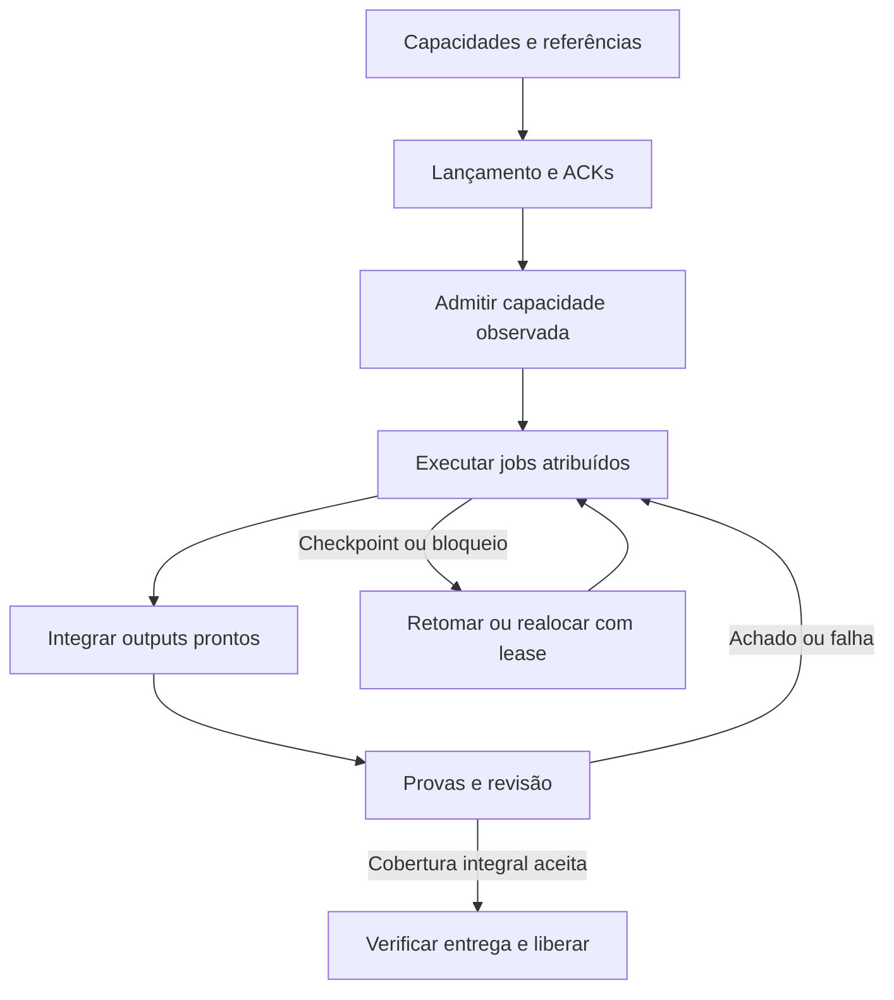

# Workflow de execução — uma supervisora e N sessões

**Objetivo:** executar o plano inteiro, integrar continuamente e fechar a entrega com provas e revisão independente dentro da meta de 120 minutos. O workflow está planejado; nenhuma execução de produto é declarada por este documento.

O ponto de entrada é [prompts/S0.md](prompts/S0.md). A fonte operacional é [execution-workflow.json](execution-workflow.json), gerada de `campaign.json`. Cada sessão recebe identidade, atribuições, branch, fronteiras, entradas, saídas, provas e regras de retomada. Ela não escolhe uma fatia.

## 1. Topologia e admissão real

O preset compilado é **S0 + N=4 sessões coordenadoras**, cada sessão com até três auxiliares além de sua coordenadora. São até vinte slots totais, dos quais cinco são coordenadoras. Três builders dão lugar a reviewers novos nas janelas e transferências previstas; as 23 identidades do plano nunca significam 23 atores simultâneos.

| Sessão | Missão e auxiliares |
| --- | --- |
| **S0 — supervisora e integradora** | Contratos, composição, integração e encerramento. S0-A: corpus/Atlas; S0-B: preflight/runtime/MCP; S0-C: harness/CI e depois memória, conforme leases. |
| **S1** | S1-A: interface; S1-B: Dashboard; S1-C: Planner. A coordenadora também entrega as fontes Finance/Portfólio nos intervalos reservados. |
| **S2** | S2-A: Procurement; S2-B: BI; S2-C: importação. A coordenadora produz extração documental e assume temporariamente o dispatcher de CI. |
| **S3** | S3-A: revisões/reuniões; S3-B: colaboração; S3-C: Relay. A coordenadora qualifica GNATIVE e entrega as fontes Maestro/Revisor. |
| **S4** | S4-A: decisões; S4-B: IA/skills; S4-C: portfólio. A coordenadora começa memória/tradução e transfere WP14 ao writer designado. |

**N é parâmetro de capacidade. Este pacote contém apenas o preset N=4 já alocado.** Outro N exige redistribuição completa de tarefas, leases, slots e provas antes da admissão. Mais nomes de agentes não criam capacidade de modelo, ferramentas ou runners.

A sequência de arranque é: **conferir capacidades → lançar ou reconhecer instâncias → receber ACKs → admitir o roster observado**. Não exigir ACK antes de criar a sessão. T0 começa na primeira execução de S0 e inclui todo esse trabalho.

No modo automático, S0 usa somente ferramentas de criação, mensagem, observação e retomada realmente expostas pelo backend. Registra quais operações existem e os IDs retornados. Nenhum nome de API imaginária é pressuposto.

O backend de `collaboration` observado durante o planejamento possui **quatro slots globais, incluindo root**. Criar subagentes dentro de subagentes não o converte em cinco pools independentes. O preset de vinte slots precisa de cinco sessões independentes confirmadas. Quando só existe arranque assistido, as conversas recebem os prompts fixos uma vez e coordenam por recibos enquanto ativas. Git é o registro comum; não cria nem desperta uma conversa encerrada.

## 2. Contexto pronto, específico e completo

Cada ator lê [COMMON](execution/COMMON.md) e seu pacote no [manifesto de execução](execution/manifest.json). Os 23 JSONs incluem tarefas e axiomas completos, contratos pertinentes, permissões por lease, handoffs, provas, anexos residentes e fontes de código. Os Markdown são entradas curtas; não duplicam os corpos JSON.

Os quinze documentos integrais antes exigidos por cada coordenadora somavam **2.598.019 bytes UTF-8 por sessão**, antes dos WPs: **12.990.095 bytes repetidos nas cinco sessões**. A medição da seleção nova está em [context-measurement.json](execution/context-measurement.json). Bytes não são tokens nem uma medição de tempo economizado.

O compilador confere cobertura de 74 tasks, 1.610 critérios, 19 handoffs, dezoito skills e 39 operações. Alteração de writer, roster ou branch sem atualizar o mapa explícito é rejeitada. Ler um pack não concede a um auxiliar todos os arquivos do WP; ele recebe somente sua parte e seus leases atuais.

O [índice de fontes](execution/sources.json) reutiliza descobertas por repositório, commit, path e blob. O escritor continua lendo o código real e as instruções locais antes de editá-lo, ampliando a investigação quando a alteração ou uma dependência exigir. Autorização, disponibilidade de modelo, scanner e capacidade são fatos de execução e não ficam válidos por um cache de código.

## 3. Loop da supervisora

Construção, integração, provas e revisão coexistem. A supervisora controla uma fila de trabalho pronto, em vez de esperar todos os WPs encerrarem uma fase.

S0 entrega uma missão persistente por writer. As tasks continuam unidades de aceite, com seus critérios próprios; não viram 74 sessões descartáveis. Um job pode atravessar fases da mesma atribuição e publicar vários outputs. O estado de um output não aprova automaticamente o restante da task ou do WP.

Cada evento informa instância da campanha, ator, tentativa, epoch do lease, sequência, task/output, SHA, dependências, provas e próximo passo. Eventos repetidos são deduplicados. Um aviso de entrega aponta para o commit e seus hashes; o consumidor confirma o SHA recebido e o comportamento observado.

**Prioridade:** cadeia nativa de T18, produtores que liberam Atlas/memória, correções que bloqueiam o candidato e demais incrementos prontos. A supervisora mantém a única escrita da branch integradora e não corrige diretamente arquivos de outro writer ativo.

Dentro de cada sessão, eventos nativos atendem ao trabalho local. Entre sessões, usar transporte realmente disponível; o fallback consulta os heads/recibos de S1–S4 em lote e lê somente mudanças. A meta de idade da fila é operacional e condicionada à disponibilidade de S0. Não há polling narrativo de vinte agentes a cada instante.

Ler e incorporar os inputs de uma task faz parte da reserva dessa task. Por exemplo, **S0 consome a cadeia nativa durante T10–18**, inclusive o encontro dos inputs em T16–18; isso não espera uma janela genérica de coordenação em T25.

## 4. Cronograma executado por prontidão

As janelas são orçamento a observar; não foram encurtadas para fabricar velocidade.

| Intervalo/checkpoint | Comportamento esperado |
| --- | --- |
| **T0–5** | Registrar relógio, referências e capacidades; lançar/reconhecer sessões, obter ACKs e observar o roster. |
| **T0–10** | Contratos, corpus, preflight de runtime e inventário de CI em paralelo, dentro dos slots atribuídos. |
| **T13–20** | AI-NATIVE, caso, Planner e runtime alimentam a composição até T18; S3 qualifica a cadeia real até T20. |
| **T25/40/55** | Conferências cumulativas. Outputs prontos integram antes desses horários quando a reserva permite. Rotas MCP começam a ser exercidas quando todos os seus insumos reais estão presentes. |
| **T55–60** | S0 consolida guia por papel, roteiro sintético e changelog no README já possuído, como saída T01. |
| **T60–75** | Integração dos consumidores tardios e ajustes dos guias antes do candidato C; memória T68 tem prioridade explícita de consumo. |
| **T72/75 em diante** | Reviewers novos ocupam apenas os slots efetivamente liberados. Cada achado segue imediatamente ao autor ativo; não esperar T95. |
| **T75–95** | Candidato completo, seleções finais e provas live; revisão e correções caminham juntas. |
| **Até T103, condicionado à cauda medida** | Congelar o último C corrigido. O último freeze viável é calculado pelas durações restantes reais; quinze minutos não são presumidos suficientes para qualquer CI. |
| **T103–118** | Completar provas/rechecks de C e preparar somente registros evidenciais. |
| **T118–120** | Conferir D, guard e publicação; emitir liberação global apenas com aceite completo. |

A cauda memória T68 → seis consumidores até T75 continua sendo risco concreto. Antecipar uma entrega ou reviewer exige trabalho realmente pronto, predecessor satisfeito, slot livre, transferência aceita e atualização explícita das reservas. Não cria um 21º agente.

## 5. Uma fila de CI e prova por rota

S0 governa a fila; um dispatcher por vez a opera. Os handoffs S0-C → S2 → S0-C transferem também requests e runs em voo. Workers pedem validação; não disparam uma cópia da mesma seleção.

A deduplicação considera candidato/árvore, request normalizado, fonte do workflow e validator, runtime/configuração, fixtures e seleção. Uma request idêntica em voo é adotada com sua proveniência original. Falha, cancelamento, seleção vazia, artefato ausente ou dependência desconhecida não viram PASS de cache.

No desenvolvimento, validar a alteração e seus consumidores transitivos. Uma execução pode fornecer várias observações específicas, com expected/observed por critério. Não criar teste por frase ou uma inferência por chamada determinística. O harness direto de AM02 conserva binding, skill carregada e autorização; AM01 ainda demonstra inferência e contribuições reais das skills.

**As oito seleções finais mínimas, suites adicionais exigidas e AM01–AM06 continuam obrigatórias no mesmo candidato de produto C.** O primeiro resultado verde de uma seleção parcial não substitui esse conjunto. [Receitas e matriz de invalidação](ci-recipes.json).

## 6. Produto C e entrega evidencial D

**C** contém produto, testes, fixtures, configuração, skills/prompts, assets e guias normativos. É o candidato testado e julgado. Mudança nesse conteúdo exige um novo C e a cobertura obrigatória correspondente.

**D** apenas acrescenta evidências admitidas, preservando todos os arquivos existentes de C. Conferir ancestralidade, diff completo, paths/tipos/modos, hashes e ausência de novos inputs de build, teste ou runtime. Skills e prompts são conteúdo de produto, inclusive quando escritos em Markdown.

O guard de C pertence a G7; o guard de D pertence a G8. D aponta para C e para os runs originais. Não troca seus SHAs nem grava dentro de si o próprio SHA ou o resultado de um guard executado depois. O fechamento externo informa o commit que contém a evidência e o resultado do guard.

Isso elimina o ciclo em que salvar um recibo leva a testar novamente o produto apenas porque o recibo criou um commit. O envelope exato e suas recusas estão em `execution.candidate_delivery` na fonte canônica e no workflow.

### Controle e tentativas de entrega

S0 mantém roster, leases, filas e checkpoints operacionais na branch **sf2-control**, com a mesma capacidade já reservada. Essa branch nunca é base de snapshot CI e nunca é mergeada em C/D. S0 incorpora em D somente os blobs evidenciais admitidos, identificando source commit, source path e blob hash; não incorpora a branch inteira de um dispatcher ou do harness.

Antes de cada tentativa de D, S0 aloca um path completo novo para o receipt, vinculado ao mesmo C, instância, número de tentativa e parent esperado. A alocação fica registrada por commit antes da criação de D. O envelope admite somente a lista finita de paths exatos dessas tentativas; nunca o prefixo inteiro de control. D2 pode preservar receipts admitidos de D1 sem alterá-los. Uma mudança proibida ou de produto não é corrigida apenas acrescentando outro receipt: exige a rota explícita de correção/requalificação.

## 7. Retomada e término

Checkpoint contém head aceito, tarefas/outputs concluídos e pendentes, contratos, inputs recebidos, lease/epoch, provas/candidato, blocker e próxima ação. Retomar a mesma instância usa esse delta e o trabalho remanescente.

Silêncio, última mensagem antiga ou falta de commit não provam que uma sessão morreu. Consultar o estado real do backend. Antes de substituir um writer, encerrar ou revogar sua autoridade por mecanismo realmente suportado, incrementar epoch e isolar o novo trabalho. Outputs do epoch antigo não são integrados. Enquanto a autoridade estiver incerta, continuar frentes disjuntas.

Os reviewers são novos e não autores. Um builder pode liberar seu slot com handoff aceito por quem fará as correções. As coordenadoras mantêm obrigação de retomada até **GLOBAL_RELEASE**; um encerramento do backend exige mecanismo real de retomada.

S0 só anuncia conclusão com escopo integral, consumidores, provas, três pareceres, nenhum achado obrigatório e commit final conferido. T120 sem aceite muda o estado para continuidade com atraso, com ETA observado; não reduz funcionalidades nem encerra a missão automaticamente.

## 8. Axiomas e verificação

DoD, invariants, quality standards, completeness criteria e success criteria existentes permanecem na campanha, em cada WP e em cada task. O workflow também define as cinco famílias para suas oito etapas operacionais. Elas orientam admissão, delegação, integração, prova, revisão, recuperação e entrega sem substituir critérios de produto.

Execute `python tools/render_plan.py --check` e `python tools/validate_plan.py` para conferir o plano e seus pacotes. Esses comandos não implementam produto, não executam CI de produto e não demonstram a duração de duas horas. Estado da revisão do delta: [formal-review/README.md](formal-review/README.md).
