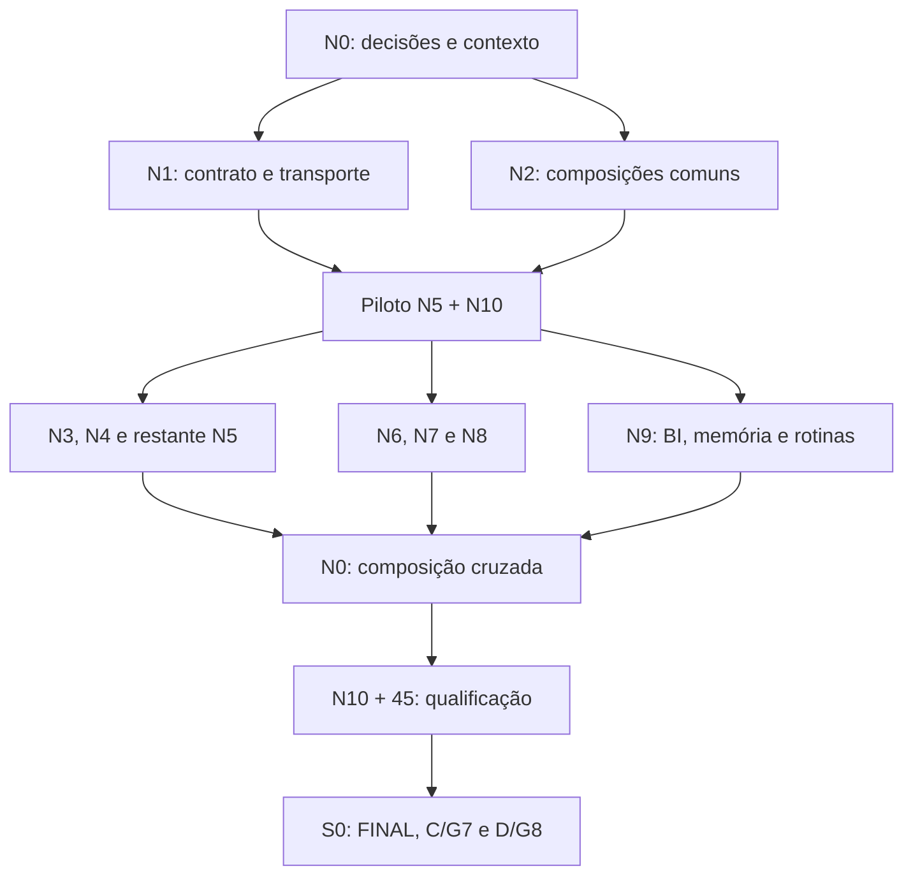

# Plano de entrega, paralelismo, dependências e dimensionamento

**Estado: execução não autorizada nesta sessão.** N0–N10 são pacotes operacionais desta adaptação; não substituem nem desmembram as 74 tasks canônicas. Os cinco grupos de axiomas e checks de cada task continuam aplicáveis.

## 1. Condições de início

1. Revisão do usuário sobre arquitetura de informação, pranchas e decisões de produto.
2. Integrador da adaptação com autorização específica e custódia reconciliada com a60/ACK60, ou seu sucessor explícito, após o terminal 57. A branch de planejamento não assume essa autoridade.
3. Congelamento de contexto/mount/cookie, DTOs, catálogo de ações, route manifest e regras de estado/erro.
4. Produtores e serviços disponíveis identificados por pin/consumer ACK; bloqueios permanecem explícitos.
5. Interface de checks/geração de 45 e runners autorizados confirmada antes de planejar execução hospedada.

## 2. Pacotes e paths exclusivos

Prefixos: **APP** = `packages/app-shell/src/orchestra/chapters/sucafina`; **SF** = `modules/sucafina/Sucafinav1`; **CLI** = `apps/cli/src/sucafina-product`. A exclusividade inclui CSS, helpers e specs unitários locais sob o mesmo subtree. Paths novos são propostas, não arquivos já existentes.

| Pacote / responsável funcional | Entrega | Paths exclusivos de implementação futura | Dependências |
| --- | --- | --- | --- |
| **N0 Integrador** | Registros, owner resolver, perfil de navegação, composição/receipts e freeze | navigation.ts, chapter-route.tsx, sidebar.tsx, app.tsx; APP/entrypoints/**; APP/route-manifest.ts; registries i18n; arquivos centrais de schema/protocol/client exports/build; CLI/installation.ts, CLI/host-context.ts, SF/local/entry.ts e SF/runtime/application.ts somente após reconciliar donos | Autorização e sucessão vigentes |
| **N1 Contrato/transporte** | Schema/Protocol dedicados, DTOs, montagem nativa e adapter autenticado | `packages/schema/src/sucafina.ts`, `packages/schema/src/sucafina/**`; `packages/protocol/src/groups/sucafina-native.ts`, `src/sucafina-api.ts`; `packages/client/src/sucafina-contract.ts`; SF/product/native-ui/**; CLI/native-ui/**; SF/test/native-ui-contract/** | N0 contrato inicial, revisão Microsoft/host |
| **N2 Composições comuns** | PageFrame, Table, MonthlyGrid, Detail, ChangeReview, Evidence/Run states, estilos e i18n comuns | APP/shared/**; `packages/app-shell/src/i18n/orchestra-chapters/sf-common.ts`; novos testes locais de componentes nesse subtree | N0 design/route contract; N1 DTO freeze para binding final |
| **N3 Trabalho e gestão** | Hoje, Dashboard, Meu trabalho, Pessoas, Operações, Portfólio overview/projetos | APP/home/**, dashboard/**, work/**, people/**, operations/**, portfolio/overview/**, portfolio/projects/**; i18n sf-home, sf-dashboard, sf-work, sf-people, sf-operations, sf-portfolio-projects | N1/N2 e piloto; C02/C06; dados/agenda atuais |
| **N4 Planner** | Sete capacidades, grid mensal/HR, versões e comparação | APP/planner/**; i18n sf-planner.ts | N1/N2; Finance/Planner atuais e invariantes |
| **N5 Procurement** | Piloto e depois fila, pedidos, aprovações, suppliers, contratos, settings | APP/procurement/**; i18n sf-procurement.ts | N1/N2; ciclo canônico53; M31/MI07 impede aceite da jornada ampliada |
| **N6 Decisões e cenários** | Casos, análise, escolha, prepared changes/receipts; portfolio cenários/sensibilidade | APP/decisions/**, portfolio/scenarios/**, portfolio/sensitivity/**; i18n sf-decisions, sf-portfolio-analysis | N1/N2; consumidores53/CurrentChoice; releases52, P03 e native onde exigidos |
| **N7 Arquivos** | Imports/manifest/Apply/receipt, docs/extração/confirmação, exports e anexos por componente próprio | APP/imports/**, documents/**, attachments/**; i18n sf-imports, sf-documents | N1/N2; C04/C14 e scanner/readers reais |
| **N8 Reuniões** | Pauta, preservação, comparação, meeting view e PPTX/DOCX | APP/reviews/**; i18n sf-reviews.ts | N1/N2; Agenda39, qualificação do Reports48 composto em C28, ACL/rascunho e readers históricos |
| **N9 Inteligência e colaboração** | BI01–11, relações/threads/confirmações, memória, rotinas e recorrência | APP/bi/**, collaboration/**, memory/**, routines/**; i18n sf-bi, sf-collaboration, sf-memory, sf-routines | N1/N2; C06/C07/C13/C17, Native/Relay/Schedule readiness |
| **N10 Qualificação** | Specs nativos, matriz visual/a11y, compatibilidade e evidência do candidato | Novos `packages/app-shell/e2e/sucafina/native/**`; `test-browser/sucafina-native/**`; docs de evidência admitidos. Os três specs canônicos e helpers compartilhados somente via N0 e aceite do dono atual | Piloto para começar; composição final para gates; coordenação45/S0 |

Os workers N1–N10 **não escrevem** navigation.ts, chapter-route.tsx, sidebar.tsx, app.tsx, kit global, paletas geradas, registries de locale, package manifests, lockfiles, workflows, host-context/installation/application ou domínios atuais fora do próprio subtree. Entregam patch/solicitação ao N0 com pre/postimages, justificativa e contratos afetados.

O N0 é o único que aplica patches compartilhados; isso não lhe dá autorização de substituir trabalho vigente sem release. Se 45 ainda detém compiler/workflow, N0 solicita a interface via handoff de repositório. Não criar outro dispatcher nem assumir a branch de checks.

### Pontos de colisão explicitamente resolvidos

- **Portfólio:** N3 só overview/projetos; N6 só cenários/sensibilidade; wrapper/tabs/route assembly em APP/entrypoints/portfolio.tsx pertencem a N0.
- **Contratos:** apresentação em N5/Procurement; domínio/ACL permanecem Dashboard. N3 não cria um segundo editor de contrato.
- **Threads/confirmações:** comportamento e componentes N9; N3/N8 consomem slots tipados do freeze, sem editar APP/collaboration.
- **Anexos:** N7 publica componente/adapter; outros consomem, não copiam upload.
- **BI contextual:** N9 fornece visuais/DTO binding; N3/N4/N6/N8 consomem interfaces publicadas. Antes de N9, composição pode usar fixtures de design, mas não pode ser aceita como produto.
- **i18n:** cada pacote escreve somente seus leaf dictionaries. N0 cuida de import/merge e labels globais; inglês/pt-BR e demais locales seguem política real.
- **Geração:** N1 entrega a proposta de target; N0/45 executam pela interface autorizada após integração. Nenhum worker edita generated à mão.

## 3. DAG e integração

As setas representam dependência de **consumo/aceite**, não autorização de escrita no produtor. N1 e N2 podem avançar simultaneamente após um pequeno freeze inicial de shapes e ownership; seu binding conjunto precisa fechar antes do piloto. A implementação do cenário P03/Relay pode preparar estrutura de UI, mas seu aceite espera a dependência real.

### Capacidade realista de paralelismo

Planejar com **um integrador e até três frentes de autoria simultâneas**, caso essa capacidade seja efetivamente disponibilizada. Não pressupor onze sessões nem oito runners. Após o piloto, sete pacotes de negócio podem ficar elegíveis; com três frentes isso exige pelo menos três rodadas de ocupação, cuja duração varia por pacote e bloqueio.

N10 pode escrever a especificação dos casos em paralelo e revisar componentes já publicados, mas só executa no candidato composto. Os três revisores FINAL são independentes dos autores do trabalho examinado; N10 não substitui os três nem aprova o próprio código.

Pacotes N3/N9 são mais amplos. Se precisarem de distribuição adicional, emitir primeiro um adendo de ownership com subtrees disjuntos (por exemplo people/operations separados de home/work), preservando a referência às tasks canônicas e sem sobrepor registry/adapter. Não despachar dois autores para o mesmo prefixo.

## 4. Entrega por pacote e consumer ACK

Cada handoff de implementação futura inclui:

- Base material, parent/tree, arquivos exclusivos e pre/postimages; versão/digest de contratos consumidos.
- Mapa dos itens CAP/UI e task/critério canônicos afetados, sem promover critérios por presença de código.
- Exemplos de dados/estados e telas; comportamento preservado, limitações e bloqueios concretos.
- Resultado de verificações hospedadas no SHA correto, quando autorizado; tentativas/falhas retidas.
- Patches compartilhados separados e inertes, com dono solicitado.
- Consumer ACK de N0: aplicado, parcialmente aplicado ou retido, com razão e próxima dependência.

Integrar cedo por slice coerente. Não juntar todas as branches por merge cego nem esperar a fase final para descobrir incompatibilidade de DTO. Mudança pública exige revisão/digest novo e atualização dos consumidores, não aceitação implícita por compilar isoladamente.

## 5. Dimensionamento fundamentado

### Unidade e inventário de esforço

A base observada é **15 chapters, 28 capacidades de domínio, 42 entradas adicionais de fluxo/detalhe, 11 composições comuns propostas, 17 contratos canônicos e 13 jornadas**. O custo principal não é criar quinze links: são edição financeira, autorização de fontes, estado assíncrono e paridade de mutações.

S/M/L/XL abaixo são comparações de complexidade, não horas ou percentuais. “S” significa composição de leitura simples com DTO pronto; “XL” significa múltiplos estados e efeitos com dependências entre domínios.

| Pacote | Faixa relativa | Base da estimativa e incerteza |
| --- | --- | --- |
| N0 | L | Quatro âncoras do shell + registries/composition roots compartilhados; resolução server/project/install ainda nova |
| N1 | XL | Sub-API, geração dedicada, cookie path/return,15+ famílias de recurso, redaction/admission/transações. Maior risco de arquitetura |
| N2 | L | Onze composições, grid APG, densidade/responsividade e todos os estados; sem DataGrid pronto observado |
| N3 | XL | 15 capacidades originais de Dashboard redistribuídas + Hoje/Meu trabalho/busca; muitos produtores/ACLs |
| N4 | XL | 7 capacidades, 12 meses, HR, FX, versões/locks, comparação e números canônicos |
| N5 | XL | 6 capacidades contando Contratos, múltiplas etapas e papéis; piloto e bloqueio M31/MI07 |
| N6 | XL | Casos/análises/alternativas/escolha/recibos, portfólio/sensibilidade; P03 e releases dependentes |
| N7 | L–XL | 2 fluxos de quatro/mais etapas, parsers/scanner, previews, evidência confirmada, downloads/backup |
| N8 | L–XL | Pauta, conteúdo preservado, compatibilidade histórica, grandes exports e falhas de leitura/rascunho |
| N9 | XL | 11 gráficos, colaboração, materialidade/memória e5 famílias de rotina; Atlas/Relay/Schedule reais |
| N10 | L–XL | 13 jornadas, papéis/contextos/temas/viewport e guards/AMs existentes; custo de runner/diagnóstico ainda não medido |

Esta contagem não soma views e ações como se tivessem o mesmo custo. O Planner mensal e uma aprovação com receipt são substancialmente mais difíceis que uma lista de leitura.

### Estimativa de prazo responsável

Não há nesta sessão dados de produtividade de port nativo, fila de CI ou disponibilidade de produtores que sustentem um número de dias/horas. O briefing proíbe estimativas sem fundamento. A previsão de prazo fica **CONDICIONAL**, com estrutura de cálculo definida:

`prazo = freeze/owner + max(contrato, composições) + piloto + escalonamento dos pacotes de negócio em 3 frentes + integração cruzada + qualificação/revisões + espera material por dependências`

Depois do piloto, registrar tempo observado de DTO+binding, lista/detalhe, revisão de comando, correção visual/a11y, integração e ciclo de CI. Aplicar esses intervalos às famílias comparáveis e usar medições específicas adicionais para grid e análise/receipt. Publicar faixa otimista/provável/conservadora com as dependências abertas e fila real. Não dividir o total por número de agentes como se não houvesse caminho crítico.

O caminho crítico provável é **binding Microsoft/owner → DTO/admissão → piloto → Planner/Decisões/Procurement completos → integração → gates**. P03/M31/MI07/Native/Reports podem dominar a espera e não têm ETA autorizada por este plano. O alvo histórico T+120 continua no canônico; não é reiniciado nem convertido em promessa desta migração.

## 6. Registro de riscos e tratamento

| Risco concreto | Efeito | Tratamento / dono de decisão |
| --- | --- | --- |
| Cookie limitado ao mount e safeReturn restrito | Native API sem sessão, callback perde a rota | N1 + produtor Microsoft; sub-API no mount e bridge revisada; sem Azure nesta sessão |
| Owner server/directory insuficiente | Vazamento ou ação no projeto errado | N0/N1; resolver instalação/projeto/principal antes de fetch, cancelamento e remount |
| Domínio de permissão diferente do chapter | Contratos/Talent/HR expostos indevidamente | N1 preserva fonte surface/ACL; negativos em N10 |
| Ausência de DTO público completo | Tentação de dump/HTML scraping | N1 extrai projeção mínima autorizada; producer patch explícito |
| Tabela/grid inadequados | Perda de produtividade/teclado e erros mensais | N2/N4; APG, editor por linha mobile, validação com corpus real |
| M31/MI07 e P03 abertos | Jornada bonita mas incapaz de concluir | Donos canônicos; UI honesta, nenhum waiver ou timeout ampliado |
| 503 confundido com revogação | Perda de rascunho/intenção ou vazamento | N1/N8; estados tipados, retenção só em contexto ainda autorizado |
| Sources52/48 em evolução | Sobrescrita e prova desatualizada | N0 consumer ACK por release, sem importar branch inteira |
| Explosão de navegação | 15 itens sem hierarquia ou menus técnicos dominantes | Grupos/frequência, default disclosure e papel; revisão de tarefas |
| Muitos temas/locales | Baixo contraste, clipping e frases partidas | N2/N10; tokens e dicionários tipados; matriz visual e corpora |
| Performance do runtime | UI assíncrona parece travada; SLA presumido | Manter cancel/status e medir; nenhum cache de autorização ou otimização rejeitada |
| Gates/client generation novos | Plano impossível de validar no runner atual | 45/N0 confirmam interface; bloqueio documentado até executor autorizado |

## 7. Recomendação de autorização

Aprovar esta direção de UX e autorizar **fundação e piloto**, mantendo como escopo final todas as áreas. Liberar os pacotes paralelos após freeze e avaliação do piloto. O produto só recebe aceite quando os gates canônicos e nativos estiverem satisfeitos no candidato correto.

Nenhum worker, servidor, teste, deploy ou execução foi iniciado por este documento.
