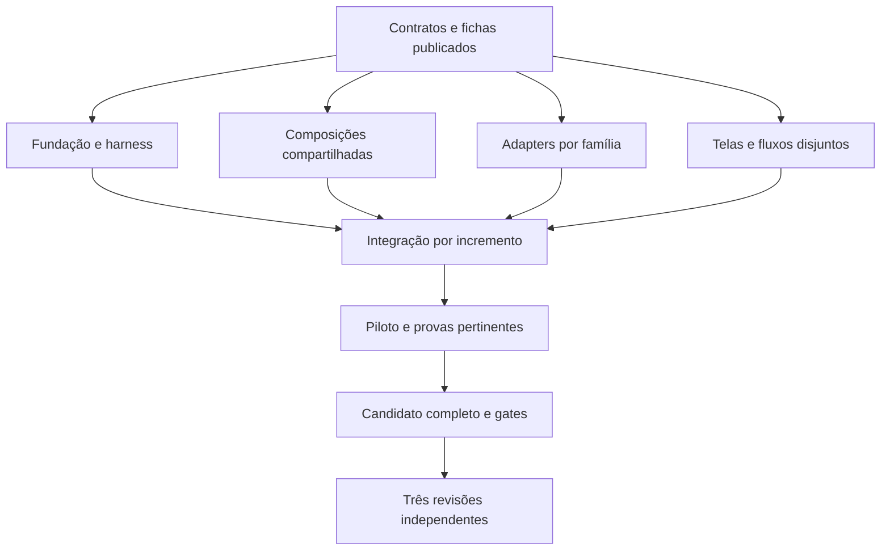

# Entrega paralela por ordens pequenas e contratos fechados

**Planejamento; execução de produto ainda não autorizada.** O fatiamento N0–N10 da revisão inicial foi substituído pelo manifesto operacional. Os nomes históricos permanecem somente em referências à primeira edição; não são leases nem pacotes para novo despacho. WPs/tasks/critérios canônicos não foram substituídos.

## 1. Unidade de execução

São **78 ordens**, incluindo **47 fatias de interface**, conforme o manifesto final. Hoje, Meu trabalho, Busca, Visões salvas, Talent, FX, Versões e as manutenções de Dashboard têm propriedade separada; páginas de colaboração não são confundidas com os componentes puros que reutilizam.

Uma ordem entrega um fluxo, composição comum, família de transporte ou prova com arquivos próprios. Sua ficha fixa: objetivo; source pins; read set mínimo; contrato consumido; exports e paths; superfícies/ações; dependências de autoria/integração/qualificação; seleção de verificação; condições de parada; e handoff terminal. Os arquivos estão em [execution/work-orders](execution/work-orders); a lista completa e os grafos estão em [manifest.json](execution/manifest.json).

| Família | O que executa | Restrição que evita retrabalho |
| --- | --- | --- |
| I00 | Registry, composition roots, geração pública existente e integração | Um writer dos paths compartilhados; compõe fragmentos, não redesenha contratos |
| F | Contexto, transporte, frames/estados e harness instalado | Assinaturas já fixadas; harness avança junto da fundação |
| D01 | Transporte desktop e sessão de autenticação isolada | Capability tipada; nenhum proxy genérico, cookie ou token no renderer |
| S | Tabela/detalhe, grid, draft/review/receipt, evidência/anexos, colaboração | Um export com um dono; consumidores não copiam componente |
| A | Adapters e clients finos por família de domínio | Reutilizam HTTP e tipos atuais; projeção nova apenas onde falta leitura pública |
| U | Fluxos/telas de negócio em subtrees disjuntos | Não alteram registries, domínios, shared components ou arquivos alheios |
| Q | Provas transversais nativas | Reutilizam o harness e o dispatcher; não repetem suite por tela |
| R | Três revisões finais independentes do produto futuro | Sem autoria do candidato examinado; não substituídas pelo cold review deste plano |

Pessoas, operações, trabalho, colaboração, memória, rotinas e análises não ficam atrás de um adapter monolítico. Serviço, segurança, riscos/relacionamento e performance têm autores independentes. Pauta, revisão/comparação e relatório também. Recorrência, residentes, settings de compras e análises assíncronas têm entregas próprias.

## 2. Três relações de dependência

**Autoria:** a ficha e as assinaturas congeladas permitem escrever sem esperar toda implementação compartilhada. Um import ainda não materializado é dependência registrada; não autoriza criar um stub concorrente, duplicar tipos ou modificar o produtor. Check que exige o produtor espera a integração, sem declarar falso PASS.

**Integração:** código consumidor precisa dos seus exports/serviços concretos e fragmentos aplicados pelo I00. BI, colaboração, anexos e estado de execução aparecem como dependências explícitas somente dos consumidores pertinentes. Piloto não é uma aresta universal para todas as U.

**Qualificação:** exige autorização atual, serviços reais, fixture instalada, identidade/candidato e oráculos corretos. A indisponibilidade de scanner, P03, aprovação financeira ou Schedule bloqueia o respectivo aceite, não toda autoria independente.

O desenho resume o mecanismo; as arestas normativas por ordem estão no manifesto. Não representa todos os pacotes como simultaneamente admitidos nem cria um scheduler novo.

## 3. Despacho e uso da capacidade

Usar a supervisão, ownership, handoff e deduplicação já definidos no canônico. O integrador confirma o número de autores, reviewers e runners realmente disponíveis; não fixa três autores por conveniência e não presume dezenas de slots. Dentro dessa capacidade, admite todas as ordens com requisitos de autoria cumpridos e allowlists sem conflito.

Prioridade de despacho: transportes/contexto/harness e componentes consumidos por muitos → adapters e fluxo de aprovação do piloto → demais caminhos críticos financeiros/decisão → demais ordens prontas. Não reservar capacidade ociosa para uma dependência ainda sem fonte. Revisores independentes são admitidos quando há material examinável e capacidade livre, sem contar autores como revisores de si mesmos.

Ao terminar código/documentos próprios, o autor entrega `ARTIFACT_READY` e o handoff completo; conforme aceite do integrador, libera o slot. `INTEGRATED` e `QUALIFIED` são estados posteriores. Espera por componente de outro dono fica na fila existente, sem agente vivo repetindo polling ou CI. Retomada usa o delta e o receipt anterior, não uma nova leitura de todos os documentos.

## 4. Piloto definido

O piloto integra navegação, identidade e transporte, fila Procurement, detalhe e **duas fases distintas** sob dois atores: P0 salva somente título `pr.title` em draft persistido com CAS/owner fence por U11.title-save (não é aprovação e não tem receipt C12); P1 aprova realmente PR submetida sob holder atual via U13.pr-approval. Ambas exigem o produtor real, estado incerto sem replay, negativo de segundo ator, web e desktop; P0 não substitui P1. O mesmo fluxo é exercitado pelo shell web na origem aprovada e pelo desktop através de D01; web verde não qualifica desktop. Harness é entrega de fundação, não tarefa descoberta depois do piloto.

O piloto verifica a ligação entre peças e calibra layout/latência observados. Não muda produto para MVP, não substitui M31/MI07, não fecha P03 e não dispensa outras jornadas. Ajuste de contrato exige finding e correção central com consumidores afetados; autor não redesenha a assinatura durante a execução.

## 5. Integração sem colisão

Cada writer altera somente `owns` de sua ficha. Prefixos são comparados após normalização, inclusive pai/filho; i18n, CSS, specs e fixtures pertencem à mesma regra. Os paths globais do I00 são finitos. Um patch compartilhado inclui preimage, postimage e motivo; seu autor não publica diretamente no registry. I00 rejeita preimage divergente e devolve a parte afetada ao writer legítimo, preservando o restante consumível.

Um avanço de stack não exige recompor tudo. Comparar a footprint do contrato/fonte usada por cada ordem; mudança fora dela não invalida autoria por associação. Mudança de contrato, teste, fixture ou runtime segue a matriz canônica de invalidação. Evidência de outra árvore permanece identificada como tal e não recebe SHA novo.

## 6. Validação eficiente

[ACCEPTANCE.md](ACCEPTANCE.md) conserva os gates finais; o protocolo operacional reutiliza `ci_plan.dispatch_policy` do canônico. Cada ordem pede somente checks próprios e consumidores transversais realmente afetados. O dispatcher adota execução em voo/concluída apenas com a chave canônica idêntica e evidência íntegra. Não despachar caminhos inexistentes, seleção vazia ou uma config que ignora o teste.

Teste de componente compartilhado é escrito uma vez; cada tela prova binding, estados e efeito de seu domínio. Não criar testes que repetem a implementação nem um produto cartesiano de todos os papéis, temas, widths e telas. A matriz escolhe casos por risco e mantém todas as obrigações finais existentes no mesmo candidato C.

## 7. Fatos de lançamento e regra de parada

O manifesto não inventa quem tem um lease hoje, credenciais, host, slot, runner ou release de produtor. I00 preenche esses fatos por observação e autoridade explícita antes de iniciar a ordem. Uma fonte ausente produz `BLOCKED_DEPENDENCY`; uma contradição ou contrato não fechado produz `BLOCKED_CONTRACT`, com ação exata necessária e dono. Nenhum deles permite implementar solução alternativa por conta própria.

Os autores concluem todo trabalho independente autorizado, registram o que falta e entregam artefatos concretos. Não fazem merge de branches alheias, não criam outro controller, não simulam scanner/receipt/runtime e não enfraquecem budgets/oráculos para passar.

## 8. Dimensionamento honesto

Mais fatias reduzem fila interna e permitem usar slots reais; não garantem aceleração linear. O caminho crítico continua passando por contexto/autenticação/transporte, componentes de edição, integração e provas reais. Prazo é medido a partir de entrega e fila observadas. Não há promessa de horas, porcentagem de ganho ou número fictício de sessões.

Os controles documentais verificam completude dos IDs, resolução de deps, ownership, rotas, cobertura de comandos e referências. Eles não executam testes de produto e não dão autorização para implementação.
