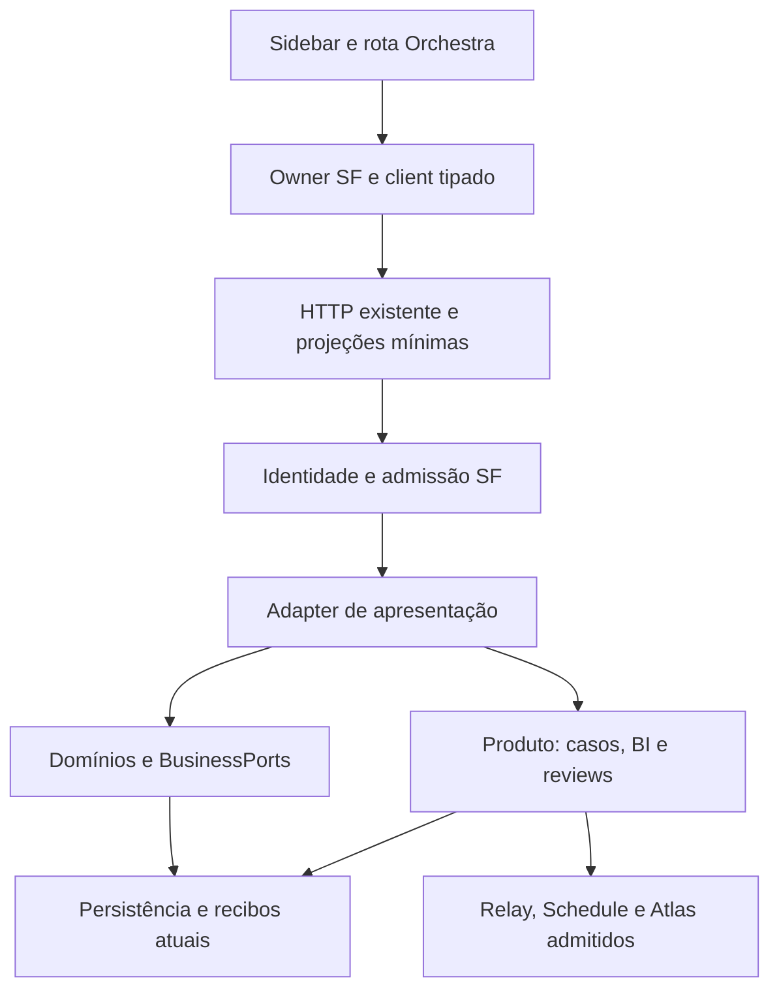

# Composição nativa no Orchestra

Estado: especificação corrigida após cold review. A inspeção histórica está em [SOURCE-BASELINE](SOURCE-BASELINE.json); os contratos operacionais pinados e a montagem vigente proposta estão em [CONTRACTS](execution/CONTRACTS.md). O objetivo é substituir a apresentação independente conservando motores e semântica. O fatiamento normativo usa [manifest.json](execution/manifest.json), não N0–N10.

## 1. O que existe e o que precisa mudar

| Âncora real | Observação de código | Adaptação proposta |
| --- | --- | --- |
| `packages/app-shell/src/orchestra/navigation.ts` | primary/advanced/settings, labels i18n, breadcrumbs, maestro dialog e search command | Perfil de navegação SF acrescenta grupos/15 IDs; mantém lookup plano para breadcrumb e destinos técnicos |
| `.../chapter-route.tsx` | `chapterPages` lazy, `ChapterPageProps={server,directory}`, owner selecionado, SDK/sync/models, Boundary/Suspense; lista serverWide | Registrar cada chapter SF; resolver binding de instalação/projeto antes do consumo. SF não entra em serverWide para escapar da seleção |
| `.../sidebar.tsx` | Uma aside, grupos, ícones, active state, tooltip, preload, perfil servidor/projeto no rodapé | Reusar a mesma estrutura, mapear ícones existentes e grupos. Expandir grupo ativo. O perfil SF é configuração da instalação, não grant client-side |
| `packages/app-shell/src/app.tsx` | Providers de tema/paleta/i18n/dialog/query e rota `/orchestra/:chapter/*rest`; routes explícitas de servidor | Manter root/provedores montados. Estender resolução de owner/deep link e entrada Hoje de instalação SF; sem root app paralelo |
| `.../chapters/kit.tsx`, `kit.css` | MxPage/MxBadge/MxToggle; largura normal 1020px | Reuso de cabeçalho/estados; variante local de canvas amplo e compacto nos chapters SF |
| `packages/ui/src/v2/components/*` | Primitivas SolidJS reais, CSS/tokens do sistema | Reutilizar componentes; compor tabela/grid/comparação SF que ainda não existem como widgets prontos |
| `modules/sucafina/Sucafinav1/index.ts` | 16+7+5 páginas e contribuições de domínio/render | Preservar registro e domínios; a nova apresentação não altera essa contagem canônica |
| `runtime/application.ts` | produto HTTP antes de lock; productView/current/finish; actor/roleMap; domain.view/publicSfData; execute | Reusar handlers JSON; adicionar projeções mínimas na entrada local antes do gate legado de path, mantendo ordem/fences/transações. Não obter dados de render() |
| `src/screen-shell.ts` | HTML/CSS independente das três superfícies | Permanece fallback transitório; não é embutido nem reestilizado como “native” |
| `local/entry.ts` + `apps/cli/src/sucafina-product/installation.ts` | Composição de persistência, auth, host, produtos e transport privacy Microsoft | Montar somente projeções novas necessárias no mount, depois do preparo de identidade e antes do legacy business; serviços reais e login preservados |

## 2. Estrutura de chapter e ownership

Novo subtree proposto: `packages/app-shell/src/orchestra/chapters/sucafina/`.

O registro lazy aponta diretamente para entrada própria de cada área. Um `SfContextProvider` compartilhado, abaixo dos providers de owner existentes e acima da ChapterBoundary keyed por chapter, recebe server/directory já resolvidos e installationId/projectId verificados. Ele não substitui o SDK do shell nem cria outro Theme/Language/Dialog provider. Resolver deeplink explícito antes de usar a seleção persistida evita montar por um instante dados do perfil errado. A navegação entre chapters do mesmo owner não remonta o store efêmero de drafts; mudança de server/projeto/instalação/principal/epoch invalida atomicamente o handle e as consultas ativas. Uma quarentena de expiry não é descartada apenas porque o login renovou authEpoch: somente F01 pode transferi-la, após confirmar a mesma identidade de servidor/origem/principal/projeto/instalação e revalidar os campos/ações atuais. Revogação, logout confirmado ou troca voluntária de owner purgam sem essa restauração.

`chapter-route.tsx` hoje usa chave server/directory. O owner SF adiciona instalação, projeto e principal ao ciclo de dados. A resolução deve ser atômica: contexto desconhecido mostra estado de seleção, não dispara leitura de domínio. A troca de owner cancela recursos anteriores; a seleção visual do sidebar acompanha apenas a rota efetiva.

`ChapterPageProps` atual não contém projectId ou installationId. A implementação precisa de um resolver SF no integrador, não de supor que directory é identidade suficiente. O servidor confirma a correspondência e não aceita um directory livre em query.

### Módulos de apresentação propostos

| Composição | Responsabilidade | Não possui |
| --- | --- | --- |
| SfContextProvider / useSfContext | Owner, contexto/admissão de destino, client montado, revision e cancelamento | Papéis autoatribuídos, tokens de provider, engine |
| SfPageFrame | MxPage, contexto, tabs, densidade/largura, estado | Segunda sidebar ou tema |
| SfStatePanel | União SfUiState e mappings fechados, com retry somente de leitura | Conversão de erro para lista vazia |
| SfDataTable | Colunas autorizadas, sort, paginação, seleção, ações e acessibilidade | Agregação financeira ou ACL no browser |
| SfMonthlyGrid | Edição por célula/linha, navegação APG, marcação de ausência/herança, draft | Cálculo de outlook, FX, spread/reset local |
| SfRecordDetail | Cabeçalho, seções, campos, fonte/histórico, deep link | Duplicação da entidade |
| SfChangeReview | Base/atual/proposta, escopo/versão, bloqueios e confirmação explícita | Aprovação implícita ou Apply de draft não admitido |
| SfEvidencePanel | Fonte/recorte/cobertura/ref/versão e links revalidados | Dump de documento ou source privada sem ACL |
| SfRelations / SfThread / SfQuestion / SfConfirmation / SfReceiptView | Relações, conversa, perguntas, confirmação e recibo, com exports separados | Novo motor de tarefas, aprovação ou auditoria |
| SfChartFrame | Título/pergunta/unidade/cobertura, gráfico e tabela equivalente | Motor BI financeiro |
| SfRunState | Receita/modelo/execução real, progresso/needs-input/cancel/failure | Simulação de readiness ou resultado do agente |

Essas composições **são novas propostas SF**, não componentes já localizados em `packages/ui`. Mantê-las locais até existir reuso real em outro módulo; não aumentar a API global do UI prematuramente.

## 3. Primitivas reais reutilizadas

Import paths abaixo seguem os exports observados de `@orchestra/ui`; o executor verifica o blob pinado antes de consumir e reporta drift se divergir, sem escolher outro componente ou criar alias. Os novos exports e props SF estão fechados em [COMPONENT-CONTRACTS](execution/COMPONENT-CONTRACTS.md).

| Necessidade | Componente / âncora atual | Aplicação |
| --- | --- | --- |
| Ação/ícone | `@orchestra/ui/v2/button-v2`, `icon-button-v2`, `@orchestra/ui/icon` | CTA, toolbar, expansão e menu; ícones reais, não Unicode improvisado |
| Formulário | `field-v2`, `text-input-v2`, `textarea-v2`, `select-v2` | Labels, ajuda, erro, moeda/versão/pessoa com opções autorizadas |
| Views/filtros | `tabs-v2`, `segmented-control-v2` | Vistas irmãs, status e modo de leitura/edição |
| Estado | `badge-v2`, `loader-v2`, `progress-circle-v2` | Texto + sinal semântico, loading por seção |
| Modal | `dialog-v2`, DialogHeader/DialogTitleGroup; provider existente | Revisão curta; ação de foco/fechamento consistente |
| Menu/tooltip | `menu-v2`, `tooltip-v2` | Overflow e ajuda de ícone, nunca conteúdo essencial somente em hover |
| Seleção | Checkbox existente, `radio-v2`, `switch-v2` | Escolha explícita e toggles admitidos |
| Feedback | wrapper `showToast` existente / `toast-v2` | Falha de ação e sucesso confirmado; mensagem i18n |
| Layout | MxPage, MxBadge, ScrollView/ResizeHandle quando adequados | Cabeçalho, superfícies, rolagem/painel no shell |
| Perfil | Composição existente de sidebar/ProjectAvatar | Mesmo servidor/projeto do shell com vínculo SF confirmado |

A decisão desta migração é não adicionar dependência de grid/charts: compor SfMonthlyGrid com as primitivas SolidJS existentes e gráficos SVG acessíveis com tabela equivalente sobre DTO calculado. S02 possui o grid; U20/U21/U22 possuem famílias de gráficos com exports distintos e F03 o frame. Necessidade concreta que contradiga essa decisão vira finding central, não escolha autônoma do executor.

## 4. Tema, i18n e desempenho

- Reusar ThemeProvider, OrchestraPaletteProvider, Font, LanguageProvider e UiI18nBridge em `app.tsx`.
- Todas as strings — inclusive erro, vazio, tooltip, aria-label, status e plurais — entram nas APIs tipadas. Cada fatia tem arquivo i18n exclusivo; integrador altera apenas registros compartilhados.
- Campos numéricos formatam por locale e moeda do DTO; parser não altera precisão/unidade do contrato. Não concatenar frases ou decidir gramática no JSX.
- Preferir `createStore` para o estado coordenado de filtros/draft/seleção. `createResource.error` tem branch visível; não catch→undefined para falha solicitada pelo usuário.
- Lazy load por chapter; hover/focus apenas preloads de chunk. Partes pesadas como grid, comparação e export não entram no bundle inicial de todos.
- Reads paginados e canceláveis; consulta não retém snapshot global. Não mascarar custo do runtime C27 com cache client que ignore accessRevision/versão.
- Medir no piloto tempo de troca de chapter, abertura de detalhe, edição e memória em corpus normal/adverso/volume. Não declarar orçamento de latência alcançado sem baseline.
- Paletas geradas seguem o fluxo existente. Não editar geração nem modificar cores globais para acomodar uma única área.

## 5. Topologia de consumo

A dependência runtime do browser termina em Schema/Protocol/Client. O host injeta serviços reais; nenhuma seta autoriza mover engines para app-shell ou instanciar uma segunda instalação.

## 6. Composição HTTP: riscos concretos

A montagem das projeções fica em local/entry.ts após identity.prepare(request) e antes de business(), sob a proteção externa de transporte. runtime/application.ts filtra os três paths legados antes da product chain; portanto essa chain não é o ponto de entrada do novo prefixo. Métodos/paths, bootstrap, Request original e headers são os de CONTRACTS. Auth/download/assets e handlers JSON atuais permanecem com seus donos e ordem original.

O adapter expõe projeções demandadas, não a coleção inteira de snapshots. Onde a projeção atual está amarrada ao renderizador, extrair somente a forma pública necessária dentro da fronteira de domínio, com review do dono. Não chamar `render` para obter JSON, não extrair estado de tags script e não importar Core em Schema.

Acesso de produto preparado fora de lock e validado novamente dentro dele deve ser preservado. Microsoft logout concorrente, source-lifecycle, CurrentChoiceFence e o custo/cópia fresca de Runtime56 não são simplificados para facilitar o frontend.

## 7. Definition of native parity

A área só é nativa quando: existe no registry da sidebar e do chapter; abre direto/reload/back; usa os providers do Orchestra; opera sob owner correto; obtém DTO autorizado de serviço real; conserva comandos/efeitos/recibos; usa componentes/tokens/i18n reais; tem estados e navegação por teclado; e satisfaz as jornadas aplicáveis no mesmo candidato.

Uma página bonita com mocks, um iframe, o HTML antigo em innerHTML ou um link externo não satisfazem esse aceite.

## 8. Bootstrap e desktop fechados

F01 entrega o recurso mínimo de descoberta de instalações no HttpApi global, filtrado pelo contexto servidor/projeto; I00 executa a geração canônica uma vez. Isso não amplia o cookie SF nem publica dados de negócio no global. O browser usa a origem aprovada; D01 implementa o broker desktop main-process com Session isolada e catálogo fechado de operações. A API Platform.fetch atual não é tratada como esse broker. Os detalhes e paths estão em CONTRACTS e nas ordens F01/F02/D01/I00.

O integrador é o único writer de registries e composition roots. Os autores entregam exports e fragmentos por allowlist; nenhum consumidor cria um segundo owner resolver, token store, engine, dispatcher ou provider de tema.
